# 项目阶段推进与质量管控流程

> **Version**: 13.22（r139 英语编码统一窗反哺：§10.5「注释语言标准」升格为「单一编码语言标准——首选英语」[四层覆盖{注释层 r112 沿袭 + 错误提示层 r139 新增——r112 双豁免位错误消息豁免撤销[用户指令明文「将错误提示标准化」] + 开发面消息层 r139 新增 + CLI 输出面 r139 新增} + 豁免位收窄{设计文档维持 + Unicode 能力测试夹具登记制白名单[以 CJK 文本为被测对象本身] + worklog/归档脚本历史工件} + 消息层形态标准{Rust 编译器惯例——小写开头/无句尾句号/「X」→`X`/全角转 ASCII/占位符逐位保留} + 双语侧字节级一致义务{单源字典——同一中文原文恒得同一英文译文，parity 守护前提} + r139 存量清偿实录{~5.9K 字面量字典驱动 + 测试/审计期望锁步 + r138 滞留审计锚 A09/P03 同窗清偿}] + §10.2 清单新增末项{非英文错误提示检查} + 变更日志 v13.22 行）；13.21（r117 第二十九轮递归处理与脚手架拆除对账反哺：§2.2 原则 58「同形树递归处理纪律」[四层实况谱系单源{Reader 递归下降 + MAX_NESTING_DEPTH=256 深度帽[FS-1 实测锚——2MiB 测试线程栈 ~600 层溢出实测 → 256 取 >8× 裕量 + 结构化错误 fail-closed + 下游 expander/compile/eval 同形树递归同帽覆盖] / HM 推断迭代式零深递归 + 512 生成预算[A6 语义不变] / VM 迭代主循环堆分配帧栈[TD-023——Rust 栈深恒定 + 帧数帽 + 尾递归 O(1) 帧] / eval 树走器互递归由 Reader 帽前置覆盖} + 理论统一归位叙事层{递归 = 效应流分支/嵌套 + 深度 = 流形嵌套层级 + 溢出 = 流分析边界条件 = 解释框架层叙事[K-F 零机制变更]——「perform 不创建栈帧」三断言 = 效应处理器实现策略面非效应语义必然[OCaml 5 堆分配续延先例 E.30-165]} + 备选谱系登记态{方案 2 流式渐进解析[内存 O(深度)——matklad 事件流先例 E.30-166 + 无消费信号不开窗] + OverflowPolicy 四形[实况恒 Error 形 fail-closed]} + 零语法面裁定{递归处理 = 运行时/编译期防御机制非语法面——零关键字零产生式；语料 effect Traverse 声明形 = 伪代码示意非 EBNF 候选} + 脚手架拆除实况对账义务{S-expr 语法脚手架拆除时点 = 步⑤ E5 收口[原则 41]；拆除边界 = 生产链 + 语料面，种子链 S-expr Reader 保留 = 混合自举宪制裁定[BS-A——VM 永久 Rust 基座]；「IR 5→4 层」= 结构化重述[Stx = 宏展开必需承载非冗余]} + 8 原语不变性第十三轮验证{零新原语零通道零 VM 零语法——历次最轻量轮族并列} + 漂移检测八项实况修正{时态漂移——切换窗步③ 4/4 已落 E1-β；IR 层级口径；管线相位分离；三路形态；验证体系}] + §21.12 新增第 27 条 + §8.4.5 递归处理/脚手架拆除对账查询行 + 目录/§2.2 标题/来源注五十七→五十八计数修正 + 变更日志 v13.21 行）；13.20（r115 第二十八轮统一流分析与描述论反哺：§2.2 原则 57「统一流分析与描述论登记纪律」[统一流分析 = 分析线程工程统一面{借用检查 = 流干涉分析投影——Lifetime(T)=π_time(EffectFlow(T)) 观测投影家族第三实例 + UnifiedFlowAnalysisPass 四相位 + 三干涉型 + 四超越优势分级登记{并发 = Stage 3+ 愿景/资源管理 = 采纳/部分借用 = 登记态[语料「Rust 不支持部分借用」修正——Rust 实支持字段级 disjoint borrow]/渐进式 = 原则 43 实例} + Polonius 工业同构先例 E.29-160 + Koka Perceus 最近工业先例 E.29-161} + EBNF 第十源语料 Level 1-4 登记态{统一流分析语法族七件 + ~32 关键字候选全脱糖——Level 0 定稿域零扰动[原则 54 免疫沿袭] + use 位形限定词 + 记法修正五处 + 操作语义六规则族 + 重写面 vs 标注面分治[默认推导优先 + lifetime_annotation 逃生舱互补]} + 描述论 = 解释框架层哲学基础声明{实体主义→观测主义/关系主义——五描述修正表采纳为表述纪律 + 机制层豁免[8 原语操作语义为机制事实非描述] + 哲学同构 Tier 3 隐喻级[康德/哥本哈根/维特根斯坦] + OSR 最近哲学锚 E.29-163 + 环数维持 12 立场层非线程 + 编译器 = 描述生成器 = MU-E 描述论重述登记态} + 哥德尔不完备同构 = 理论终极验证层{第一定理↔间隙性[∀D ∃T: T∉D + 四具体体现] + 第二定理↔自举信任根[BS-E 三机制理论背书——信任链缩短非消除] + 不完备正面化三价值叙事层 + 三重不完备统一[逻辑+计算+观测]叙事层 + 「超越」降格表述增益[非新数学]} + 零载荷纪律{8 原语不变性第十二轮验证——零新原语零通道零 VM 变更 + 原创贡献 #23/#24/#25 新登记[累计 25 项] + 理论环数维持 12 环[本体层流本体论+立场层描述论双基座]}] + §21.12 新增第 26 条 + §8.4.5 统一流分析/描述论查询行 + 目录/§2.2 标题/来源注五十六→五十七计数修正 + 变更日志 v13.20 行）；13.19（r113 第二十七轮流特性理论反哺：§2.2 原则 56「流特性理论登记纪律」[流 = 理论本体对象·流本体论第十二环{五层特性 = 同一效应流的五种观测模式 = 完备观测谱 + 六线程族维持不推翻——本体层为共同基座叙事非新线程非新支柱 + 「九支柱」降格叙事层口径} + 固定 vs 确定 = 观测维度阶区分{Fix(v,d) 单维度锁定其余维度叠加开放 vs Det(v) 全维度坍缩理论上限——Handle = 固定操作非确定操作[resume∈{0,1} 合围兼容] + 退相干式表述增益 E.28-155 锚} + 随机种子 = 自由度·能力约束对偶第三形态{CAP-C 对偶面完备化——能力=约束减少自由度 ℝᴺ→ℝᴹ ↔ 随机种子=提供自由度 ∅→ℝᴺ + 「≥常数」为隐喻性叙事层 + 数学实质 = 计数恒等式 TotalFreedom = Constrained + Removed[E.28-159 相空间计数先例 N−2M−S]} + 弦理论对应 = 隐喻工具箱 Tier 3{T 对偶驳回[尺度对偶非观测机制——替换为退相干/投影测量] + 全息原理 = Tier 2 信息论骨架共享[投影算子+熵不等式 E.28-158 锚] + 弦理论不采纳为第八数学基础层[准入判据 = Tier 1/2 主线]} + 时间性 = 操作语义物理层重述{小步语义每步坍缩 + Const 快照 + eager 求值持续观测 + Randomness 种子演进——K-F 零机制变更} + 零载荷纪律{8 原语不变性第十一轮验证——零新原语零通道零 VM 零语法历次最轻量轮族 + 理论结构体 = Stage 3+ 分析愿景登记态}] + §21.12 新增第 25 条 + §8.4.5 流特性/流本体论查询行 + 目录/§2.2 标题/来源注五十五→五十六计数修正 + 变更日志 v13.19 行）；13.18（r112 注释语言标准轮：§10.5 新增「注释语言标准」[语言选择原则——代码注释一律标准化英文{Rust `//`/`///`/`//!` + 语料 `;`/`//` + TOML/Shell `#`}；中文双豁免位——设计文档非注释 + 字符串字面量非注释且受 parity 字节级守护；技术锚保留义务{§/TD/r/裁定号/诊断码/标识符原样保留——§8.4.5 对账锚}；形态标准{模块 `//!` 职责+入口 / 函数 `///` why 优先 / 禁 fenced code block}；存量治理{r112 首轮全量清偿——139 `.rs` + 语料/配置/脚本件窗口化批量转换 + 零语义变更纪律 + rg 清零实证}] + §10.2 清单新增末项 + 变更日志 v13.18 行；同步面 = 代码域全量注释英文化转换[~11.2K 注释行 + 语料/配置/脚本件]——零代码语义变更）；13.17（r111 第二十六轮信息效应化反哺：§2.2 原则 55「信息效应化登记纪律」[信息 = 效应流的状态投影——解释框架层登记{五类信息 = 流形观测投影 + 观测双子闭合[类型形状观测 + 信息状态观测互补] + 「计算宇宙学」叙事层收束非实现宣称} + 统一五机制/分治五策略登记态推广{全 8 原语既有使用模式——零新增原语零通道增量[8 原语不变性第十轮验证] + 策略外置 handler——原则 42 信息面推广零修订原文 + 渐进观测分级 = 原则 43 观测面投影——LSP 四级协议同构} + 信息效应语法 = 第九源语料 Level 1-4 登记态{三分域归位 + ~20 关键字候选全脱糖 + Level 0 定稿域零扰动[原则 54] + 二义性预防例 23-25} + 空间双层口径{InfoEffectSpace = EffectSpace Level 2 登记态子空间第七例——空间单源第九轮；编译器内部诊断留 InfrastructureSpace——越界收缩不采纳} + 编译期诊断恒值通道不可漂移{F13 正交裁定维持——元级/对象级分立 + fail-closed + 既有实况三理由；信息流管线 = 架构叙事层登记} + 理论载体第十一环{六线程族：效应七环+能力+生命周期+分析+类型+信息} + 原创贡献 18/19 + 三视角三口号终态] + §21.12 新增第 24 条 + §8.4.5 信息效应化/信息系统设计查询行 + 目录/§2.2 标题/来源注五十四→五十五计数修正 + 变更日志 v13.17 行）；13.16（r104 第二十五轮 EBNF 整合定稿反哺：§2.2 原则 54「EBNF 整合定稿登记纪律」[定稿子窗行权形态{用户指令直接开窗——M1 指令开窗第十二例纯文档域；定稿 ≠ 实施——切换窗本体维持未开窗} + 单源收敛原则{八份骨架 v1-v8 同名产消取最新演进形态 + 十二整合裁定 C1-C12 冲突消解档案} + 定稿域边界纪律{Level 0 + 优先级表 + 22 定稿词面 = Stage 2 切换窗首批 Reader 解析规范基线；Level 1-4 候选恒登记态脱糖优先} + 优先级/结合律/二义性定稿义务三件{层级文法机器面与表格面单源一致 + 22 例完备登记四策略消歧} + 关键字经济全域适用{15 全域 + 位形限定词——全域排他面不扩大；张力族 ~47 候选全部脱糖路径在位} + 内核不变终验{8 原语不变性第九轮验证——零新增原语零通道增量} + Rust 最小集补全边界{仅补结构性缺位——不引入 unsafe/trait 独占域/生命周期标注三主线}] + §21.12 新增第 23 条 + §8.4.5 EBNF 定稿/语法整合查询行 + 目录/§2.2 标题/来源注五十三→五十四计数修正 + 变更日志 v13.16 行）；13.15（r98 第二十四轮混合自举反哺：§2.2 原则 53「混合自举与迁移验证登记纪律」[自举路径第三形态 = 最大化前端自举——前端三段 + HM + 构建编排五切口全自举 + VM 永久 Rust 基座{12 §2.5.1/INC7/r69 A 类}，「完全自举」VM 重写 = 宪制排除项 + 本地码后端永不入自举链{QBE/LLVM = Stage 2+ 可选后端性能通道} + 语法迁移同结果测试硬纪律{双 Reader CoreExpr/字节码全等 + 语义安全网分层：字节级限同语法链/跨语法 CoreExpr 全等} + 两路径合法声明义务{一次性 vs 渐进——E5 先例} + 零信号不开窗{讨论语料不构成 match 消费信号——r70 §5.2 六步前置清单} + 三阶段 fixpoint 传递性扩展——工程进程线程开面{第一个工程面吸收轮——理论载体十环维持}] + §21.12 新增第 22 条 + §8.4.5 渐进式混合自举/语法迁移验证定位查询行 + 目录/§2.2 标题/来源注五十二→五十三计数修正 + 变更日志 v13.15 行）；13.14（r96 第二十三轮类型观测反哺：§2.2 原则 52「类型观测化登记纪律」[类型=效应流的观测描述——静态=节点快照/动态=区域轨迹的观测模式二分 + 横切静态验证层验证者非执行者 + 零运行时原语{8 原语不变性第八轮} + 类型推断=流形约束求解 HM[X] 约束域扩展叙事非新数学 + InferenceStrategy 四形安全域恒 Static fail-closed + EBNF v8 第七份骨架分层门控{~12+ 关键字历次最大张力两域分治} + 模型间接口恰五接口计数纪律{自反不占数+类型↔生命周期经效应中介 6 边取 5 直连}——五线程族完备{理论载体第十环}] + §21.12 新增第 21 条 + §8.4.5 类型观测/效应容器类型系统定位查询行 + 目录/§2.2 标题/来源注五十一→五十二计数修正 + 变更日志 v13.14 行）；13.13（r95 第二十二轮流形统一分析反哺：§2.2 原则 51「流形统一分析登记纪律」[分析统一=架构级叙事登记——解释框架层第九环 + Pass 数据结构单源纪律三级单源体系{IR 单源 CoreExpr + 分析单源流形对象 + Pass 变换纪律} + MU-C 八项映射表 K-A 分级零越级{Tier 1×1 + Tier 2×4 + Tier 3×3——H₀/H₁ 同调=图算法数学上溯表述} + 统一性收益/风险对偶登记 + AI/ML Level 5 远见{MLGO 工业锚 + GNN-on-manifold 特有愿景无先例} + 零丢失精确化{表示层真/分析层投影必有损}] + §21.12 新增第 20 条 + §8.4.5 流形统一分析/统一场论定位查询行 + 目录/§2.2 标题/来源注五十→五十一计数修正[**含 R4 顺修一处**：来源注「第 50 条」条目 r94 漏更——本轮发现当轮补齐] + 变更日志 v13.13 行）；13.12（r94 第二十一轮生命周期效应化反哺：§2.2 原则 50「生命周期效应化登记纪律」[生命周期=资源的时间效应——四操作全 Perform 模式 8 原语不变性第六轮验证 + 借用=干涉分析 + LifecycleAnalysisPass 消除三形 Stage 2+ 候选 + EBNF v7 第六份骨架零环境通道增量 + 接口契约五形三元组唯一接触面纪律多模型推广 + 生命周期非平级模型双口径注记 + 安全底线裁定：乐观仅限性能优化域安全域恒保守 fail-closed] + §21.12 新增第 19 条 + §8.4.5 生命周期效应化/四模型协同定位查询行 + 目录/§2.2 标题/来源注四十九→五十计数修正[含 R4 顺修两处：TOC「四十七」陈旧残留 + 来源注「v7.8/四十八」r93 漏更——本轮发现当轮修正] + 变更日志 v13.12 行）；13.10（r91 第十九轮数学工具箱与波粒二象性反哺：§2.2 原则 48「数学工具箱分级与隐喻登记纪律」[K-A 三级分级——组合拓扑精确同构/微分几何离散化对应 DEC/量子隐喻维持 + 贝尔不等式诊断性裁定 K-B + 波粒二象性解释框架层第六环 K-C + EBNF v5 第四份骨架语料与 Level 3-4 脱糖优先 K-D + QuantumEffectSpace 归位空间单源 K-E + 理论-实现分层映射采纳 K-F + 推演方法论档案 K-G + 自评数字对账 K-H] + §21.12 新增第 17 条 + §8.4.5 数学工具箱/波粒二象性定位查询行 + 目录/标题/来源注四十七→四十八计数修正 + 变更日志 v13.10 行）；13.9（r89 第十八轮逆向效应流与计算干涉反哺：§2.2 原则 47「逆向效应与计算干涉登记纪律」[解释框架层第五环 + 8 原语闭合三轮验证 + 量子术语族隐喻裁定 + 知识不对称效应适用域判据 + EBNF v4 第三份骨架语料与关键字张力双判据 + Randomness 效应面登记] + §21.12 新增第 16 条 + §8.4.5 逆向效应流/计算干涉定位查询行 + 目录/标题/来源注四十六→四十七计数修正 + 变更日志 v13.9 行 + 同轮 R4 顺修四处[stage0 流形消歧节号漂移 §20→§21 ×3 + 00 上游内联版本注 r88 漏更新——本轮发现当轮修正]）；13.8（r88 第十七轮效应流形理论与形式化完备反哺：§2.2 原则 46「效应流形理论登记纪律」[解释框架层第四环 + 三连接 8 原语可表达零新增原语 + 隐喻性术语裁定 + EBNF v3 第二份骨架语料 + 坐标系/地图裁定 + 设计宪法第一查询锚] + §21.12 新增第 15 条 + §8.4.5 效应流形/空间理论定位查询行 + 目录/标题/来源注四十五→四十六计数修正 + 变更日志 v13.8 行 + 同轮 17-principles R4 顺修两处[原则 45 重复条目 + 附十一重复块——r84 残留清除]）；13.7（r86 工具收录 + TD-032 第三切口实施窗：① §3.1 项目工具表新增 `ripwire` 行[agent 仓库导航/影响面分析——可选宿主侧开发工具，非构建依赖：§18.4 表不收录 + 永不进入 Cargo 依赖/语言管线/自举链；「ripgrep of AI context」确定性调用图；裁定三重实证——v0.6.0 实机安装 + kerf 仓库实测 358 文件/6090 符号/5562 边/1.1s + `--for` 定向查询命中 TD-032 第三切口全符号面；.krf 未索引面诚实披露归原则 44 双源单源不受影响；归档 = scripts/ripwire/setup.sh + docs/tools/ripwire/setup.md] ② 变更日志 v13.7 行）；13.6（r84 第十六轮效应本体论与目标语言极简设计反哺：§2.2 原则 45「效应理论登记纪律」[解释框架层登记 + 机制 100% 兼容零变更义务 + 容器式签名终态草案 + resume ∈ {0,1} 合围 + 术语消歧义务] + §21.12 新增第 14 条[效应理论登记纪律——三部曲演进链登记/方案 A 否决教训/17 关键字与 Stage 0 正交分层/渐进实现路径 + 零载荷] + §8.4.5 效应本体论/标注语法查询行 + 目录/标题/来源注四十四→四十五计数修正 + 变更日志 v13.6 行 + **R4 顺修：§2.3 表后孤立重复 44 号行清除[r83 误插第二处]**）；13.5（r83 第十五轮语法定义形式增量维度反哺：§2.2 原则 44「语法定义形式化单源纪律」[形式定义义务 + grammar 文档单源 L2 规范层 + 定义/实现分离 + 生成器永不入自举链 + 工具语法单向派生] + §21.12 新增第 13 条[语法形式化登记纪律——EBNF 产生式义务/W3C 记法裁定/清单≠文法/#15 切换窗形式载体 + 零载荷] + §8.4.5 语法定义形式/语法文件查询行 + 目录/标题/来源注四十三→四十四计数修正[来源注 v7.0/四十一残留 R4 顺修→v7.4/四十四] + 变更日志 v13.5 行）；13.4（r81 第十四轮目标语言设计与错误统一效应模型反哺：§2.2 原则 42「错误处理统一而分治」[统一模型五面 + 分治策略 + 禁止硬编码错误机制 + Fatal 效应 + Result 值级/效应级对偶 + one-shot 纪律 + 编译期诊断正交] + 原则 43「渐进披露」[四层用户画像 + 皮肤叠加非内核分叉 + 与原则 33 正交互补] + §21.12 新增第 12 条[错误机制设计登记纪律——try/catch 关键字化 = 特殊化违例 + 目标语言设计登记态零代码变更 + F13 两通道分立终态] + §8.4.5 错误处理/目标语言查询行 + 目录/标题/来源注四十一→四十三计数修正 + 变更日志 v13.4 行）；13.3（r67 原语集真值对账反哺：§21.12 新增第 11 条[原语集真值对账纪律——真值单一锚/两分法处置/缺位补齐义务/计数漂移防护] + 变更日志 v13.3 行）；13.2（r66 核心空间统一规划反哺：§21.12 第 10 条升格[双侧统一体系——核心空间显式化 + A1-A7 公理 + 改名三连 RootSpace/ExtensionSpace/MetaprogrammingDomain + kerf-space 骨架 crate + J8 双侧对称判据 + type alias 非从属载体]；含 13.1 r65 空间层级正交分解反哺：§21.12 新增第 10 条[空间层级从属判据即刻生效——跨级直挂 = 违例 + 六域从属表 + 三步从属审理程序] + 原则 40 v7.2 精确化挂接[逐级声明——见 lang-design/17-principles.md] + §8.4.5 空间层级查询行[24 号件]；含 13.0 第十三轮双向调试与脚手架哲学反哺：§2.2 原则 41 脚手架哲学统一纪律[一切临时借用统一生命周期——借用→自建→拆除→超越 + 逐个替换 + 拆除判据 ≥98%/额外能力 + 可回滚 + 依赖锁定辨异] + §21.12 第 9 条[三种已登记脚手架全景 + 新借用登记纪律即刻生效 + 双向调试策略设计登记态 + 零载荷纪律] + §8.4.5 脚手架/调试策略查询行 + 目录/标题/来源注四十→四十一计数修正；含 12.9 第十二轮根空间架构与约束组合代数反哺：§2.2 原则 40 根空间统一组织[概念性占位 marker + 约束特化非继承 + 预留空间而非点 + 预留接口依赖方向裁定] + §21.12 第 8 条[三层预留体系 + 依赖方向判据 + 表述纪律 + 零载荷纪律] + §8.4.5 根空间查询行 + 目录/标题/来源注三十九→四十计数修正；含 12.8 第十一轮性能潜力裁定与双轨策略反哺：§2.2 原则 38 v12.8 判据级澄清增注[性能潜力 vs 开发成熟度概念区分——next7.md 第三段吸收链 stage0 v6.8 §6.13.3 → 17 v6.9 → 本版] + §21.12 第 7 条[三阶段性能预期登记与性能讨论判据纪律] + §2.2 来源注 v12.8 增记；含 12.7 第十轮优化桥接与 IR 正交精简反哺：§2.2 原则 38/39 + §21.12 第 6 条[Stage 2 优化窗裁定材料登记——判据与方案分层吸收] + §21.2 转换开销正贡献接入 + 目录/正则三十七→三十九计数修正；含 12.6 第九轮机制预留反哺：§2.2 原则 36/37 + §21.12 第 5 条 + §21.2 速度四档；含 12.5 路由覆盖全量审查 / 12.4 附录级同步反哺 / 12.3 原则 35 / 12.2 原则 34 / 12.1 原则 33 / 12.0 §8.6 Worklog 树机制 + v11.4 设计原则 32 + §21.12 接口预留时机）
> **Purpose**: 为项目提供清晰、严格、高效、可协调的阶段推进与质量管控 SOP。任何 Agent 拿到本文档即可：**清晰**知道每个阶段/轮次/角色的输入输出与验收标准；**严格**知道哪些是硬性阻断、哪些可酌情；**高效**知道哪些可并行、哪些必须串行、何时可提前收敛；**可协调**知道跨 Agent 协作协议（Task ID / worklog / 升级路径）。
> **开发语言**: Rust
> **目标语言**: kerf（占位名称，可全局替换）
> **LLVM 策略**: Stage 0 不引入；Stage 2+ 可选后端；永远不进入自举链

---

## 目录

- [§1 文档导航与角色路由](#1-文档导航与角色路由)
- [§2 核心原则（含五十八条设计原则 + 架构原则 + 每轮执行原则 + 决策细则）](#2-核心原则)
- [§3 环境与工具管理](#3-环境与工具管理)
- [§4 阶段任务拆分（MUV）](#4-阶段任务拆分muv)
- [§5 审查-修订内循环](#5-审查-修订内循环)
- [§6 缺陷分级](#6-缺陷分级)
- [§7 集成验证协议](#7-集成验证协议)
- [§8 文档同步规则](#8-文档同步规则)
- [§9 测试标准与矩阵](#9-测试标准与矩阵)
- [§10 API 命名标准](#10-api-命名标准)
- [§11 接口隔离](#11-接口隔离)
- [§12 解决方案选择：最优 > 最小](#12-解决方案选择最优--最小)
- [§13 阶段切换与重构](#13-阶段切换与重构)
- [§14 深度审查协议](#14-深度审查协议)
- [§15 项目图管理](#15-项目图管理)
- [§16 变更日志](#16-变更日志)
- [§17 任务规划排版图](#17-任务规划排版图)
- [§18 依赖与基础设施审查](#18-依赖与基础设施审查)
- [§19 阶段打包规则](#19-阶段打包规则)
- [§20 迭代审计原则](#20-迭代审计原则)
- [§21 阶段推进规划与后端策略](#21-阶段推进规划与后端策略)

---

## 1. 文档导航与角色路由

### 1.1 角色路由表

| 你是… | 先读 |
|-------|------|
| 第一次进入项目的 Agent | §2 → §4 MUV → §1.4 角色映射 → §5 内循环 → §7 集成验证 |
| 准备开新阶段的 Agent | §21 阶段规划（含 §21.7 能力引入规划）→ §4 MUV → §5 复杂度预评估 → §8 文档同步 → §13.1 阶段开始设计对齐 → §7.3 阶段门审查 → §14 深度审查 → §14.6 阶段间深度验证 |
| 准备提交门审查的 Agent | §7.3 阶段门审查 → §7.3.1/§7.3.2/§7.3.3 审计规则 → §9 测试矩阵 → §6.3 外循环投票 |
| 子 Agent（被分派任务） | §1.4 角色映射 → §11 接口隔离 → worklog 协议（§8.6） |
| 评审 Agent（审查者） | §6 缺陷分级 → §6.1 技术债分类 → §12 最优 > 最小 → §11 接口隔离 → §9 测试矩阵 → §20 迭代审计（同类路径审查至收敛——v12.5 补线） |
| 流程维护者 | §16 变更日志 → §3.3 演进原则 → 教训源锚点（§2.2/§2.3/§2.4 "来源"注 + §6.2/§7/§7.3.1/§7.3.2/§7.3.3 五处"根因教训"——v12.5 实盘口径） → §6.6.1 校准阈值 |

### 1.2 任务类型精确路由

| 任务类型 | 必读章节 | 关键约束 |
|---------|---------|---------|
| 写代码（新功能） | §2, §4, §10, §11 | API 命名（§10）+ 接口隔离（§11） |
| 写测试 | §9.1, §9.4, §9.5, §7.1 | tests/ 结构 + 矩阵覆盖 + **1:3+ 正负比例（§9.4.3）** |
| 写文档 | §8, §9.2, §15 | 文档同步 + 图管理 |
| 审查代码 | §6, §10, §11, §14, §2.2 | 缺陷分级 + 命名标准 + 接口隔离 + 深度审查 |
| 重构 | §13, §13.4, §12.3, §11, §14.8 | 最优>最小 + 重构治理 + 阶段末设计回写 |
| 进入新阶段 | **§21 阶段规划**, §21.7-§21.9 能力引入, §13.1, §4, §7, §9, §14.6, §17 | 阶段后端策略 + 能力成熟度与处理程度 + 设计对齐 + MUV 拆分 + 集成验证 |
| 环境准备 | §3 | 工具缺失时先查 `scripts/`+`tools/` 再安装 |
| 交付前验收 | §3.2, §19 | cargo clean+build+check+fmt+clippy+test --release 全绿 + 打包 |
| 设计-审查循环 | §13.5 | review agent ↔ design agent 迭代校准 |
| 引入新依赖 / 依赖底层实现 | §18, §3.1 | 依赖与基础设施审查（v12.5 补线——§18 原零路由入口孤岛） |
| 修复 bug / 修复质量收敛 | §20, §20.3, §20.6 | 同类路径审查至收敛 + 实验性探索方法论（v12.5 补线——§20 原零路由入口孤岛） |

### 1.2.1 流程分层应用（L1/L2/L3）

> **目的**：避免小任务承受大流程开销。按任务复杂度（§4.2）分层应用流程协议。

| 复杂度 | 必须执行 | 可跳过 | 典型场景 |
|--------|---------|--------|---------|
| **L1** (≤50 LOC, 1 文件) | §3.2 验收 + §8 文档同步 + §10 命名 | §17 规划图, §14.5/§14.6/§14.8/§14.9 深审族, §7.2 防崩, §7.3 门审查, §6.3 外循环投票 | 修 typo, 加测试, 改注释 |
| **L2** (50-500 LOC, 2-5 文件) | §3.2 + §8 + §10 + §7.2 + §7.3 门审查 + §6.3 投票 + §13.1 设计对齐 | §14.5 深度审查 (用 §7.3 替代), §14.6 阶段间验证, §14.8/§14.9（深审族仅大阶段末轮触发） | 新功能, 重构模块 |
| **L3** (500+ LOC, 跨模块) | **全部章节** (§1-§21) | 无 | 核心架构变更, 新阶段, 大重构 |

**判定规则**：由 PM-A 在任务开始时判定复杂度。如果执行中发现实际复杂度高于预估，必须升级到对应层级的完整流程。

> **v12.5 口径裁定（ARCH-A——消除 §1.2.1 / §1.3 分层提示 / §1.3 L1-L2 路径注三处互斥）**：L1 不经过 §7.2/§7.3/§6.3（六命令全绿 + worklog 记录即可交付）；L2 到 §7.3 门审 + §6.3 投票为止，不触发 §14.5/§14.8/§14.9（三者触发时机 = 大阶段末轮，与任务体量无关——见各节自身触发条款）；L1/L2 若恰逢大阶段末轮（gate/收敛/切换点），必须按 L3 全流程执行（R5 只升不降）。

### 1.3 整体阶段工作流

> **分层提示**：以下流程图展示**完整 L3 流程**。L1/L2 任务可按 §1.2.1 跳过部分环节——L1 仅执行 §3.2 + §8 + §10（不经过 §7.2/§7.3/§6.3）；L2 执行到 §7.3 门审查 + §6.3 投票为止，跳过 §14.5/§14.6/§14.8/§14.9（深审族仅大阶段末轮触发——见 §1.2.1 v12.5 裁定）。流程图中标注 `[L3]` 的环节表示 L1/L2 可跳过。

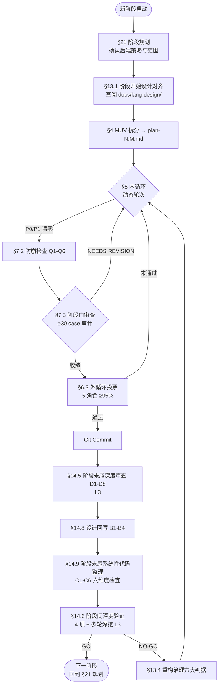

> **L1/L2 路径（v12.5 统一口径——与 §1.2.1 对齐）**：L1 = `Inner(§5) → §3.2 六命令 → Commit`（跳过 Q6/Gate/Outer 与全部深审族）；L2 = `Inner(§5) → Q6(§7.2) → Gate(§7.3) → Outer(§6.3) → Commit`（跳过 §14.5/§14.8/§14.9/§14.6——§7.3 门审替代深审）。若本轮恰为大阶段末轮 → 强制升级 L3 全流程（R5 只升不降）。

### 1.4 Stage Committee 角色映射

§6.3 的 4 流程角色映射到 Agent 角色：

| 流程角色 | 职责 | Agent 角色 | 权重 | 替补 |
|---------|------------|----------|------|------|
| 架构师/技术负责人 | 把控技术方向与架构一致性 | ARCH-A | 2 票 | ARCH-B / ALG-A |
| 核心开发工程师 | 评估代码实现与可维护性 | DEV-A | 1.5 票 | DEV-B/C / ALG-B |
| 质量保证 | 验证测试覆盖与功能符合度 | QA-A | 1 票 | QA-B/C / REV-A |
| 产品/业务代表 | 确认语言语义正确性 | ALG-C | 1 票 | ARCH-B |
| （附加）Tooling & DX | 工具链与开发体验 | SKL-A | 1 票（不参与加权） | SKL-B |
| （协调） | 任务分派与冲突仲裁 | PM-A | — | PM-B/C |
| （记录） | 文档归档 | REC-A | — | REC-B/C |
| （排期） | 阶段计划 | PL-A | — | PL-B/C |

> 本编译器项目无传统"用户"，"产品/业务代表"由 Type System Theorist 担任（确认语言语义与 9 个核心原语的正确性）。Tooling & DX Lead 的 1 票不参与加权通过率计算，但其 NEEDS REVISION 投票仍会触发二次内循环。

### 1.5 协作矩阵

| 阶段单元 | 主导 | 必须参与 | 可选参与 |
|---------|------|---------|---------|
| **stage 启动** | PM-A + ARCH-A | PL-A, REC-A | ALG-A, SKL-A |
| **plan 制定** | PL-A | ARCH-A, QA-A | DEV-A, ALG-A |
| **task 实现** | DEV-A | QA-A, REV-A | ALG-A（如涉及算法） |
| **review 审查** | REV-A | ARCH-A, QA-A, ALG-C | DEV-A（解释实现） |
| **gate 审查** | REV-A | 全 5 流程角色 | PM-A, REC-A |
| **文档同步（§8）** | REC-A | 主导 Agent | QA-A（验证） |
| **设计-审查循环（§13.5）** | REV-A ↔ ARCH-A | DEV-A, QA-A | PM-A |

### 1.6 任务分派与升级路径

1. PM-A 接收用户需求 → 评估类型与优先级
2. PL-A 分解为 MUV → 分配 Task ID
3. PM-C 分派给相应 Agent → 写入 worklog
4. 主导 Agent 执行 → 每完成一个 MUV 追加 worklog
5. REV-A/B/C 审查 → 在 worklog 标注 PASS/NEEDS REVISION
6. REC-C 归档 → 更新 dev-log + matrix + lang-design（如适用）

| 触发条件 | 升级到 | 升级动作 |
|---------|-------|---------|
| 1 次审查 NEEDS REVISION | 主导 Agent + REV-A | 二次内循环 |
| 2 次审查 NEEDS REVISION | PM-A + ARCH-A | 评估是否需要换主导 Agent |
| 3 次审查 NEEDS REVISION | 技术委员会 | 仲裁 |
| 跨 Agent 冲突 | PM-A | 仲裁（per §8.6 冲突解决规则） |
| 流程违反 §8 | QA-A → PM-A | 标记 P2 缺陷 |
| 架构致命伤 | ARCH-A 一票否决 | 硬性退回（per §6.3） |

---

## 2. 核心原则

### 2.1 总体原则

- **小步快跑 + 深度验证**：每个阶段产出在精度与深度上满足目标
- **动态自适应 + 分级治理**：兼顾质量与效率（见 §5.2 动态调整、§6 缺陷分级）
- **数据驱动**：所有轮次与决策基于量化指标，而非主观感受
- **集成优先**：每个子阶段不仅验证自身内部正确性，还必须验证与上下游子阶段的**集成正确性**（见 §7）
- **最优 > 最小**（§12）：思考解决方案时优先选择架构上最优的方案，而非"当前改动最小"的方案
- **阶段间接口隔离**（§11）：阶段之间通过明确的数据契约交互，禁止跨阶段直接调用内部接口
- **测试矩阵全覆盖**（§9）：每进入下一阶段之前，测试矩阵需要满足近 100% 覆盖率
- **轮次完成文档同步**（§8）：每轮完成任何阶段单元时，必须同步更新或新建对应文档
- **阶段末尾深度审查**（§14）：每个阶段末尾必须执行深度审查，分析"当前架构是否足够支撑进入下一阶段"
- **环境工具自助准备**（§3）：工具缺失时主动查找+安装，不因环境问题阻塞推进
- **交付前验收校验**（§3.2）：返回结果给用户前必须运行验收命令并确认全绿
- **Spec 持续演进**（§3.3）：spec 吸收实战经验持续精要化，避免臃肿
- **重构即架构设计**（§13.4）：重构的本质是组织结构设计，不是单纯缩小文件体积
- **阶段开始设计对齐**（§13.1）：每阶段开始时必须先查阅 `docs/lang-design/` 对应阶段设计文档
- **阶段末尾设计回写**（§14.8）：每阶段末尾结束前必须对照设计文档与项目实际实现
- **阶段末尾系统性代码整理**（§14.9）：确保代码库在进入下一阶段前处于"干净基线"状态
- **设计-开发-测试互相锚定**（§9.4）：三者互相锚定、互相依赖
- **任务规划排版图**（§17）：每个阶段开始前必须构建任务依赖图
- **后端策略分阶段演进**（§21）：Stage 0 自建 VM，Stage 2+ 可选后端，LLVM 永不进入自举链
- **架构混合务实**（§2.4）：成熟语义方案 + 现代基础设施 + 前沿技术接口预留——所有架构决策的裁决基线
- **能力引入时机匹配成熟度**（§21.7）：能力模型的引入时机与处理程度必须匹配其生态成熟度分级，处理程度沿阶段单调深化（§21.9）
- **多 crate 结构语义**（§8.4.6）：根项目承载跨 crates/全局性质的结构，crate 内部承载 crate 自身的结构

### 2.1.1 每轮执行原则

> **目的**：确保每一轮 stage 执行都严格遵循设计、开发、测试原则，不因"赶进度"而跳过关键质量步骤。

每轮 stage 执行时，Agent 必须遵守以下原则：

| # | 原则 | 说明 | 违反示例 |
|---|------|------|---------|
| 1 | **按计划推进任务** | 根据当前审查报告、stage、plan、gate-review、复盘情况、开发记录，结合设计文档与项目实际情况，按照计划推进修复 | 跳过 plan 中列出的任务直接做下一个 |
| 2 | **严格 API 命名标准化** | 所有代码变更必须遵循 §10 API 命名标准 | 使用 glob re-export 或不一致命名 |
| 3 | **严格接口设计** | 所有接口变更必须遵循 §11 接口隔离原则 | codegen 直接调用 mir::lower 内部函数 |
| 4 | **通解 > 特解** | 优先实现通用机制，避免逐案特例处理（§2.2 原则 6） | 为每种 ADT 形态在 codegen 加单独 `if` 分支 |
| 5 | **高内聚低耦合** | 每个模块/文件承担且仅承担一个明确职责；模块间通过数据契约交互 | utils.rs 同时包含类型转换 + 错误格式化 + IO 助手 |
| 6 | **单一职责** | 每个模块、函数、类型只做一件事，用一句话能描述 | lower_expr 同时处理表达式降低 + 控制流 + 内置函数 |
| 7 | **管道流** | 编译流水线各阶段单向流动（reader → expander → compiler → vm → runtime），不允许回流或回查 | codegen 反向查询 HIR 获取类型信息 |
| 8 | **层级划分** | 各阶段层级清晰，不跨层调用；下游只读上游产出的数据结构 | typeck 直接调用 parser 内部函数 |
| 9 | **避免死代码** | 不再使用的代码直接删除（Git 记录历史）；不注释保留 | 注释掉废弃函数而非删除 |
| 10 | **避免分散内容** | 相关功能内聚到同一模块/文件，不分散到多处 | 同一 trait 的定义在 A、impl 在 B、方法在 C |
| 11 | **确定性边界先行** | 在修复或设计前，必须先清晰划定能力边界、设计边界、职责边界（§2.3 原则 11 确定性边界）。不确定的边界不得猜测，必须基于设计文档或 Rust 参考实现确定。**知识搜索 > 猜测** — 存在不清晰时调用搜索工具。**不得回避 bug 触发** — 必须真正根治，而非抑制症状。 | 不先划分 `emit_null_ptr()` (value) vs `emit_store()` (type prefix) 职责边界就修改代码 |
| 12 | **临时桩识别与记录** | 在开发过程中，如果遇到传递 `None`、`_`、默认值等情况，必须判断这是真实设计还是临时桩（stub）。如果是临时桩，说明是不完整的实现，必须在 tech-debt 中添加对应条例并说明缘由、影响范围和修复计划（避免埋雷和 bug 生产）。 | 在 codegen 中传递 `mono_layouts=None` 而不记录原因；使用 `loop {}` 作为 prelude 方法体而不在 tech-debt 记录 |
| 13 | **架构限制记录与升级** | 如果在处理 bug 或设计开发过程中审查结果得出架构限制，必须将审查得出的架构限制和缘由等必要内容添加条例到 tech-debt 中，纳入计划项目架构级重构优化升级。可参考 Rust 对应模型设计。 | 发现 `find_receiver_substs(&cx)` 不能调用 `lower_expr_to_operand(&mut cx)` 时不记录为架构限制，而是 hack 绕过 |
| 14 | **功能缺失即时同步 TD** | 开发中发现功能缺失或当前存在限制时，**立即**将问题描述、影响范围、修复方案同步到 `tech-debt-register.md`，不得推迟到阶段末尾。同步在 `worklog.md` 中记录 TD ID 和规划。 | 发现类型推断不支持某模式但不记录 TD，继续用 workaround 推进 |
| 15 | **依赖限制阻断推进** | 开发中发现任务所需的依赖内容存在限制时，**停止继续做阉割版任务推进**（正确 > 妥协），转而分析缺失的依赖内容并同步规划到 tech-debt。可参考同类优秀实例（如 Rust）的相关设计进行修复补全。已实现的阉割版内容也必须将修复计划同步到 tech-debt。 | 发现闭包不支持但继续用函数指针 workaround 推进而不记录 TD |
| 16 | **可疑代码模式审计** | 开发/审查时遇到以下模式必须**怀疑为 bug 或不完整实现**，纳入 tech-debt 规划：(1) 下划线开头的变量名未使用；(2) 空值/None 传递未记录原因；(3) 默认值/默认分支使用未说明；(4) 不完整 match arm（缺少覆盖）。每种情况必须判断"真的不需要"还是"预留漏洞"，并在 worklog 中注明判断依据。 | `let _unused = ...` 而不记录原因；`match` 缺少 `_ =>` arm 但不报 non-exhaustive |

### 2.2 核心设计原则（五十八条）

> **来源**：最小自举系统级编程语言设计蓝图（stage0.md v8.8，核心五十八条原则；蓝图全文存档于 `docs/stage0.md`，目录级拆分见 `docs/lang-design/`）。第 1-20 条自 v2.0 沿用；第 21-25 条为 v3.0 引入的“2026 现代方案”原则；第 26-28 条为 v5.0 引入的进程裁决原则；第 29-31 条为 v6.0 引入的内部语法与语法分离原则（next3 讨论终轮）；第 32 条为 v6.1 引入的接口预留原则（next4 第八轮「2026 接口预留完整性审查」）；第 33 条为 v12.1/r32 引入的表面现代化动态演进原则（用户审查指令「实现端不要停留在 Lisp 家族 1970 年代表达」）；第 34 条为 v12.2/r33 引入的能力正交与授权分层原则；第 35 条为 v12.3/r34 引入的判据先于先例原则；第 36-37 条为 v12.6/r57 引入的机制预留与抽象-具体分离原则（next5.md 第九轮「接口预测悖论与开闭原则」——见 lang-design/17-principles.md v6.7 §1 与 13-capability-matrix.md §3.6）；第 38-39 条为 v12.7/r58 引入的模式识别桥接与维度正交 Pass 化原则（next6.md 第十轮「优化桥接与 IR 正交精简」——见 lang-design/17-principles.md v6.8 §1 与 13-capability-matrix.md §3.7 与 15-architecture-layers.md §5.2 注记；**v12.8/r59 增记：原则 38 获判据级澄清增注[性能潜力 vs 开发成熟度——next7.md 第十一轮偏见纠正，见 17-principles.md v6.9 §1 与 13-capability-matrix.md §3.7.5]**；第 40 条为 v12.9/r62 引入的根空间统一组织原则（next8.md 第十二轮「根空间架构与约束组合代数」——见 lang-design/17-principles.md v7.0 §1 与 13-capability-matrix.md §3.8 与 21-capability-architecture.md §2.6）；第 41 条为 v13.0/r63 引入的脚手架哲学统一纪律原则（next9.md 第十三轮「双向调试策略与脚手架哲学闭环」——见 lang-design/17-principles.md v7.1 §1 与 12-roadmap.md §2.11 三种脚手架生命周期权威与 13-capability-matrix.md §3.9 与 11-testing.md §5）；第 42-43 条为 v13.4/r81 引入的错误处理统一而分治与渐进披露原则（next10.md 第十四轮「目标语言的完整设计 + 统一而分治」——见 lang-design/17-principles.md v7.4 §1 与 02-syntax-model.md §8.3 与 05-runtime.md §6 与 06-operational-semantics.md §8 与 19-references.md §15）；第 44 条为 v13.5/r83 引入的语法定义形式化单源纪律原则（用户第十五轮新维度指令「语法定义形式/语法文件/EBNF 体系」——见 lang-design/17-principles.md v7.5 §1 与 02-syntax-model.md §8.4[grammar L2 规范层] 与 19-references.md §16 与 18-terminology.md §5k）；第 45 条为 v13.6/r84 引入的效应理论登记纪律原则（用户第十六轮讨论 next11.md 九段「效应本体论三部曲 + 极简关键字 + 十二问题系统性审查」——见 lang-design/17-principles.md v7.6 §1 与 02-syntax-model.md §8.5[容器式签名终态草案] 与 05-runtime.md §7 与 06-operational-semantics.md §9 与 22-namespace-design.md §20 与 19-references.md §17）。第 46 条为 v13.8/r88 引入的效应流形理论登记纪律原则（用户第十七轮讨论 next12.md 六轮「效应流形推广 + 空间理论定位澄清 + 形式化完备」——见 lang-design/17-principles.md v7.7 §1 与 02-syntax-model.md §8.6[EBNF v3 + 流形语法] 与 05-runtime.md §8[EffectGraph] 与 06-operational-semantics.md §10[操作语义全集] 与 13-capability-matrix.md §3.12 与 22-namespace-design.md §21 与 24-space-decomposition.md §15 与 19-references.md §18）。第 47 条为 v13.9/r89 引入的逆向效应与计算干涉登记纪律原则（用户第十八轮讨论 next12.md 追加段「逆向对偶 + 干涉坍缩 + 量子边缘 + 异步并发优势」——见 lang-design/17-principles.md v7.8 §1 与 02-syntax-model.md §8.7[EBNF v4 正逆干涉版] 与 05-runtime.md §9[双向 Continuation + CollapseScheduler] 与 06-operational-semantics.md §11[正逆五规则 + 干涉四规则] 与 13-capability-matrix.md §3.13 与 22-namespace-design.md §22 与 24-space-decomposition.md §16 与 19-references.md §19）。第 48 条为 v13.10/r91 引入的数学工具箱分级与隐喻登记纪律原则（用户第十九轮讨论 next13.md 四段「数学工具箱全量复用 + 波粒二象性 + 理论-实现分层映射 + EBNF v5」——见 lang-design/17-principles.md v7.9 §1 与 02-syntax-model.md §8.8[EBNF v5 分层版] 与 05-runtime.md §10[量子分析 Pass D + 路径积分] 与 06-operational-semantics.md §12[波粒二象性语义注记] 与 13-capability-matrix.md §3.14 与 24-space-decomposition.md §17 与 22-namespace-design.md §23 与 19-references.md §20 与 09-stdlib.md §5）。第 49 条为 v13.11/r93 引入的能力-效应正交与内禀关系登记纪律原则（用户第二十轮讨论 next14.md 五文档「能力模型三支柱 + 八维度正交分解 + 内禀关系 + EBNF v6 + 可行性审查」——见 lang-design/17-principles.md v7.10 §1 与 21-capability-architecture.md §10[三支柱统一体 + 四层次协同] 与 13-capability-matrix.md §3.15[协同接口效应侧] 与 24-space-decomposition.md §18[CapabilitySpace 归位] 与 05-runtime.md §11[运行时通道] 与 09-stdlib.md §6[能力线程开面] 与 02-syntax-model.md §8.9[EBNF v6] 与 22-namespace-design.md §24[关键字张力] 与 19-references.md §21[E.21 四文献]）。第 50 条为 v13.12/r94 引入的生命周期效应化登记纪律原则（用户第二十一轮讨论 next15.md 三文档「生命周期效应化统一 + 最终收敛版 + 四模型协同审查」——见 lang-design/17-principles.md v7.11 §1 与 13-capability-matrix.md §3.16[生命周期效应化能力面] 与 21-capability-architecture.md §11[资源能力族与四模型协同] 与 24-space-decomposition.md §19[EffectSpace Level 2 登记态子空间] 与 02-syntax-model.md §8.10[EBNF v7] 与 05-runtime.md §12[with_resource Handle 四臂] 与 09-stdlib.md §7[生命周期线程开面] 与 19-references.md §22[E.22 四文献]——**R4 顺修：r94 漏更本轮补齐**）。第 51 条为 v13.13/r95 引入的流形统一分析登记纪律原则（用户第二十二轮讨论 next15.md Document 4「流形统一分析：设计核心优势」——见 lang-design/17-principles.md v7.12 §1 与 13-capability-matrix.md §3.17[流形统一分析能力面] 与 15-architecture-layers.md §5.4[统一流形分析中心愿景与分析单源] 与 24-space-decomposition.md §20[EffectSpace 分析面视图] 与 08-backend-evolution.md §5.5[流形→ANF-SSA 桥接] 与 12-roadmap.md §2.13[Stage 3+ 愿景注记] 与 19-references.md §23[E.23 四文献]）。第 52 条为 v13.14/r96 引入的类型观测化登记纪律原则（用户第二十三轮讨论 next16.md「效应容器类型系统 + 类型观测理论[静/动统一] + 流形约束求解 + 四模型协同最终审查」——见 lang-design/17-principles.md v7.13 §1 与 13-capability-matrix.md §3.18[效应容器类型系统能力面] 与 21-capability-architecture.md §11.2[五接口契约化深化注记] 与 24-space-decomposition.md §21[TypeSystemSpace 归位] 与 02-syntax-model.md §8.11[EBNF v8 第七份骨架] 与 12-roadmap.md §2.14[Stage 2+/3+ 分层门控注记] 与 19-references.md §24[E.24 四文献]）。第 53 条为 v13.15/r98 引入的混合自举与迁移验证登记纪律原则（用户第二十四轮讨论 next17.md「前端自举 vs 完全自举 + S-expr→目标语法转换阶段指导」——见 lang-design/17-principles.md v7.14 §1 与 07-bootstrap-strategy.md §4[渐进式混合自举与语法迁移验证] 与 02-syntax-model.md §8.12[语法迁移验证与映射表登记] 与 11-testing.md §6[parity 结构化完备与切换窗验证协议] 与 12-roadmap.md §2.15[三阶段策略对账注记] 与 19-references.md §25[E.25 四文献]）。第 54 条为 v13.16/r104 引入的 EBNF 整合定稿登记纪律原则（用户第二十五轮指令「EBNF 整合 + Rust 最小集借鉴 + 理论栈处理 → 完整目标语言 EBNF 语法定义」——**EBNF 定稿子窗开窗**[M1 指令开窗第十二例——纯文档域；切换窗本体维持未开窗]——见 lang-design/17-principles.md v7.15 §1 与 02-syntax-model.md §8.13[**EBNF v9 整合定稿位——grammar L2 规范层权威定稿位**] 与 22-namespace-design.md §27[关键字分级终态与分隔符双面映射] 与 20-surface-conventions.md §14[皮肤字典定稿域扩充] 与 19-references.md §26[E.26 四文献] 与 18-terminology.md §5u[术语 17 条]）。第 55 条为 v13.17/r111 引入的信息效应化登记纪律原则（用户第二十六轮讨论 next18.md 两段「信息表示效应化 + 最终收敛版」——观测双子闭合[类型形状观测 + 信息状态观测] + 六线程族理论载体第十一环——见 lang-design/17-principles.md v7.16 镜像登记与 stage0.md v8.5 §9.27[全量权威] 与 02-syntax-model.md §8.14[信息效应语法族第九源语料 Level 1-4 登记] 与 24-space-decomposition.md §22[InfoEffectSpace 归位第七例] 与 19-references.md §27[E.27 四文献] 与 18-terminology.md §5v[术语二十条]）。第 56 条为 v13.19/r113 引入的流特性理论登记纪律原则（用户第二十七轮讨论 next19.md 三段「流特性问询 + 完整回答 + 终极收敛版」——流本体论第十二环[六线程族共同基座叙事] + 固定 vs 确定观测维度阶 + 随机种子 = 自由度对偶第三形态 + 弦理论 Tier 3 + T 对偶驳回——见 lang-design/17-principles.md v7.17 镜像登记与 stage0.md v8.6 §9.28[全量权威] 与 06-operational-semantics.md §14[时间性与坍缩语义注记] 与 13-capability-matrix.md §3.20[自由度-约束对偶能力面] 与 21-capability-architecture.md §11.5[随机种子=自由度对偶注记] 与 24-space-decomposition.md §23[流本体论空间注记——零新子空间] 与 19-references.md §28[E.28 四文献——退相干/T对偶/全息原理/DOF 计数] 与 18-terminology.md §5w[术语二十条]）。第 57 条为 v13.20/r115 引入的统一流分析与描述论登记纪律原则（用户第二十八轮讨论 next20.md 六段「统一流分析替代借用检查 + 描述论本体论 + 哥德尔不完备同构 + 终极审查」——借用检查投影化工程统一面 + π_time 投影家族第三实例 + 第十源语料 Level 1-4 登记 + 描述论立场层[机制层豁免] + 三重不完备统一叙事——见 lang-design/17-principles.md v7.18 镜像登记与 stage0.md v8.7 §9.29[全量权威] 与 02-syntax-model.md §8.13.2a[第十源语料登记] 与 06-operational-semantics.md §15[统一流分析语义注记] 与 13-capability-matrix.md §3.21[描述论能力面] 与 05-runtime.md §15[NLL 段结束推导运行时面] 与 12-roadmap.md §2.18[Stage 2+ 分析窗门控注记] 与 24-space-decomposition.md §24[描述论空间注记] 与 19-references.md §29[E.29 四文献——Polonius/Koka Perceus/哥德尔家族/OSR] 与 18-terminology.md §5x[术语二十二条]）。第 58 条为 v13.21/r117 引入的同形树递归处理纪律原则（用户第二十九轮讨论 next21.md 两段「S 表达式递归问题四方案 + 脚手架完全移除与 IR 层级优化」——见 lang-design/17-principles.md v7.19 镜像登记与 stage0.md v8.8 §9.30[全量权威] 与 04-bytecode-vm.md §3.1[递归处理实况注记] 与 07-bootstrap-strategy.md §3.2.2[脚手架生命周期映射与拆除边界] 与 06-operational-semantics.md §16[递归流形统一叙事注记] 与 13-capability-matrix.md §3.22[递归深度处理能力面] 与 12-roadmap.md §2.19[脚手架拆除时点对账注记] 与 19-references.md §30[E.30 四文献] 与 18-terminology.md §5y[术语十二条]）。
> **优先级**：按编号排列，冲突时编号小的优先。这些原则是硬性约束，任何 Agent 在面临设计选择时必须以此为准绳。

| # | 原则 | 含义 | 违反示例 |
|---|------|------|---------|
| 1 | **极小化原则** | 核心形式集合压缩到信息论下限，同时保留元层对核心的全部控制权 | 在核心中添加非必要的原语 |
| 2 | **正交性原则** | 9 个核心原语之间必须正交——任何一个都不能被其他原语组合推导 | 添加 `let` 作为第 10 个核心原语（可从 lambda 推导） |
| 3 | **元层分离原则** | 可塑性上限由元层（编译期）与对象层（运行期）之间的严格分离决定 | 允许宏代码直接访问运行时值 |
| 4 | **可替换性原则** | 每个 Stage 0 模块都必须设计为可替换的，且替换时不需要修改其他模块 | VM 设计与 Compiler 深度耦合 |
| 5 | **相位分离原则** | Phase 1（编译时）和 Phase 0（运行时）是物理隔离的两个世界 | 宏代码在运行时执行 |
| 6 | **横切关注点必须早期内置** | Span、诊断、相位分离——它们是"贯穿所有阶段"的属性，无法后期以模块化方式添加 | Stage 1 后才考虑添加 Span 系统 |
| 7 | **查询式架构** | 将编译过程建模为纯函数查询图（而非线性管线），使得增量计算成为架构的天然属性 | 编译器各阶段为黑盒，无中间缓存 |
| 8 | **语义形式化** | 操作语义是正确性的可验证规范；每个原语必须有一个明确的归约规则 | 无操作语义定义就实现编译器 |
| 9 | **核心冻结** | 核心原语语义在整个生命周期内不变，所有演化通过宏系统在核心之上叠加 | 修改 lambda 的求值语义 |
| 10 | **编译即 API** | 所有阶段可独立调用，支持 REPL、调试器、IDE 工具 | 编译器只能作为整体命令调用 |
| 11 | **信任显式化** | 所有信任假设（宿主编译器、依赖库、宏权限）必须被显式声明和可验证 | 隐式信任宿主编译器无后门 |
| 12 | **接口预留优先于实现** | Stage 0 预留 API 而非实现——写屏障、扩展栈帧槽、foreign ref 接口 | 数据结构不预留 GC 演进接口 |
| 13 | **目标中立性** | 前端与目标无关，后端通过统一目标描述驱动，支持交叉编译 | 前端包含目标特定代码 |
| 14 | **工具即编译器** | LSP、格式化、lint 消费与编译器相同的语法树和绑定信息，保证行为一致 | 工具链独立解析源码 |
| 15 | **文档即代码** | 规范与实现使用相同语言编写，通过编译器生成，保证同步 | 规范与代码脱节 |
| 16 | **人类可感知输出是一等公民** | 字符（Unicode）、错误信息（Span+诊断）、性能数据（基准）、调试信息（IR dump）——这些"面向人类"的输出与"面向机器"的计算同等重要 | 错误信息仅打印到 stderr |
| 17 | **编译时生成，运行时查询** | debug 信息表等在编译时一次性生成，运行时仅查询——零运行时开销 | 运行时计算源码位置 |
| 18 | **零生产开销** | 调试/基准功能通过编译期开关控制，Release 构建中完全不存在 | Release 构建中存在调试代码 |
| 19 | **语义完备性优先于性能完备性** | Stage 0 的目标是证明语义自洽，而非获得最佳运行性能 | Stage 0 引入 LLVM 追求性能 |
| 20 | **数据结构的"留白"是廉价的** | 为横切关注点预留接口的成本远低于后期重构——数据结构"留白"是廉价的，数据结构重构是昂贵的 | VM 栈帧不预留扩展槽 |
| 21 | **类型安全优先** | 所有操作在编译期被类型系统验证，而非依赖运行时动态检查（2026 现代方案基调） | Token 种类不做类型区分，靠运行时字符串判断 Token 类别 |
| 22 | **显式优于隐式** | 效应、能力、阶段都显式声明，不依赖隐式推断或隐式环境捕获 | 宏隐式捕获调用点环境；副作用不经声明直接触发 |
| 23 | **不可变性** | 代码值、能力对象都是不可变的——变换产生新值而非原地修改 | 宏展开原地修改传入的 SyntaxObject |
| 24 | **编译期计算** | 尽可能将计算从运行时推到编译期（多阶段编程思想） | 可在编译期完成的常量折叠留到运行时逐次求值 |
| 25 | **组合性** | 所有组件都设计为可组合的（handler 组合、capability 传递） | handler 栈只能整体替换不能逐层叠加；能力只能全局授予不能逐级传递 |
| 26 | **三级成熟度匹配** | 能力的处理程度必须匹配其生态成熟度——生产就绪直接实现，早期实践接口预留，研究前沿仅类型定义（§21.7） | Stage 0 直接实现 Effect Handlers 完整语义（研究前沿档能力） |
| 27 | **接口稳定性** | Stage 0 冻结的接口签名在整个生命周期内保持向后兼容——演进只替换实现，不破坏契约（P2/P3 处理程度分级即为此落地） | Stage 1 重写时修改已冻结的预留 trait 方法签名 |
| 28 | **渐进替换** | 每个能力可从简单实现演进到复杂实现而接口不变——元循环求值器 → 编译器、传统闭包 → Effect Handlers、全局 I/O → 能力模型 | 引入 Effect Handlers 时推翻闭包的现有接口重新设计 |
| 29 | **命名行为导向** | 原语与 AST 节点的命名精确描述行为而非语法历史（`Branch`/`Apply` 而非 `If`/`App`）；拒绝 `#%` 前缀式命名约定与多层转义（`quote`+`#%datum` → `Const` 单层） | 用历史命名或语法关键字命名 AST 变体且不做行为对照说明；引入“编译器内部专用前缀”式命名约定 |
| 30 | **类型安全优于命名安全** | 内部 AST 节点是编译器私有数据结构（ADT 私有构造子），安全性由类型系统保证而非命名约定；用户代码不可能直接构造核心节点 | 用命名约定（如 `#%` 前缀、保留字列表）保障 AST 内部形式的边界；允许用户层构造核心 AST 节点 |
| 31 | **表面-内部语法严格分离** | 表面语法是可替换的用户接口（皮肤——S 表达式/中缀/DSL 经 Reader 桥接），内部语法是编译器私有不变量（骨架——核心原语不变）；任何表面语法的编译产物为相同核心形式 | 表面语法细节泄漏进 CoreExpr；绕过 Reader 直通内部 AST 的旁路；语义验证绑定特定语法 |
| 32 | **预留留白原则** | 接口预留的本质是「为未来留出空间」而非「提前实现」——预留要求数据结构与类型定义的**兼容性**，而非功能的完整性；P0 级接口（LSP 查询/调试信息/增量查询）的数据结构位置必须在 Stage 0 冻结，否则后期引入需破坏性重构（预留层 14 项唯一权威清单：lang-design/13-capability-matrix.md §3.4） | 以「功能未实现」为由拒绝冻结接口形状；P0 接口不预留位置直接进入 Stage 1；把预留实现成半成品功能而非纯类型形状 |
| 33 | **表面现代化动态演进**（v12.1，r32） | 用户可见表面（库命名/行为契约/组织结构）必须在**每个引入新表面的设计时点**对照当期前沿约定审视，而非默认继承历史语言家族形态；标点后缀约定（`?`/`!`/`->`）是前类型系统时代的补偿机制——现代机制（HM/效应/能力）就位后表面应同步迁移（别名层→命名空间层→一次性移除，零破坏分段；首个落地规范：lang-design/20-surface-conventions.md R1-R6 + 57 项映射表 + TD-027） | 新内置/新库函数沿用历史家族命名（新铸 `?`/`->`/`!` 名）；表面债静默累积而不登记；「以后再改」式拖延（库每长一件，迁移面等比放大）；未经前沿对照即引入新表面 |
| 34 | **能力正交与授权分层**（v12.2，r33） | 语言能力按四层正交分解（L0 值域/L1 控制/L2 效应/L3 授权——每层持定位/边界/职责/正交四要素），层间正交以可审计判据承载（J1 值-控交换律/J2 效应-语义独立/J3 许可-语义独立/J4 效应-授权对偶——正交是已验证的测试属性非口号）；授权按粒度三态递进（纯度态/声明态/令牌态）且 fail-closed（缺省拒绝/授权零语义载荷/import 不传播授权）；原语级变更先过正交判据且新原语准入持不可归约性与单层归属两判据——「原语级迁移 ≠ 重命名」（六类迁移性质：重命名/脱糖/索引化/层级迁移/效应化/新增；首个落地规范：lang-design/21-capability-architecture.md + 22-namespace-design.md + 20 v1.1） | 层归属模糊（一个特性跨层登记无受控债务登记）；正交声明无测试锚（口号式正交）；授权变更携带语义载荷（违反 J3）；import 传播授权（可见性门与许可门混同）；把原语级结构重构当作重命名轻批（M-D 脱糖/M-E 效应化等深度变更未经正交判据）；「能力」三义混用（工程能力/语言能力/授权互换） |
| 35 | **判据先于先例**（v12.3，r34） | 每个设计决策先过判据集（行为语义/认知负荷/正交性/安全粒度/实现成本/成熟度匹配）再引先例——先例是佐证不是权威；锚定有两种等价失败形态：向后锚定（停在 Lisp 家族 1970 表达）与向前锚定（抄 Rust/Swift 把家族方案当权威）；引证纪律 = 依据列先判据后先例 + 跨家族取样（对照表 ≥3 范式家族）+ 否决记录保留 + 判据冲突先修判据不迁就先例（语境与操作化：lang-design/23-evolution-governance.md §4——设计栈治理层四件首落之一） | 「依据」列只引先例无判据（「Clojure 这么做」式论证）；单一家族连续引证（取样分布失衡 = 锚定警报）；被否决方案无理由档案（「为什么不」缺失）；先例与判据矛盾时绕开判据迁就先例 |
| 36 | **机制预留**（v12.6，r57） | 接口预测悖论（无法为未知预留特定接口）的正确解法不是「更努力地预测」而是「设计添加新接口的机制」——三层未知防御：原语集图灵完备（数学保证）+ 自定义效应/宏展开/能力系统三种「打洞能力」（工程保证）+ 机制组合（生态保证）；接口预留（13 §3.4 14 项矩阵——原则 32）覆盖已知需求的结构位置，机制预留覆盖未知需求的表达通道——两者正交互补不可互相替代（语境与展开：lang-design/13-capability-matrix.md §3.6——机制预留节；stage0.md §9.9；原则 36） | 把 14 项预留清单当作完备性证明（清单只覆盖已知世界）；新副作用/新语法/新资源需求未经机制评估直接要求修改编译器（本可经 Custom 效应/宏/能力承载）；「机制预留」被当作逃避接口预留的借口（已知 P0 需求仍须结构位置冻结——两原则并列非互斥） |
| 37 | **抽象-具体分离（开闭）**（v12.6，r57） | 原语集是「抽象」（永久不变的语义骨架——对修改关闭），宏/Handle/Capability 是「抽象与具体分离机制」（用户可无限扩展的具体实现——对扩展开放）；数学力量 = 抽象覆盖空间而非预测点（具体 = 一个点，抽象 = 一个空间——Perform(Custom) 覆盖所有可能副作用构成的空间）；与 OCP/依赖倒置/高阶函数/类型类是同一原理的范式投影；历史验证 = Lisp/Racket 60 年 + Unix 50 年 + LLVM 20 年（语境与展开：lang-design/13-capability-matrix.md §3.6.4；stage0.md §9.9.5；原则 37） | 每个新特性都「打开」编译器修改（胖关键字路线——添加 async/await/模式匹配即改编译器）；把具体当抽象（预留 AsyncInterface 类特定接口当作已覆盖未知）；把抽象当具体（以「未来可能需要」为由提前实例化抽象机制） |
| 38 | **模式识别桥接**（v12.7，r58） | 极小原语的组合模式可被结构特征判据识别（循环四特征：自引用 Apply/Branch 入口/参数更新链/纯循环；异常三特征：单 handler/不 resume/恒等 final），经相等性标记替换为胖关键字等价物——方向 A 复用 50 年成熟优化体系（LICM/向量化/循环展开/零成本异常）+ 方向 B 保留细粒度信息获得额外优化（融合/部分求值/精确并行化）——「A + B > 胖关键字」；性能天花板风险（宏组合开销）的正面解法与「语义极小化有利于长期性能」的实现路径；识别即替换 = 单一 pass；**v12.8 判据级澄清（r59 第十一轮偏见纠正）：性能潜力（理论上限——极小原语严格更高：信息更多/粒度更细/空间更大）与开发成熟度（当前表现——胖关键字占优：50 年 vs ~30 年研究投入）为两个正交概念——差距本质是研究投入差距非设计本质差距，性能讨论须先过此概念区分**（语境与展开：lang-design/13-capability-matrix.md §3.7/§3.7.5——优化桥接与性能潜力裁定节；08-backend-evolution.md §5；stage0.md §6.13.1/§6.13.3；原则 38） | 「极小原语性能必然差」的定性结论直接采纳（不追问模式识别桥接路径——亦不区分性能潜力与开发成熟度）；模式识别与等价替换设计为两个独立 pass（识别即替换是同一 pass 的两阶段）；Stage 2 优化窗未开窗即提前实现模式识别器（零信号不开窗——23 §2.2） |
| 39 | **维度正交与 Pass 化**（v12.7，r58） | IR 层级按不可再分的正交维度划分（结构/语义/形式/目标——每层唯一维度，维度重复即合并候选）；优化是单层上的原地 pass 而非新 IR 层（零转换开销）；单遍合并（脱糖+标注单遍 / ANF+闭包+SSA 单遍）——转换次数最小化 = 编译速度与信息保真双重收益（5→3 次[40% 减] + 遍历 6→3）；四层修正案 = Stage 2 优化窗裁定候选（与六层规划的差集论据开窗时按正交性验证表 + 性能实测裁定——判据冲突先修判据集）（语境与展开：lang-design/15-architecture-layers.md §5.2 注记；13-capability-matrix.md §3.7.4；stage0.md §6.13.2；原则 39） | 新增优化时新建 IR 层（优化是 pass 不是层）；为未来灵活性保留维度重复层（合并候选应登记而非永久保留）；开窗前直接实施四层合并（修正案登记非推翻——权威性维持至开窗） |
| 40 | **根空间统一组织**（v12.9，r62） | 预留与拓展能力以根空间为统一组织骨架——根空间是概念性占位（零语义载荷 marker/存在性标记，非具体实现）；所有预留接口与拓展能力是根空间的子空间，经**约束特化**（集合交集/约束合取——`子空间 = 根约束 ∩ 附加约束`）定义而非类继承（格[交/并/偏序——任意两元素唯一交并]替代偏序树——无菱形/解耦/开放）；子空间可无限递归划分并可实例化（预留「空间」而非「点」——无需预见具体）；预留接口必须**依赖抽象根空间而非具体实现类型**（依赖倒置的预留层投影——具体实现经「满足约束」归属空间，预留点零破坏演进）；编译器内部空间与拓展空间共享同一基石（原语）——对称性即自相似（分形）；与原则 32 接口预留[点] + 原则 36 机制预留[通道] 构成三层预留体系（点+通道+骨架——自 v12.9 起权威口径）（语境与展开：lang-design/13-capability-matrix.md §3.8——根空间统一组织节；17-principles.md 原则 40；21-capability-architecture.md §2.6；stage0.md §9.10；原则 40） | 预留接口依赖具体实现类型而非抽象根（具体变更破坏全部预留点）；空间关系按类继承组织（菱形问题/实现耦合/封闭性）；为每个新能力新建独立预留体系而非挂靠统一根空间（预留碎片化——各自为政）；「根空间」被当作提前实现具体机制（概念占位零语义载荷——非新原语/关键字/语法） |
| 41 | **脚手架哲学统一纪律**（v13.0，r63） | 一切「现实条件约束下的临时借用」必须显式声明为**脚手架**并登记完整生命周期（搭建→使用→自建替代→拆除→超越），禁止把脚手架当永久依赖（依赖锁定辨异：脚手架有拆除判据与时间表，锁定无拆除计划）；拆除必须**逐个替换**（每次一个，非一次性切换）且满足可量化判据（**自建替代 ≥ 被替换物 × 98% 或额外能力 > 0**）+ 必须可回滚（被替换物保留为 fallback + 失败自动回退）；三种已登记脚手架：语法脚手架（S 表达式——Stage 2 拆除换目标语法）、信任脚手架（Rust 宿主——Stage 2 完全拆除[全自举] + Stage 3+ 仅保留构建种子）、优化脚手架（胖关键字优化——Stage 4+ 逐个拆除换原语优化，拆除后模式识别器保留转调试[双重用途闭环]）；本原则是原则 28 渐进替换的哲学层推广（能力替换路径 → 一切借用的统一生命周期纪律）（语境与展开：lang-design/17-principles.md 原则 41；12-roadmap.md §2.11 三种脚手架生命周期权威；13-capability-matrix.md §3.9 工程能力定位；stage0.md §9.12） | 把临时借用当永久依赖（无拆除判据与时间表 = 依赖锁定）；一次性整体替换脚手架（非逐个替换——不可验证不可回滚）；无量化判据的主观「成熟了就换」；拆除后丢弃模式识别器等可复用资产（双重用途闭环断裂） |
| 42 | **错误处理统一而分治原则**（v13.4，r81） | 异常/错误/async/状态/IO 不是「特殊个体」而是计算流统一模型下的不同表现形式——**统一模型**（一个 Perform/Handle 原语 + EffectRow 类型追踪 + HandlerClause 处理结构 + 效应消除优化管线 + EffectSpace 根空间归属五面统一）+ **分治策略**（不同效应子空间各配处理策略——Error[恢复/终止/传播]/Async[调度/等待/超时]/State[读写/事务/回滚]/IO[重定向/缓冲]——处理器值级组合自由）；语言禁止硬编码错误机制（try/catch/throw 关键字化 = 特殊化违例——语法糖归标准库宏）；panic/abort = Fatal 效应（用户可定义语义）；Result\<T,E\> = EffectRow Error 项的可选值表示（值级/效应级对偶——同一语义两种投影）；resume 至多一次（one-shot 安全默认——多射需线性/仿射类型保护）；编译期诊断与运行时 Error 效应正交（编译期检查 = 效应系统的静态投影——诊断呈现受原则 16 管辖）（语境与展开：lang-design/17-principles.md 原则 42；02-syntax-model.md §8.3；05-runtime.md §6；06-operational-semantics.md §8；19-references.md §15；stage0.md §9.15） | try/catch/throw 关键字化（语言硬编码错误机制 = 特殊化违例——违反统一性/组合性/可扩展性三判据）；错误处理独立分层（错误 = L2 效应层 Error 子空间实例——非独立能力维度）；resume 多次调用（违反 one-shot 纪律——空间爆炸 + 禁止标准优化）；编译期诊断与运行时错误效应混淆（两通道职责错位） |
| 43 | **渐进披露原则**（v13.4，r81） | 同一语言按用户层级渐进披露复杂性——初学者面零效应知识可编程（fn/struct/if/while/match/try-catch 熟悉语法——效应标注由推断系统承载自动隐藏）、进阶面效应标注+能力管理、高级面自定义效应/宏/优化 pass、专家面原语内部与根空间扩展；**禁止按用户层级分裂为不同语言**（分层 = 皮肤叠加非内核分叉——层级分语言 = 表面债极端形态）；与原则 33 互补（33 管表面随机制演进、43 管复杂度随用户层级披露——两条正交的表面治理轴）（语境与展开：lang-design/17-principles.md 原则 43；02-syntax-model.md §8.3；stage0.md §9.14.6） | 按用户层级分裂为不同语言（初学者语言与专家语言分叉——内核分叉 = 表面债极端形态）；初学者面强制效应知识门槛（效应标注未由推断承载——渐进披露断裂）；层级分层未经判据（与原则 33 治理轴混淆） |
| 44 | **语法定义形式化单源纪律**（v13.5，r83） | 语言语法的任何成员登记必须附**形式定义**（EBNF 产生式或等价体系——清单式登记不构成语法定义，「有什么」≠「如何定义」）；语法定义以 grammar 规范节为**文档单源**（02-syntax-model.md §8.4 为 L2 规范层——与代码侧 Keyword 枚举/Reader 形成双面对照，冲突以代码为准 R4 + 当轮修正文档）；**定义形式与实现形式分离**（EBNF 登记 ≠ 生成器输入——语法生成器永不入自举链，与 LLVM 策略同构；Stage 0 手写递归下降维持）；工具语法（tree-sitter 等）从规范层**单向派生禁止反向**（语境与展开：lang-design/17-principles.md 原则 44；02-syntax-model.md §8.4；19-references.md §16；stage0.md §9.16） | 新语法成员仅登记名字清单无产生式（G1/G2 类缺漏——清单≠文法）；IDE 工具语法反向覆盖规范层（工具语法 ≠ 语言规范）；语法生成器进入构建链（第二工具链——自举链纪律冲突） |
| 45 | **效应理论登记纪律**（v13.6，r84） | 目标语言的效应理论演进（标注式 → 容器式 → 概率域式 → 生命周期式）登记为**解释框架层**档案——机制层（Perform/Handle/Resume + 效应帧栈）与现有效应系统 100% 兼容（「同一系统两种描述」），理论形态变更**不构成任何 Stage 0/1 机制变更义务**；类型与效应标注语法以**容器式** `Return(T) \| E` 为登记终态草案（`effects {}` 与 `+ {E}` 均为被否决中间形态——二元分离残留），定稿义务在 #15 切换窗内；Resume = one-shot（至多一次）+ 可选性（可以零次）合围 `resume ∈ {0,1}`；理论术语（概率域/投影/坍缩）入命名消歧登记（语境与展开：lang-design/17-principles.md 原则 45；02-syntax-model.md §8.5；05-runtime.md §7；06-operational-semantics.md §9；22-namespace-design.md §20；stage0.md §9.17） | 将「概率域」直接实现化为四维运行时表示（渐进路径裁定：容器先行）；以 `+ {Error}` 标注式登记为签名终态（已被用户否决）；效应理论演进未登记演进链（阶段形态与否决理由丢失）；理论教学前置（机制先行理论后解释——原则 43 协同） |
| 46 | **效应流形理论登记纪律**（v13.8，r88） | 效应理论的流形推广（串联/嵌套/循环三连接 + 切片/升降维）登记为解释框架层**第四环**——三连接在 8 原语中可表达，**零新增原语零机制层变更义务**（I-A）；「流形」为**隐喻性术语**（数学实质 = 带连接的效应范畴/图——非拓扑流形），消歧义务入 22 §21（I-B）；升降维对偶 = 语义层登记（project∘lift = id 限 lift 定义域内；lift∘project ⊇ id 构造性表述——I-B'）；EBNF v3（15 关键字 + connect/lift/project/pass）= grammar L2 **第二份骨架语料**，定稿义务维持 #15 窗内（I-C）；空间理论「组织工具」定位 = **坐标系/地图裁定**（不混淆 + 不分离两纪律；低熵控制 = A1-A7 信息论再表述零新公理——I-E）；概念定义漂移以设计宪法五定义为**第一查询锚**（语境与展开：lang-design/17-principles.md 原则 46；02-syntax-model.md §8.6；05-runtime.md §8；06-operational-semantics.md §10；13-capability-matrix.md §3.12；22-namespace-design.md §21；24-space-decomposition.md §15；stage0.md §9.18） | 将流形连接实现化为 EffectGraph 运行时结构（编译器分析层登记——Stage 2+ 优化素材非运行时义务）；以「流形」作拓扑断言（局部欧氏性/微分结构——非数学实质）；connect/lift/project 三语法直接纳入目标语言首批形态（窗内就绪度裁定）；空间理论与具体模型混淆（「空间理论 = 效应理论」——坐标系不是点）；概念漂移未对账宪法五定义（一致性防护失效） |
| 47 | **逆向效应与计算干涉登记纪律**（v13.9，r89） | 逆向效应流（Consume/Offer/Rewind + 汇流/收拢/收敛三逆连接 + 双幺半群代数）登记为解释框架层**第五环**——逆向三操作 = Perform/Handle/Resume 使用模式（Consume = Perform(Receive) / Offer = Handle 服务模式 / Rewind = Resume 多播），**零新增原语零机制层变更义务**（J-A——8 原语闭合三轮验证[r84/r88/r89]）；「量子」术语族（干涉/坍缩/纠缠/非对易/不确定性）= **隐喻性术语**（计算干涉 = 共享资源的经典非对易性结构——无复概率幅/无真随机/无 Bell 违反；层次 2 计算量子 = 预留方向非承诺[E.19-122 Selinger 锚]）；消歧义务入 22 §22（J-B）；逆向不可替代性判据 = **知识不对称理论**（全局解不可分解为局部解组合时必须逆向——效应适用域判据，与原则 14 联动）（J-C）；EBNF v4（逆向/干涉/概率三语法族，~10 新关键字候选）= grammar L2 **第三份骨架语料**——关键字张力窗内按「实现就绪度 + 极简义务」双判据裁定（备选 = 宏层脱糖零关键字路径）（J-D）；伪随机坍缩 = **Randomness 效应面登记**（语言级效应非运行时全局函数——策略外置 + PCG32 锚 E.19-121；Stage 2+ std 效应族候选）（J-E）；统一五层框架 = 层次化总图登记非新理论增量（J-F）（语境与展开：lang-design/17-principles.md 原则 47；02-syntax-model.md §8.7；05-runtime.md §9；06-operational-semantics.md §11；13-capability-matrix.md §3.13；22-namespace-design.md §22；24-space-decomposition.md §16；stage0.md §9.19） |
| 48 | **数学工具箱分级与隐喻登记纪律**（v13.10，r91） | 数学工具箱复用主张 = **三级分级裁定**（K-A）——①组合拓扑工具（同调/上同调/基本群/欧拉示性数）在离散 EffectGraph 上**精确同构可用**（严格数学——E.20-124 持久同调锚；H₁ 死锁/H₀ 并行化/π₁ 同伦等价登记 Pass C 素材）；②微分几何工具（切空间/联络/曲率/微分形式/Stokes）= **离散化对应物登记**（DEC——E.20-123 Hirani 锚；「曲率=非对易」经 r89 交换子代数定义已承载）；③量子结构 = 隐喻维持（J-B 沿袭）——「实例化数学」降格为「结构对应 + 工具借用」；**贝尔不等式诊断性裁定**（K-B——经典计算关联必然 ≤ 经典上限，`QuantumAdvantage::Present` 不可达分支 = 守卫代码形态非能力宣称）；**波粒二象性** = 解释框架层第六环（用户理论 v6——Perform=坍缩/Handle=弥散为描述转换非机制新增，8 原语闭合第四轮验证 K-C）；**EBNF v5** = grammar L2 第四份骨架语料（分层 Level 0-4——Level 3-4 脱糖备选优先级提高[分析器配置/pragma 形态——K-D]）；**空间归属单源**（K-E——QuantumEffectSpace 归位 EffectSpace Level 3 量子登记态子空间非平级新增）；**理论-实现分层映射采纳**（K-F——五层理论 vs 四阶段实现 = 理论登记默认层级视图）；**推演方法论** = 构建叙事档案非验收判据（K-G——验收口径 = 原则 35 判据先行 + 检索证 + R4）（语境与展开：lang-design/17-principles.md 原则 48；02-syntax-model.md §8.8；05-runtime.md §10；06-operational-semantics.md §12；13-capability-matrix.md §3.14；24-space-decomposition.md §17；22-namespace-design.md §23；09-stdlib.md §5；stage0.md §9.20） | 宣称「效应流形满足微分结构公理」（离散结构无微分结构——须离散化对应物）；贝尔不等式违反实现为能力宣称（经典计算不可达——守卫代码形态）；Level 3-4 拓扑/量子语法直接纳入目标语言首批形态（第四份骨架均为登记态——脱糖备选优先）；QuantumEffectSpace 平级新增为拓展空间 Level 2（空间单源纪律违例）；语料自评 97%/99% 当作项目验收口径（讨论时点档案——K-H） | 将逆向三操作实现为新原语（8 原语闭合违例——§3.2 冻结面）；以「量子」术语作物理断言（真随机/叠加态/纠缠非定域——非数学实质）；逆向/干涉/概率语法直接纳入目标语言首批形态（窗内裁定——三份骨架语料均为登记态）；伪随机源实现为运行时内建全局函数（语言级效应面登记——与 Stage 0 最小 I/O 实况分立）；干涉分析 Pass 提前实现化（Stage 2+ 优化素材——流形/干涉/坍缩三 Pass 分立维持） |
| 49 | **能力-效应正交与内禀关系登记纪律**（v13.11，r93） | 能力模型与效应模型 = **八维度正交分解双模型**（CAP-B——各八维精确数学定义；正交判据 = 职责集不相交，唯一邻接对 Effect.R2「HOW to handle」vs Capability.R2「WHETHER allowed」以投影选择/门卫验证分立）；协同接口 = **唯一接触面** `Perform(e) requires Capability(e)`（函子 F: Effect→Capability；kerf E0006 能力门控 fail-closed = 层次 1 既有生产形态）；**内禀关系（计算广义相对论）= 解释框架层**（CAP-C——效应=概率空间上的流/能力=度规：`dE² = C_μν dE^μ dE^ν` + 三层内禀方程——度规/联络/曲率依原则 48 K-A ②离散化对应物登记）；**14 能力操作 = Perform/Handle 使用模式**（8 原语不变性第五轮验证——零新原语）；**四层次协同渐进谱系**（CAP-E——门控[编译期零开销，Stage 0 已交付]/调制[度规查询 <5% 三策略]/演化[on-effect 状态]/耦合[Stage 3+ 前沿——收敛性 = 数学难题登记：LV 三失败模式 + 三缓解]——层次 2-4 触发式远窗）；**EBNF v6 = 第五份骨架**（CAP-D——15+ 关键字张力：E0020 名空间经济判据 → 宏层糖→8 原语核心层脱糖备选；环境五元组 ⟨e,ρ,σ,κ,C⟩ 运行期 C 通道——编译期退化四元组通道分立）；**CapabilitySpace 归位单源**（CAP-A——理论坐标系保留 + 实施面核心七域能力域；七维度 = 九动词投影双视角）（语境与展开：lang-design/17-principles.md 原则 49；21-capability-architecture.md §10；13-capability-matrix.md §3.15；24-space-decomposition.md §18；05-runtime.md §11；09-stdlib.md §6；02-syntax-model.md §8.9；22-namespace-design.md §24；stage0.md §9.21） | 能力操作实现为新 VM 原语（8 原语不变性第五轮验证违例——§3.2 冻结面）；「计算广义相对论」当作新增运行时机制（解释框架层——描述转换；度规/联络/曲率须离散化对应物登记）；15+ 能力关键字直接入语言首批形态（EBNF v6 骨架态——宏层脱糖备选优先）；效应与能力职责混同（HOW vs WHETHER 正交判据违例）；耦合演化层提前实施（触发式远窗——收敛性证明未决） | 三支柱定位当实施义务（CAP-A = 定位锚非实施项）；语料七维度替换九动词矩阵（投影双视角——双登记不替换）；度规开销预算当已达成（<5% = 优化后估算——朴素 2-5x 减速须三策略落地）；正逆效应语言表达当新语法（v7.7 已登记形态零漂移）；8/9 原语计数混用（双层口径注记——理论基座 8 + 结构臂 2 = 现行 9） |
| 50 | **生命周期效应化登记纪律**（v13.12，r94） | 生命周期 = **资源的时间效应**——四操作（acquire/use/release/transfer）全 Perform 使用模式（8 原语不变性第六轮验证——零新原语）；作用域 = Handle 语义（Return/Error 双臂 RAII 释放）；借用 = 效应组合（immutable 可复制非线性/mutable 线性 use-once——线性性差异承载共享/独占语义）；冲突检测 = 效应干涉分析（三处置策略 handler 外置）；**生命周期是效应的应用非独立系统**（不升格平级模型——「四模型协同」= 协作面视角描述，模型族单源口径维持）；编译期验证 = 效应消除优化（Koka 迁移三 Stage 管线 + LifecycleAnalysisPass 五 Phase + 消除三形 Full/Partial/Optimized——Stage 2+ pass 候选）；EBNF v7 = 第六份骨架（~7 关键字宏层脱糖备选 + 零环境通道增量纯糖层）；接口契约五形最小正交（三元组：数据流方向/传输内容/时机——唯一接触面纪律多模型推广）；效应分析单点性三缓解（分层/多级缓存/双模式——乐观仅限性能优化域，安全域[E0006]恒保守 fail-closed） | 生命周期实现为新 VM 原语或独立类型系统维度（零新原语第六轮验证违例）；LifecycleAnalysisPass 提前实现化（零信号不开窗违例）；resource/with/analyze 等新关键字直接入语言首批形态（EBNF v7 骨架态——宏层脱糖备选优先）；生命周期升格为平级模型建 LifecycleSpace 平行空间（空间单源纪律违例——归位 EffectSpace Level 2 登记态子空间）；发布模式乐观分析违 fail-closed 安全底线（安全域恒保守） |
| 51 | **流形统一分析登记纪律**（v13.13，r95） | **分析统一 = 架构级叙事登记**（MU-A——所有分析[类型/借用/能力/优化/并发/调试/生命周期] = 同一效应流形上的投影/切片——「分析的统一场论」为解释框架层第九环；「架构革命」宣称 = 叙事层非实现宣称——统一流形分析中心 = Stage 3+ 愿景层档案[K-F 分层既有]）；**Pass = 流形变换函数 + Pass 数据结构单源纪律**（MU-B——任何分析 Pass 不得引入自有中间表示——三级单源体系：IR 单源[CoreExpr] + 分析单源[流形对象] + Pass 变换纪律；传统 Pass 间 IR 转换信息丢失 = 反例登记——Stage 2+ 设计约束不提前实现化）；**数学工具映射必经 K-A 三级分级**（MU-C——八项映射表：连通分量 Tier 1 图算法精确同构 / H₀·H₁·欧拉·联络 Tier 2 / 曲率·外微分·Stokes Tier 3——零越级升格；H₀/H₁ 同调语言 = 图算法数学上溯表述）；**统一性收益/风险对偶登记**（统一数据结构收益面 = LC-F 效应分析单点性风险面——同一架构属性两面；缓解承袭 LC-F 三策略 + 近似/分级两新策略[性能域不违 fail-closed]）；**AI/ML 接口 = Level 5 远见登记**（MLGO 工业锚 + GNN-on-manifold 特有愿景无先例——不入近期路线图）；**零丢失宣称精确化**（表示层真[共享底层零转换] / 分析层投影必有损[切片即丢弃维度]） | 流形分析中心提前实现化（Stage 0-1 引入同调/曲率计算——零信号不开窗违例）；分析 Pass 引入自有中间表示（破坏三级单源——信息转换丢失形态复辟）；微分几何工具未经 K-A 分级直称精确同构（「实例化数学」越级升格违例）；「架构革命」作实现/验收宣称（愿景层时态违例——kerf 实况 Stage 0 分析面 = 效应行收集 + E0006 门控）；GNN-on-manifold 列入近期路线图（Level 5 远见越窗违例） |
| 52 | **类型观测化登记纪律**（v13.14，r96） | **类型 = 效应流的观测描述 = 架构级叙事登记**（TY-B——静态类型 = 节点快照观测[CompileTime 定点] / 动态类型 = 区域轨迹观测[RunTime 全程]——静动统一 = 观测模式二分而非二元对立；「哥白尼革命」= 叙事层定位非实现宣称——可操作内核[推导链五步 + 观测维度代数 + 耦合三形]为 Stage 2+ 设计约束）；**类型系统 = 横切静态验证层（验证者非执行者）+ 零运行时原语**（「类型系统不做任何事，它验证其他系统声明的事」——效应签名追踪/线性强制/时间边界验证/数据形状描述四横切；8 原语不变性第八轮）；**类型推断 = 流形约束求解 = HM[X] 约束域扩展叙事非新数学**（生成/求解分离 + 迭代传播 = HM[X] Sulzmann 成熟范式结构对应；流形求解器 = Stage 2+ pass 候选 + MU-B 单源纪律适用）；**动态/渐进/混合观测策略 = 表达力域与性能优化域专用**（安全域[能力/线性/悬垂检查]恒 Static fail-closed——r94 裁定四策略推广）；**EBNF v8 = 第七份骨架 + 分层门控**（依赖/演化/叠加/渐进四形 = Stage 3+ 愿景不入 Stage 2+ 定稿；~12+ 关键字历次最大张力——两域分层 + 宏层脱糖 + E0020 判据）；**模型间接口恰五（接口计数纪律）**（自反一致性不占计数 + 类型↔生命周期经效应中介传递[6 边取 5 直连]） | 观测理论提前实现化（零信号不开窗违例）；「哥白尼革命/理论突破」作实现/验收宣称（叙事层越位违例[K-H 沿袭]）；superposition 概率类型列入 Stage 2+ 定稿（Stage 3+ 量子域越窗违例[r91]）；类型系统引入运行时原语（破坏 8 原语不变性——验证层零执行语义违例）；五接口之外新增模型间直连接口（接口最小化正交违例） |
| 53 | **混合自举与迁移验证登记纪律**（v13.15，r98） | **自举路径第三形态 = 最大化前端自举**（BS-A——前端三段[read r6/expand r15/compile r23] + HM 判定面[r80 INC3 推翻先例] + 构建编排五切口[TD-032 全收口]全自举 + VM 永久 Rust 基座[12 §2.5.1/INC7/r69 A 类]——「完全自举」VM/Runtime 重写 = 宪制排除项非计划项；自举面扩张循用户指令 + 判据双闸门行权形态）；**本地码后端永不入自举链**（BS-B——QBE/LLVM = Stage 2+ 可选后端性能通道，自举链恒走 VM——「Phase 2 为 Phase 3 铺路」因果链截断：本地码导向 VM+native 并存）；**语法迁移 = 同结果测试硬纪律**（BS-C——双 Reader 对同一逻辑产出 CoreExpr/字节码全等[原则 31 进程面硬断言] + 错误消息/Span 逐字节 parity；语义安全网分层：字节级限同语法 fixpoint 链/跨语法以 CoreExpr 全等 + 运行结果等价为判据）；**两路径合法声明义务**（一次性替换 vs 渐进演进——E5 先例已选渐进；路径形态变更须过治理登记）；**零信号不开窗**（目标语法轮 T3+ 触发式维持——讨论语料不构成 match 表面消费信号——切换窗循 r70 §5.2 六步前置清单）；**三阶段 fixpoint 扩展为迁移完成判定**（A 编译 B、B 编译 C、B==C 字节级——门 B fixpoint 传递性扩展）。违反示例：完全自举 VM 重写入计划或作进度宣称（永久基座宪制违例）；无 match 类消费信号开语法切换实施窗（红线 3 违例）；同结果测试降格为行为级/抽样级（parity 逐字节纪律弱化）；未达三阶段 fixpoint 即删旧 Reader 或种子 oracle（原则 41 拆除判据违例）；新 Reader 未经双 Reader 等价性验证即切生产（parity oracle 链断裂） |
| 54 | **EBNF 整合定稿登记纪律**（v13.16，r104） | **定稿子窗行权形态**（用户指令直接开窗履行原 #15 窗内定稿义务——M1 指令开窗形态{纯文档域}；**定稿 ≠ 实施**：切换窗本体维持未开窗——六步前置清单第 1 步「完整语法规范」设计面达成，实施面待信号）；**单源收敛原则**（八份骨架 v1-v8 跨版本同名产消取最新演进形态——冲突按十二整合裁定 C1-C12 裁决，被替代形态入演进档案可追溯）；**定稿域边界纪律**（Level 0 + 优先级表 + 22 定稿词面 = Stage 2 切换窗首批 Reader 解析规范基线；Level 1-4 候选恒登记态——脱糖优先不升格）；**优先级/结合律/二义性 = 定稿义务三件**（层级文法机器面与表格面单源一致；二义性 22 例完备登记四策略消歧——零隐式歧义）；**关键字经济全域适用**（E0020 排他经济判据延伸目标域：15 全域 + 位形限定词——全域排他面不扩大；张力族 ~47 候选全部脱糖路径在位）；**内核不变终验**（8 原语不变性第九轮验证——v9 全量产消经脱糖抵达核心形式零新增原语零通道增量）；**Rust 最小集补全边界**（仅补结构性缺位——不引入 unsafe/trait 独占域/生命周期标注三主线{由能力门控/type+impl 简化/生命周期效应化承接}）。违反示例：定稿后 Reader 实施径直开工（跳过切换窗六步前置清单——治理闸门违例）；Level 3-4 研究语法混入 Level 0 定稿域（分层门控违例）；张力族关键字免脱糖直入全域清单（E0020 经济违例）；优先级表与层级文法产消漂移（单源一致性违例）；文法定稿引入第九原语或第六环境通道（内核不变违例） |
| 55 | **信息效应化登记纪律**（v13.17，r111） | **信息 = 效应流的状态投影 = 解释框架层登记**（INFO-A——五类信息[Error/Warning/Hint/Debug/Performance] = 流形观测投影{异常坍缩/风险/建议/轨迹/性能特征}；观测双子闭合——类型形状观测 + 信息状态观测互补非重叠；「计算宇宙学」= 叙事层收束非实现宣称）；**统一五机制/分治五策略 = 登记态推广**（产生 perform/处理 handle/传播 EffectRow/组合 handler/观测分析查询——全 8 原语既有使用模式[零新增原语零通道增量——**8 原语不变性第十轮验证**]；策略全部外置 handler——原则 42 信息面推广且推广零修订 42 原文；渐进观测分级[errors→full 五级] = 原则 43 观测面投影——LSP DiagnosticSeverity 四级协议同构）；**信息效应语法 = 第九源语料 Level 1-4 登记态**（INFO-C——三分域归位：用户侧效应 Level 2/观测指令 Level 4 工具链面/管道库面；~20 关键字候选全部脱糖路径在位；**Level 0 定稿域零扰动**[原则 54]；二义性预防新增例 23-25）；**空间双层口径**（INFO-D——InfoEffectSpace = EffectSpace Level 2 登记态子空间第七例[空间单源第九轮维持]；语言级信息效应归 EffectSpace/编译器内部诊断留 InfrastructureSpace——越界收缩不采纳）；**编译期诊断恒值通道不可漂移**（INFO-E——F13 正交裁定维持：编译期诊断 = Result/Diagnostic 终止性控制流非 perform/handle 效应[元级/对象级分立 + fail-closed + 既有实况三理由]；信息流管线 = 架构叙事层登记；ErrorPolicy 三策略 = 既有配置面命名完备化）；**理论载体与原创登记**（INFO-F——八项一致性验证全过 + 理论载体第十一环[六线程族：效应七环+能力+生命周期+分析+类型+信息] + 原创贡献 18/19 + 三视角三口号终态）。违反示例：将编译器自身诊断改为 perform/handle 效应（F13 正交裁定违例——元级/对象级分立破坏）；信息效应关键字[info/emit/observe 等]免脱糖直入定稿域（原则 54 定稿域边界违例）；InfoEffectSpace 平级新增空间或 InfrastructureSpace 越界收缩（空间单源纪律违例）；「计算宇宙学/终极统一」作实现或验收宣称（叙事层越位违例）；信息系统升格平级模型新建模型间直连接口（接口最小化正交违例——信息经 EffectRow 既有接口承载） |
| 56 | **流特性理论登记纪律**（v13.19，r113） | **流 = 理论本体对象·流本体论第十二环**（FLW-A——五层特性[波动性/粒子性/中间态/间隙性/时间性] = 同一效应流的五种观测模式 = 完备观测谱；六线程族{效应七环+能力+生命周期+分析+类型+信息}维持不推翻——本体层为共同基座叙事非新线程非新支柱；「九支柱」= 语料叙事层口径——体系计数口径恒为模型族单源[效应/能力/空间/类型四模型] + 理论环数[12 环]；四视角全景登记态：本体[流]/机制[效应]/分析[投影]/观测[信息]——三口号终态维持）；**固定 vs 确定 = 观测维度阶区分**（Fix(v,d) 单维度锁定[其余维度叠加开放] vs Det(v) 全维度坍缩[理论上限]；Handle = 固定操作非确定操作[与 resume∈{0,1} 合围兼容——正交效应行独立坍缩]；「固定而非确定」= 退相干式表述增益[E.28-155 锚]）；**随机种子 = 自由度·能力约束对偶第三形态**（能力 = 约束减少自由度 ℝᴺ→ℝᴹ ↔ 随机种子 = 提供自由度 ∅→ℝᴺ[CAP-C 对偶面完备化]；「Freedom×Constraint≥Constant」= 隐喻性叙事层——数学实质 = 计数恒等式 TotalFreedom = Constrained + Removed[E.28-159 相空间计数先例 N−2M−S]；实施面承接 = Randomness 效应 + PCG32[r89 既有]）；**弦理论对应 = 隐喻工具箱 Tier 3**（T 对偶驳回[尺度对偶非观测机制——替换为退相干/投影测量 E.28-155 锚] / 全息原理 = Tier 2 信息论骨架共享[投影算子+熵不等式 E.28-158 锚] / 其余 Tier 3 隐喻维持；弦理论不采纳为第八数学基础层[准入判据 = Tier 1/2 主线]）；**时间性 = 操作语义物理层重述**（小步语义每步 = 一次坍缩 + Const = 时刻快照 + eager 求值 = 持续观测 + 种子演进 = VM 确定性状态演化——K-F 理论-实现分层零机制变更）；**零载荷纪律**（8 原语不变性第十一轮验证[零新原语零通道零 VM 零语法——历次最轻量轮族]；理论结构体[FlowTheory/CollapseEvent/DimensionalSeed] = Stage 3+ 分析愿景登记态——未来入分析层须过 MU-B Pass 单源纪律） | 流本体论升格为平级模型或第九支柱新建模型间接口（模型族单源口径违例）；「不确定性原理」无「第三形态·叙事层」限定注使用（术语消歧违例——与 r89 严格非对易形态混同）；T 对偶/弦理论同构作严格数学宣称（K-A 分级违例——Tier 3 越级）；时间性坍缩叙事改写操作语义机制（K-F 理论-实现分层违例）；流特性理论结构体绕过 Pass 单源纪律入实现（MU-B 违例） |
| 57 | **统一流分析与描述论登记纪律**（v13.20，r115） | **统一流分析 = 分析线程工程统一面**（UFA-A——借用检查 = 流干涉分析投影[Lifetime(T)=π_time(EffectFlow(T)) + UnifiedFlowAnalysisPass 四相位 + 三干涉型{destructive/exclusive/dangling}]；观测投影家族三实例完备[类型 π_shape/信息 π_state/生命周期 π_time]；「统一流分析中心」= MU-E 愿景的借用检查投影面实例化[Stage 2+ 分析窗登记态——MU-B Pass 单源纪律适用]；四超越优势分级登记[并发 = Stage 3+ 愿景/资源管理 = 采纳/部分借用 = 登记态{语料「Rust 不支持部分借用」修正：Rust 实支持字段级 disjoint borrow}/渐进式 = 原则 43 实例]；Polonius = 工业同构先例 E.29-160 + Koka Perceus = 效应型内存管理最近工业先例 E.29-161）；**EBNF 第十源语料登记态**（UFA-B——统一流分析语法族[lifetime_override/lifetime_phase/lifetime_constraint/lifetime_interference_rule/flow_analysis_directive/resource_lifetime_decl/借用糖四形] Level 1-4 登记——~32 关键字候选全脱糖优先[Level 0 定稿域零扰动——原则 54 免疫沿袭]；`use` = resource_phase 位形限定词非全域关键字；记法修正五处[语料缺陷如实登记]；操作语义六规则族登记[NLL 段结束推导 = E.29-160 先例]；重写面 vs 标注面分治[默认推导优先 + lifetime_annotation 显式标注逃生舱互补——渐进披露生命周期面实例]）；**描述论 = 解释框架层哲学基础声明**（UFA-C——实体主义→观测主义/关系主义；五描述修正表采纳为表述纪律——**机制层豁免**：8 原语操作语义为机制事实非描述[K-F 分层哲学面延伸]；三理由采纳；哲学同构 Tier 3 隐喻级[康德/哥本哈根/维特根斯坦] + OSR 最近哲学锚 E.29-163；环数维持 12——立场层非线程非支柱；编译器 = 描述生成器 = MU-E 描述论重述登记态）；**哥德尔不完备同构 = 理论终极验证层**（UFA-D——第一定理↔间隙性[∀D ∃T: T∉D + 四具体体现为既有登记态理论重述] + 第二定理↔自举信任根[BS-E 三机制理论背书——信任链缩短非消除的数学根源] + 不完备正面化三价值[开放性/自由度/描述多样性]叙事层 + 三重不完备统一[逻辑+计算+观测]叙事层 + 「超越不完备定理」降格表述增益[非新数学]）；**零载荷纪律**（UFA-E——8 原语不变性第十二轮验证[零新原语零通道增量零 VM 变更——第十源语法登记态但 Level 0 定稿域零扰动]；原创贡献 #23/#24/#25 新登记[累计 25 项]；理论环数维持 12 环[本体层流本体论+立场层描述论双基座]） | 统一流分析升格为第十支柱或独立借用检查器实现（体系计数口径违例+分析窗未开窗违例）；「描述」表述纪律误及 8 原语机制层（K-F 分层违例——机制事实非描述）；哥德尔同构作严格数学宣称或「超越不完备定理」宣称（K-A 分级违例——Tier 3 越级）；第十源语料关键字入 Level 0 定稿域（原则 54 定稿域免疫违例）；UnifiedFlowAnalysisPass 结构体绕过 Pass 单源纪律入实现（MU-B 违例）；「十支柱」「五个统一」作体系计数口径使用（r113「九支柱」同族叙事层口径违例） |
| 58 | **同形树递归处理纪律**（v13.21，r117） | **四层实况谱系单源**（REC-A——Reader 递归下降 + MAX_NESTING_DEPTH=256 深度帽[FS-1 实测锚：2MiB 测试线程栈 ~600 层溢出实测 → 256 取 >8× 裕量 + 结构化错误 fail-closed + 下游 expander/compile/eval 同形树递归同帽覆盖] / HM 推断迭代式零深递归 + 512 生成预算[A6 语义不变——超预算子树结构化诊断] / VM 迭代主循环堆分配帧栈[TD-023——Rust 栈深恒定 + 帧数帽 + 尾递归 O(1) 帧] / eval 树走器互递归由 Reader 帽前置覆盖——四层谱系 = 架构分层单源对账[§10]）；**理论统一归位叙事层**（递归 = 效应流分支/嵌套 + 深度 = 流形嵌套层级 + 溢出 = 流分析边界条件 = 解释框架层叙事[K-F 零机制变更]——「perform 不创建栈帧」三断言 = 效应处理器实现策略面非效应语义必然[OCaml 5 堆分配续延先例 E.30-165]）；**备选谱系登记态**（方案 2 流式渐进解析[内存 O(深度)——matklad 事件流先例 E.30-166 + 无消费信号不开窗] + OverflowPolicy 四形 Error/Lazy/Compress/HeapEscape[实况恒 Error 形 fail-closed]）；**零语法面裁定**（递归处理 = 运行时/编译期防御机制非语法面——零关键字零产生式；语料 effect Traverse 声明形 = 伪代码示意非 EBNF 候选）；**脚手架拆除实况对账义务**（REC-C——S-expr 语法脚手架拆除时点 = 步⑤ E5 收口[原则 41 + 12 §2.4.1]；拆除边界 = 生产链 + 语料面，种子链 S-expr Reader 保留 = 混合自举宪制裁定[BS-A——VM 永久 Rust 基座]；「IR 5→4 层」= 结构化重述[Stx = 宏展开必需承载非冗余]） | 同形树递归新增无深度预算无显式栈防护的裸递归路径（fail-closed 防护缺失违例）；「递归 = 效应流嵌套」作机制宣称改 VM/原语（K-F 分层违例——叙事层非机制层）；语料四方案当作未实施规划重写已交付组件（时态漂移违例——方案 1/3 已落地实证 R4 代码为准）；Stx 中间层作为「可消除冗余」提前拆除（宏展开相位必需承载违例——拆除面 = S-expr 语料形态非 Stx）；流式/降级非形无消费信号开窗实施（r70 §5.2 六步前置清单违例）；种子链 S-expr Reader 提前删除（切换窗步⑤ 前置违例——parity oracle 消费中） |

**原则间的协同关系**：

```
原则 1-5（极小化/正交/元层/可替换/相位）→ 语言设计基石
原则 6-8（横切/查询/语义）→ 架构框架
原则 9-11（冻结/API/信任）→ 可持续性保障
原则 12-15（预留/中立/工具/文档）→ 生态基础
原则 16-18（可感知/查询/零开销）→ 用户体验
原则 19-20（语义/留白）→ Stage 0 特殊约束
原则 21-25（类型安全/显式/不可变/编译期/组合）→ 2026 现代方案基调
原则 26-28（成熟度匹配/接口稳定/渐进替换）→ 进程裁决规则
原则 29-31（命名行为/类型安全/语法分离）→ 内部语法与语法边界（v6.0——表面可替换、骨架不变）
原则 32（预留留白）→ 接口演进时序（v11.4）
原则 33（表面现代化动态演进）→ 用户可见表面的时代对齐（v12.1——与原则 29 构成「内部 ADT + 库表面」两半区闭合）
原则 34（能力正交与授权分层）→ 语言能力的架构坐标系与授权安全模型（v12.2——与原则 2 正交性、原则 25 组合性、原则 9 核心冻结构成「语言设计 → 架构验证 → 安全模型」三层闭环；原语演进（E1-E5/Stage 3 窗口）的判定入口）
原则 35（判据先于先例）→ 设计决策的引证纪律与反锚定治理（v12.3——与原则 33 动态演进、原则 26 成熟度匹配构成「判据集」的操作层；r34 设计栈治理层（23-evolution-governance.md）的方法论基座：十二审计轴 A11 的规范本体）
```

**执行要求**：
- 每次代码变更的 worklog 条目必须注明遵循了哪些原则（如有取舍须说明理由）
- 审查（§14 深度审查）必须检查是否违反了任何原则
- 违反原则的代码即使测试通过也标记为 P1 缺陷

### 2.3 核心设计决策原则（工程执行细则）

> **来源**：用户在持续审查中反复强调的决策原则，贯穿所有代码、重构、测试、文档决策。这些原则不是建议而是硬性约束——任何 Agent 在面临设计选择时必须以此为准绳。

以下 11 条原则按优先级排列，冲突时上面的优先。它们是三十九条核心原则（§2.2）的工程执行细则：

| # | 原则 | 含义 | 违反示例 |
|---|------|------|---------|
| 1 | **长期 > 短期** | 优先选择长期架构最优方案，而非短期最小改动 | 为赶进度在 codegen 层 hack 而非修复 resolver 根因 |
| 2 | **整体 > 局部** | 优先选择对整体架构最优的方案，而非局部最优 | 优化单个函数性能但破坏了接口隔离 |
| 3 | **显式 > 隐式** | 类型、行为、意图应显式表达，不依赖隐式推断 | 让 codegen 猜测 MIR 层的类型信息而非通过数据传递 |
| 4 | **报错 > 静默** | 遇到不合法输入或不可能状态时必须报错，不静默接受 | 静默将未知方法调用降级为返回 0 |
| 5 | **去除兼容思维** | 早期版本不需要向后兼容——旧代码应被替换而非保留 | 为"兼容旧测试"而保留错误行为 |
| 6 | **通用 > 特例** | 优先实现通用机制，避免逐案特例处理 | 为每种 ADT 形态在 codegen 加单独 `if` 分支 |
| 7 | **API 命名标准化** | 所有公共 API 遵循 §10 命名标准 | 使用 glob re-export 或不一致的命名模式 |
| 8 | **设计驱动测试，测试验证设计** | 测试用例必须按编译流水线阶段全覆盖设计，与设计文档相互印证 | 随意写测试无覆盖矩阵，无法追溯设计意图 |
| 9 | **正确 > 妥协** | 优先选择语义正确（matching 目标语言规范）的方案，而非为了省事而妥协。妥协会累积为技术债 | 为避免修复 NLL 的 `&mut self` 假阳性而选择保留 lexical lifetimes，而非实现真正的 Rust NLL |
| 10 | **唯一可信数据源** | 每个数据实体（类型、布局、签名等）在编译管道中应有且仅有一个权威来源。其他模块通过引用获取，不得复制或自行推断。当多处存储同一数据时，必须明确谁是 source of truth，其余为 cache/view。 | `local_decl.ty` 是 local 类型的唯一可信源；`ProjectionElem::Field(_, field_ty)` 中的 `field_ty` 是 cache，必须与 `local_decl.ty` 一致。`find_receiver_substs` 签名是 `&cx` 时不能调用 `&mut cx` 函数修改 MIR — 必须尊重数据源的可变性边界。 |
| 11 | **确定性边界** | 在开始任何修复或设计前，必须先清晰划定能力边界（能做什么）、设计边界（架构允许什么）、职责边界（谁负责什么）。不确定的边界不得猜测，必须基于设计文档或 Rust 参考实现确定。 | 修复 `store ptr ptr null` 前，必须先划分 `emit_null_ptr()` 返回值（value only）与 `emit_store()` 类型前缀（type prefix）的职责边界 — 不能模糊两者。`find_receiver_substs(&cx)` 的能力边界是只读 MIR local_decls，不能 lower 新表达式 — 这是确定性边界。 |

**原则间的协同关系**：
- 原则 1-2（长期/整体）是**决策框架**——决定做什么
- 原则 3-4（显式/报错）是**实现准则**——决定怎么做
- 原则 5-6（去兼容/通用）是**架构纪律**——决定不做什么
- 原则 7-8（命名/测试）是**质量保障**——确保做对了
- 原则 9（正确 > 妥协）是**正确性底线**——确保做的是对的事
- 原则 10（唯一可信数据源）是**数据架构基石**——确保数据一致性，防止多源冲突
- 原则 11（确定性边界）是**设计前置条件**——确保在动手前清晰边界，防止越界操作

**原则 9 的执行要求**：
- 当面临"正确但费力"vs"妥协但省事"的选择时，必须选择正确方案
- 除非有**无法拒绝的优点和理由**（例如：物理上不可能、违反 Rust 语义但当前阶段不支持），否则不得妥协
- 妥协必须在设计文档中显式记录（包含：妥协内容、妥协理由、未来修复计划）
- 审查（§14 深度审查）必须检查是否有未记录的妥协
- 已记录的妥协必须在后续阶段计划中安排修复（不得无限期推迟）

**原则 10（唯一可信数据源）的执行要求**：
- 每个数据实体（类型、布局、签名、substs 等）在编译管道中应有且仅有一个**权威来源**
- 其他模块通过**引用**获取数据，不得**复制**或**自行推断**
- 当多处存储同一数据时，必须明确谁是 **source of truth**，其余为 **cache/view**
- Cache 必须与 source of truth 保持一致 — 如果 source 被修改，cache 必须同步更新（或标记为 stale）
- 函数签名（`&T` vs `&mut T`）决定了对数据的可操作性 — `&cx` 只能读，`&mut cx` 可读写
- 当函数签名限制了对数据的访问时（如 `&cx` 不能调用 `&mut cx` 的 `lower_expr_to_operand`），不得通过 hack 绕过 — 必须尊重数据源的可变性边界
- 参考 Rust rustc 的 `TyCtxt` — 它是所有类型查询的唯一入口，通过 `&self` 提供只读访问

**原则 11（确定性边界）的执行要求**：
- 在开始任何修复或设计前，必须先清晰划定三类边界：
  1. **能力边界**（Capability Boundary）：当前模块/函数**能做什么** — 由其签名、数据访问权、依赖决定
  2. **设计边界**（Design Boundary）：当前架构**允许什么** — 由设计文档、§11 接口隔离、§13.4 重构判据决定
  3. **职责边界**（Responsibility Boundary）：当前模块**负责什么** — 由 §11 接口隔离、单一职责原则决定
- 不确定的边界不得猜测 — 必须基于设计文档或 Rust 参考实现确定
- 当边界冲突时（如需要 `&mut cx` 但签名是 `&cx`），必须先解决边界冲突（修改签名 or 换路径），不得 hack 绕过
- 参考 Rust rustc 的 `InferCtxt` — 它的边界由 `&self` 签名明确划定，调用者不能越界修改

**执行要求**：
- 每次代码变更的 worklog 条目必须注明遵循了哪些原则（如有取舍须说明理由）
- 审查（§14 深度审查）必须检查是否违反了任何原则
- 违反原则的代码即使测试通过也标记为 P1 缺陷

### 2.4 核心架构原则

> **来源**：设计蓝图 v5.0（架构原则总结、能力矩阵与职责边界、架构分层与总览）。本节与 §2.2（语言设计原则）、§2.3（工程决策原则）并列，构成架构层面的裁决基线——§11 接口隔离是本节“单向依赖”的流程落地，§13.4 重构即架构设计是本节“层级划分”的操作化，§21.7-§21.11 是本节“三层能力分类”沿时间轴的展开。
>
> **裁决地位**：当任何新设计诉求与既有架构分层冲突时，回到本节“混合务实”策略重新裁决；违反本节原则的代码即使测试通过也标记为 P1 缺陷（同 §2.2/§2.3 执行要求）。

#### 2.4.1 混合务实策略

**用经过验证的成熟技术构建语义引擎，用已成熟的基础设施技术（类型化 Token 流、Span 系统、结构化诊断）提升工程质量，为前沿技术（Effect Handlers、多阶段编程、能力模型）预留演进空间。**

这不是保守主义，而是工程务实：直接采用最前沿方案存在实现风险（如实现依赖启发式方法、语言级应用生态尚未建立）。正确策略是——**在数据结构和接口层面为前沿技术留好位置，在实现层面使用成熟方案，在 Stage 2+ 逐步替换为前沿方案的实现**。

#### 2.4.2 四个核心架构原则

| # | 原则 | 含义 | 违反示例 |
|---|------|------|---------|
| 1 | **成熟技术优先** | Stage 0 的每个组件都使用至少在生产环境验证过的技术 | Stage 0 直接实现 Effect Handlers 完整语义（研究前沿档） |
| 2 | **接口先行** | 为前沿技术预留接口但不实现——在数据结构和接口层面留位置 | 数据结构未留 GC/Effects 演进位，后期被迫架构级重构 |
| 3 | **传统 + 现代混合** | 核心语义用传统方案（60 年验证），基础设施用现代方案（Rust 生态验证） | 为“现代”而现代——语义引擎也采用未验证方案 |
| 4 | **渐进演进** | Stage 1+ 可以替换 Stage 0 的实现，但接口契约不变 | Stage 1 重写时破坏 Stage 0 冻结的接口签名 |

#### 2.4.3 三层能力分类哲学

能力模型（含语言特性与依赖设施）按处理程度分三层管理——三层是五级标度（P0-P4，见 §21.7.2）的骨架：

| 分类 | 处理程度 | 职责 |
|------|---------|------|
| **必须实现** | P0/P1 | Stage 0 核心交付物：语义引擎用最成熟传统方案（避免技术风险），基础设施用已成熟现代方案（提升工程质量） |
| **接口预留** | P2/P3 | 为前沿技术留好位置：仅冻结类型签名与行为规格，不写实现——Stage 1+ 可无缝替换实现而不破坏调用方 |
| **完全推迟** | P4 | 不在 Stage 0 设计范围：存在循环依赖（类型检查器）、非 Stage 0 目标（优化器、JIT）、或破坏自举闭环（FFI） |

#### 2.4.4 单向依赖规则

- **管线方向**：`Reader → Expander → Compiler → VM → Runtime` 单向流动，禁止回流或回查（流程强制见 §11 接口隔离）
- **相位分离**：Phase 1（编译时）与 Phase 0（运行时）物理隔离——一个相位的输出是下一相位使用的代码，禁止任何直接的值传递
- **数据流分离**：编译时数据（SyntaxObject、CoreExpr）与运行时数据（Value）是不同的类型体系，禁止混用
- **接口契约**：(1) 每个接口是纯函数（无副作用、幂等）；(2) 错误显式返回 `Result`，禁止异常；(3) 数据类型跨模块传递时不可变；(4) 接口签名一旦冻结，向后兼容永久保持

#### 2.4.5 层级依赖规则（Layer 0-6）

```text
Layer 0: 最小 I/O Runtime（无依赖）
Layer 1: Span 系统 + 诊断框架（依赖 Layer 0 用于输出）
Layer 2: Token/Reader（依赖 Layer 1 用于 Span）
Layer 3: Graph IR（依赖 Layer 2 用于构造）
Layer 4: CodeValue + 宏系统（依赖 Layer 3）
Layer 5: 元循环求值器 + Compiler（依赖 Layer 4）
Layer 6: 相位分离系统（依赖 Layer 4-5 用于协调）
```

**规则**：上层可以依赖下层，反之禁止；同层之间通过显式接口交互。该分层是 workspace crate 划分（§18.5）与 crate 内部模块组织（§8.4.6）的依赖方向蓝本——**架构分层是结构组织的唯一依据**，不得按 LOC 或“文件大了就拆”组织代码（§13.4 J1/J5/J6）。

---

## 3. 环境与工具管理

> **核心原则**：工具缺失不应阻塞推进——Agent 应主动查找和安装；缺失前先查 `scripts/` 与 `tools/`，避免重复造轮子。

### 3.1 环境工具检查与准备

**检查时机**：(1) 会话开始时；(2) 执行命令报 "command not found" 时；(3) 用户明确要求验证时。

**操作流程**：

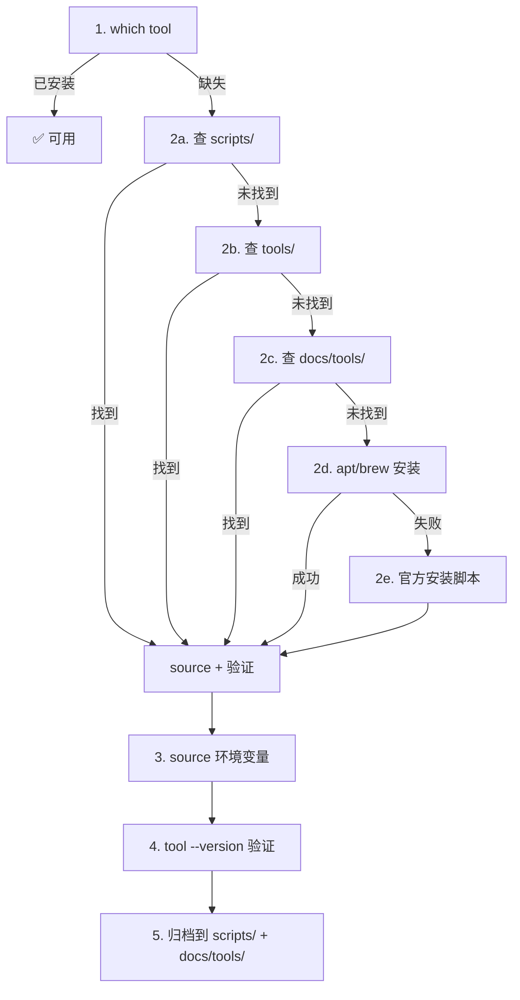

**项目必需工具**：

| 工具 | 用途 | 安装方式 | 引入阶段 |
|------|------|---------|---------|
| `rustc` + `cargo` | 编译+测试（开发语言） | `curl https://sh.rustup.rs \| sh -s -- -y` | Stage 0 |
| `rustfmt` | 格式检查 | `rustup component add rustfmt` | Stage 0 |
| `clippy` | lint 检查 | `rustup component add clippy` | Stage 0 |
| `llvm-config` | LLVM 后端（可选） | 官方发行版安装（LLVM 永不入自举链——§2.4；v12.5 修正：原引用 scripts/setup-llvm-env.sh 不存在于仓库） | **Stage 3+（可选）** |
| `llc` / `opt` / `lld` | LLVM IR 验证+链接 | 随 LLVM 安装 | **Stage 3+（可选）** |
| `qbe` | QBE 后端（可选） | 系统包管理器 | **Stage 2+（可选）** |
| `zip` / `tar` | 打包 | `apt install zip` | Stage 0 |
| `ripwire` | agent 仓库导航/影响面分析（可选——宿主侧开发工具，**非构建依赖**：永不进入 Cargo 依赖/语言管线/自举链，§18.4 表不收录；「ripgrep of AI context」确定性调用图，Rust/docs 面覆盖而 .krf 面归原则 44 双源单源不受影响） | `sh scripts/ripwire/setup.sh`（v13.7/r86 收录——裁定实证与速查见 docs/tools/ripwire/setup.md） | **可选（agent 辅助，r86+）** |

**LLVM 引入策略**（重要变更）：
- **Stage 0-1**：完全不引入 LLVM。使用自建字节码 VM
- **Stage 2**：可选引入 QBE 或 Cranelift 作为快速开发后端
- **Stage 3+**：可选引入 LLVM 作为发布优化后端
- **原则**：LLVM 永远不进入自举链；编译器永远能不依赖 LLVM 构建

**规则**：
- 安装失败时记录到 worklog 并告知用户，不静默跳过
- 安装成功后继续推进任务，不等用户确认
- 自定义安装/配置脚本必须归档到 `scripts/<sub_dirname>/`，对应文档同步到 `docs/tools/<sub_dirname>/`

### 3.2 交付前验收检查

**原则**：返回包给用户前，必须实际运行验收命令并确认全绿。

**验收命令**（按阶段适配）：

**Stage 0-1（无 LLVM 依赖）**：
```bash
cargo clean && cargo build --release && cargo check && cargo fmt --check && cargo clippy --all-targets -- -D warnings && cargo test --release
```

**Stage 3+（可选 LLVM 后端）**：
```bash
cargo clean && cargo build --release --features llvm-backend && cargo check --features llvm-backend && cargo fmt --check && cargo clippy --all-targets --features llvm-backend -- -D warnings && cargo test --release --features llvm-backend
```

**验收标准**：

| 命令 | 要求 | 失败处理 |
|------|------|---------|
| `cargo clean` | 成功（无 exit code 要求） | — |
| `cargo build --release` | 编译成功（release 优化模式） | 修复编译错误，不交付 |
| `cargo check` | 0 errors, 0 warnings (快速类型检查) | 修复类型错误/unused 警告，不交付 |
| `cargo test --release` | `0 failed`（ignored 可接受，release 优化模式） | 修复代码或更新测试，不交付 |
| `cargo fmt --check` | exit 0（零 diff） | 运行 `cargo fmt` 修复 |
| `cargo clippy -- -D warnings` | `0 warnings` | 修复 lint，不交付 |

**流程**：
1. 完成代码+文档改动
2. 运行 `cargo clean`
3. 运行 `cargo build --release` — 必须成功
4. 运行 `cargo check` — 必须 0 errors + 0 warnings（快速类型检查，捕获 unused_mut 等）
5. 运行 `cargo test --release` — 必须全绿
6. 运行 `cargo fmt`（apply）+ `cargo fmt --check`（验证）
7. 运行 `cargo clippy --all-targets -- -D warnings` — 必须 0 warnings
8. 全绿后按 §19 规则打包 tar.gz 并返回
9. worklog 记录验收结果（actual test count + fmt/clippy exit codes）

**`cargo check` 的作用**：
- 比 `cargo build` 更快的类型检查（不生成代码）
- 捕获 `unused_mut`、`unused_variables`、`dead_code` 等警告
- 在 `cargo build` 之后、`cargo test` 之前运行，提供早期反馈
- 不替代 `cargo clippy`（clippy 有更多 lint 规则）

**禁止**：
- ❌ 跳过验收直接交付（即使"语法看起来对"）
- ❌ 标记 "pending env verification" 然后交付（应先装环境再验证）
- ❌ clippy 有 warning 但交付（除非用户明确豁免）
- ❌ `cargo check` 有 warning 但忽略（即使 clippy 通过）

### 3.3 Spec 持续演进原则

**原则**：spec 吸收实战经验持续优化，内容精要，避免臃肿。

**演进触发**：
- 每个阶段完成后（§14 深度审查发现流程缺陷）
- 重复出现的问题（同一类错误发生 ≥2 次）
- 用户反馈
- 审查复盘（§6.6 迭代与自我进化数据）
- **校准阈值越界（§6.6.1 §2 告警阈值——P3 误分类率 ≥30% 或集成覆盖率 <50%）**：强制开立演进提案（v12.5 接线——审计发现必须导向 SOP 修订，或 worklog 显式记录"裁定不修订"及理由）

**演进原则**：
1. **精要 > 冗长**：相同内容用更精简表述；新增条目前先看能否合并到现有章节
2. **实战 > 理论**：每条规则应有"教训来源"（哪个 stage/round 暴露的问题）
3. **路由 > 通读**：通过 §1.2 任务路由让 Agent 精确访问，而非通读全文
4. **合并 > 新增**：能合并到现有 § 的不新建 §；必须新建时附 changelog（§16）
5. **废弃 > 保留**：过时条目标记 `§DEPRECATED` 并在下一版本删除，不保留死代码

**反臃肿检查**（每次演进时执行）：
- 有无重复表述同一规则？（合并）
- 有无条目无"教训来源"？（删除或补来源）
- 有无条目从未被引用/执行？（标记废弃）
- 能否用表格/列表替代段落？（优先表格）

**版本管理**：
- 每次演进 bump 版本号（v9.0 → v10.0 → ...）
- §16 changelog 记录 diff（新增/修改/删除条目）

### 3.4 工具/脚本目录管理

> **目的**：把"工具/脚本/文档分离管理"从隐式约定固化为流程规则。避免 Agent 反复重新实现已有工具。

**目录约定**：

| 目录 | 用途 | 示例 |
|------|------|------|
| `scripts/<sub_dirname>/` | 环境配置脚本、安装脚本、构建脚本 | `scripts/rust/setup.sh`, `scripts/qbe/setup.sh`（+ `scripts/archive/` 历史一次性脚本归档——r100 整理轮立约） |
| `tools/<sub_dirname>/` | 自研工具、命令行辅助、代码生成器 | `tools/qbe/bin/qbe`, `tools/debug/dump_bytecode.rs` |
| `docs/tools/<sub_dirname>/` | 工具使用文档、设计文档 | `docs/tools/qbe/setup.md`, `docs/tools/ripwire/setup.md` |
| `docs/scripts/<sub_dirname>/` | 脚本使用文档 | `docs/scripts/rust/setup.md`（r100 整理轮收敛：docs/tools/rust/setup.md 字节级重复件已删除——r46 deep-review-round1 登记缺陷清偿） |

**强制规则**：
1. **缺失前先查**：发现需要某工具/脚本时，**必须先**检查 `scripts/`、`tools/`、`docs/tools/`、`docs/scripts/` 是否已存在等价实现，避免重复造轮子
2. **新工具归档**：自研工具必须归档到 `tools/<sub_dirname>/`，**同步**编写文档到 `docs/tools/<sub_dirname>/`
3. **新脚本归档**：环境/构建/部署脚本必须归档到 `scripts/<sub_dirname>/`，**同步**编写文档到 `docs/scripts/<sub_dirname>/`
4. **工具更新同步文档**：工具/脚本变更后，对应 `docs/tools/` 或 `docs/scripts/` 文档必须同步更新
5. **`<sub_dirname>` 命名**：按工具领域命名（`rust/`、`debug/`、`codegen/`、`vm/`、`dev/` 等），跨阶段共享
6. **命名遵循 §10**：工具入口函数、CLI 命令、文件名遵循 §10 API 命名标准
7. **遵守 §11 接口隔离**：工具之间通过明确数据契约交互，不互相调用内部函数

### 3.5 自动化工具链（规划中）

> **目的**：把"工具缺失时手动查找+手动安装"升级为"自动化工具链"，最大化 Agent 自助能力。
>
> **状态**：§3.5 规划中——auto-query / auto-install / auto-configure 尚未实现。当前手动工具链 = `scripts/rust/setup.sh` + `scripts/qbe/setup.sh`（v12.5 修正——原引用的 setup-llvm-env.sh / switch-llvm-version.sh 不存在于仓库）。未来实现后归档到 `tools/dev/`。

**三个规划工具**（实现后归档到 `tools/dev/`）：

| 工具 | 职责 | 入口 | 文档 |
|------|------|------|------|
| `auto-query` | 检测工具是否已安装、查询包管理器是否有对应包、查询 `tools/`+`scripts/` 是否有等价实现 | `tools/dev/auto-query.sh <tool>` | `docs/tools/dev/auto-query.md` |
| `auto-install` | 根据 `auto-query` 结果自动选择最佳安装路径（项目自带 → 包管理器 → 官方脚本），记录到 worklog | `tools/dev/auto-install.sh <tool>` | `docs/tools/dev/auto-install.md` |
| `auto-configure` | 安装后自动配置环境变量、生成 source 脚本、验证版本 | `tools/dev/auto-configure.sh <tool>` | `docs/tools/dev/auto-configure.md` |

**执行协议**：

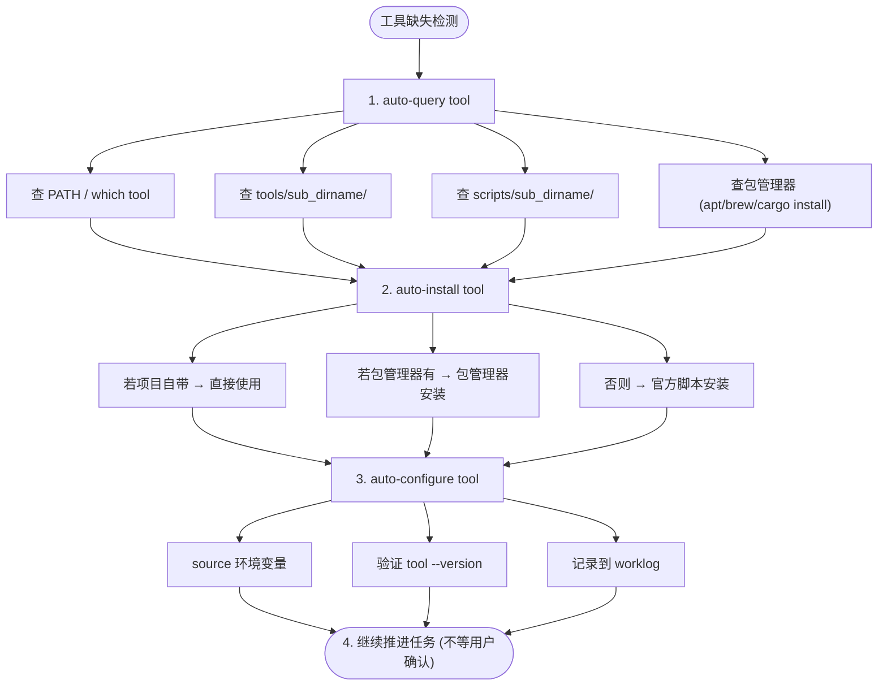

**规则**：
- 三个工具自身遵循 §10 命名标准、§11 接口隔离
- 安装失败时不静默跳过，必须记录到 worklog 并告知用户
- 三个工具的源码必须开源到 `tools/dev/`，文档同步到 `docs/tools/dev/`

---

## 4. 阶段任务拆分（MUV）

> **前置条件**：§17 任务规划排版图必须在本节之前完成。§17 的叶子任务 = MUV。

将阶段目标拆解为可独立验证的最小工作单元（MUV，Minimum Verifiable Unit），保证每个子任务可单独审查、修正和追溯。

### 4.1 MUV 必备字段

| 字段 | 说明 |
|------|------|
| 输入条件（前置依赖） | 上游 MUV / 阶段的输出 ID |
| 输出物 | 代码 / 测试 / 文档（明确路径） |
| 验收标准 | 可量化指标（测试数、覆盖率、字节码检查点） |
| 集成验证用例 | ≥1 个端到端测试覆盖该 MUV 输出被下一阶段正确消费（见 §7） |
| 责任 Agent | 主导角色（§1.4） |
| Task ID | 全局唯一标识，用于 worklog 追溯（见 §8.6） |

### 4.2 MUV 拆分粒度

| 复杂度 | MUV 平均规模 | 子阶段数 |
|--------|--------------|----------|
| L1（文档/配置） | ≤50 LOC / 1 文件 | 1-2 |
| L2（业务逻辑） | 50-500 LOC / 2-5 文件 | 3-6 |
| L3（核心架构） | 500+ LOC / 跨模块 | 5-10 |

---

## 5. 审查-修订内循环

### 5.1 复杂度预评估（启动前）

由 AI Agent 基于以下三项指标预估子任务的问题复杂度等级：

- **代码变动量**（新增/修改 LOC）
- **依赖风险**（跨模块耦合度、接口变更影响面）
- **历史缺陷密度**（同类任务在之前阶段的 P0/P1 发现率）

| 等级 | 描述 | 基准轮次区间 |
| :---: | :--- | :---: |
| L1 | 低复杂度（文档/配置/样式调整） | 2 ~ 4 轮 |
| L2 | 中复杂度（常规业务逻辑增改） | 4 ~ 9 轮 |
| L3 | 高复杂度（核心架构/跨模块变更） | 8 ~ 15 轮 |

### 5.2 执行中的动态调整

- 若循环过程中新发现的 P0/P1 级问题数量超出预期，或修复后引发二次缺陷，Agent 可将轮次上限自动上浮 30%~50%，并记录调整理由。
- 若连续 2 轮仅发现 P3 级轻微问题，Agent 可提前终止循环（无需达到下限轮次）。

### 5.3 退出内循环的硬性标准

退出内循环必须**同时**满足以下条件：

1. 所有 P0（致命）与 P1（严重）级别缺陷必须清零。
2. 产出物完整、一致，足以支撑下一阶段开展。
3. `cargo build --release` 0 warnings。
4. `cargo clippy --all-targets -- -D warnings` 通过。
5. `cargo fmt --check` 通过。
6. **至少 1 个集成测试**证明该子阶段的输出可被下一阶段正确消费（见 §7）。
7. **本轮文档同步完成**（§8）：`docs/develop/` + `docs/tests/` 下所有应更新的文档均已更新或新建。
8. **阶段末尾深度审查完成**（§14.5）：如果本轮是阶段的最末轮（gate review / 收敛轮 / 阶段切换点），必须执行 §14.5 深度审查，输出 `deep-review-roundN.md` 报告。

> **分层豁免（v12.5——对齐 §1.2.1 裁定）**：L1 任务项⑥可豁免（无行为变更时以全量既有套件全绿替代）；项⑧仅适用于"本轮为大阶段末轮"——L1 常规轮无深审义务（由阶段末 L3 轮承载），L2 项⑧由 §7.3 门审替代承载。项①-⑤/⑦任何层级不可豁免。

---

## 6. 缺陷分级

### 6.1 缺陷等级划分

| 等级 | 名称 | 定义（举例） | 处理要求 |
| :---: | :--- | :--- | :--- |
| P0 | 致命 | 系统崩溃、核心流程中断、编译器 panic、**语义错误（9 个核心原语行为不符规范）**、**P3 技术债被误分类导致实际阻塞** | 强制修复，阻塞退出 |
| P1 | 严重 | 主要功能缺失、API 接口错误、Span 丢失、相位分离违规、数据丢失 | 强制修复，阻塞退出 |
| P2 | 一般 | 非核心功能异常、边界条件错误、性能低于预期 | 修复；若遗留需在团队讨论中申报并获 95% 同意，可带技术债进入下一阶段 |
| P3 | 优化 | 代码风格、文档措辞、非关键性能优化 | 不阻塞，直接记录为技术延伸，后续迭代处理 |

### 6.2 技术债分类审查规则

> **根因教训**（来自 Stage 2.x 门审查）：Stage 2.x 的多个 P3 技术债实际为 P0/P1。根因是每个子阶段的委员会投票基于"该子阶段内部测试通过"，但从未验证子阶段之间的集成。每个子阶段都是"孤立正确"但"集成失败"。

**规则**：
1. 每个被标记为 P3 的技术债，在退出内循环前必须由**架构师角色**确认其真实等级。如果该 P3 会影响下一阶段的正确性，则**升级为 P0/P1**，强制在本阶段修复。
2. 判定标准：**如果下一阶段（或下游消费者）的输入依赖该项的输出，且该项的"简化实现"会产出错误结果，则该 P3 必须升级。**
3. 不得以"后续阶段处理"为由推迟会影响集成正确性的 P3。

#### 6.2.0 技术债触发时机与处理流程

> **目的**：明确在开发流程中何时必须同步 TD 到技术债队列，以及如何处理依赖限制。

**触发时机 1：功能缺失或当前存在限制**

| 触发条件 | 处理流程 | 示例 |
|---------|---------|------|
| 开发中发现功能缺失（语言特性不支持） | (1) 停止当前任务推进 (2) 分析缺失功能的影响范围 (3) 同步到 `tech-debt-register.md` 含描述/根因/修复方案/优先级 (4) 在 `worklog.md` 记录 TD ID (5) 如果有 workaround，在 TD 中记录 workaround 及其限制 | 发现卫生宏不支持某模式 → 记录 TD，用文本替换 workaround 并记录限制 |
| 开发中发现当前实现有限制 | 同上 | `mangle_ty` 对 Error 类型返回 "error" → 记录 TD |

**触发时机 2：依赖内容存在限制**

| 触发条件 | 处理流程 | 关键原则 |
|---------|---------|---------|
| 任务所需的依赖功能不存在或被限制 | (1) **停止继续做阉割版任务推进** (2) 分析缺失的依赖内容 (3) 同步规划到 `tech-debt-register.md` (4) 可参考同类优秀实例（如 Rust）的相关设计进行修复补全 (5) 如果存在已实现的阉割版内容，将完整修复计划同步到 tech-debt | **正确 > 妥协**：不得以"后续阶段处理"为由继续推送阉割版。已实现的阉割版必须记录修复计划。 |

**触发时机 3：可疑代码模式**

| 模式 | 怀疑理由 | 处理要求 |
|------|---------|---------|
| 下划线开头的变量名未使用（`_unused`） | 可能是预留漏洞 — 真的不需要还是设计不完整？ | (1) 判断是否真的不需要 (2) 如果不确定，纳入 tech-debt 规划 (3) 在 worklog 注明判断依据 |
| 空值/None 传递未记录原因 | 可能是临时桩 — 真实设计还是不完整实现？ | (1) 检查是否有文档说明 (2) 如无说明，在 tech-debt 记录 (3) 评估是否影响正确性 |
| 默认值/默认分支使用未说明 | 可能是静默降级 — 正确处理还是掩盖 bug？ | (1) 检查默认值是否合理 (2) 如不合理，记录为 TD (3) 评估是否有报错路径替代 |
| 不完整 match arm（缺少覆盖） | 可能是非穷尽匹配 — 有意为之还是遗漏？ | (1) 检查是否有 `_ =>` catch-all (2) 如无 catch-all 且类型有更多 variant，记录为 TD (3) 评估是否会导致 panic |

#### 6.2.1 综合技术债登记册（tech-debt-register.md）

> **目的**：把全项目的技术债从分散的 dev-log / gate-review 收敛到**单一持久化文件**，与 §6.6.1 calibration-data.md（流程校准数据池）形成"技术债 + 流程校准"双视图。

**文件位置**：`docs/develop/v0/tech-debt-register.md`

**强制结构**：
1. **已解决项**（Resolved）：每项含 ID、描述、解决阶段、验证方式
2. **剩余项**（Open）：每项含 ID、描述、当前等级（P0/P1/P2/P3）、目标解决版本、阻塞条件
3. **架构摘要**：流水线图 + 测试计数 + Span::DUMMY 状态 + 枚举分支覆盖 + 错误系统状态
4. **分类索引**：按 §6.1 缺陷等级 + 按 §11.3 接口隔离违规（L-PIPE-N）+ 按 §10 命名违规（L-NAMING-N）+ 按 §13.4 重构判据（J1-J6）

**更新规则**：
1. **每子阶段必更新**：每个子阶段完成后，REC-A 必须更新 tech-debt-register.md 的对应分类索引（新增已解决项 + 调整剩余项优先级）。
2. **大阶段末尾全审**：每个大阶段末尾的 §14.5 深度审查时，**必须**对 tech-debt-register.md 做全量审计——确认所有"已解决"项确实在代码中消失、所有"剩余"项的优先级仍准确。
3. **跨引用 calibration-data.md**：tech-debt-register.md 中"已解决项"的数量趋势必须与 calibration-data.md §1 表中"P0/P1/P2/P3 发现密度"列相互印证（双向追溯）。
4. **只追加不删除**：本文件为追加型日志，已解决项不删除（保留作为历史决策记录），仅标注 `[Resolved at Stage N.M]`。
5. **REC-A 责任**：本文件由 REC-A 在阶段归档时同步更新（per §8 文档同步规则）。

**与 §6.6.1 的职责分工**：

| 文件 | 关注点 | 时间维度 | 更新频率 |
|------|--------|---------|---------|
| `tech-debt-register.md`（§6.2.1） | **代码层**技术债（接口违规、命名违规、Span::DUMMY 等） | 单阶段 + 跨阶段累积 | 每子阶段 |
| `calibration-data.md`（§6.6.1） | **流程层**校准数据（轮次偏差、误分类率、集成覆盖率） | 跨阶段滚动 | 每大阶段 + 显著偏差子阶段 |

### 6.3 团队准入讨论（外循环与二次内循环联动）

**角色与权重**：

| 角色 | 职责 | 权重系数 | 特殊权限 |
| :--- | :--- | :---: | :--- |
| 架构师/技术负责人 | 把控技术方向与架构一致性 | 2 票 | 拥有一票否决权（反对即触发二次内循环） |
| 核心开发工程师 | 评估代码实现与可维护性 | 1.5 票 | — |
| 质量保证 | 验证测试覆盖与功能符合度 | 1 票 | — |
| 产品/业务代表 | 确认语言语义正确性 | 1 票 | 仅对需求偏差有否决权（触发二次内循环） |
| （附加）Tooling & DX | 工具链与开发体验 | 1 票（**不计入加权**） | NEEDS REVISION 立场仍触发二次内循环（对齐 §1.4 注记） |

> 注：对于本编译器项目，"产品/业务代表" 角色由 **Type System Theorist**（ALG-C）担任。SKL-A 的 1 票不参与 ≥95% 加权通过率计算（总权重恒 5.5），但其 NEEDS REVISION 立场仍触发二次内循环——"5 角色 ≥95%"表述中的第 5 角色即指 SKL-A（v12.5 显式接线，消除 §1.3/§1.4/§7.3.3/§14.5.1 的表述歧义）。

**外循环准入与二次触发规则**：
- **加权总通过率 ≥ 95%** 视为阶段准入通过。
  - 总权重 = 2 + 1.5 + 1 + 1 = 5.5
  - 通过需要 ≥ 5.225 票（即最多 0.275 票反对，约等于 0 反对）
  - 实践中：全员 APPROVED 或 APPROVED WITH MINOR CONCERNS（P3 级）
- **若未通过（反对票超标）**：
  - 不直接退回起点，而是**触发"二次内循环"**。
  - 外循环必须输出**书面定向修正意见**（架构师指出架构缺陷 / QA 指出漏测场景 / 产品指出需求偏差）。
  - Agent 携带该书面意见进入二次内循环，进行**靶向精准修复**，完成后再次提交外循环投票。
- **硬性退回条件（仅限极端情况）**：
  - 架构师投反对票且修正意见指向**不可逆的设计致命伤**；
  - 非架构师累积反对加权票数超过总权重的 40%（即 > 2.2 票）。
- **循环上限**：二次内循环最多触发 **2 次**。若仍未通过，升级至**技术委员会**仲裁。

### 6.4 Git Commit 规范

团队外循环投票**通过**后，方可进入下一阶段。同步执行标准 Git Commit，包含：
- **消息头**（类型 + 范围）：`feat(stageX.Y): 简述`
- **主体**（变更摘要）
- **脚注**（**强制包含**）：
  - 关联需求编号（Stage plan 文档引用）
  - 遗留债务清单（如有，列出 P2/P3 项 + 目标解决阶段 + **真实等级确认**）
  - 本次内循环/二次内循环轮次记录
  - Committee 投票结果（如 "5/0 APPROVED"）

### 6.5 紧急通道（Expedited Lane）

- 针对线上 P0 级紧急漏洞或致命阻断，允许**架构师 + 产品经理**双重签署后，**跳过预评估与外循环投票**，直接进入内循环修复。
- 修复完成后，**事后 24 小时内**必须补齐完整的审计日志（预评估模拟数据 + 修复轮次记录），并纳入下一阶段的复杂度校准数据池。

### 6.6 迭代与自我进化

每个阶段结束后，由 Agent 统计：
- 预估等级与实际轮次的偏差；
- P0/P1/P2 发现密度与分布；
- **P3→P0/P1 误分类率**（来自 Stage 2.x 教训）；
- 外循环否决票的集中领域（架构/测试/需求）；
- 紧急通道触发频次；
- **集成测试覆盖率**（有多少子阶段被端到端测试覆盖）。

以上数据作为**下一阶段复杂度预评估（三项指标）的校准依据**，实现流程的持续优化。

#### 6.6.1 校准数据池（calibration-data.md）

> **目的**：把"校准依据"从概念性描述固化为**单一持久化文件**，避免每个阶段的统计数据散落在不同 worklog/dev-log 里、跨阶段比对困难。

**文件位置**：`docs/develop/v0/calibration-data.md`

**文件结构**（强制）：

```markdown
# 流程校准数据池

> **Author**: redskaber
> **Version**: vX.Y
> **Status**: Active
> **最后更新**: Stage N.M / YYYY-MM-DD

## 1. 每阶段统计表

| Stage | 预估等级 | 实际轮次 | P0 | P1 | P2 | P3 | P3→P0/P1 误分类 | 紧急通道 | 集成覆盖率 | 备注 |
|-------|---------|---------|----|----|----|----|----------------|---------|-----------|------|
| 0 | L3 | 9 | ... | ... | ... | ... | N/A | 0 | 60% | v0.1 基线 |
| ... | ... | ... | ... | ... | ... | ... | ... | ... | ... | ... |

## 2. 校准结论（滚动更新）

- L2 基准轮次区间：4~9 轮
- L3 基准轮次区间：8~15 轮
- P3 误分类率告警阈值：≥30%
- 集成覆盖率告警阈值：<50%（触发 §7 复查）

## 3. 历史教训归档

### Stage 2.x: 孤立正确但集成失败
- 现象：5/7 个 P3 实际为 P0/P1
- 根因：子阶段间无集成测试
- 修复：新增 §7 集成验证协议 + §6.2 技术债分类审查规则
```

**更新规则**：
1. 每个大阶段（Stage 0/1/2/3/4/5）末尾的 §14.5 深度审查时，**必须**向本文件追加一行阶段统计 + 一条校准结论。
2. 子阶段的统计只在出现显著偏差（实际轮次 > 预估 × 1.5，或 P3 误分类率 ≥ 30%）时才追加。
3. 紧急通道（§6.5）触发后，事后审计日志必须同步写入本文件的"历史教训归档"小节。
4. 本文件由 REC-A 在阶段归档时同步更新（per §8 文档同步规则）。

---

## 7. 集成验证协议

> **根因教训**（来自 Stage 2.x 门审查）：每个子阶段的委员会投票基于"该子阶段内部测试通过"，但从未验证子阶段之间的集成。每个子阶段都是"孤立正确"但"集成失败"。Stage 2.x 的多个 P0 全部来自子阶段间的衔接缺失。

### 7.1 集成测试要求

每个子阶段在退出内循环前，**必须**包含至少 **N 个集成测试**（N ≥ 5 = 正向 ≥1 + 负向 ≥3 + 跨阶段消费 ≥1——v12.5 修正子项算术矛盾），其中：

1. **正向集成测试**（≥1 个）：使用真实源码作为输入，运行完整流水线到当前子阶段，断言输出结构正确（非 panic、非 placeholder）。
   - 示例：`(define (fib n) (if (< n 2) n (+ (fib (- n 1)) (fib (- n 2)))))` → 经过 Reader → Expander → Compiler → VM，断言 VM 执行返回正确值。

2. **负向集成测试**（≥3 个，**强制要求**）：使用包含已知错误的源码，运行完整流水线，断言正确的错误被检测到。
   - 示例：`(+ 1 "string")` → VM 应报 type mismatch in arithmetic。
   - **每类错误至少 1 个负向测试**：语法错误、未绑定标识符、参数个数错误、类型不匹配、宏展开错误等。
   - **历史教训**：现有测试 100% 偏向正向 case，导致负向用例漏检。**负向测试不是可选项**。

3. **跨阶段消费测试**（≥1 个）：验证当前子阶段的输出可被下一阶段正确消费。
   - 示例：Compiler 的输出（`Bytecode`）被 VM 消费后，所有指令操作数正确解析。

#### 7.1.1 负向测试最小覆盖矩阵

对于编译器项目，以下错误类别每个都至少要有 1 个负向集成测试：

| 类别 | 示例 | 必须检测的错误 |
|------|------|----------------|
| 语法错误 | `(lambda (x)`（未闭合括号） | reader: unclosed delimiter |
| 未绑定标识符 | `undefined_var` | expander: unbound identifier |
| 语法对象为空 | `()`（空应用） | expander: cannot apply empty form |
| 参数个数错误 | `((lambda (x) x) 1 2)` | vm: arity mismatch |
| 类型不匹配 | `(+ 1 "string")` | vm: type mismatch in arithmetic |
| 模块循环依赖 | A imports B, B imports A | module_loader: circular dependency |
| 宏展开深度超限 | 嵌套宏展开无限递归 | expander: expansion depth exceeded |

**审查规则**：在委员会投票前，QA 角色必须验证以上 7 类至少有 6 类被负向测试覆盖。否则触发 NEEDS REVISION。（v12.5 口径注：此为**子阶段级**门槛 ≥6/7——允许 1 类缺口进入下一轮；**门审级**（§7.3.1 规则 1）为更严门槛 **7/7 全覆盖**。两道关口构成递进关系，非口径冲突。）

### 7.2 "孤立正确"防剧行动项

每个子阶段在委员会投票前，**必须**回答以下问题（由 QA 角色审核）：

| # | 问题 | 通过条件 |
|---|------|------|
| Q1 | 本子阶段的输出是否包含 placeholder/stub？ | 如是，列出所有 placeholder + 标注真实等级（P0/P1/P2/P3） |
| Q2 | 下一阶段能否直接消费本子阶段的输出？ | 如否，列出阻断原因 + 修复计划 |
| Q3 | 是否有端到端测试覆盖从源码到本子阶段输出的完整路径？ | 如否，补充至少 1 个 |
| Q4 | 本子阶段标记为 P3 的技术债中，是否有任何一项会影响下一阶段？ | 如是，升级为 P0/P1 并在本阶段修复 |
| Q5 | 本子阶段的入口函数是否被任何调用方实际调用？ | 如否，补充驱动程序 |
| Q6 | 本轮的 `docs/develop/` 与 `docs/tests/` 是否已按 §8 同步？ | 如否，补齐文档后再投票 |

### 7.3 阶段门审查（Stage Gate Review）

在一个**完整阶段**（如 Stage 2.x）的所有子阶段完成后、进入下一大阶段（如 Stage 3）之前，**必须**执行一次**阶段门审查**：

1. 启动一个独立的审查 Agent，对整个阶段做全量审计。
2. 审计覆盖所有子阶段的**集成正确性**，不仅仅是各子阶段的内部正确性。
3. 审计输出：
   - P0/P1/P2/P3 分类列表
   - 每个问题的具体 file:line + 修复建议
   - **阶段准入判定**：APPROVED（可进入下一阶段）或 NEEDS REVISION（需修复后重新审查）
4. 如 NEEDS REVISION，创建修复子阶段（如 Stage 2.4），不允许跳过。

#### 7.3.1 扩展负向审计要求

> **根因教训**（来自 Stage 2.x 三轮审查）：Round 2 加了 19 个负向测试（覆盖 95%），但 Round 3 用 44-case 扩展审计又发现 7 个新 soundness holes。这说明：负向测试数量不是关键，**覆盖广度**才是关键。

**规则**：
1. 每个阶段门审查（§7.3）**必须**使用一个 **≥30 case 的负向审计集**，覆盖 §7.1.1 矩阵的全部 7 类错误。
2. 审计集**必须**包含至少：
   - 10 个单语句负向测试（基础类型系统）
   - 10 个多语句/多函数负向测试（集成正确性）
   - 5 个复杂程序负向测试（嵌套控制流、闭包、递归）
   - 5 个错误恢复测试（一个错误不应导致后续全部 fail）
3. 审计集应该作为 `examples/audit/stageN_gate_audit_r<R>.rs` 提交到仓库，可重运行。
4. 每轮审查的审计集**必须**比上一轮更大或同等规模。

**强制失败条件**：如果审计集 < 30 case 或未覆盖全部 7 类，自动触发 NEEDS REVISION，不允许进入委员会投票阶段。

#### 7.3.2 上轮修复边界 case 测试

> **根因教训**（来自 Stage 2.x Round 4 审查）：Round 3 的 44-case 审计通过后，Round 4 通过测试 *上轮修复的边界 case* 又发现 2 个 P0。

**规则**：
1. 每个阶段门审查的审计集**必须**包含至少 **5 个"上轮修复边界 case"测试**，专门测试上一轮修复可能引入的边界情况。
2. 边界 case 测试应覆盖：
   - 类型推断变量区分（不同变量类型）
   - resolve/unify 时机（绑定前 vs 绑定后）
   - 类型注解 vs 推断（同一类型的两种路径）
   - 错误恢复（一个错误后后续是否正确处理）
   - 跨阶段数据流一致性
3. 边界 case 测试应作为 `examples/audit/stageN_gate_audit_r<R>.rs` 的独立 group 标注。
4. 如果上轮修复了 N 个 P0，边界 case 测试应 ≥ N 个（每个修复至少 1 个边界测试）。

**强制失败条件**：如果上轮有 P0 修复但本轮审计没有对应的边界 case 测试，自动触发 NEEDS REVISION。

#### 7.3.3 收益递减规则

> **根因教训**（来自 Stage 2.x Round 5 审查）：Round 5 用 60-case + 15-deep 审计发现 **0 个新问题**，所有 Round 4 修复的边界 case 都通过。这表明审计已达到收益递减点。

**规则**：
1. 如果一轮审查发现 **0 个新 P0/P1 问题**，且所有 §7.3.1/§7.3.2 要求满足，则该阶段视为**审查收敛**。
2. 审查收敛后，**下一轮审查可经委员会批准跳过**（需要 ≥4/5 角色同意）。
3. 跳过的审查轮次仍需在 worklog 中记录"审查收敛，跳过 Round N"。
4. 如果委员会认为仍有未覆盖的风险区域，可拒绝跳过并要求继续审查。
5. **下一大阶段启动条件**（强制）：
   - 至少 1 轮审查发现 0 个新问题（审查收敛）
   - 所有 §7.1.1 类别覆盖
   - 所有 §7.3.1/§7.3.2 要求满足
   - 5 角色全票 APPROVED
   - 无 P0 阻塞，P1 全部修复或标记为下一阶段限制

**目的**：防止无限审计循环，让项目在质量保证和进度之间取得平衡。审查不是目的，**质量**才是目的。

---

## 8. 文档同步规则

> **目的**：防止文档与代码脱节。每次代码变更都必须同步更新相关文档，确保项目状态在文档中准确反映。

### 8.1 强制同步项

每次代码更新（含子阶段提交）**必须**同步以下文档：

| 文档 | 更新时机 | 更新内容 |
|------|---------|---------|
| `Cargo.toml` | 每次版本变更 | version 字段 |
| `README.md` | 每次重大变更 | 项目概述、构建说明、特性列表 |
| `docs/develop/v0/stage-N/dev-log.md` | 每次子阶段完成 | 新增开发日志条目（v12.5 实盘口径：Stage 1+ 的开发日志由 worklog flat + rec 树双源承载——§8.6；仅 stage-0 建有独立 dev-log.md） |
| 门审查报告 | 每次门审查 | 审查报告（v12.5 实盘口径：**双载体** = `examples/audit/*.rs` 可重跑审计集 + worklog 门审条目；阶段级深审报告在 `docs/develop/v0/stage-N/deep-review-*.md`） |
| `docs/tests/matrix.md` | 每次测试数量/覆盖率变化 | 测试矩阵 |
| `docs/lang-design/NN-*.md` | 当设计文档涉及变更 | 语言设计文档 |
| `docs/stage0.md` | 上游设计蓝图查询（合并全文与演进记录档案） | 设计蓝图存档（v6.1 接口预留完整性版——目录级拆分权威为 docs/lang-design/） |
| `RELEASE_NOTES.md` | 每次出包 | 版本号、变更摘要、测试统计 |
| `docs/develop/v0/stage-N/plan.md` | 进入新阶段时 | 阶段计划和子阶段拆分 |
| `docs/develop/v0/tech-debt-register.md` | 每子阶段 | 技术债登记册 |
| `docs/develop/v0/calibration-data.md` | 每大阶段 | 校准数据池 |

### 8.2 文档质量要求

- **不可有过期信息**：文档中的版本号、测试数量、特性列表必须与代码实际状态一致
- **变更必须有记录**：每次 commit 如果改变了用户可见的行为，必须在 dev-log.md 或 RELEASE_NOTES.md 中记录
- **新模块必须有文档**：新增的 `src/` 子模块必须在 `docs/` 中有对应的设计文档或更新到现有文档中

### 8.3 后端相关文档同步规则

> **原则**：按 §21 的阶段规划，不同阶段使用不同后端，文档同步策略随阶段演进。

| Stage | 后端 | 必须同步的文档 |
|-------|------|--------------|
| Stage 0-1 | 自建字节码 VM | `docs/vm/` 下的 VM 设计、字节码格式、操作码文档 |
| Stage 2+ | QBE/Cranelift（可选） | `docs/backend/` 下的后端集成文档 |
| Stage 3+ | LLVM（可选） | `docs/llvm/` 下的 LLVM 集成文档 |

**检查时机**：每次对应后端代码有实质变更时，QA 角色必须验证相关文档是否已同步更新。

### 8.4 文档组织结构规则

#### 8.4.1 顶层目录结构

> 本树为 `docs/` 的内部组织。`docs/` 本身位于 **Cargo Workspace 根项目**——根项目与 crate 内部的两级结构语义（根项目 = 跨 crates/全局，crate 内部 = crate 自身）见 §8.4.6。

```text
docs/
├── develop/             # 开发文档（按版本 → 阶段 → 任务三级组织）
│   └── v0/
│       ├── stage-0/     # Stage 0：Reader + Expander + VM + Runtime
│       ├── stage-1/     # Stage 1：目标语言重写 + 类型检查
│       ├── stage-2/     # Stage 2：完整语言 + QBE/C 转译后端
│       ├── stage-3/     # Stage 3+：完全自举 + 可选 LLVM
│       ├── tech-debt-register.md
│       └── calibration-data.md
├── lang-design/         # 语言设计文档（00-19 编号）——上游蓝图的目录级拆分（权威执行面）
├── stage0.md            # 上游设计蓝图存档（v6.1——合并全文 + 演进记录档案，§8.4.5 查询表）
├── tests/               # 测试文档（与 develop 相互印证）
│   ├── matrix.md
│   ├── pipeline-test-coverage.md
│   └── v0/stage-N/
├── vm/                  # 字节码 VM 设计文档（Stage 0-1）
├── backend/             # 可选后端文档（Stage 2+）
├── llvm/                # LLVM 集成文档（Stage 3+，可选）
├── graph/               # 项目图（mermaid 数据流图，§15）
│   └── <sub_dirname>/
├── tools/               # 工具文档（§3.4）
│   └── <sub_dirname>/
├── scripts/             # 脚本文档（§3.4）
│   └── <sub_dirname>/
├── worklog.md           # 共享 worklog 镜像（flat 详录与审计底座，§8.6.1）
├── worklog/             # worklog rec 树（v12.0 §8.6.2——时间×精度双轴 + 每层 l 路由索引）
│   ├── l                # 根路由（未压实区间 + 里程碑导航 + by-topic 决策视图）
│   └── NN_里程碑_概述/    # 递归同构（dir/file 编号_概述 + l，扇出 ≤12）
├── sop.md  # 本文件（流程管控；原 stage-committee-process.md，v11.0 起更名）
├── build-guide.md       # 构建指南
└── testing-guide.md     # 测试指南
```

#### 8.4.2 开发文档层级

开发文档按 **大版本 → 阶段 → 任务** 三级组织：

```text
docs/develop/v0/
├── calibration-data.md   # 流程校准数据池（§6.6.1，跨阶段统计 + 校准结论）
├── tech-debt-register.md # 综合技术债登记册（§6.2.1）
├── v0.1-capability-boundaries.md  # 能力边界文档
├── v0.5-roadmap.md       # 长期路线图
├── stage-0/
│   ├── plan.md          # 阶段计划（MUV 拆分、验收标准）
│   ├── status.md        # 阶段状态报告
│   ├── dev-log.md       # 开发日志（按轮次记录）
│   └── gate-review.md   # 阶段门审查报告
├── stage-1/
│   ├── plan.md
│   ├── ...
│   └── gate-review.md
├── stage-2/
│   ├── plan.md
│   ├── gate-review-round1.md   # 多轮审查按 roundN 编号
│   ├── gate-review-round2.md
│   └── ...
└── stage-3/
    ├── plan.md
    ├── dev-log.md
    ├── gate-review-round1.md
    └── ...
```

**命名规则**：
- `plan.md` — 阶段计划
- `status.md` — 阶段状态
- `dev-log.md` — 开发日志
- `gate-review.md` — 门审查报告（单轮）
- `gate-review-roundN.md` — 门审查报告（多轮，N=1,2,3...）
- `task-{name}.md` — 具体任务文档（如果阶段复杂，按 MUV 拆分）
- `calibration-data.md` — 流程校准数据池（§6.6.1，跨阶段汇总，**禁止删除历史行**，只追加）
- `tech-debt-register.md` — 综合技术债登记册（§6.2.1）

#### 8.4.3 语言设计文档

语言设计文档按编号组织，反映设计顺序（v12.4：目录树与磁盘实况对齐——r32-r34 设计栈四件 20/21/22/23 显式列出；四层设计栈 = 20 名字与行为层 / 21 能力与职责层 / 22 命名机制层 / 23 演进治理层，r34 起完整）：

```text
docs/lang-design/
├── 00-overview.md               # 语言概览（文档地图——24 文件）
├── 01-core-forms.md             # 9 个核心原语定义（+内部语法设计）
├── 02-syntax-model.md           # 语法对象与 Span 系统（+表面语法决策）
├── 03-macro-system.md           # 卫生宏与相位分离
├── 04-bytecode-vm.md            # 字节码 VM 设计
├── 05-runtime.md                # 最小运行时
├── 06-operational-semantics.md  # 操作语义（形式化）
├── 07-bootstrap-strategy.md     # 自举策略
├── 08-backend-evolution.md      # 后端演进策略（§21）
├── 09-stdlib.md                 # 标准库（命名规范层指针）
├── 10-toolchain.md              # 工具链（LSP×命名空间交互点）
├── 11-testing.md                # 测试
├── 12-roadmap.md                # 路线图（含 §2.10 表面迁移登记）
├── 13-capability-matrix.md      # 能力三层分类矩阵（工程能力 owner）
├── 14-design-alternatives.md    # 替代设计与 2026 现代方案
├── 15-architecture-layers.md    # 架构分层与总览
├── 16-reference-analysis.md     # C 参照与语言选择
├── 17-principles.md             # 三十九条设计原则（裁决规则索引）
├── 18-terminology.md            # 术语表 + 诊断码位登记表（E0001-E0019）
├── 19-references.md             # 参考文献与引用（含知识搜索实证）
├── 20-surface-conventions.md    # 表面规范（名字与行为层——R1-R6 + 57 项映射表）
├── 21-capability-architecture.md # 语言能力架构（能力与职责层——L0-L3 × N0-N4 × P0/P1 三轴）
├── 22-namespace-design.md       # 命名空间设计（命名机制层——N0-N4 + 权限矩阵）
└── 23-evolution-governance.md   # 演进治理（治理层——六窗触发表 + 变更通道矩阵）
```

**存档侧对应**：`docs/stage0.md`（v6.5）为合并全文存档（拆分文件为权威执行面；存档侧镜像其 §9.6/§9.7/§9.8 + 附录 A/E 已与拆分面对齐——v12.5 全限定注：此处为 stage0.md 自身节号，非本 SOP §9.6-§9.8）。

#### 8.4.4 文档格式规范

1. **所有文档必须使用 Markdown 格式**（.md 文件）
2. **每个文档必须有标题**（# 开头）
3. **每个文档必须有元数据头**：
   ```markdown
   # 文档标题

   > **Author**: <author>
   > **Date**: YYYY-MM-DD
   > **Version**: vX.Y
   > **Status**: Draft / Active / Archived
   ```
4. **代码块必须标注语言**：` ```rust `、` ```ocaml `、` ```mermaid `
5. **表格必须对齐**，使用 GitHub Flavored Markdown 表格语法
6. **交叉引用使用相对路径**：`[Stage 2 计划](develop/v0/stage-2/plan.md)`
7. **数据流图使用 mermaid**（§15）

#### 8.4.5 文档优先查询规则

> **目的**：在获取用户问题和准备推进项目时，**必须先查询 `docs/` 下的相关文档**，确保决策基于已有设计文档和历史记录，而非凭空推断。

**查询时机**：

| 场景 | 查询目录 | 查找内容 |
|------|---------|---------|
| 用户提出新需求 | `docs/lang-design/` | 是否已有相关设计文档 |
| 准备进入新阶段 | `docs/develop/v0/stage-N/` | 是否已有阶段计划 |
| 确认后端策略 | `docs/lang-design/08-backend-evolution.md` | §21 阶段规划 |
| 修改核心原语 | `docs/lang-design/01-core-forms.md` | 核心原语定义 |
| 修改宏系统 | `docs/lang-design/03-macro-system.md` | 宏系统设计 |
| 修改 VM | `docs/lang-design/04-bytecode-vm.md` | VM 设计 |
| 修改流程 | `docs/sop.md` | 当前流程版本 |
| 查看技术债状态 | `docs/develop/v0/tech-debt-register.md`（§6.2.1） | 已解决/剩余项 + 分类索引 |
| 查看流程校准基线 | `docs/develop/v0/calibration-data.md`（§6.6.1） | L2/L3 轮次区间 + 误分类率告警阈值 |
| 查看数据流 | `docs/graph/<sub_dirname>/` | 数据流图（§15） |
| 修改/新增接口预留 | `docs/lang-design/13-capability-matrix.md` §3.4 | 14 项预留矩阵（唯一权威清单）+ P0-P3 优先级（其 §3.5.1——13 号文档自身节号） |
| 预留/拓展接口的依赖方向与组织 | `docs/lang-design/13-capability-matrix.md` §3.8 | 根空间统一组织（三层预留体系 + 约束组合代数 + 预留接口依赖方向裁定——原则 40 落地规范） |
| 错误处理设计（统一而分治/try-catch 宏定位/one-shot 纪律）与目标语言设计登记（六维定位/渐进披露/生态六维） | `docs/lang-design/17-principles.md` 原则 42/43 + `docs/lang-design/02-syntax-model.md` §8.3 + `docs/lang-design/05-runtime.md` §6 + `docs/lang-design/19-references.md` §15 | 错误处理统一而分治（统一模型五面 + 分治策略 + 禁止硬编码错误机制 + Fatal 效应 + Result 对偶 + one-shot 纪律 + 编译期诊断正交——原则 42 落地规范）+ 目标语言设计蓝图登记态（#15 门控——Stage 2+ 零代码变更；渐进披露四层——原则 43） |
| 语法定义形式/语法文件（EBNF 体系/grammar 单源/定义-实现分离） | `docs/lang-design/02-syntax-model.md` §8.4 + `docs/lang-design/19-references.md` §16 | Stage 0 语法 EBNF 形式化（既有事实 R4 对账）+ Stage 2+ 目标语法骨架（#15 门控登记态）+ grammar 四层组织模型（记法/规范/实现/工具——原则 44 落地规范；W3C EBNF 记法裁定 + 生成器永不入自举链） |
| 效应本体论/类型效应标注语法（三部曲演进链/容器式签名/17 关键字/resume 可选性） | `docs/lang-design/02-syntax-model.md` §8.5 + `docs/lang-design/05-runtime.md` §7 + `docs/lang-design/06-operational-semantics.md` §9 + `docs/lang-design/22-namespace-design.md` §20 | 效应理论三部曲（容器→概率域→生命周期——解释框架层登记）+ 容器式签名 `Return(T) \| E` 终态草案（#15 门控）+ 17 关键字极简体系（Stage 0 25 关键字正交分层）+ resume ∈ {0,1} 完整语义（原则 45 落地规范；机制 100% 兼容零变更义务） |
| 效应流形/空间理论定位（三连接公理/切片升降维/坐标系地图裁定/低熵控制/操作语义全集/合一算法） | `docs/lang-design/02-syntax-model.md` §8.6 + `docs/lang-design/05-runtime.md` §8 + `docs/lang-design/06-operational-semantics.md` §10 + `docs/lang-design/13-capability-matrix.md` §3.12 + `docs/lang-design/24-space-decomposition.md` §15 + `docs/lang-design/22-namespace-design.md` §21 | 效应流形理论 v4（解释框架层第四环——三连接 8 原语可表达零新增原语）+ EBNF v3（15 关键字 + connect/lift/project/pass——grammar L2 第二份骨架语料）+ 坐标系/地图裁定（空间理论 = 组织工具；低熵控制 = A1-A7 信息论再表述）+ 14 推理规则 + 小步语义 + 效应行合一算法 + SpaceRegistry/SpaceValidationPass + EffectTrace 桥接层（原则 46 落地规范；#15 门控零载荷纪律） |
| 逆向效应流/计算干涉定位（正逆对偶/8 原语闭合/非对易性/伪随机坍缩/EBNF v4/五层框架） | `docs/lang-design/02-syntax-model.md` §8.7 + `docs/lang-design/05-runtime.md` §9 + `docs/lang-design/06-operational-semantics.md` §11 + `docs/lang-design/13-capability-matrix.md` §3.13 + `docs/lang-design/24-space-decomposition.md` §16 + `docs/lang-design/22-namespace-design.md` §22 |
| 数学工具箱/波粒二象性定位（K-A 三级分级/贝尔诊断性/波粒第六环/EBNF v5/量子登记态子空间/五 Pass 全景） | `docs/lang-design/02-syntax-model.md` §8.8 + `docs/lang-design/05-runtime.md` §10 + `docs/lang-design/06-operational-semantics.md` §12 + `docs/lang-design/13-capability-matrix.md` §3.14 + `docs/lang-design/24-space-decomposition.md` §17 + `docs/lang-design/22-namespace-design.md` §23 + `docs/lang-design/09-stdlib.md` §5 | 数学工具箱分级裁定（组合拓扑精确同构[E.20-124 锚] + 微分几何离散化对应[DEC——E.20-123 锚] + 量子隐喻维持）+ 贝尔不等式诊断性构造（经典不可达守卫代码）+ 波粒二象性解释框架层第六环（用户理论 v6——Perform=坍缩/Handle=弥散描述转换）+ EBNF v5 第四份骨架语料（Level 0-4 分层 + Level 3-4 脱糖优先）+ QuantumEffectSpace 归位（EffectSpace Level 3 量子登记态子空间）+ 理论-实现分层映射（五层理论 vs 四阶段实现——K-F）+ 五 Pass 分立全景（原则 48 落地规范；#15 门控零载荷纪律） | 逆向效应流对偶理论 v5（解释框架层第五环——Consume/Offer/Rewind = 正向原语使用模式零新增原语）+ 知识不对称判据（四领域 + 不可分解性数学）+ 计算干涉理论（非对易性交换子 + 计算不确定性原理 + 量子隐喻裁定）+ 伪随机坍缩（Randomness 效应 PCG32 + CollapseScheduler）+ EBNF v4（第三份骨架语料——关键字张力双判据 + 脱糖备选）+ 统一五层框架（原则 47 落地规范；#15 门控零载荷纪律） |
| 能力模型三支柱/内禀关系定位（CAP-A~E 五裁定/八维度正交/14 操作/四层次协同/EBNF v6） | `docs/lang-design/21-capability-architecture.md` §10 + `docs/lang-design/13-capability-matrix.md` §3.15 + `docs/lang-design/24-space-decomposition.md` §18 + `docs/lang-design/05-runtime.md` §11 + `docs/lang-design/09-stdlib.md` §6 + `docs/lang-design/02-syntax-model.md` §8.9 + `docs/lang-design/22-namespace-design.md` §24 | 三支柱统一体（线性/OCap/能力效应——E.21-125/126/128 锚）+ 八维度正交分解（HOW vs WHETHER 判据 + Cap-gates-Effect 唯一接触面——E0006 对账）+ 内禀关系解释框架层（计算 GR——`dE² = C_μν dE^μ dE^ν` + 14 操作完备集 + 能力侧波粒对偶）+ EBNF v6 第五份骨架（capability_decl 四成员 + 15+ 关键字宏层脱糖备选）+ 四层次协同谱系（门控已交付/调制/演化/耦合——LV 收敛登记 E.21-127 锚；原则 49 落地规范；#15 门控零载荷纪律） | 数学工具箱分级裁定（K-A 三级）+ 贝尔不等式诊断性构造 + 波粒二象性解释框架层第六环 + EBNF v5 第四份骨架 + QuantumEffectSpace 归位 + 理论-实现分层映射 + 五 Pass 分立全景（原则 48 落地规范；#15 门控零载荷纪律——理论载体六环） |
| 生命周期效应化/四模型协同定位（LC-A~F 六裁定/EBNF v7/接口契约五形/LifecycleAnalysisPass） | `docs/lang-design/13-capability-matrix.md` §3.16 + `docs/lang-design/21-capability-architecture.md` §11 + `docs/lang-design/24-space-decomposition.md` §19 + `docs/lang-design/02-syntax-model.md` §8.10 + `docs/lang-design/05-runtime.md` §12 + `docs/lang-design/09-stdlib.md` §7 | 生命周期吸收轮（r94 形态——next15.md 五链指令）与生命周期线程查询的第一入口；stage0.md §9.22 为全量权威 |
| 流形统一分析/统一场论定位（MU-A~F 六裁定/Pass 单源纪律/八项映射表/分析中心愿景/第九环） | `docs/lang-design/13-capability-matrix.md` §3.17 + `docs/lang-design/15-architecture-layers.md` §5.4 + `docs/lang-design/24-space-decomposition.md` §20 + `docs/lang-design/17-principles.md` 原则 51 + `docs/lang-design/08-backend-evolution.md` §5.5 + `docs/lang-design/12-roadmap.md` §2.13 + `docs/lang-design/19-references.md` §23 + `docs/lang-design/18-terminology.md` §5r | 流形统一分析吸收轮（r95 形态——next15.md Document 4 五链指令）与分析架构面查询的第一入口；stage0.md §9.23 为全量权威 |
| 类型观测/效应容器类型系统定位（TY-A~F 六裁定/观测理论静动统一/流形约束求解/EBNF v8/五接口契约化/第十环五线程族） | `docs/lang-design/13-capability-matrix.md` §3.18 + `docs/lang-design/21-capability-architecture.md` §11.2 + `docs/lang-design/24-space-decomposition.md` §21 + `docs/lang-design/17-principles.md` 原则 52 + `docs/lang-design/02-syntax-model.md` §8.11 + `docs/lang-design/12-roadmap.md` §2.14 + `docs/lang-design/19-references.md` §24 + `docs/lang-design/18-terminology.md` §5s | 类型观测吸收轮（r96 形态——next16.md 五链指令）与类型系统面查询的第一入口；stage0.md §9.24 为全量权威 |
| 渐进式混合自举/语法迁移验证定位（BS-A~F 六裁定/自举路径第三形态/三阶段对账/切换窗前置设计登记/parity 结构化完备/供应链承接/工程进程线程） | `docs/lang-design/07-bootstrap-strategy.md` §4 + `docs/lang-design/02-syntax-model.md` §8.12 + `docs/lang-design/11-testing.md` §6 + `docs/lang-design/12-roadmap.md` §2.15 + `docs/lang-design/17-principles.md` 原则 53 + `docs/lang-design/19-references.md` §25 + `docs/lang-design/18-terminology.md` §5t | 混合自举吸收轮（r98 形态——next17.md 五链指令）与自举策略/语法迁移面查询的第一入口；stage0.md §9.25 为全量权威；r70 surface-syntax-switch-assessment 为切换节点判定单源 |
| EBNF 定稿/语法整合（v9 整合定稿/八份骨架收敛/优先级结合律/关键字分级 22 词面/二义性 22 例/Rust 最小集补全/8 原语第九轮验证/切换窗规范基线） | `docs/lang-design/02-syntax-model.md` §8.13 + `docs/lang-design/22-namespace-design.md` §27 + `docs/lang-design/20-surface-conventions.md` §14 + `docs/lang-design/17-principles.md` 原则 54 + `docs/lang-design/19-references.md` §26 + `docs/lang-design/18-terminology.md` §5u | EBNF 定稿子窗（r104 形态——用户指令 = 需求信号本体）与目标语言文法面查询的第一入口；stage0.md §9.26 为全量权威；切换窗 Reader 实施消费 Level 0 定稿域为解析规范基线 |
| 信息效应化/信息系统设计（五类信息效应/观测双子/统一分治策略/渐进观测分级/InfoEffectSpace 归位/信息流管线叙事层/F13 值通道/六线程族） | `docs/lang-design/02-syntax-model.md` §8.14 + `docs/lang-design/24-space-decomposition.md` §22 + `docs/lang-design/17-principles.md` 原则 55 + `docs/lang-design/05-runtime.md` §13 + `docs/lang-design/06-operational-semantics.md` §13 + `docs/lang-design/13-capability-matrix.md` §3.19 + `docs/lang-design/15-architecture-layers.md` §5.5 + `docs/lang-design/12-roadmap.md` §2.16 + `docs/lang-design/20-surface-conventions.md` §15 + `docs/lang-design/21-capability-architecture.md` §11.4 + `docs/lang-design/23-evolution-governance.md` §2.2.1 + `docs/lang-design/19-references.md` §27 + `docs/lang-design/18-terminology.md` §5v | 信息系统（错误/警告/提示/调试/性能）设计查询的第一入口；stage0.md v8.5 §9.27 为全量权威（INFO-A..G 七裁定）；原则 42 的信息面推广 + F13 编译期诊断值通道纪律在此查询 |
| 流特性理论/流本体论（五层特性/完备观测谱/固定vs确定维度阶/多维可能性/随机种子=自由度对偶/弦理论 Tier 3 + T 对偶驳回/时间性语义重述/8 原语第十一轮验证） | `docs/lang-design/17-principles.md` 原则 56 + `docs/lang-design/06-operational-semantics.md` §14 + `docs/lang-design/13-capability-matrix.md` §3.20 + `docs/lang-design/21-capability-architecture.md` §11.5 + `docs/lang-design/24-space-decomposition.md` §23 + `docs/lang-design/05-runtime.md` §14 + `docs/lang-design/12-roadmap.md` §2.17 + `docs/lang-design/19-references.md` §28 + `docs/lang-design/18-terminology.md` §5w | 流特性理论与流本体论设计查询的第一入口；stage0.md v8.6 §9.28 为全量权威（FLW-A..FLW-G 七裁定）；原则 48 K-A 分级 + 原则 49 CAP-C 对偶面 + 原则 52 观测维度阶的交汇条款在此查询 |
| 统一流分析/描述论本体论（借用检查=流干涉投影/π_time 投影家族三实例/EBNF 第十源语料 Level 1-4 登记态/五描述修正表/机制层豁免/哥德尔不完备同构/三重不完备统一/8 原语第十二轮验证） | `docs/lang-design/17-principles.md` 原则 57 + `docs/lang-design/02-syntax-model.md` §8.13.2a + `docs/lang-design/06-operational-semantics.md` §15 + `docs/lang-design/13-capability-matrix.md` §3.21 + `docs/lang-design/05-runtime.md` §15 + `docs/lang-design/12-roadmap.md` §2.18 + `docs/lang-design/24-space-decomposition.md` §24 + `docs/lang-design/19-references.md` §29 + `docs/lang-design/18-terminology.md` §5x（stage0.md v8.7 §9.29 全量权威——r115 吸收轮） |
| 递归处理/脚手架拆除对账（四层实况谱系：Reader 256 帽/HM 迭代 512 预算/VM 堆帧栈/eval 前置覆盖；理论统一 = 叙事层 K-F 沿袭；方案 2/4 = 登记态备选；零语法面；S-expr 拆除时点 = 步⑤ E5 收口；拆除边界 = 生产链+语料面 + 种子链保留宪制） | `docs/lang-design/17-principles.md` 原则 58 + `docs/lang-design/04-bytecode-vm.md` §3.1 + `docs/lang-design/07-bootstrap-strategy.md` §3.2.2 + `docs/lang-design/06-operational-semantics.md` §16 + `docs/lang-design/13-capability-matrix.md` §3.22 + `docs/lang-design/12-roadmap.md` §2.19 + `docs/lang-design/19-references.md` §30 + `docs/lang-design/18-terminology.md` §5y（stage0.md v8.8 §9.30 全量权威——r117 吸收轮） |
| 临时借用（脚手架）登记/拆除判据/调试策略 | `docs/lang-design/12-roadmap.md` §2.11 + `docs/lang-design/11-testing.md` §5 | 三种脚手架生命周期（语法/信任/优化——搭建/使用/拆除 Stage + 拆除判据 ≥98% 或额外能力 + 可回滚——原则 41 落地规范）+ 双向调试策略（模式识别器双重用途 + 五级调试视图——Stage 2+ 设计登记态） |
| Agent 冷启动 / 查流程历史 / 查某裁定何时做出 | `docs/worklog/l`（rec 树根路由） | 未压实区间 + 里程碑/批次导航 + by-topic 决策视图（§8.6.3-§8.6.4 三原语） |
| 库表面命名/新内置函数命名 | `docs/lang-design/20-surface-conventions.md` | R1-R6 六规则 + 57 项映射表 + 新语料现代名纪律（原则 33 落地规范） |
| 能力归属/正交判据/授权模型 | `docs/lang-design/21-capability-architecture.md` | L0-L3 四层四要素 + J1-J4 判据 + 授权三态 + 组合闭包/编译期权威（原则 34 落地规范） |
| 命名空间/模块/遮蔽/解析规则 | `docs/lang-design/22-namespace-design.md` | N0-N4 五层 + R-N1~N8 + 权限矩阵 + 批次 M 实施对账表 |
| 演进时机/窗口触发/变更通道 | `docs/lang-design/23-evolution-governance.md` | 六窗触发表（K/L/M/E5/T3+）+ 变更通道矩阵 + 准入总表 + 时间治理四红线 |

**强制规则**：
1. **不得跳过查询直接编码**：即使 Agent "知道"答案，也必须先查文档确认是否有更新或变更。
2. **文档与代码冲突时，以代码为准但必须更新文档**：如果发现文档描述与代码实现不一致，以代码实现为准，并在本次提交中修正文档。
3. **新功能必须有设计文档**：在实现新功能前，必须先在 `docs/lang-design/` 中创建或更新对应的设计文档。

**未查询文档直接执行的任务，QA 角色可触发 NEEDS REVISION。**

#### 8.4.6 Cargo Workspace 多 crate 项目结构规则

> **目的**：本项目是 Rust 构建的**多 crate（Cargo Workspace）项目**（内部依赖图见 §18.5，共 9 个 `kerf-*` 成员 crate）。目录结构存在**两级语义**——任何放置决策必须先判定服务范围（crate 自身 vs 跨 crate/全局），再决定位置。
>
> **核心规则：crate 内部使用的结构服务 crate 自身；根项目使用的结构是跨 crates 和全局性质的。**

**根项目（Workspace 根）结构**——承载跨 crate 与全局性质的内容：

```text
kerf/                        # 根项目（Cargo Workspace 根）
├── Cargo.toml                # workspace 清单（[workspace] members + 根 [package]）
├── Cargo.lock
├── src/                      # 根 crate 源码（根测试/聚合/驱动层）
├── crates/                   # 全部成员 crate（内部结构见下）
│   ├── kerf-span/           # Span/位置
│   ├── kerf-syntax/         # SyntaxObject
│   ├── kerf-reader/         # 词法+语法
│   ├── kerf-expander/       # 宏展开
│   ├── kerf-core/           # CoreExpr 定义
│   ├── kerf-compiler/       # 字节码生成
│   ├── kerf-vm/             # 字节码 VM
│   ├── kerf-runtime/        # 运行时/GC
│   └── kerf-driver/         # 编译器入口（编排层）
├── tests/                    # 【跨 crate】根项目集成测试（§9.1 的 v0/stage-N 树；总入口 runner.rs，见下「测试入口架构」）
├── examples/                 # 【跨 crate】演示与审计脚本（§9.6）
├── benchmarks/               # 【跨 crate】性能基准
├── docs/                     # 【全局】文档（§8.4.1 的 docs/ 树）
├── scripts/                  # 【全局】环境/构建/部署脚本（§3.4）
├── tools/                    # 【全局】自研工具（§3.4）
├── worklog.md                # 全局 worklog（§8.6）
├── README.md
└── RELEASE_NOTES.md
```

**crate 内部结构**——仅服务该 crate 自身：

```text
crates/kerf-reader/          # 单个成员 crate
├── Cargo.toml                # 该 crate 的清单（声明的依赖 = 依赖图的边）
├── src/
│   ├── lib.rs                # crate 入口：显式 re-export（§10.1 规则 4，禁止 glob）
│   ├── lexer.rs              # 实现模块（内联 #[cfg(test)] 单元测试）
│   └── ...
├── tests/                    # 【crate 自身】该 crate 的集成测试（仅验证本 crate 公共 API）
│   └── api_tests.rs
└── README.md                 # 该 crate 说明（详细文档统一收口全局 docs/）
```

**目录语义对照表**——同名目录在两级结构中的不同含义：

| 目录 | 根项目（跨 crates / 全局） | crate 内部（crate 自身） |
|------|--------------------------|------------------------|
| `tests/` | **跨 crate 集成测试**：流水线 E2E、相邻阶段集成、阶段门审计（§7.3、§9.1 的 v0/stage-N 树） | **该 crate 自身的集成测试**：仅验证本 crate 公共 API |
| `examples/` | 跨 crate 组合演示、跨阶段审计脚本（§9.6） | 该 crate 的 API 用法演示 |
| `benches/` | 跨 crate 端到端性能基准 | 该 crate 的微基准 |
| `src/` | 根 crate 的源码（驱动/聚合/根测试承载层） | 该 crate 的实现 + 内联单元测试（`#[cfg(test)]`） |
| `docs/` | 全局文档树（§8.4.1） | 不设 crate 级 docs/——文档统一收口全局；crate 内仅 README + rustdoc 注释 |
| `scripts/`、`tools/` | 全局（§3.4 约定） | 不设 crate 级脚本/工具（§3.4 约定归全局） |

**测试入口架构意图（v11.2 新增——Cargo.toml 干净精要原则）**：根 `Cargo.toml` 是 workspace 清单与根 package 的**总入口**，不承载逐测试目标的机械声明——`[[test]]` 块逐文件声明是反模式（每新增测试文件都改清单，清单与 tests/ 树双维护违反精要与单一事实源）。**方案**：`tests/runner.rs` 作为跨 crate 集成测试的**唯一总入口**（cargo 对 tests/ 顶层 .rs 自动发现，零 [[test]] 配置），内部以 `#[path = "v0/…"]` mod 树挂载 v0/stage-N 全部测试文件——阶段/plan/gate 目录语义不变（物理位置即语义），仅入口收敛。选择性运行：`cargo test --test runner <module>::<case>`（模块路径即过滤器）。**例外**：`[[example]]` 嵌套目录声明保留（examples/audit/ 审计脚本——cargo 对 example 无 mod 树等价机制）。测试文件内部的相对 `#[path]`（如 `mod common`）以文件自身目录为基准解析——挂载方式不改变其解析基准。**设计侧锚点接线（v11.3）**：lang-design 各设计文件的「测试锚点」节（01 §5/§8.5、02 §7/§8.1 等）是测试树对应模块的设计依据锚——新增/变更测试文件时须同步核对锚点表（§9.4 设计-开发-测试互相锚定原则的双向面）。

**强制规则**：

1. **先判范围，再定位置**：任何新目录/新文件的放置决策，必须先回答“它服务什么范围”——只服务单一 crate → crate 内部；跨 crate 或全局 → 根项目。范围含糊时不得猜测放置，按 §2.3 原则 11（确定性边界）先划定边界再落位。
2. **两级 `tests/` 语义**（本节核心示例）：根项目 `tests/` 是对多个 crate 性质的**集成测试**；crate 内部 `tests/` 只放该 crate 自身的测试。跨 crate 断言出现在 crate 内部 `tests/` 属于 P1 结构违规。
3. **根项目 `tests/` 的 Cargo 生效条件**：根项目 `tests/` 作为 cargo 集成测试目录生效的前提是根 `Cargo.toml` 含 `[package]`（根测试/聚合 crate）；若采用虚拟清单（仅 `[workspace]` 无 `[package]`），跨 crate 集成测试必须改由专门成员 crate 承载（如 `crates/kerf-integration-tests/`）——两级语义规则本身不变。
4. **crate 间依赖只走公共 API**：兄弟 crate 之间禁止依赖内部实现，只能消费对方 `lib.rs` 显式 re-export 的公共 API（§10.1 规则 4）；跨阶段访问同时受 §11 接口隔离约束。
5. **依赖图 = DAG 且文档同步**：workspace 依赖方向必须与 §18.5 内部依赖图及 §2.4.5 层级依赖规则（Layer 0-6）一致；新增/调整 crate 依赖边必须同步更新 §18.5 图与 `docs/lang-design/` 对应设计文档。
6. **workspace 成员收口**：所有成员 crate 必须位于 `crates/` 并登记在根 `[workspace] members`；禁止游离于 workspace 之外的孤儿 crate。
7. **命令作用域**：`cargo test -p kerf-reader` 只运行该 crate 自身的测试（含其内部 `tests/`）；§3.2 的验收命令在**根项目**执行——天然覆盖全部成员 crate 与根项目 `tests/` 的跨 crate 集成测试。
8. **测试入口精要（v11.2）**：根项目跨 crate 集成测试经 `tests/runner.rs` 单一总入口组织（mod 树挂载 v0/stage-N），禁止新增 `[[test]]` 逐文件声明；新测试文件 = 在 runner.rs 加一行 `#[path]` mod 声明 + 新建文件（阶段/plan/gate 目录语义见 §9.1）。crate 内部测试不受此约束（自动发现）。

### 8.5 审查检查

在委员会投票前，QA 角色必须验证：

1. `Cargo.toml` 的 version 是否与最新 commit 一致
2. `README.md` 的特性列表是否反映当前代码能力
3. `dev-log.md` 是否有本次变更的条目
4. 新增模块是否有对应文档
5. `docs/tests/matrix.md` 是否反映最新测试数量
6. **VM/后端相关变更是否同步了对应文档**（§8.3）
7. **`docs/tests/pipeline-test-coverage.md` 是否已更新**
8. **`docs/graph/` 中的数据流图是否已同步**（§15——实盘为 `pipeline/` 单图；涉及该管线变更时更新，其余四类图为按需扩展模板）
9. 文档是否放在正确的 `docs/develop/v0/stage-N/` 目录下
10. 新文档是否有元数据头（Author/Date/Version/Status）
11. 代码块是否标注了语言
12. 文档在 GitHub/编辑器中是否正确渲染（无断裂的 Markdown）
13. **`docs/develop/v0/tech-debt-register.md`（§6.2.1）是否同步更新**——新增已解决项 / 调整剩余项优先级（每子阶段必检）
14. **`docs/develop/v0/calibration-data.md`（§6.6.1）是否同步更新**——大阶段末尾必检；子阶段仅在显著偏差时检查
15. **新文档是否已加入 §8.4 对应目录树**——避免文档孤立
16. **校准阈值是否越界（§6.6.1 §2 告警阈值）**——P3 误分类率 ≥30% 或集成覆盖率 <50% 时，必须开立 §3.3 演进提案（v12.5 接线——审计发现导向 SOP 修订，禁止只记录不处理）

**未通过则触发 NEEDS REVISION。**

### 8.6 Worklog 协议（多 Agent 协作 + 树化知识库）

worklog 是唯一共享事实源，由**写路径**（flat 追加，§8.6.1——不变）、**压实路径**（flat → 树摘要，§8.6.5）与**读路径**（树导航，§8.6.4）三部分组成：flat 文件 `worklog.md` 是**详录与审计底座**（只追加、永不删除），`docs/worklog/` rec 树是**可高效检索的知识索引**（时间 × 精度双轴 + 每层 `l` 路由）。设计依据与交叉领域佐证（MemGPT/Letta 文件记忆、LSM-tree、时间分区、B+ 树稀疏索引、salsa 对账）见 `docs/develop/v0/worklog-mechanism-research.md`。

#### 8.6.1 写路径（flat 追加协议，不变）

所有 Agent（主 + 子）共享单一 worklog 文件：`<repo-root>/worklog.md`，并同步镜像到 `docs/worklog.md`。

**同步规则**：每轮完成时，执行 `cp <repo-root>/worklog.md docs/worklog.md`。
- `docs/worklog.md` 是 `<repo-root>/worklog.md` 在项目目录树内的**完整镜像备份**，始终是最新完整版本。

**读协议（v12.0 起冷启动优先走树）**：
- 每个 Agent 启动前**必须**了解前序 Agent 工作：先读 `docs/worklog/l`（根路由，§8.6.2——按需逐层下降 + §8.6.4 三原语），flat 全文通读仅在小树/冲突排查场景。
- 如果发现自己被分派的任务与前序 Agent 工作重叠或冲突，**必须**在开始前在 worklog 中追加一条"冲突声明"并暂停工作等待协调。

**写协议**：
- 每个 Agent 完成自己分派的工作后**必须**追加新 section（**禁止覆盖**已有内容）。
- 每个 section 必须以单独一行 `---` 起始。
- 每个 section 必须包含以下字段：

```markdown
---
Task ID: <task id, e.g. 2-a>
Agent: <agent name, e.g. Super Z (main) / Plan agent / Code reviewer>
Task: <the task you were asked to do>

Work Log:
- <concrete step 1>
- <concrete step 2>
- ...

Stage Summary:
- <key results / important decisions / produced artifacts>
```

**Task ID 命名规则**：

| 格式 | 含义 | 示例 |
|------|------|------|
| `N` | 第 N 个串行任务 | `1`, `2`, `3` |
| `N-a`, `N-b` | 第 N 步的并行子任务 | `2-a`, `2-b` |
| `stageX.Y-rN` | Stage X.Y 的第 N 轮审查 | `stage0.1-r3` |

**冲突解决**：
- 如果两个 Agent 的 worklog section 互相矛盾，以**时间戳较晚**的为准，并由协调 Agent（通常是 PM-A 或 ARCH-A 角色）追加一条"仲裁 section"说明取舍理由。
- 仲裁 section 必须以 `--- ARBITRATION ---` 起始。

**违反后果**：
- **第一次违反**：QA 角色在投票时投 NEEDS REVISION，列出缺失文档清单。
- **第二次违反**（同一 Agent 在同一阶段）：升级为 P2 缺陷，记录到 tech-debt-register.md（§6.2.1——v12.5 落点修正，原 risk-register 悬空），由 PM-A 评估是否需要调整 Agent 分派策略。
- **累计三次违反**：触发 §6.3 硬性退回条件，升级技术委员会仲裁。

#### 8.6.2 rec 树结构（`docs/worklog/`）

```
docs/worklog/                          # rec 根
├── l                                  # 根路由（§8.6.3）
├── 00_stage-0_语义验证/                 # 里程碑层 dir：编号_概述
│   ├── l                              # 本层路由（递归同构）
│   ├── 01_r1_语义验证与12能力模型.md     # 条目 file：编号_概述.md
│   └── 02_r2_langdesign收敛.md
└── 01_stage-1_能力引入/
    ├── l
    └── 01_r4_批次A切换期重构.md ...
```

**结构文法**：`rec ::= l + ( dir(NN_概述) | file(NNNN_概述.md) )*`——每个目录必含 `l`；条目文件是 release/批次粒度的**压实摘要**（详录永远只在 flat 文件，树条目经溯源指针指回）。

**双轴**：
- **时间轴 = 目录层级**：里程碑（Stage N）→ 阶段（批次/吸收轮）→ 条目（release rN）；层级粒度对齐查询粒度（不引入无人查询的中间层）。
- **精度轴 = 条目内三段**：1 行概述（l 中呈现）→ 压实摘要（条目正文 5-15 行，压缩比 1:5~1:10）→ 溯源指针（Task ID 清单 → flat 详录）。

**命名与扇出约束**（字典序 = 时间序）：编号定宽零填充单调递增（`00`/`01`…；条目 `01_r4_…` 前半为序号、后半含 release 号）；**每层扇出 ≤24**（>12 时优先以行内概述分组；v12.5 自 ≤12 上调——对齐 r53 实盘 01/02/03 层 = 13/21/17 条目），超限即在该层下再分层；`ls` 输出即有序稀疏索引。

#### 8.6.3 `l` 路由文件格式（稀疏索引）

每子项一行，行数 = 该层扇出（与内容量解耦，故极小——单 l 体积上限 24KB，一次读入即全量索引；v12.5 自 8KB 上调——对齐实盘根 l ≈20.4KB / 02 层 l ≈17.6KB）：

```markdown
# l — <本层概述> 路由
覆盖：<时间/release 范围> · Task <ID 区间> · 记忆类分布

| 编号 | 概述（含 2-4 检索关键词） | 类型 | 覆盖 | 记忆类 | 状态 |
|------|--------------------------|------|------|--------|------|
| 01 | 语义验证·12 能力模型·500 测试前身 | file | r1 · Task 3-20 | e+s | active |
| 01 | 批次 A 切换期重构 | dir | r4-r12 · Task 21-31 | e+s+p | active |
```

**记忆类**（三分，条目头同步标注）：`e` episodic（做了什么）/ `s` semantic（裁定与结论）/ `p` procedural（规则与 SOP）。**状态**：`active` / `superseded by <编号>`（修正走新条目接替，不改历史）/ `stale`（下层有未压实增量，§8.6.5）。根 `l` 额外携带：**未压实区间行**（「flat 已追加至 Task X，已压实至 rN」——冷启动 agent 一眼看出增量边界）与 **by-topic 决策视图**（语义类条目的主题索引：冻结裁定/技术债/流程修订——补主题第二入口，纯时间分区答不了「某裁定何时定的」）。

#### 8.6.4 检索三原语（读路径）

Agent 检索 worklog 只用三个文件原语（不引入向量库/embedding——与 Claude Code 生产实践一致，佐证见研究文档 ②）：
1. **枚举**（`ls` / 目录名即分区键）→ 时间粗定位，一次裁剪掉无关分区；
2. **读 `l`** → 语义精定位（稀疏索引逐层下降，O(log N)）；
3. **grep -r** → 关键词兜底（全文命中，含路径名中概述关键词命中）。

**冷启动协议**：读根 `l`（+ stale 区间对应的 flat 增量）→ 按任务相关性决定是否下降一层 → 打开目标条目 → 必要时经溯源指针回 flat 详录。

#### 8.6.5 压实规则（compaction——flat → 树）

- **时机**（挂接既有流程节点，不新增会议）：release 打包轮（§19）、批次收口（§14.9）、阶段门审查（§6.3）——由当轮 REC-A 顺带执行。
- **动作**：把 flat 新增 sections 压实为树条目（1:5~1:10）+ 更新所在层 `l` 行 + 根 `l` 未压实区间。
- **对账（stale 检测）**：flat 追加即产生增量；根 `l` 未压实区间行与 flat 尾部 Task ID **不一致 = stale**——门审查（§7.3）把「树未压实」列为文档同步检查项（§8.5），可检测而非沉默漂移。
- **不可变**：已封存里程碑目录（Stage N+1 开始后）只读；任何修正写新条目并置 `superseded` 链接，历史不重写（审计底座 = flat 永存）。

#### 8.6.6 与既有协议的关系

| 既有协议 | v12.0 后的定位 |
|---------|---------------|
| flat 追加 + 镜像（§8.6.1） | 写路径——逐字不变 |
| Task ID 六字段 section | 详录格式——不变；树条目经溯源指针引用 |
| 冲突声明 / 仲裁 section | 写路径内机制——不变（发生在 flat） |
| worklog.md 入包（§19.4 v12.3 口径——r34 包内自举实测教训） | 根 flat + docs/worklog.md 镜像 + docs/worklog/ 树三源均在包内，审计底座随包（v12.5 修正——本行原表述"排除根 worklog.md"与 §19.4 漂移） |

---

## 9. 测试标准与矩阵

### 9.1 标准化 tests/ 目录结构

测试代码按“大版本/阶段/轮次类型”三层组织，与 `docs/develop/` 和 `docs/tests/` 双向印证。**本节的 `tests/` 树位于 Cargo Workspace 根项目**，承载跨 crate 的流水线/集成测试（两级测试结构详见 §8.4.6 与本节规则 5-6）：

```text
tests/
├── runner.rs                        # 唯一总入口（§8.4.6 v11.2——#[path] mod 树挂载
│                                    #   v0/stage-N 全部测试文件，零 [[test]] 配置）
├── v0/                              # 大版本（v0, v1, ...）
│   ├── stage0/                      # 阶段（stage0, stage1, ...）
│   │   ├── plan/                    # 开发轮测试（对应 docs/tests/v0/stage0/plan/）
│   │   │   ├── reader_tests.rs      # 与 docs/tests/v0/stage0/plan/reader.md 印证
│   │   │   ├── expander_tests.rs
│   │   │   ├── compiler_tests.rs
│   │   │   └── vm_tests.rs
│   │   └── gate/                    # 审查轮测试（对应 docs/tests/v0/stage0/gate/）
│   │       └── gate_review_r1.rs
│   ├── stage1/                      # Stage 1：目标语言重写
│   │   ├── plan/
│   │   └── gate/
│   ├── stage2/                      # Stage 2：完整语言 + 后端
│   │   ├── plan/
│   │   └── gate/
│   └── stage3/                      # Stage 3+：完全自举
│       ├── plan/
│       └── gate/
├── common/                          # 共享测试辅助（mod.rs——runner 单实例共享）
└── legacy/                          # [§DEPRECATED v12.5] 迁移已完成（该目录实盘已不存在）——结构仅作历史记录
    ├── reader.rs
    ├── expander.rs
    └── ...
```

**强制规则**：
1. **新测试必须按 `tests/v0/stage-N/plan/` 或 `tests/v0/stage-N/gate/` 放置** — 不允许直接添加到 `tests/` 根目录。
2. **现有扁平 `tests/*.rs` 迁移到 `tests/legacy/`** — 通过 `mod` 重导出保持可用，逐步迁移到新结构。
3. **每个测试文件必须有对应的 `docs/tests/v0/stage-N/` 文档** — 双向印证。
4. **`tests/common/` 放共享辅助** — 如 `mod.rs`、`helpers.rs`、测试工具函数。
5. **测试按服务范围分层放置**（§8.4.6）：跨 crate 的流水线/集成测试与阶段门审计 → 根项目 `tests/v0/stage-N/`（本节树）；仅验证单一 crate 公共 API 的集成测试 → 该 crate 内部 `tests/`（如 `crates/kerf-reader/tests/`）；单元测试 → 该 crate 的 `src/` 内联 `#[cfg(test)]`
6. **crate 内部测试禁止跨 crate 断言**：crate 内部 `tests/` 只验证本 crate 公共 API 的行为；需要多 crate 协作的断言一律上移到根项目 `tests/`（违反 = P1 结构违规，per §8.4.6 规则 2）

### 9.2 标准化 docs/tests/ 目录结构

测试文档与开发文档双向印证：

```text
docs/tests/
├── README.md                        # 测试文档索引
├── matrix.md                        # 全局测试矩阵（覆盖率追踪）
├── pipeline-test-coverage.md        # 流水线路径覆盖（§9.5.1）
└── v0/                              # 大版本
    ├── stage0/
    │   ├── plan/                    # 开发轮测试计划
    │   │   ├── reader.md             # 与 tests/v0/stage0/plan/reader_tests.rs 印证
    │   │   └── expander.md
    │   └── gate/                    # 审查轮测试报告
    │       └── gate-review-round1.md
    ├── stage1/
    │   ├── plan/
    │   └── gate/
    ├── stage2/
    │   ├── plan/
    │   └── gate/
    └── stage3/
        ├── plan/
        └── gate/
```

**强制规则**：
1. **每个测试代码文件必须有对应的测试文档** — `tests/v0/stage-N/plan/X.rs` ↔ `docs/tests/v0/stage-N/plan/X.md`。
2. **测试文档必须包含**：测试目标、覆盖场景、对应代码文件、预期/实际测试数、覆盖率状态。
3. **`matrix.md` 汇总所有阶段覆盖率** — 阶段门审查的输入。

### 9.3 三阶段文档协议

> **目的**：把"阶段生命周期"对应的文档要求从隐式约定固化为流程协议。每个阶段的完整生命周期分为三个时期，每个时期有不同的文档要求。
>
> **与 §8 / §15 的关系**：§8 是"代码变更触发文档同步"的**触发式规则**（任何变更都同步），§9.3 是"阶段生命周期触发文档创建"的**时期式规则**（按时期批量创建/更新），§15 是"图同步"的**专题规则**（图与文档同源）。三者互补：§8 管粒度、§9.3 管节奏、§15 管可视化。

#### 9.3.1 时期 1：阶段开始→末尾（开发轮）

**触发**：每轮代码更新（实现新功能、修复 limitation、重构）。

**必须创建/更新的文档**：

| 文档 | 路径 | 内容 |
|------|------|------|
| **开发计划** | `docs/develop/v0/stage-N/plan-<子阶段>.md` | 本轮开发目标、MUV 拆分、复杂度预评估 |
| **开发日志** | `docs/develop/v0/stage-N/dev-log.md` | 本轮开发日志条目（问题/根因/修复/测试数） |
| **测试计划** | `docs/tests/v0/stage-N/plan/<功能点>.md` | 测试目标、覆盖场景、预期测试数 |
| **测试代码** | `tests/v0/stage-N/plan/<功能点>_tests.rs` | 实际测试代码 |
| **测试矩阵** | `docs/tests/matrix.md` | 更新测试数、覆盖率 |
| **worklog** | `<repo-root>/worklog.md` + `docs/worklog.md` | 追加本轮 Task ID / Work Log / Stage Summary |

#### 9.3.2 时期 2：阶段末尾（审查轮 — review / gate）

**触发**：每轮 gate review、收敛轮、审查轮。

**必须创建/更新的文档**：

| 文档 | 路径 | 内容 |
|------|------|------|
| **审查复盘** | `docs/develop/v0/stage-N/gate-review-round<N>.md` | 审计设计、执行、结果、投票、Limitation、结论 |
| **审查测试报告** | `docs/tests/v0/stage-N/gate/gate-review-round<N>.md` | 审计 case 覆盖、测试结果、覆盖率验证 |
| **审计脚本** | `examples/audit/stageN_gate_audit_r<N>.rs` | ≥30 case 审计脚本（可重运行） |
| **测试矩阵** | `docs/tests/matrix.md` | 更新累计审计 case 数 |
| **worklog** | `<repo-root>/worklog.md` + `docs/worklog.md` | 追加本轮审查记录 |

#### 9.3.3 时期 3：阶段完成（深度审查轮 — 完成 review/gate 之后）

**触发**：阶段所有子阶段完成、连续收敛后、进入下一大阶段前。

**必须创建/更新的文档**：

| 文档             | 路径                                                   | 内容                               |
| -------------- | ---------------------------------------------------- | -------------------------------- |
| **深度审查报告**     | `docs/develop/v0/stage-N/deep-review-round<N>.md`    | §14.5 八维度审查（D1-D8）+ 委员会投票 + 行动计划 |
| **深度审查测试**     | `docs/tests/v0/stage-N/gate/deep-review-round<N>.md` | 跨阶段测试覆盖验证 + 回归验证 + 下一阶段就绪度测试     |
| **dev-log 总结** | `docs/develop/v0/stage-N/dev-log.md`                 | 阶段总结条目                           |
| **测试矩阵**       | `docs/tests/matrix.md`                               | 最终覆盖率确认                          |
| **worklog**    | `<repo-root>/worklog.md` + `docs/worklog.md`         | 追加深度审查记录                         |

### 9.4 设计-开发-测试互相锚定原则

> **目的**：把"设计、开发、测试三者互相锚定、互相依赖"从原则性陈述固化为流程硬性规则。测试不是事后补丁，而是与设计、开发同等重要的支柱。

#### 9.4.1 三者锚定关系

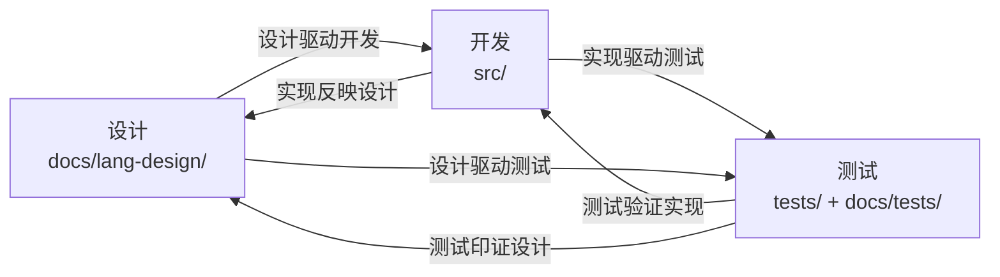

**锚定含义**：
1. **设计 ↔ 开发**：开发严格按设计文档实现；实现走了捷径或填满灰区时，必须按 §14.8 回写设计文档。
2. **开发 ↔ 测试**：每个功能点实现后必须有对应测试；测试结果反向验证实现的正确性。
3. **设计 ↔ 测试**：测试用例必须按设计文档的场景设计；测试覆盖矩阵必须与设计文档章节对应。

#### 9.4.2 测试严格按测试理论设计

**测试理论原则**：
1. **测试用例不是随意的**——必须按测试理论系统化设计（等价类划分、边界值分析、因果图、决策表、状态迁移等）。
2. **测试流与实际设计流和编译管道流能相互印证**——测试用例的组织反映编译流水线阶段结构。
3. **测试条例按标准测试设计书写和组织**——流程清晰、格式统一、可追溯（§9.7）。
4. **覆盖矩阵细粒度、深深度、广范围**——粒度足够细，深度足够深，范围足够广。

#### 9.4.3 负向/错误测试优先原则

> **核心要求**：错误/负向测试比正向测试更重要。

**理由**：
- 正向测试只能证明"功能在预期输入下工作"。
- 负向测试能证明"功能在非预期输入下不会出错、能正确报错"。
- 编译器的核心价值是**拒绝错误程序**——负向测试是验证这一价值的主要手段。

**强制比例：1:3+（正确:错误）**：

| 维度 | 要求 |
|------|------|
| **比例** | 正向测试 : 负向测试 ≥ 1 : 3（即 1 个正向至少配 3 个负向） |
| **下限** | 每个功能点至少 1 个正向 + 3 个负向 |
| **覆盖** | §7.1.1 的 7 类错误每类至少 1 个负向 |
| **复杂度** | 负向测试必须包含简单（单语句）+ 中等（多语句/多函数）+ 复杂（嵌套控制流/闭包/递归）+ 错误恢复 |

**审查强制规则**：
- QA 角色在投票前**必须**验证正负比例满足 1:3+。比例不达标自动触发 NEEDS REVISION。
- §7.3.1 的 ≥30 case 审计集中，负向 case 必须 ≥ 22 个（即 30 case 中至少 22 个负向，正向 ≤ 8 个）。
- §14.5 D3 维度（测试覆盖深度）必须验证正负比例。

### 9.5 测试矩阵覆盖率要求

**每进入下一阶段之前，测试矩阵需要满足近 100% 覆盖率。**

具体含义：
1. **功能覆盖率**：当前阶段计划的所有功能点都有对应的测试。
2. **回归覆盖率**：之前阶段的测试仍然通过（无回归）。
3. **边界覆盖率**：每个功能点至少有 1 个边界 case 测试。
4. **负向覆盖率**：§7.1.1 负向测试矩阵的 7 个类别都有覆盖。
5. **审计覆盖率**：§7.3.1 要求的 ≥30 case 审计每轮通过。
6. **流水线路径覆盖率**：测试用例必须按编译器编译流水线阶段全覆盖——每个流水线阶段都有对应的测试路径，阶段间集成测试覆盖所有相邻阶段对，全流程 E2E 测试覆盖从源码到运行时输出的完整路径。所有分支流（if/else、match arms、loop/break/continue、early return 等）都有测试覆盖。
7. **正负比例覆盖率**：所有功能点的正负测试比例满足 1:3+（§9.4.3）。

**"近 100%"** 的含义：允许 ≤5% 的功能点标记为 `DEFERRED`（有明确的推迟理由和计划），但不允许 `UNTESTED`（没有测试且没有推迟理由）。

#### 9.5.1 编译流水线测试路径覆盖矩阵

> **原则**：测试理论必须与设计理论对应——设计和测试相互印证。测试用例的设计不是随意的，而是根据编译器编译流水线的阶段结构系统化设计的。

**覆盖维度**（3 层 × N 阶段）：

| 层级 | 覆盖范围 | 测试设计要求 |
|------|---------|------------|
| **Tier 1: 阶段内** | 每个编译流水线阶段内部的各功能点 | 每个功能点至少 1 个正向 + 3 个负向测试（§9.4.3） |
| **Tier 2: 阶段间** | 相邻阶段的集成正确性 | 每对相邻阶段至少 1 个集成测试（如 Reader→Expander, Expander→Compiler） |
| **Tier 3: 全流程** | 从源码到运行时输出的完整路径 | run_ok 测试覆盖所有核心特性 + 边界 + 分支流 |

**编译流水线阶段全覆盖要求**：


每个箭头代表一个阶段间集成点，必须有对应的测试路径覆盖。

**分支流测试覆盖要求**：
- 控制流分支：if/else、match arms（含 or-pattern、wildcard、guard）、loop/break/continue、early return
- 数据流分支：struct/tuple/enum 构造与解构、方法调用（含链式）、闭包捕获、数组索引、字段访问（含嵌套）
- 类型系统分支：类型推断（含 Infer→具体）、类型注解、类型转换（as）、泛型（如支持）

**记录要求**：所有测试路径统计完整记录在 `docs/tests/pipeline-test-coverage.md` 单文件中，包含：
1. 每个测试的 ID、名称、覆盖的流水线阶段、预期输出、验证状态
2. 按层级汇总的覆盖率统计表
3. 未验证路径列表及原因
4. 正负测试比例统计

#### 9.5.2 测试用例书写与组织标准

> **原则**：测试条例需要按照标准测试设计书写和组织，流程清晰，测试流与实际设计流和编译管道流能相互印证。

**测试用例标准格式**（conformance tests）：
```kerf
// CATEGORY: <e2e|typecheck|reader|expander|compiler|vm|soundness|stdlib|integration>
// DESCRIPTION: <一句话描述测试目标>
// EXPECTED: <run_ok|compile_ok|compile_error>
// EXPECTED_STDOUT: <预期标准输出（run_ok 时必填，\n 表示换行）>
// EXPECTED_EXIT_CODE: <预期退出码（可选，默认 0）>
// ERROR_PATTERN: <错误模式（compile_error 时可选）>
// SOURCE: <来源 stage/round>
// POLARITY: <positive|negative>
```

**测试组织规则**：
1. 按编译流水线阶段分类（`00-reader`, `01-expander`, `02-compiler`, `03-vm`, `04-e2e`, `05-soundness`, `06-stdlib`, `07-integration`）
2. 每个分类下的测试按功能点命名：`<编号>-<功能描述>.kerf`
3. run_ok 测试必须有 `EXPECTED_STDOUT` 并实际运行验证
4. compile_error 测试必须有 `ERROR_PATTERN` 或验证编译失败
5. 新增/变更测试时必须同步更新 `docs/tests/pipeline-test-coverage.md`
6. **正负比例审查**：每个分类下的正负比例必须满足 1:3+，不达标的分类标记为 P1 缺陷

### 9.6 标准化 examples/ 目录结构

**examples/ 的定位**：可运行的演示程序（`cargo run --example <name>`），用于 (a) 展示 compiler 公共 API 用法、(b) 阶段审查时的手动审计脚本。**不是**测试套件——测试归 `tests/`（§9.1），审查归 `docs/develop/`。

#### 9.6.1 目录结构

```text
examples/
├── README.md                        # 索引 + 运行说明
├── usage/                           # API 用法演示（长期保留）
│   ├── basic_compile.rs             # compile() 基本用法
│   ├── macro_expansion.rs           # 宏展开演示
│   └── ...
└── audit/                           # 阶段审查脚本（历史归档，不再扩展）
    ├── stage0_gate_audit_r1.rs      # Stage 0 gate review round 1
    └── ...
```

#### 9.6.2 强制规则

1. **新 example 必须按 `examples/usage/` 或 `examples/audit/` 放置** — 不允许直接添加到 `examples/` 根目录。
2. **每个 example 必须有 `//!` 顶部文档注释** — 说明用途、运行方式、对应的阶段/轮次。
3. **`examples/usage/` 的 example 必须使用当前公共 API** — 编译失败的 example 视为 P1 缺陷（API 变更后必须同步更新）。
4. **`examples/audit/` 的 example 是历史归档** — 审查轮次结束后不再维护，但保留作为历史参考；若 API 变更导致编译失败，标记为 `#[allow(dead_code)]` 或移到 `examples/audit/legacy/`。
5. **`examples/README.md` 必须索引所有 example** — 按类别列出 + 运行命令 + 简要说明。

#### 9.6.3 命名规范

| 类别 | 命名 | 示例 |
|------|------|------|
| API 用法 | `<feature>.rs` | `macro_expansion.rs`, `closure_demo.rs` |
| 阶段审查 | `stage<N>_gate_audit_r<R>.rs` | `stage0_gate_audit_r3.rs` |
| 跨阶段审查 | `cross_stage_audit.rs` | — |
| 轮次审查 | `round<N>_audit.rs` | `round5_audit.rs` |

#### 9.6.4 与 tests/ 的区别

| 维度 | `tests/` | `examples/` |
|------|----------|-------------|
| 目的 | 自动化测试（CI 运行） | 手动演示 / 审计脚本 |
| 运行方式 | `cargo test` | `cargo run --example <name>` |
| 失败后果 | 阻断合并 | 不阻断（但 P1 缺陷需修复） |
| 文档要求 | `docs/tests/` 双向印证 | `examples/README.md` 索引 |
| API 变更 | 必须同步更新 | `usage/` 必须更新；`audit/` 可归档 |

#### 9.6.5 维护策略

1. **API 变更时**：必须检查 `examples/usage/` 是否编译失败；失败则立即修复（与 `src/` 改动同一轮次完成）。
2. **阶段闭合时**：该阶段的所有 `audit/` 脚本归档，不再维护。
3. **定期清理**：`audit/` 中超过 5 轮的中间审查脚本可移到 `examples/audit/legacy/`，只保留最新 + 关键轮次。

### 9.7 测试文档格式标准

每个测试文档（`docs/tests/v0/stage-N/plan/X.md`）必须包含：

```markdown
# <功能点> 测试计划

> **阶段**: Stage N.M
> **对应代码**: tests/v0/stage-N/plan/X_tests.rs
> **状态**: ✅ Complete / 🔄 In Progress / ⏳ Deferred

## 1. 测试目标
<一句话描述本测试文件验证什么>

## 2. 覆盖场景

| 场景 | 测试函数名 | 极性 | 状态 | 说明 |
|------|-----------|------|------|------|
| 正常用法 | test_X_basic | positive | ✅ PASS | ... |
| 边界 case | test_X_edge | positive | ✅ PASS | ... |
| 错误 case 1 | test_X_err_1 | negative | ✅ PASS | ... |
| 错误 case 2 | test_X_err_2 | negative | ✅ PASS | ... |
| 错误 case 3 | test_X_err_3 | negative | ✅ PASS | ... |

## 3. 测试统计
- 预期测试数: N
- 实际测试数: N
- 正向: N1
- 负向: N2（比例 N1:N2 = 1:K，K ≥ 3 ✓/✗）
- 覆盖率: 100%

## 4. 依赖
- <前置条件、依赖的模块等>
```

### 9.8 迁移策略 [§DEPRECATED v12.5]

> 迁移已完成（扁平测试已全部入 `tests/v0/stage-N/` 树，`tests/legacy/` 已清空移除）——本节保留作历史记录；新测试一律入 `tests/v0/stage-N/`。

对于现有的扁平 `tests/*.rs`：
1. **立即生效**：新测试必须按 `tests/v0/stage-N/plan/` 放置。
2. **现有扁平文件迁移到 `tests/legacy/`**：通过 `mod` 重导出保持可用。
3. **逐步迁移**：每个 stage 闭合时，将该 stage 的测试迁移到新结构。
4. **迁移完成标志**：`tests/legacy/` 中不再有该 stage 的直接测试文件。

---

## 10. API 命名标准

> **目的**：把跨阶段 audit（§14.6）发现的命名不一致问题固化为本流程的硬性规则，避免未来回归。
>
> **触发时机**：任何对 `src/` 下文件的修改都必须遵守本节规则。
>
> **执行者**：所有开发 Agent；REV-A 在代码审查时强制检查。

### 10.1 必须遵守的命名规则

1. **入口函数模式**：每个阶段必须暴露一个自由函数入口，模式为 `<verb>_<noun>(<data>: &<Type>, ...) -> <ReturnType>`。需要状态访问的调用者可以使用 struct 方法变体。
   - ✅ `reader::read_source(src, &mut interner)`
   - ✅ `expander::expand_form(&stx, &mut ctx)`
   - ✅ `compiler::compile_expr(&expr, &mut ctx)`
   - ✅ `vm::run(&bytecode, &mut runtime)`
   - ❌ 不允许只有 struct 方法入口（除非有明确的状态需求）

2. **上下文类型命名**：
   - lowering 上下文：`<Stage>LowerCtxt<'a>` 模式
     - ✅ `ExpanderCtxt`、`CompilerCtxt`
   - 分析上下文：`<Stage>Checker` 或 `<Stage>Resolver` 模式（-er 后缀）
     - ✅ `TypeChecker`、`Resolver`、`Reader`、`Parser`
   - 可插拔 trait：`<Verb>er` 模式
     - ✅ `Emitter` trait + `TextEmitter` 实现

3. **类型前缀**：
   - SyntaxObject 类型统一 `Stx` 前缀（`StxToken`、`SyntaxObject` 等）
   - CoreExpr 类型统一 `Ce` 前缀或无前缀（按模块路径限定）
   - Bytecode 类型统一 `Bc` 前缀（`BcInstruction`、`BcModule`）
   - 跨阶段共享的 ID 类型无前缀（`DefId`、`Span` 等）

4. **Re-export 风格**：每个阶段模块的 `mod.rs` **必须**使用显式 re-export 列表，**禁止** glob（`pub use X::*;`）。
   - ✅ `pub use kinds::{Type1, Type2, Type3};`
   - ❌ `pub use kinds::*;`
   - 每个 explicit re-export 列表前必须有注释说明约定

5. **单一真理源（DRY）**：跨阶段消费的类型必须有且仅有一处定义。跨阶段 re-export 通过 `pub use` 允许（用于向后兼容），但定义必须位于架构上正确的模块。
   - ✅ `DefKind` 定义在 `syntax::kinds`，`expander::module_tree` 通过 `pub use crate::syntax::DefKind;` re-export

6. **弃用约定**：违反 §11（接口隔离）的遗留入口必须标记 `#[deprecated(note = "...")]`，note 必须指向 §11 合规的替代方案。
   - ✅ `#[deprecated(note = "Use compile_expr (§11-compliant) or driver::compile instead")]`
   - 模块 re-export deprecated 项时必须用 `#[allow(deprecated)]` 包裹

7. **函数命名前缀**：
   - `read_`：reader 内部（`read_atom`、`read_list`）
   - `expand_`：expander 内部（`expand_form`、`expand_macro`）
   - `compile_`：compiler 内部（`compile_expr`、`compile_body`）
   - `run_`：vm 内部（`run_frame`、`run_instruction`）
   - `emit_`：codegen（`emit_header`、`emit_debug_info`）

8. **错误类型**：所有错误类型使用 `Error` 后缀（`ReadError`、`ExpandError`、`CompileError`、`RuntimeError`）。结构共享 `{ message: String, span: Span }` 最小形态。

### 10.2 审查检查清单

REV-A 在代码审查时必须验证以下项目：

- [ ] 没有新增 `pub use X::*;` glob
- [ ] 没有新增缺少正确阶段前缀的类型
- [ ] 没有新增缺少正确后缀（`Ctxt` / `-er`）的上下文类型
- [ ] 没有新增违反自由函数模式的入口
- [ ] 没有新增跨模块重复定义的类型（违反 DRY）
- [ ] 没有新增 `#[deprecated]` 但缺少 `note = "..."` 的项
- [ ] 如果移动了类型定义，旧模块必须 re-export 用于向后兼容
- [ ] 没有新增非英文代码注释（§10.5 单一编码语言标准——首选英语）
- [ ] 没有新增非英文错误提示/诊断消息/CLI 输出面（§10.5 第 1 款错误提示层——r139 立法）

### 10.3 违反后果

- **第一次违反**：REV-A 投 NEEDS REVISION，列出违反的规则编号
- **第二次违反**（同一 Agent 在同一阶段）：升级为 P2 缺陷，记录到 tech-debt-register.md（§6.2.1）
- **累计三次违反**：触发 §6.3 硬性退回条件，升级技术委员会仲裁

### 10.4 跨阶段 audit 中的命名审查

每次 §14.6 跨阶段深度审查必须包含命名标准化审查维度：
- 检查所有 `src/*/mod.rs` 是否使用 explicit re-export（无 glob）
- 检查所有阶段入口是否符合自由函数模式
- 检查所有上下文类型是否符合 `Ctxt` / `-er` 后缀约定
- 检查所有跨阶段共享类型是否符合 DRY（单一真理源）
- 检查所有 deprecated 项是否标记 `note = "..."` 指向替代方案

审查结果记录在 `gate-review-roundN.md` 中，违反项标记为 `L-NAMING-N`（命名债务），按 §6 缺陷等级评估优先级。

### 10.5 单一编码语言标准——首选英语（Single Coding Language Standard — English Preferred）

> **目的**：代码域（注释 + 错误提示 + 开发面消息）是跨语言协作的工程界面。混合语言代码域提高长期维护成本（检索/审阅/新人上手三面），必须统一语言与形态。**r139 立法升级**：由 r112「注释语言标准」升格为「单一编码语言首选-英语」——错误提示与开发面消息纳入强制英文域（r112 双豁免位中的错误消息豁免**撤销**——用户指令明文「将错误提示标准化」）。
> **触发时机**：任何对 `crates/`、`src/`、`tests/`、`tools/`、`examples/`、`scripts/` 下文件的注释、错误提示消息、panic/expect/assert 消息、CLI 输出面或诊断消息的新增或修改。
> **执行者**：所有开发 Agent；REV-A 在代码审查时强制检查（§10.2 清单末两项）。

1. **语言选择原则（单一编码语言首选-英语）**：代码域一律使用**标准化英文**书写，覆盖四层：
   - **注释层**（r112 立法沿袭）：Rust `//` / `///` / `//!`、kerf S-expr 语料 `;`、目标语法语料 `//`、TOML 与 Shell/Python 脚本 `#`；
   - **错误提示层**（r139 新增）：一切用户面诊断消息（E00xx 族）、Reader/Expander/Compiler/VM/Driver 错误消息、bootstrap `.krf`/`.ktf` 镜像消息——**双语侧字节级一致**（同一中文原文经单源字典翻译，双侧产物逐位相同——parity 守护前提）；
   - **开发面消息层**（r139 新增）：panic/expect/assert/unwrap 消息、测试断言锚文本、审计脚本期望面；
   - **CLI 输出面**（r139 新增）：usage 帮助、check/test/run 报告与汇总行。
   中文仅允许出现在三类位置：①设计文档（`docs/**` 的 `.md` 文件——文档不是代码，治理语料维持中文）；②**Unicode 能力测试夹具**（以 CJK 文本为被测对象本身的字符串数据——如 Reader CJK 字面量往返测试、字符串全序码点测试、test runner Unicode 截断边界——登记制白名单）；③worklog 历史记录与归档脚本（`scripts/archive/`——历史工件非活跃代码）。
2. **技术锚保留义务**：注释与消息中的条款号（`§X.Y`）、债务编号（`TD-xxx`）、轮次号（`rNNN`）、裁定号（`D6`/`L-A`/`C12`/`INFO-x` 等）、诊断码（`E00xx`）、标识符、crate 名、文件名、路径**原样保留不翻译**——它们是单源对账锚（§8.4.5 查询链的消费面）。
3. **形态标准**：模块级 `//!` = 一句话职责 + 入口清单；函数级 `///` 意图优先（说明 why 而非复述 what）；行内 `//` 简短；`///` 内**禁止** fenced code block（避免 doctest 语义）；注释行长度对齐周边代码行宽惯例（~100 列内）。消息层遵循 Rust 编译器惯例：小写开头、无句尾句号、`「X」`→`` `X` `` 反引号引号、全角标点转 ASCII、格式占位符（`{}`）逐位保留。
4. **存量治理**：历史中文按窗口化批量转换（r112 首轮注释全量清偿 ~12.7K 行；**r139 第二轮错误提示/开发面/CLI 面全量清偿 ~5.9K 字面量——单源字典驱动[消息同一中文原文恒得同一英文译文，双侧 parity 前提] + 测试/审计期望锁步 + 同窗缺陷清偿[r138 滞留审计锚 A09/P03 两件]**）；转换轮遵守语义不变纪律（消息文本变更但行为面不变——测试计数逐位维持），GATE 1 = 六命令全绿 + 测试计数逐位维持 + `rg` 代码域中文清零实证（白名单豁免件除外）+ 审计×6 EXIT 0 + CLI 双语法面零回归。
5. **新增违反后果**：REV-A 审查发现新增中文注释或中文错误提示 = P2 缺陷（规范类——§6.2），按 §10.3 升级路径处置。

---

## 11. 接口隔离

> **背景**：在阶段推进中发现，下游阶段直接调用上游阶段的内部函数，违反了阶段隔离原则。阶段之间应该通过明确的数据契约交互，而不是函数调用。

### 11.1 核心原则

**项目阶段之间通过明确的数据契约交互，禁止跨阶段直接调用内部接口。**

> 层级依赖的完整架构规则（混合务实策略、三层能力分类、Layer 0-6 单向分层）见 §2.4 核心架构原则——本节 §11 是其中“单向依赖 + 数据契约”在流程上的强制落地。

每个阶段（reader → expander → compiler → vm → runtime）是一个"管道节点"。节点之间应该：
1. **高内聚**：每个节点内部实现完整，不依赖其他节点的内部实现细节。
2. **低耦合**：节点之间通过明确的数据结构（SyntaxObject、CoreExpr、Bytecode、Value）交互，而不是函数调用。
3. **可替换**：任何节点可以被等价实现替换（例如把 reader 换成不同的实现，只要产出相同的 SyntaxObject 流，expander 不受影响）。
4. **组合优于继承**：节点之间通过组合数据流连接，而不是共享内部状态或互相调用私有函数。

### 11.2 允许的跨阶段访问

以下跨阶段访问是允许的，因为它们是**数据契约**的一部分：

1. **下一阶段读取上一阶段的输出数据结构**：
   - expander 读 reader 的 `Vec<SyntaxObject>`
   - compiler 读 expander 的 `CoreExpr`
   - vm 读 compiler 的 `Bytecode`
   - runtime 读 vm 的 `Value`
   - 这些都是"读上游产出的数据"，是管道的正常数据流。

2. **上一阶段定义的公共 API（明确导出的）**：
   - `expand_form` 如果被 `pub` 导出且文档明确说明"供下游使用"，则可以调用。
   - 但这种情况下应该考虑：是否应该把数据直接放在 CoreExpr 里，而不是让下游重新调用 expand 函数？

3. **公共的 ID 类型和工具类型**：
   - `DefId`、`Span` 等跨阶段共享的 ID 类型。
   - 这些是"基础设施"，不是"内部接口"。

### 11.3 禁止的跨阶段访问

以下跨阶段访问是禁止的，违反时必须在 gate review 中标记为 `L-PIPE-N`（Pipeline coupling debt）：

1. **跨 N 个阶段调用内部函数**：
   - 反例：vm（Stage 0）调用 `crate::reader::read_atom`（reader 的内部函数）。
   - 正确做法：reader 阶段就把原子读取结果放进 SyntaxObject 数据结构，vm 读 SyntaxObject 数据结构即可。

2. **下游阶段反向修改上游数据结构**：
   - 反例：vm 修改 reader 的 `SyntaxObject` 字段。
   - 正确做法：vm 只读 SyntaxObject，不修改；如果要修改，应该在上游阶段做。

3. **下游阶段依赖上游的内部实现细节**：
   - 反例：vm 依赖 compiler 用某种特定方式生成字节码这一实现细节。
   - 正确做法：compiler 应该把字节码信息完整写进 `Bytecode`，vm 只读 `Bytecode`。

4. **跨阶段共享可变状态**：
   - 反例：vm 持有 `Interner`（符号表）的 `&mut` 引用并修改它。
   - 正确做法：Interner 在 read 阶段就冻结，下游只读。

### 11.4 判定"是否违反隔离"的检查清单

在 gate review 中，reviewer 对每个跨阶段访问问以下问题：

1. **数据流向**：是"上游 → 下游"（正常）还是"下游 → 上游"（违规）？
2. **接口性质**：调用的是 `pub` 导出的公共 API，还是模块内部的 `fn` / `pub(crate)`？
3. **可替换性**：如果被调用的阶段换一个等价实现，调用方还能工作吗？
4. **数据契约**：被调用的函数返回的数据，是否本应该作为数据结构字段直接传递？
5. **修复成本**：消除这个耦合需要改多少个文件？如果 ≤3 个，应该立即修复；如果 >3 个，记 `L-PIPE-N` 并在后续 stage 修复。

### 11.5 实施要求

当发现违反 §11 的代码时：
1. **优先修复**：如果修复成本 ≤3 文件，本 stage 内修复。
2. **记录债务**：如果修复成本 >3 文件，记 `L-PIPE-N` 并在 gate review limitation 表中明确"修复需要什么"。
3. **数据下沉**：修复方式优先选择"把数据放进数据结构"而不是"让下游重新调用上游函数"。
4. **公共 API 标注**：如果某个函数确实需要被下游调用，必须 `pub` 导出并在文档注释中标注"跨阶段公共 API"。

### 11.6 例外情况

以下情况允许跨阶段调用：
1. **driver 层**：`driver.rs` 是"编排层"，可以调用所有阶段的入口函数（`read_source`、`expand_form`、`compile_expr`、`run`）。这是它的职责。
2. **测试代码**：测试可以调用任何内部函数来验证行为。
3. **examples/**：示例代码可以调用任何 `pub` API。
4. **临时 spike**：如果用最小方案验证想法（per §12.3），可以临时跨阶段调用，但必须在 worklog 记录"待修复"。

---

## 12. 解决方案选择：最优 > 最小

> **背景**：在设计与实现时，往往面临"最小改动"与"最优架构"二选一的决策。最小方案短期成本低，但会累积为长期技术债。本节把"选最优而非最小"从原则性陈述固化为流程规则。

### 12.1 核心原则

**当面对"最小改动"与"最优架构"二选一时，选最优架构。**

理由：
- 最小方案的"省下的工作量"是**短期收益**，但累积的"潜在问题复杂度"是**长期负债**。负债会按复利增长。
- 早期阶段（Stage 0-3）的架构债务利息最高——因为后续每一阶段都会基于当前架构叠加新功能，债务会被放大。
- 一步到位的重构成本通常只是最小方案的 2-3 倍，但能避免未来 N 次相同主题的"打补丁"工作（N 通常 ≥5）。

### 12.2 判定"最优"的标准

一个方案是"最优"而非"最小"，当且仅当满足以下至少一条：

1. **消除根因**：直接修复了问题的根本原因，而不是症状。
   - 反例：在 codegen 加 `if func is struct { emit insertvalue }` 是治症；在 `Res::Def` 加 `DefKind` 让 MIR lower 天然正确是治根。
2. **架构对齐**：让代码结构与语言规范/设计文档对齐。
3. **避免特例**：不需要在未来每次扩展时加 `if`/`match` 特例。
4. **跨阶段一致**：让 reader → expander → compiler → vm → runtime 的数据流一致，没有信息丢失或重新推导。

### 12.3 何时仍可选"最小方案"

最小方案在以下情况仍可接受：

1. **紧急通道（Expedited Lane，§6.5）**：P0 阻塞线上功能，先打补丁，下个迭代周期补根因修复。
2. **临时验证**：用最小方案快速验证一个想法是否可行（spike），验证完后要么补成最优方案，要么删除。
3. **最优方案依赖未就绪的前置条件**：例如最优方案需要 Stage 5 的某个基础设施，当前在 Stage 3，可以先打补丁但**必须在 worklog 和 dev-log 里记录"待 Stage 5 修复根因"**，并在该 stage 的 gate review 里列入 limitation 表。

### 12.4 实施要求

当选择最优方案时：
1. **必须更新 worklog 和 dev-log**：明确记录"放弃了最小方案 X，选择了最优方案 Y，理由是 Z"。
2. **必须更新受影响的设计文档**（per §8）：如果方案改变了某个阶段的公共数据结构，设计文档同步更新。
3. **必须更新所有 pattern match 点**：最优方案通常会改公共数据结构，所有 match 点必须同步更新，不能留 `// TODO: handle new variant`。
4. **gate review 必须验证"是否真的消除了根因"**：reviewer 不能只看"测试通过"就 APPROVED，必须验证根因确实被修复（例如：新增一个测试，明确验证"以前会走 hack 路径的 case 现在走的是正常路径"）。

### 12.5 反例记录

每个 gate review 报告中，如果发现当前实现有"治症不治根"的代码，**必须**在 limitation 表里标记为 `L-DEBT-N`（Technical Debt），并记录"根因修复需要什么"。这避免了技术债被遗忘。

---

## 13. 阶段切换与重构

### 13.1 阶段开始设计对齐

> **目的**：把"每阶段开始必须先对齐设计文档"从最佳实践固化为流程强制规则。设计文档（`docs/lang-design/`）是项目的设计意图基线，阶段规划必须以它为最高优先级参考。
>
> **触发时机**：每个**新阶段**（含子阶段）启动时的第一次规划。
>
> **执行者**：PM-A 主导规划，ARCH-A 协同解读设计文档，REV-A 审查规划与设计文档的一致性。

#### 13.1.1 对齐流程

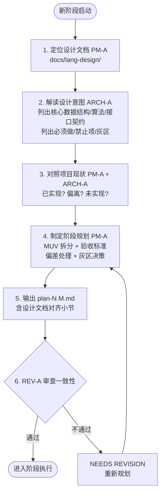

**设计文档定位（按阶段）**：
- Stage 0/1 → `01-core-forms.md` / `02-syntax-model.md` / `04-bytecode-vm.md`
- Stage 1 → `03-macro-system.md` / `06-operational-semantics.md`
- Stage 2 → `05-runtime.md` / `08-backend-evolution.md`
- Stage 3+ → `07-bootstrap-strategy.md` / `09-stdlib.md` / `10-toolchain.md`

#### 13.1.2 强制要求

1. **设计文档优先级最高**：当设计文档与"经验判断"或"互联网惯例"冲突时，以设计文档为准。如要偏离设计文档，必须在 plan 中显式声明"本阶段偏离 §X.Y，理由是 Z"，并在 §14.8 阶段末尾回写时同步更新设计文档。
2. **规划必须列对齐小节**：`plan-N.M.md` 必须包含"设计文档对齐"小节，最少包含：
   - 对应设计文档章节列表（带链接）
   - 设计意图摘要（3-5 句）
   - 已实现项 / 偏差项 / 未实现项
   - 本阶段灰区决策
3. **灰区决策不可省略**：设计文档未覆盖的灰区必须在 plan 中明确决策，不允许"边做边定"。
4. **沿用上一阶段 §14.8 输出**：上一阶段末尾回写的设计偏差清单必须在本阶段 plan 中显式处理（纠正 / 推迟 / 接受为永久偏差）。

### 13.2 阶段切换期：大胆但谨慎的重构

> **目的**：在当前阶段完全结束、新阶段尚未开始之间的"切换期"，是做架构重构的最佳时机——此时对当前阶段已交付成果零影响，对新阶段是干净基线。
>
> **核心理念**：大胆但谨慎——敢于改架构，但每一步都经过深思熟虑。这个时段是流水线重构、数据结构优化、错误系统重组、API 设计调整的最佳窗口。

#### 13.2.1 切换期重构聚焦的 6 个维度

| #   | 维度         | 重构内容                                                             | 风险等级 |
| --- | ---------- | ---------------------------------------------------------------- | ---- |
| 1   | **设计原则**   | 单一职责、单向流动、显式 > 隐式、报错 > 静默等 §2.3 原则的违反点                           | 低    |
| 2   | **数据结构选择** | 核心数据结构是否最优（SyntaxObject/CoreExpr/Bytecode 的字段布局、enum variant 设计） | 中    |
| 3   | **架构设计**   | 模块边界、阶段划分、跨阶段数据契约（§11）、架构原则符合性（§2.4）                     | 中    |
| 4   | **流水线组织**  | 编译管道是否有"回流"或"回查"反模式，是否有不必要的中间表示                                  | 高    |
| 5   | **错误系统**   | 错误类型层级、错误传播路径、错误恢复策略                                             | 中    |
| 6   | **API 设计** | 公共 API 命名（§10）、入口函数模式、re-export 风格                               | 低    |

#### 13.2.2 切换期重构流程

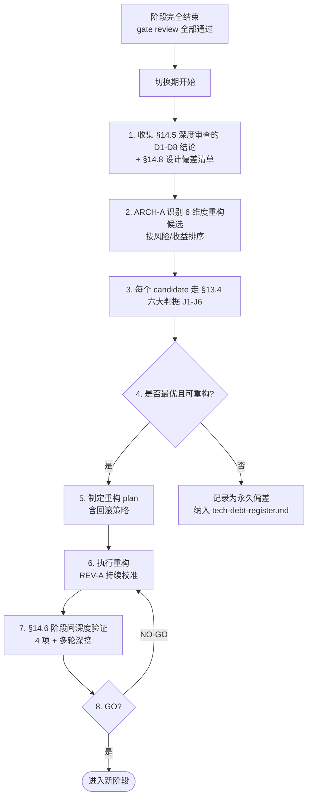

#### 13.2.3 切换期重构的强制规则

1. **大胆**：切换期允许破坏性变更（§13.3 早期阶段规则），不需要向后兼容。
2. **谨慎**：每个重构必须经过 §13.4 六大判据（J1-J6）检查。
3. **回滚就绪**：每个重构 plan 必须包含回滚策略（git revert / branch 隔离 / feature flag）。
4. **测试守护**：重构过程中 `cargo test` 必须零回归（除非显式标注"重构导致测试需更新"并同步更新）。
5. **文档同步**：重构后立即更新 `docs/lang-design/`、`docs/develop/`、`docs/graph/`（§15）。
6. **流水线重构的特殊地位**：切换期是流水线重构（§13.2.1 第 4 项）的最佳时机——因为流水线重构影响面最大，需要阶段隔离的环境。

### 13.3 开发阶段变动规则

> **背景**：本编译器项目当前处于**早期开发阶段**（Stage 0-3），代码变动频繁而且大量。在此阶段，**不需要考虑向后兼容**。
>
> 这意味着：
> - 可以自由重命名、删除、重构公共 API
> - 可以破坏性地修改数据结构
> - 可以移除旧代码而不保留 deprecated 标记
> - 可以删除不再使用的测试（但必须同步删除对应的代码）
>
> **当项目进入 v1.0 稳定阶段后**，本规则将失效，届时需要遵循语义化版本（SemVer）和向后兼容承诺。

**适用范围**：`src/` 所有模块、`tests/` 测试代码、`docs/` 设计文档、`examples/` 示例代码

**不适用范围**：`Cargo.toml` 的 `name`/`edition`、`LICENSE` 文件、已发布的 crate（目前 N/A）

**重构指导原则**：
1. **大胆重构**：如果发现更好的设计，直接改，不要为了"兼容旧代码"而保留过时的实现。
2. **删除优于注释**：不再使用的代码直接删除，不要注释掉保留。Git 历史会记录删除前的版本。
3. **测试随代码变**：重构代码时同步更新测试。删除代码时同步删除测试。
4. **文档随代码变**：重构后立即更新设计文档（per §8）。
5. **一步到位**：不要分多步"渐进迁移"——在早期阶段，一步到位的重构比渐进迁移更高效。
6. **开发期不要引入简写语法**：开发期不引入简写语法，稳定期才是好时机（整体引入）。

### 13.4 重构即架构设计

> **目的**：把"重构 = 组织结构设计"从原则性陈述固化为可操作的流程规则。当用户需求或代码触动"重构"时（无论是模块拆分、文件迁移、接口重组、目录结构调整），Agent 必须严格依据架构设计、编译相关表达、阶段划分、设计原则、组织结构做科学合理的划分，**不得把重构降级为"按 LOC 切片"的体力活**。
>
> **触发时机**：
> 1. 用户明确要求"重构 / 拆分 / 重新组织 / 重新分析"等关键词时
> 2. gate review 发现 LOC 超阈值（mod.rs > 1500 LOC）时
> 3. §14.5 深度审查 D1（架构健康度）识别职责混合时
> 4. §14.8 阶段末尾设计回写识别"实现偏离设计"且可重构时
> 5. §13.2 阶段切换期识别流水线重构机会时
>
> **执行者**：ARCH-A 主导架构分析，PM-A 制定拆分计划，REV-A 验证单一职责 + 单向流动合规。

#### 13.4.1 重构的六大判据

任何重构（拆分 / 合并 / 迁移 / 重组）在动手前必须先回答以下 6 个判据。**任一判据答"否"则该重构不合规**，需重新设计：

| #   | 判据           | 通过条件                                                                    | 反例                                                                                |
| --- | ------------ | ----------------------------------------------------------------------- | --------------------------------------------------------------------------------- |
| J1  | **架构设计对齐**   | 新结构与 `docs/lang-design/` 对应阶段设计文档的章节划分一致，或对设计文档未覆盖的灰区有明确决策              | 设计文档把 CoreExpr 分为 atom/compound/special 三层，重构却按 LOC 把 atom 拆成 atom_a / atom_b 两文件 |
| J2  | **单一职责**     | 每个新模块/文件承担且仅承担一个明确的职责（用一句话能描述）                                          | `utils.rs` 同时包含类型转换 + 错误格式化 + IO 助手                                               |
| J3  | **单向流动**     | 模块间依赖关系是无环有向图（DAG）。数据流方向与编译管线方向一致                                       | A 调用 B，B 调用 C，C 又调用 A（环依赖）                                                        |
| J4  | **编译相关表达完整** | 每个模块的"编译相关概念"（数据结构 / 算法 / 接口）在模块内是完整的，不被多个模块共享切割                        | 一个 trait 的定义在 A，impl 在 B，方法在 C——分散三个文件无内聚                                         |
| J5  | **阶段划分清晰**   | 新结构尊重编译管线阶段（reader → expander → compiler → vm → runtime），不破坏阶段隔离（§11）   | 重构后 compiler 直接调用 reader 内部函数                                                     |
| J6  | **科学合理粒度**   | 每个模块的 LOC 在合理区间（mod.rs 建议 < 1500 LOC；子模块建议 100-1500 LOC），且粒度由职责决定而非 LOC | 把 100 LOC 文件拆成 5 个 20 LOC 文件，纯粹为降 LOC                                             |

#### 13.4.2 重构执行流程

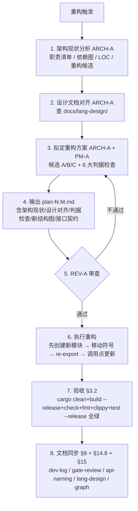

#### 13.4.3 反模式（禁止）

以下重构方式被本节明确禁止，违反时 REV-A 必须 NEEDS REVISION：

1. **按 LOC 切片**：把一个大文件按 N 行切成多个小文件，每个小文件承担多个职责。表面上 LOC 降了，实际职责混合更严重。
2. **隐藏环依赖**：拆分后看似模块清晰，实际通过 `super::` 互相调用形成环。必须用 §11.4 检查清单验证。
3. **跨阶段拆分**：把一个阶段（如 compiler）的代码拆到另一个阶段（如 vm）的目录下。违反 §11 接口隔离。
4. **空降新设计**：不查阅 `docs/lang-design/`，凭 Agent 主观判断"怎么拆合理"。必须先对齐设计文档（§13.1）。
5. **不留 re-export**：拆分后旧模块直接删除符号定义，导致下游调用点全部断裂。早期阶段虽允许破坏性变更（§13.3），但留 re-export 能显著降低回归风险。
6. **无判据记录**：`plan-N.M.md` 没有"6 大判据检查"小节，无法复核重构合理性。

#### 13.4.4 与 §12 的关系

| 协议 | 触发场景 | 关注重点 |
|------|---------|---------|
| §12 最优 > 最小 | 解决**单个问题**时，最小补丁 vs 根因修复 | 治根 vs 治症 |
| §13.4 重构即架构设计 | 解决**结构性问题**时，如何科学拆分 / 重组 | 单一职责 + 单向流动 + 设计对齐 |

§12 处理"一个问题两种解法"，§13.4 处理"一组结构如何重组"。两者互补：重构时通常先有 §13.4 的架构分析，再用 §12 的"最优 > 最小"原则选择具体实现方案。

### 13.5 设计-审查 Agent 循环

> **目的**：把"review agent 和 design agent 迭代审查与校准设计"从隐式协作固化为流程协议。设计不是一次成型，需要多轮迭代校准才能收敛到最优。
>
> **核心理念**：设计 Agent 和审查 Agent 是两个独立角色——设计 Agent 负责产出方案，审查 Agent 负责挑刺。两者迭代循环直到设计无缺陷且最优。
>
> **触发时机**：
> 1. 任何新设计（数据结构、API、模块拆分、流水线变更）开始时
> 2. §13.4 重构方案拟定阶段
> 3. §13.2 阶段切换期重构候选方案制定阶段
> 4. §14.5 深度审查发现设计缺陷需要重新设计时
>
> **执行者**：ARCH-A 作为设计 Agent 主导方案产出，REV-A 作为审查 Agent 主导缺陷识别与校准。

#### 13.5.1 循环结构

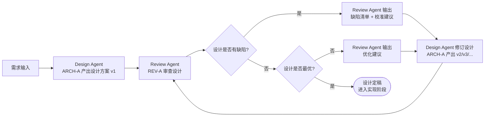

#### 13.5.2 强制规则

1. **角色分离**：设计 Agent（ARCH-A）和审查 Agent（REV-A）必须是不同 Agent，不能由同一 Agent 自审自校。
2. **缺陷分类**：审查 Agent 输出的缺陷必须按 §6 分级（P0/P1/P2/P3）：
   - P0 设计缺陷：会导致编译器 panic / soundness hole / 数据丢失——必须修复
   - P1 设计缺陷：会导致 API 错误 / 接口违反 §11 / 命名违反 §10——必须修复
   - P2 设计缺陷：边界条件处理 / 性能问题——优先修复
   - P3 设计建议：风格 / 措辞 / 微优化——可推迟
3. **校准建议具体**：审查 Agent 不能只说"这里有问题"，必须给出具体的校准建议（"建议改为 X，理由是 Y"）。
4. **设计 Agent 必须回应**：对每个缺陷/建议，设计 Agent 必须明确"采纳"/"拒绝"并说明理由。拒绝 P0/P1 必须有充分理由。
5. **循环上限**：设计-审查循环最多 5 轮。若 5 轮后仍有 P0/P1 未解决，升级到 PM-A + ARCH-B 仲裁。
6. **每轮产出文档**：每轮设计稿归档到 `docs/develop/v0/stage-N/<主题>-design.md`，审查清单归档到 `docs/develop/v0/stage-N/design-review-round<N>.md`（v12.5 实盘口径——原 design-v<N>.md 命名从未使用，实盘如 capability-model-design.md / i1-incision-migration-design.md）。
7. **定稿标记**：设计定稿时在文档头标注 `Status: Final`，后续实现严格按定稿执行。

#### 13.5.3 与其他协议的关系

| 协议                  | 角色                               | 与设计-审查循环的关系       |
| ------------------- | -------------------------------- | ----------------- |
| §13.1 阶段开始设计对齐      | Design Agent 输入                  | 提供设计文档基线          |
| §13.2 阶段切换期重构       | Design Agent + Review Agent 协作场景 | 切换期重构方案必须走循环      |
| §13.4 重构即架构设计       | 循环的具体应用                          | 重构方案必须走循环         |
| §14.5 深度审查 D5 设计合理性 | Review Agent 的输出依据               | D5 发现的设计缺陷触发循环    |
| §14.8 阶段末尾设计回写      | 循环的输出归档                          | 回写的设计偏差是下一阶段循环的输入 |

---

## 14. 深度审查协议

### 14.1 三层深度审查体系

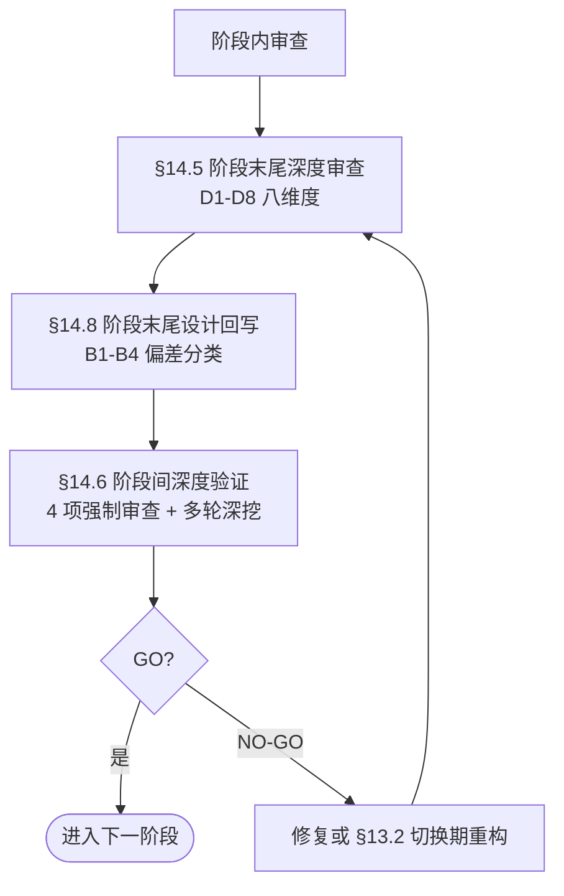

| 协议 | 触发时机 | 审查范围 | 输出 |
|------|---------|---------|------|
| §7.3 阶段门审查 | 每轮 gate review | 单阶段正确性（30+ case 审计） | gate-review-roundN.md |
| §14.5 阶段末尾深度审查 | 阶段切换点 | D1-D8 八维度全面审查 + 下一阶段就绪度 | deep-review-roundN.md |
| §14.6 阶段间深度验证 | 阶段切换前（§14.5 完成后） | 数据流覆盖 + 架构审查 + 三者覆盖 + 隐藏问题 + 多轮深挖 | architecture-review.md / design-impl-test-coverage.md / hidden-problems-assessment.md / refactoring-optimality-review.md / performance-baseline.md / final-assessment.md |
| §14.7 跨阶段架构审查 | 大阶段完成后 | 6 维度架构完整性 + §11 合规 + 数据流校验 | final-assessment.md 跨阶段章节（v12.5 裁定：原 cross-stage-audit.md 从未产出，职责实际由 §14.6 六件套承载） |

### 14.2 阶段末尾深度审查的 8 个维度（§14.5）

每次深度审查必须覆盖以下 8 个维度，每个维度输出"现状评估 + 风险分析 + 行动建议"三段式结论：

| #   | 维度               | 审查问题                                                                                                 | 输出                   |
| --- | ---------------- | ---------------------------------------------------------------------------------------------------- | -------------------- |
| D1  | **架构健康度**        | 当前阶段间接口隔离（§11）是否依然健壮？是否出现新的跨阶段耦合？数据流是否清晰？                                                            | 架构图 + 耦合点清单 + 重构建议   |
| D2  | **技术债清单**        | 累积了哪些 P2/P3 技术债？哪些是"可接受的"（有明确偿还计划），哪些是"危险的"（影响下一阶段）？                                                 | 技术债表 + 优先级排序 + 偿还计划  |
| D3  | **测试覆盖深度**       | 测试矩阵（§9）是否近 100%？是否有"孤立正确但集成失败"的风险？负向测试（§7.1.1）是否覆盖？**正负比例是否满足 1:3+（§9.4.3）**？                       | 覆盖率报告 + 缺漏清单 + 补测计划  |
| D4  | **下一阶段就绪度**      | 下一阶段（Stage N+1）需要当前阶段提供什么数据/接口？当前是否提供？差距在哪？                                                          | 就绪度清单 + 阻塞项 + 解阻计划   |
| D5  | **设计合理性**        | 当前阶段的核心数据结构/算法/接口是否设计合理？是否有“过度设计”或“设计不足”？是否符合 §2.4 核心架构原则（混合务实 + 单向/层级依赖）？各能力模型的处理程度是否与 §21.9 演进矩阵一致？                                                            | 设计评审 + 简化/增强建议       |
| D6  | **性能与可扩展性**      | 当前实现在规模增长时是否会成为瓶颈？是否有 O(n²) 或更差的算法？                                                                  | 性能基线 + 瓶颈分析 + 优化建议   |
| D7  | **文档与知识传承**      | 文档是否充分？新 Agent 能否仅凭文档理解当前架构？是否有"隐性知识"未记录？                                                            | 文档清单 + 缺漏项 + 补档计划    |
| D8  | **测试路径覆盖与流水线印证** | `docs/tests/pipeline-test-coverage.md` 是否完整覆盖编译流水线所有阶段、阶段间集成点、全流程 E2E？测试流与设计流/编译管道流是否相互印证？所有分支流是否覆盖？ | 路径覆盖矩阵 + 缺漏路径 + 补测计划 |

### 14.3 深度审查执行协议

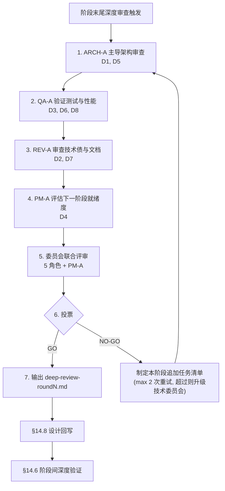

### 14.4 深度审查输出格式

每次深度审查必须输出 `docs/develop/v0/stage-N/deep-review-roundN.md`，包含以下结构：

```markdown
# Stage N 深度审查报告（Round M）

> 审查日期 / 审查者 / 基线版本 / 测试数

## 1. 执行摘要
- 一段话总结：当前阶段是否可以进入下一阶段？
- 阻塞项数量（P0/P1/P2）
- 建议行动：GO / GO-WITH-CONDITIONS / NO-GO

## 2. 八维度审查结论

### D1. 架构健康度
- **现状**：...
- **风险**：...
- **建议**：...

### D2. 技术债清单
| ID | 描述 | 优先级 | 偿还计划 |
|----|------|--------|---------|
| TD-001 | ... | P2 | Stage N+1 |

### D3. 测试覆盖深度
- 覆盖率：X%
- 正负比例：N_pos:N_neg = 1:K（K ≥ 3 ✓/✗）
- 缺漏：...
- 补测计划：...

### D4. 下一阶段就绪度
| 下一阶段需求 | 当前状态 | 差距 | 解阻计划 |
|-------------|---------|------|---------|
| ... | ✅/⚠️/❌ | ... | ... |

### D5. 设计合理性
- 过度设计：...
- 设计不足：...
- 建议：...

### D6. 性能与可扩展性
- 性能基线：...
- 瓶颈：...
- 优化建议：...

### D7. 文档与知识传承
- 文档完整度：X%
- 隐性知识：...
- 补档计划：...

### D8. 测试路径覆盖与流水线印证
- 路径覆盖矩阵：...
- 缺漏路径：...
- 补测计划：...

## 3. 委员会投票
| 角色 | 投票 | 理由 |
|------|------|------|
| ARCH-A | GO / NO-GO | ... |
| DEV-A | GO / NO-GO | ... |
| QA-A | GO / NO-GO | ... |
| ALG-C | GO / NO-GO | ... |
| SKL-A | GO / NO-GO | ... |

## 4. 行动计划
- 本阶段追加任务（如有）：...
- 下一阶段优先任务：...
- 技术债偿还顺序：...

## 5. 结论
GO / GO-WITH-CONDITIONS / NO-GO

## 6. 设计偏差清单（§14.8）
| 设计文档章节 | 偏差类型 | 偏差描述 | 最优判断 | 重构判断 | 回写动作 |
|-------------|---------|---------|---------|---------|---------|
| ... | B1/B2/B3/B4 | ... | ... | ... | ... |
```

### 14.5 阶段末尾深度审查协议

> **目的**：在每个阶段末尾（review / gate / 收敛轮次 / 阶段切换点）执行深度架构审查，主动分析"当前项目的设计、实现、架构是否足够支撑进入下一阶段"，识别技术债并制定偿还计划。
>
> **核心理念**：阶段切换点是技术债影响最大的节点——一个在 Stage N 可以用 1 小时修复的设计缺陷，到 Stage N+2 可能需要 1 周重构。因此阶段末尾是做优化和重构的最佳时机。本协议把"深度审查"从可选行为升级为强制行为。
>
> **触发时机**：
> 1. 每个**大阶段**（Stage 0/1/2/3/4/5）的最末轮 gate review
> 2. 每个**子阶段**（如 Stage 3.63, 3.64...）的收敛轮（§7.3.3 收敛后）
> 3. 用户明确要求"深度审查"或"跨阶段审查"时
> 4. 连续 3 轮 gate review 收敛后（§7.3.3），在进入下一大阶段前
>
> **执行者**：ARCH-A 主导，QA-A 验证，REV-A 审查，PM-A 协调。

#### 14.5.1 完成标准

深度审查完成需满足：
1. 8 个维度全部审查（D1-D8）
2. 每个维度有明确的"现状 + 风险 + 建议"三段式结论
3. 技术债清单完整（所有 P2/P3 项有 ID、优先级、偿还计划）
4. 下一阶段就绪度清单完整（每个需求有状态 + 差距 + 解阻计划）
5. 委员会投票完成（5 角色全部投票）
6. 行动计划明确（GO / GO-WITH-CONDITIONS / NO-GO + 具体任务）
7. 报告输出到 `docs/develop/v0/stage-N/deep-review-roundN.md`
8. **正负测试比例满足 1:3+**（§9.4.3）

#### 14.5.2 何时可以跳过深度审查

以下情况可以跳过 §14.5 深度审查（但必须在 worklog 中记录跳过理由）：
1. **非阶段切换点的普通轮次**——只需 §7.3 阶段门审查
2. **紧急修复轮次**（§6.5 紧急通道）——修复后补审
3. **纯文档更新轮次**——无代码变更

**不可跳过的情况**：
- 任何大阶段（Stage 0/1/2/3/4/5）的最末轮
- 连续 3 轮收敛后进入下一大阶段前
- 用户明确要求时

#### 14.5.3 深度审查发现的问题处理

| 问题类型 | 处理方式 |
|---------|---------|
| 阻塞下一阶段的 P0/P1 | **必须本阶段修复**，不允许带入下一阶段 |
| 影响下一阶段的 P2 | 本阶段修复或制定明确的 Stage N+1 修复计划 |
| 不影响下一阶段的 P2/P3 | 记录为技术债，按 D2 排序偿还 |
| 设计缺陷（D5） | 评估修复成本：≤3 文件则本阶段修复，否则 §13.2 切换期修复 |
| 性能瓶颈（D6） | 除非影响功能正确性，否则记录为 Stage N+2 优化项 |

### 14.6 阶段间深度验证与架构审查协议

> **目的**：在当前阶段末尾之后、下一阶段开始之前，执行全面的深度验证和架构审查，确保项目具备足够强大的基础进入下一阶段。
>
> **核心理念**：阶段切换不仅是"当前阶段完成"的确认，更是"下一阶段可以安全开始"的前置条件。隐藏的问题不会因为进入下一阶段而消失，反而会因为新功能的叠加而变得更复杂、更难修复。因此必须在阶段间执行深度验证，经团队多轮商讨审核通过后才算正式通过。
>
> **触发时机**：
> 1. 每个大阶段（Stage 0/1/2/3/4/5）的最终 gate review 通过后
> 2. 连续 3 轮收敛后进入下一大阶段前
> 3. 用户明确要求"深度审查 / 数据流覆盖 / 架构审查"时
> 4. §14.5 深度审查发现需要进一步验证的问题时
>
> **执行者**：ARCH-A 主导架构审查，QA-A 验证数据流覆盖，REV-A 审查重构最优性，PM-A 协调文档输出。

#### 14.6.1 四项强制审查

阶段间深度验证必须依次完成以下 4 项审查。**任一项未通过则阶段切换不允许进行**。

##### 14.6.1.1 数据流覆盖分支检测（完整性审查）

> **要求**：所有枚举和分支全覆盖（不能缺失），且不能静默处理。

审查内容：
1. **枚举全覆盖**：检查每个 `enum` 的所有 variant 是否在所有 `match` 语句中被显式处理（或有意用 `_` 并注释原因）
2. **无静默处理**：检查所有 `_ => {}` catch-all 是否有明确注释说明为什么静默是安全的。无注释的 catch-all 视为违规
3. **错误路径覆盖**：检查所有 `Result`/`Option` 的 `Err`/`None` 路径是否有处理（不能静默 `.unwrap()` 或 `.expect()` 代替错误处理）
4. **流水线阶段覆盖**：按编译管道（reader → expander → compiler → vm → runtime → driver）逐阶段检查

输出：`docs/tests/pipeline-test-coverage.md` 中的完整性审查小节，含每个阶段的 catch-all 计数、静默处理清单、修复状态。

##### 14.6.1.2 架构设计审查

> **要求**：审查架构是否完整、是否符合要求、结构是否清晰、是否高效、是否易于扩展。

审查内容（按编译管道逐阶段）：
1. **完整性**：当前阶段是否覆盖了语言规范的所有功能？
2. **设计对齐**：实现是否与 `docs/lang-design/` 设计文档一致？
3. **结构清晰性**：模块职责是否单一（§13.4 J2）？依赖是否无环（J3）？
4. **效率**：是否有 O(n²) 或更差的算法？是否有不必要的 clone？
5. **扩展性**：添加新功能（新 token、新 AST 节点、新字节码指令）的难度如何？是否需要修改大量调用点？

输出：`docs/develop/v0/stage-N/architecture-review.md`，含每阶段架构评分（✅ 优秀 / ⚠️ 需改进 / ❌ 有问题）和改进建议。

##### 14.6.1.3 设计-实现-测试三者覆盖

> **要求**：测试需要完整覆盖设计，实现能完整反映设计，三者相互印证（§9.4 锚定原则）。

审查内容：
1. **设计 → 实现**：设计文档中的每个功能点是否在代码中实现？列出"设计要求但未实现"清单（B1 偏差，§14.8.1）
2. **实现 → 测试**：代码中的每个功能是否有对应的测试用例？列出"已实现但未测试"清单
3. **测试 → 设计**：测试用例是否覆盖了设计文档中的所有场景？列出"设计要求但未测试"清单
4. **三者一致性**：设计、实现、测试三者描述的行为是否一致？列出"三者不一致"清单

输出：`docs/develop/v0/stage-N/design-impl-test-coverage.md`，含三列对照表（设计点 / 实现状态 / 测试状态）和差距清单。

##### 14.6.1.4 隐藏问题与下一阶段就绪度

> **要求**：当前隐藏的问题是否不会因为进入下一阶段而变得更多和更复杂？

审查内容：
1. **隐藏问题清单**：列出所有已知的隐藏问题（技术债、设计缺陷、性能瓶颈），按"进入下一阶段后的复杂度增长"排序
2. **复杂度增长评估**：每个隐藏问题如果不修复就进入下一阶段，其修复难度会如何变化？（不变 / 2× / 5× / 指数增长）
3. **下一阶段就绪度**：下一阶段需要当前阶段提供什么数据/接口？当前是否提供？差距在哪？
4. **强制修复项**：复杂度增长 ≥ 2× 的隐藏问题必须在本阶段修复

输出：`docs/develop/v0/stage-N/hidden-problems-assessment.md`，含隐藏问题表 + 复杂度增长评估 + 下一阶段就绪度清单。

#### 14.6.2 重构最优性审查

> **要求**：团队审查当前这次重构和优化是否是最为合理最优的。

审查内容：
1. **重构方案评估**：每个已执行的重构是否选择了最优方案（§12）？是否有"治症不治根"的 hack？
2. **数据结构审查**：核心数据结构是否是最优设计？是否具备强扩展、强灵活和高效等编译数据结构组织能力？
3. **管道流程审查**：编译管道的数据流是否最优？是否有不必要的中间表示？是否有"回流"或"回查"反模式？
4. **遗漏审查**：有哪些应该做但被跳过的重构？跳过理由是否充分？

输出：`docs/develop/v0/stage-N/refactoring-optimality-review.md`，含重构评分表 + 数据结构评分表 + 遗漏清单。

#### 14.6.3 多轮深挖验证

> **要求**：需要反复深入到项目细节和深处，经过多轮甚至十几轮的深挖，团队商讨审核通过之后才算正式通过。

执行协议：
1. **最低轮数**：阶段间深度验证至少 3 轮，每轮由不同 Agent 独立执行
2. **发现即修**：每轮发现的问题必须当轮修复或制定明确的修复计划
3. **遗留问题文档**：如果存在遗留问题，必须做相关文档和修复规划
4. **团队商讨**：所有轮次完成后，委员会联合评审（§6.3 外循环投票），5 角色全部投票 GO 才算正式通过
5. **用户确认**：最终结论需用户确认后才算正式通过

#### 14.6.4 性能测试标准

> **要求**：注意性能测试和相关问题，需要关注和相关评测以及相关文档的标准构建、组织、维护更新等。

执行协议：
1. **性能基线**：每个大阶段末尾必须建立性能基线（编译时间 + 运行时间）
2. **性能文档**：性能基线记录在 `docs/develop/v0/stage-N/performance-baseline.md`
3. **性能回归检测**：每次代码变更后运行性能基线，对比是否有回归
4. **性能热点识别**：识别 O(n²) 或更差的算法，记录为优化候选
5. **性能文档维护**：`docs/tests/pipeline-test-coverage.md` 中维护性能基线表，每次变更同步更新

#### 14.6.5 自我强化与迭代

> **要求**：如果在开发和设计中需要什么工具或者其他内容，Agent 都可以根据相关标准流程和结构组织去组织并补充相关文档和组织结构。
>
> **与 §6.6.1 的关系**：本节关注"**项目资产层**"的自我强化（工具/文档/组织结构补充），§6.6.1 关注"**流程层**"的校准数据池（轮次偏差/误分类率/集成覆盖率统计）。两者职责互补，不重叠——本节的"补充新文档"动作本身应作为 §6.6.1 校准数据池中的一条记录。

执行协议：
1. **工具补充**：Agent 发现需要新工具时，可直接创建并补充文档（如 `tools/debug/` 下的新命令），归档按 §3.4；同时在 §6.6.1 calibration-data.md §3 历史教训归档追加一条"工具补充"记录。
2. **文档补充**：Agent 发现需要新文档时，可直接创建并补充到 `docs/` 对应目录；同时更新 §8.4 对应目录树。
3. **组织结构**：Agent 发现需要新的目录或组织结构时，可直接创建并补充说明文档；同时更新 §8.4.1 顶层目录结构图。
4. **标准遵循**：所有补充必须遵循 §10 API 命名标准化 + §13.4 重构六大判据 + §11 接口隔离。
5. **流程校准同步**：每次自我强化动作（1-3）都应触发 §6.6.1 calibration-data.md 的"流程优化历史"表追加一行（Stage N.M + 优化项 + 触发依据 + 效果）。

#### 14.6.6 输出文档集合

阶段间深度验证完成后，必须输出以下文档集合作为阶段性总结和下一阶段的准备工作：

| 文档 | 位置 | 内容 |
|------|------|------|
| 数据流覆盖审查 | `docs/tests/pipeline-test-coverage.md` | 完整性审查小节 |
| 架构设计审查 | `docs/develop/v0/stage-N/architecture-review.md` | 每阶段评分 + 建议 |
| 设计-实现-测试覆盖 | `docs/develop/v0/stage-N/design-impl-test-coverage.md` | 三列对照表 |
| 隐藏问题评估 | `docs/develop/v0/stage-N/hidden-problems-assessment.md` | 问题表 + 就绪度 |
| 重构最优性审查 | `docs/develop/v0/stage-N/refactoring-optimality-review.md` | 评分表 + 遗漏清单 |
| 性能基线 | `docs/develop/v0/stage-N/performance-baseline.md` | 编译+运行基线 |
| 最终评估 | `docs/develop/v0/stage-N/final-assessment.md` | 综合结论 + GO/NO-GO |
| worklog 同步 | `docs/worklog.md` | 所有阶段间验证记录 |

### 14.7 跨阶段架构审查协议

> **目的**：当完成项目对应阶段的所有 stage review 之后，必须执行一次跨阶段深度审查，确保编译流水线的架构完整性。这不是常规的 gate review（§7.3），而是一次**架构级审计**，覆盖阶段内路径、阶段间路径、管道数据流、接口隔离等维度。
>
> **触发时机**：当一个大阶段（如 Stage 3）的所有子阶段完成后，或当用户明确要求"跨阶段审查"时。
>
> **执行者**：ARCH-A 主导，QA-A 验证，REV-A 审查。
>
> **v12.5 产物裁定（ARCH-A）**：本协议输出物 `cross-stage-audit.md` 自 Stage 1 起从未产出，其职责实际由 §14.6 六件套（含 final-assessment.md）承载。裁定：输出物改指 final-assessment.md 的跨阶段审查章节（C1-C6 维度清单保留）；Stage 1（r16）/ Stage 2（r37）/ Stage 3（r52）三次收口视为已按本裁定履行（回溯锚定——依据 §8.4.5 规则 2 文档以实盘为准）。

#### 14.7.1 审查维度

跨阶段深度审查覆盖以下 6 个维度（编号 C1-C6 以避免与 §14.5 D1-D8 冲突）：

| # | 维度 | 审查内容 | 验证方法 |
|---|------|---------|---------|
| C1 | 阶段内路径覆盖 | 每个阶段内部的所有代码路径是否完整覆盖 | 检查测试矩阵 §9，确认每个功能点都有测试 |
| C2 | 阶段间路径覆盖 | 阶段之间的数据流路径是否完整 | 检查 driver.rs 中每个阶段交接点，确认数据正确传递 |
| C3 | 高内聚低耦合 | 每个阶段是否高内聚（职责单一）、低耦合（通过数据契约交互） | grep 检查跨阶段函数调用，确认零违规 |
| C4 | 可插拔可替换 | 每个阶段是否可被等价实现替换 | 检查是否有 trait 接口，是否有数据驱动的元数据传递 |
| C5 | 数据流校验 | 所有数据流路径是否正确传递，无丢失或损坏 | 检查 CompileResult 的字段是否被正确填充和消费 |
| C6 | 路径缺漏补充 | 是否存在未覆盖的代码路径或数据流 | 检查错误处理路径、边界条件、特殊类型 |

#### 14.7.2 §11 合规验证清单

跨阶段审查必须验证以下 §11 合规项：

| 检查项                            | 验证方法                                       | 通过标准                  |
| ------------------------------ | ------------------------------------------ | --------------------- |
| compiler 不调用 reader::read_atom | `grep "crate::reader::read" src/compiler/` | 零匹配（注释除外）             |
| vm 不调用 compiler 内部             | `grep "crate::compiler::" src/vm/`         | 零匹配（数据类型引用除外）         |
| compiler 不调用 driver            | `grep "crate::driver" src/compiler/`       | 零匹配（数据类型引用除外）         |
| driver 是唯一 reader 调用者          | 检查所有阶段的入口                                  | 只有 driver 直接调用 reader |
| 元数据预计算                         | 检查 CompileResult 字段                        | 所有字段均预计算              |
| 无 glob exports                 | `grep "pub use.*::\*" src/*/mod.rs`        | 零匹配                   |
| 错误路径覆盖                         | 检查所有 has_errors() 调用                       | 零 unchecked 调用        |

#### 14.7.3 数据流完整性校验

跨阶段审查必须验证以下数据流路径：

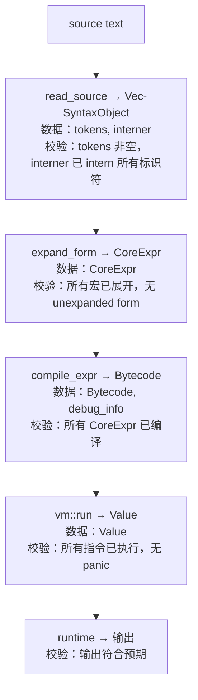

#### 14.7.4 审查完成标准

跨阶段审查完成需满足：
1. 6 个维度全部通过（C1-C6）
2. §11 合规验证清单全部 ✅
3. 数据流完整性校验全部通过
4. 发现的问题全部修复（P0/P1 必须修复，P2 可记录为技术债）
5. 所有测试通过（cargo test 0 failures）
6. clippy 0 warnings，fmt 通过

#### 14.7.5 审查频率

- **常规**：每个大阶段（Stage 0/1/2/3/4/5）完成后执行一次
- **强制**：当用户明确要求"跨阶段审查"时
- **可选**：当连续 3 轮 gate review 收敛后（§7.3.3），可在下一轮加入跨阶段审查维度

### 14.8 阶段末尾设计回写协议

> **目的**：在每个**大阶段末尾**结束前，强制对照 `docs/lang-design/` 对应阶段文档与项目实际实现，深入思考"理论设计 vs 现实实现"的偏差，判断二者一致性、当前最优、是否可重构实现，结论同步回写设计文档。这是把 §13.1（阶段开始设计对齐）形成闭环的关键协议——开始时读设计，结束时写设计，避免设计文档与实现长期脱节。
>
> **核心理念**：理论设计是基线，现实实现是事实。两者必然存在偏差（设计的灰区被实现填满、实现走了捷径偏离设计、设计本身需要修正）。偏差不可怕，可怕的是不识别、不记录、不修正。本协议把"偏差识别与回写"从可选行为固化为强制行为。
>
> **触发时机**：
> 1. 每个**大阶段**（Stage 0/1/2/3/4/5...）的最末轮 gate review
> 2. 连续 3 轮收敛后进入下一大阶段前
> 3. 用户明确要求"对照设计文档审查"时
> 4. §14.5 深度审查 D5（设计合理性）识别设计偏差时
>
> **执行者**：ARCH-A 主导偏差分析，REV-A 验证回写准确性，PM-A 协调纳入下一阶段计划。

#### 14.8.1 偏差分类

理论设计 D（来自 `docs/lang-design/`）与现实实现 I 之间存在 4 类偏差：

| 偏差类型           | 描述               | 处理方式                                        |
| -------------- | ---------------- | ------------------------------------------- |
| **B1 实现 < 设计** | 设计要求但实现未做（设计超前）  | 纳入下一阶段计划（§13.1 沿用）                          |
| **B2 实现 > 设计** | 实现做了但设计未要求（实现超前） | 评估是否补写设计文档（如属于"灰区填满"则补写）                    |
| **B3 实现 ≠ 设计** | 实现与设计冲突（实现走了捷径）  | 评估哪种更优：若实现更优 → 更新设计文档；若设计更优 → 纳入重构计划（§13.4） |
| **B4 设计灰区**    | 设计未覆盖但实现已做（设计滞后） | 必须补写设计文档（实现即事实）                             |

#### 14.8.2 回写流程

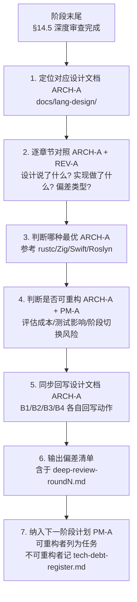

#### 14.8.3 强制要求

1. **大阶段末尾必须执行**：跳过 §14.8 的 deep-review 报告不允许 PASS，必须 NEEDS REVISION 补做。
2. **偏差清单不可省略**：`deep-review-roundN.md` 必须包含"设计偏差清单"小节。即使所有章节都"实现 = 设计"，也必须明确写"无偏差"，并附逐章节对照记录。
3. **回写设计文档是单向的**：只允许"实现 → 设计"回写（把现实实现反映到设计文档），不允许"设计 → 实现"硬塞（让设计文档强行描述未实现的特性）。后者属于 B1，应纳入下一阶段计划。
4. **回写内容最小化**：设计文档只记录"设计 + 理由"，不记录实现细节。实现细节归 `docs/develop/v0/stage-N/dev-log.md`。
5. **可重构不等于立即重构**：B3 偏差即使判定"可重构"，也不强制本阶段立即重构。最佳时机是"本阶段完全结束、新阶段未开始时"（§13.2 切换期重构）——此时重构对当前阶段已交付成果零影响，对新阶段是干净基线。

#### 14.8.4 偏差清单输出格式

```markdown
## 6. 设计偏差清单（§14.8）

| 设计文档章节 | 偏差类型 | 偏差描述 | 最优判断 | 重构判断 | 回写动作 |
|-------------|---------|---------|---------|---------|---------|
| 04-bytecode-vm.md §2.1 顶层结构 | B3 | 设计要求 Bytecode 含 `debug_info: DebugInfo`，实现用 `debug_info: DebugInfo` ✓ | 二者等价 | N/A | 无 |
| 04-bytecode-vm.md §3.2 Instruction | B1 | 设计要求 `is_debug: bool` 字段，实现未做 | 设计更优（影响调试信息） | 可重构（≤3 文件） | 纳入 Stage 1.X 计划 |
| 05-runtime.md §4 GC | B4 | 实现已做 GC roots 收集，设计文档无此章节 | 实现即事实 | N/A | 补写 05-runtime.md §4.X GC roots |
```

#### 14.8.5 与 §13.1 / §13.4 的闭环关系

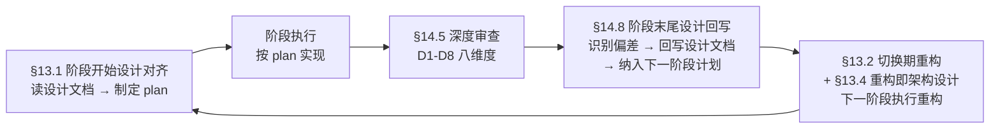

四者形成"读设计 → 实现 → 审查 → 回写 → 重构 → 读设计"的完整闭环。任一环节缺失都会导致设计文档与实现长期脱节，最终演变为"文档是文档、代码是代码"的双轨制——这是项目失控的典型先兆。

### 14.9 阶段末尾系统性代码整理协议

> **目的**：当处于一个阶段的末尾时（处理时机：§14.5 深度审查通过后、§14.8 设计回写完成后、阶段切换前），必须对整个项目进行系统性全面代码的整理。这不是可选的"美化"——而是确保代码库在进入下一阶段前处于"干净基线"状态的强制协议。
>
> **核心理念**：阶段切换是代码库"熵减"的最佳时机。一个阶段内积累的技术债（注释过时、命名不一致、文件头缺失、同类代码分散）如果不在此节点清理，会在下一阶段被新代码"继承"和"扩散"。本协议把"系统性代码整理"从可选行为固化为强制行为。
>
> **触发时机**：
> 1. §14.5 深度审查通过后
> 2. §14.8 设计回写完成后
> 3. 阶段切换前（§13.2 切换期）
>
> **执行者**：DEV-A 主导执行，REV-A 审查整理质量，PM-A 确认完成。

#### 14.9.1 整理维度（6 项强制检查）

| #      | 维度             | 检查内容                                                                                                                                                                | 验证方法                                                                                   |                |
| ------ | -------------- | ------------------------------------------------------------------------------------------------------------------------------------------------------------------- | -------------------------------------------------------------------------------------- | -------------- |
| **C1** | **代码清洁**       | 删除死代码（unused imports/functions/variables）、删除被注释掉的代码块、删除 TODO/FIXME 中已完成的项                                                                                           | `cargo build` 0 warnings + `cargo clippy -- -D warnings` 0 warnings                    |                |
| **C2** | **同类聚块**       | 同类功能代码聚集在同一模块/文件内，不分散在多处。同一抽象层级的代码在同一目录。跨模块引用通过 `pub use` 显式导出（§10），不通过 glob re-export                                                                              | 人工审查目录结构 + `grep -r "pub use"` 确认无 `*` 通配符                                             |                |
| **C3** | **注释时效同步**     | 所有 `// Stage N` 注释中的 Stage 编号与当前版本一致。设计文档引用的章节编号准确。删除引用已删除代码的注释。更新因重构而失效的注释                                                                                         | `grep -rn "Stage [0-9]" src/` 人工审查 + `grep -rn "TODO\|FIXME\|HACK\|XXX" src/` 确认每个项仍有效 |                |
| **C4** | **文件头信息检查**    | 每个模块的 `//!` 文件头注释准确描述当前职责（不是过时的旧描述）。`Stage N` 标记与实际版本一致。文件头不描述已删除的功能                                                                                                | 逐文件人工审查 `//!` 文件头                                                                      |                |
| **C5** | **API 命名规范检查** | 所有 `pub fn` / `pub struct` / `pub enum` 遵循 §10 命名规则（`<verb>_<noun>` / `UpperCamelCase` / `UPPER_SNAKE_CASE`）。无缩写不一致（如 `fmt` vs `format` 混用）。无 Hungarian notation 残留 | `grep -rn "pub fn\|pub struct\|pub enum\|pub type" src/` 人工审查                          |                |
| **C6** | **数据结构与流标准化**  | 数据结构定义在正确的模块（§11 接口隔离）。数据流向清晰：driver → reader → expander → compiler → vm → runtime，无逆向依赖。`CompileResult` 字段命名一致。`pub` 可见性最小化（无不必要的 `pub`）                           | 人工审查 `src/` 目录结构 + `grep -rn "pub " src/                                               | wc -l` 确认无过度暴露 |

#### 14.9.2 执行流程

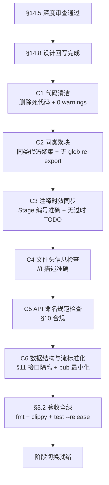

#### 14.9.3 完成标准

系统性代码整理完成需满足：
1. 6 项检查全部完成（C1-C6）
2. `cargo fmt --check` 0 diff
3. `cargo clippy --all-targets -- -D warnings` 0 warnings
4. `cargo test --release` 全绿
5. 无死代码（`grep -rn "TODO\|FIXME\|HACK\|XXX" src/` 中每项都有明确理由或计划）
6. 无 glob re-export（`grep -rn "pub use.*::\*" src/` 结果为空或每项有明确理由）
7. 整理报告（简要）记录在 `docs/worklog.md` 的阶段末尾段落中

#### 14.9.4 与 §14.5 / §14.8 的关系

```text
§14.5 深度审查（架构层面：设计是否足够？）
  ↓
§14.8 设计回写（文档层面：设计 vs 实现偏差？）
  ↓
§14.9 代码整理（代码层面：代码是否干净？）
  ↓
§3.2 验收全绿 → 阶段切换就绪
```

§14.5 审查"架构是否足够支撑下一阶段"。
§14.8 审查"设计文档与实现是否一致"。
§14.9 审查"代码本身是否干净、一致、可维护"。

三者互补：§14.5 关注架构层，§14.8 关注文档层，§14.9 关注代码层。任一环节缺失都会导致"架构对、文档对、但代码脏"的隐患——脏代码会在下一阶段扩散，增加维护成本。

---

## 15. 项目图管理

> **标准化项目图文件管理**：使用 mermaid 维护设计/阶段/总数据流图与关键词执行流图。
>
> **v12.5 实盘口径**：当前 `docs/graph/` 仅 `pipeline/data-flow.md` 单图在册；总数据流/阶段图/关键词执行流图为按需扩展模板（触发 = 该类数据流发生结构性变更时）。§8.5 第 8 项检查按此口径执行。

### 15.1 目的与原则

**目的**：把"用图记录数据流"从可选行为固化为流程规则。图比文字更直观——一张数据流图胜过千行文字描述。

**核心原则**：
1. **统一格式**：所有图使用 mermaid（在 Markdown 中内嵌），不使用外部图片或专有格式。
2. **三层覆盖**：设计层数据流图、阶段层数据流图、总体数据流图齐全。
3. **关键词全覆盖**：所有语言关键词都有执行流图。
4. **同步更新**：设计/实现/测试变更时同步更新图。
5. **标准化管理**：图的命名、组织、版本管理遵循统一规则。

### 15.2 目录结构与命名

**位置**：`docs/graph/<sub_dirname>/`

```text
docs/graph/
├── README.md                          # 图索引
├── overall/                           # 总体数据流图（编译器全流水线）
│   ├── README.md
│   ├── compiler-pipeline.md           # 编译器整体流水线图
│   ├── data-flow-end-to-end.md        # 端到端数据流图
│   └── stage-transition.md            # 阶段切换图
├── design/                            # 设计层数据流图（按 lang-design 章节）
│   ├── README.md
│   ├── 01-core-forms-flow.md          # 9 原语数据流图
│   ├── 02-reader-flow.md              # Reader 数据流图
│   ├── 03-expander-flow.md            # Expander 数据流图
│   ├── 04-bytecode-vm-flow.md         # 字节码 VM 数据流图
│   ├── 05-runtime-flow.md            # Runtime 数据流图
│   └── ...
├── stage/                             # 阶段层数据流图（按 stage 编号）
│   ├── README.md
│   ├── stage-0/
│   │   ├── reader-data-flow.md
│   │   └── expander-data-flow.md
│   ├── stage-1/
│   │   ├── compiler-data-flow.md
│   │   └── vm-data-flow.md
│   └── ...
└── keywords/                          # 关键词执行流图（按语言关键词）
    ├── README.md
    ├── core-forms/
    │   ├── lambda.md                  # lambda 执行流图
    │   ├── application.md             # application 执行流图
    │   ├── if.md                      # if 执行流图
    │   └── ...
    ├── special-forms/
    │   ├── define.md                  # define 执行流图
    │   ├── quote.md                   # quote 执行流图
    │   └── ...
    └── type-system/
        ├── as.md                      # as 类型转换流图
        └── ...
```

**`<sub_dirname>` 命名规则**：
- `overall/` — 总体图
- `design/` — 设计层图（按 lang-design 编号）
- `stage/` — 阶段层图（按 stage 编号）
- `keywords/` — 关键词图（按 core-forms/special-forms/type-system 分类）

**文件命名规则**：
- 全小写 + 连字符分隔
- 数据流图：`<主题>-data-flow.md` 或 `<主题>-flow.md`
- 结构图：`<主题>-structure.md`
- 关键词图：`<关键词>.md`（如 `lambda.md`）

### 15.3 四类图标准

#### 15.3.1 设计数据流图

**定义**：描述设计文档中定义的核心数据流——某个设计概念从输入到输出的完整流转过程。

**位置**：`docs/graph/design/<编号>-<主题>-flow.md`

**示例**：`docs/graph/design/04-bytecode-vm-flow.md`

````markdown
# Bytecode VM 数据流图

> **Author**: <author>
> **Date**: YYYY-MM-DD
> **Version**: v1.0
> **对应设计文档**: docs/lang-design/04-bytecode-vm.md

### Reader → Compiler 流程

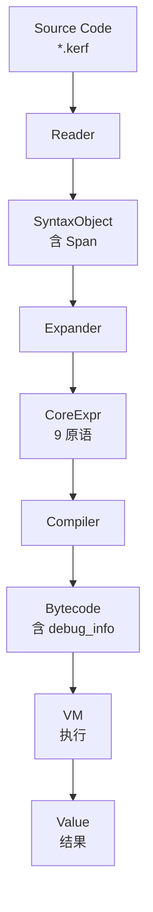
````

#### 15.3.2 阶段数据流图

**定义**：描述某个开发阶段的实际数据流——代码实现中数据如何在模块间流转。

**位置**：`docs/graph/stage/stage-<N>/<模块>-data-flow.md`

**示例**：`docs/graph/stage/stage-0/compiler-data-flow.md`

````markdown
# Stage 0 Compiler 数据流图

> **Author**: <author>
> **Date**: YYYY-MM-DD
> **Version**: v1.0
> **对应代码**: src/compiler/

### Compiler 主流程

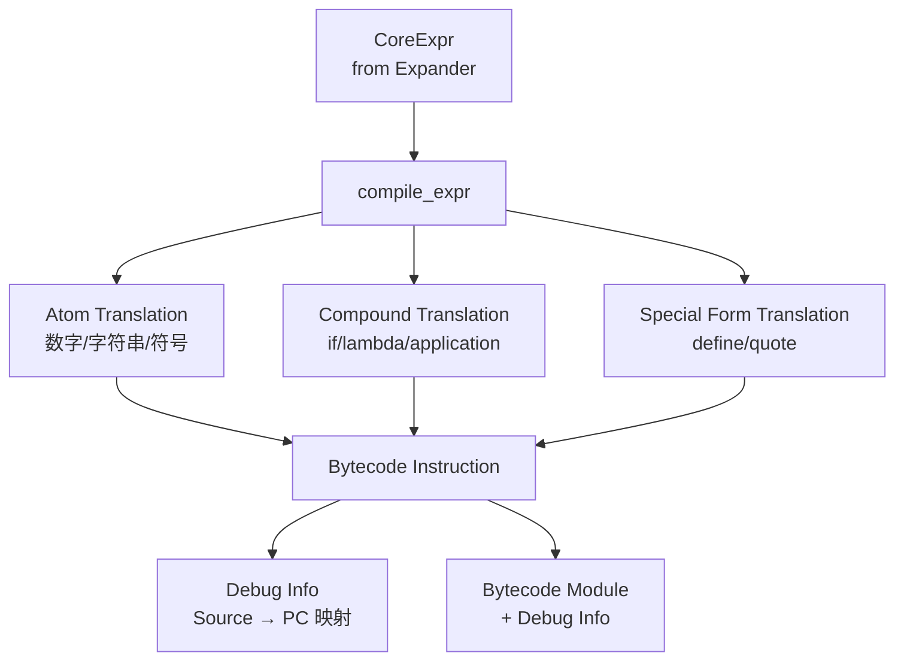
````

#### 15.3.3 总体数据流图

**定义**：描述编译器从源码到目标代码的完整数据流——所有阶段的端到端视图。

**位置**：`docs/graph/overall/compiler-pipeline.md`

````markdown
# kerf 编译器总体数据流图

> **Author**: <author>
> **Date**: YYYY-MM-DD
> **Version**: v1.0

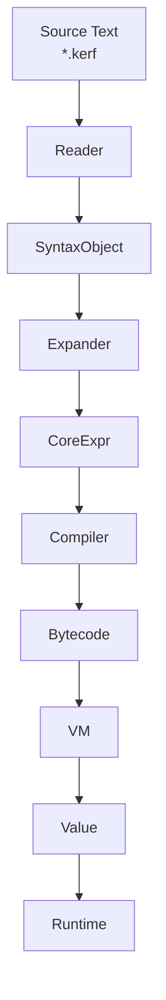
````

#### 15.3.4 关键词执行流图

**定义**：描述某个语言关键词从源码解析到代码生成的完整执行流——该关键词在编译器各阶段如何被处理。

**位置**：`docs/graph/keywords/<分类>/<关键词>.md`

**示例**：`docs/graph/keywords/core-forms/lambda.md`

````markdown
# `lambda` 关键词执行流图

> **Author**: <author>
> **Date**: YYYY-MM-DD
> **Version**: v1.0

### lambda 在各阶段的处理

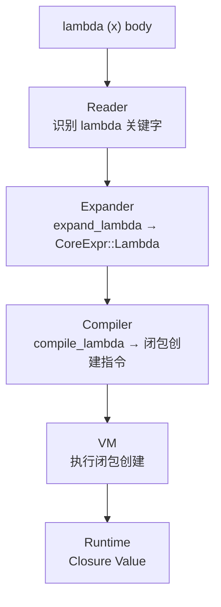
````

### 15.4 图同步规则

**触发时机**：以下变更必须同步更新对应的图：

| 变更类型 | 必须更新的图 | 更新内容 |
|---------|------------|---------|
| 设计文档变更（`docs/lang-design/`） | `docs/graph/design/<对应编号>-flow.md` | 设计数据流图同步变更 |
| 实现新增/修改模块（`src/`） | `docs/graph/stage/stage-<N>/<模块>-data-flow.md` | 阶段数据流图同步变更 |
| 编译流水线变更（新增阶段/调整阶段顺序） | `docs/graph/overall/compiler-pipeline.md` | 总体数据流图同步变更 |
| 新增/修改语言关键词 | `docs/graph/keywords/<分类>/<关键词>.md` | 关键词执行流图同步变更 |
| CoreExpr/Bytecode 数据结构变更 | `docs/graph/design/01-core-forms-flow.md` 或 `04-bytecode-vm-flow.md` | 数据结构关系图同步变更 |
| §13.4 重构 | 所有相关图 | 重构后立即同步 |
| §14.5 深度审查发现设计偏差 | `docs/graph/design/` 对应图 | 偏差回写后同步更新 |

### 15.5 图审查检查

在委员会投票前，QA 角色必须验证（补充 §8.5 第 8 项）：

1. 设计变更是否同步了 `docs/graph/design/` 对应图
2. 实现变更是否同步了 `docs/graph/stage/` 对应图
3. 流水线变更是否同步了 `docs/graph/overall/` 对应图
4. 新增关键词是否补充了 `docs/graph/keywords/` 对应图
5. 所有图是否使用 mermaid 格式（无外部图片）
6. 所有图是否有元数据头（Author/Date/Version）
7. 所有图是否标注对应设计文档/代码/关键词来源

**未通过则触发 NEEDS REVISION。**

### 15.6 与其他协议的关系

| 协议 | 与 §15 的关系 |
|------|--------------|
| §8 文档同步规则 | §15 是 §8 的子规则——图是文档的一部分 |
| §13.1 阶段开始设计对齐 | 设计对齐时同步查阅 `docs/graph/design/` 中的图 |
| §13.4 重构即架构设计 | 重构 plan 必须包含新结构图（§13.4.2 步骤 4） |
| §14.5 深度审查 D1 架构健康度 | D1 输出"架构图 + 耦合点清单"即引用 §15 的图 |
| §14.5 深度审查 D8 测试路径覆盖 | D8 验证测试流与 §15 的图是否相互印证 |
| §14.6.1.1 数据流覆盖分支检测 | 输出到 `docs/tests/pipeline-test-coverage.md` 时引用 §15 的总体数据流图 |
| §14.8 阶段末尾设计回写 | 设计偏差回写时同步更新 `docs/graph/design/` 对应图 |

### 15.7 标准化项目图管理

**目的**：把"图管理"从零散行为升级为标准化管理，确保图的质量、一致性、可追溯性。

**管理原则**：
1. **版本管理**：每个图必须有 `Version` 字段，变更时 bump 版本号。
2. **来源标注**：每个图必须标注对应的设计文档/代码/关键词来源。
3. **审查纳入**：图变更纳入 §8 文档同步审查 + §14.5 深度审查。
4. **索引维护**：`docs/graph/README.md` 必须索引所有图，按类别列出 + 链接 + 简要说明。
5. **命名规范**：遵循 §15.2 的命名规则，全小写 + 连字符分隔。
6. **格式统一**：所有图使用 mermaid 在 Markdown 中内嵌，不使用外部图片或专有格式。

---

## 16. 变更日志

### 16.1 流程版本历史

| 版本 | 日期 | 变更内容 | 作者 |
|------|------|---------|------|
| **v13.22** | 2026-11-11 | 英语编码统一窗（r139 / 209-a..209-f——用户四链指令「检查当前项目中的编码语言，使用单一英语编码，将错误提示标准化，并将『单一编码语言首选-英语』添加到 docs/sop.md 中 + 继续推进目标语言设计的实现窗 + 按推荐先后任务顺序继续推进 + 完整打包 tar.gz + 同步完整更新 web page」驱动，M1 指令开窗第四十四例——r112 注释语言标准轮同型第 2 例）：① §10.5 由「注释语言标准」升格为「单一编码语言标准——首选英语」——四层覆盖{注释层 r112 沿袭 + 错误提示层 r139 新增[E00xx 诊断族/Reader/Expander/Compiler/VM/Driver/bootstrap 双侧消息——r112 双豁免位错误消息豁免撤销，用户指令明文「将错误提示标准化」] + 开发面消息层 r139 新增[panic/expect/assert/测试断言锚/审计期望面] + CLI 输出面 r139 新增[usage/check/test 报告]}；豁免位收窄{设计文档维持 + Unicode 能力测试夹具登记制白名单[以 CJK 文本为被测对象本身——Reader 字面量往返/字符串全序码点/test runner Unicode 截断边界] + worklog/归档脚本历史工件}；消息层形态标准{Rust 编译器惯例——小写开头/无句尾句号/「X」→`X` 反引号/全角转 ASCII/占位符逐位保留}；双语侧字节级一致义务{单源字典——同一中文原文恒得同一英文译文，parity 守护前提}；存量治理增 r139 第二轮实录{~5.9K 字面量字典驱动 + 测试/审计期望锁步 + r138 滞留审计锚 A09/P03 同窗清偿}；② §10.2 清单新增末项（非英文错误提示/诊断消息/CLI 输出检查）。同步面：代码域错误提示/开发面/CLI 面全量英文化（148 文件 ~5.9K 字面量——单源字典四轮迭代 + 空格/引号/转义边界修复 + 语义不变纪律——测试计数 1724 逐位维持）。 | Super Z (main) |
| **v13.21** | 2026-10-30 | 第二十九轮递归处理与脚手架拆除对账反哺（r117 / 187-a..187-e——用户五链段式指令「next21.md 设计理念原则演进内容吸收融入 stage0.md 直至收敛 → 融入 lang-design 对 next21.md 全部问题系统性全面审查直至收敛 → 反哺 stage0.md 二次整理 → 反哺 sop.md → 完整打包 tar.gz + web page + t3plus 同步更新」驱动，#15 讨论主线第十九次用户行权[设计讨论吸收轮——纯文档域零代码变更零语法增量] + M1 指令开窗第二十二例——沿 r111/r113/r115 先例形态）：① §2.2 设计原则由五十七条扩为五十八条（新增第 58 条「同形树递归处理纪律」——r117 吸收链 stage0.md v8.8 §9.30 → lang-design/17 v7.19 镜像 → 本版）② §21.12 新增第 27 条（同形树递归处理纪律：四层实况谱系/理论统一叙事层/备选谱系登记态/零语法面/脚手架拆除对账五项）③ §8.4.5 查询时机表新增递归处理/脚手架拆除对账行（17 原则 58 + 04 §3.1 + 07 §3.2.2 + 06 §16 + 13 §3.22 + 12 §2.19 + 19 §30 + 18 §5y 八锚）④ 目录/§2.2 标题/来源注五十七→五十八计数同步（stage0.md v8.7→v8.8 锚同步）。同步面：stage0.md v8.7→v8.8（**§9.30 S 表达式递归处理与脚手架拆除对账六小节**[REC-A..REC-C 三裁定——同形树递归处理四层实况谱系{Reader 256 帽/HM 迭代 512 预算/VM 堆帧栈/eval 前置覆盖} + 理论统一 = 解释框架层叙事{K-F 零机制变更} + 漂移检测八项实况修正{时态漂移——切换窗步③ 4/4 已落 E1-β；IR 层级口径——VM 路径四层 + Stx 必需承载；拆除边界宪制} + 脚手架生命周期五段 ↔ 切换窗五步映射 + **8 原语不变性第十三轮验证**{零新原语零通道零 VM 零语法——历次最轻量轮族并列} + 原创贡献零新增{累计维持 25 项——语料 = 既有原则/实况/计划的理论确认}] + 原则 58 + 附录 A 十二条/E.30 四条[Rust 社区递归防护共识 + OCaml 5 效应处理器堆栈策略 + matklad 事件流解析 + 自举脚手架拆除谱系——四项 web-search 实检索证 r117-q1~q4 存档 tool-results/r117-search/]/F.24）+ lang-design **九件**修订（17 v7.19[原则 58 + 附二十四] / 18 v7.23 §5y / 19 v7.15 §30 / 04 v5.5 §3.1[递归处理实况注记] / 07 v7.1 §3.2.2[脚手架生命周期映射] / 06 v6.12 §16[递归流形叙事注记] / 13 v6.24 §3.22[递归深度处理能力面] / 12 v6.30 §2.19[脚手架拆除时点] / 00 v6.24）+ 十六件零增量维持（02 号件零触碰 = **v9 定稿域零扰动实证——本轮零语法面与第十源语料轮的差异登记**：递归处理 = 防御机制非语法面故无 §8.13.2a 类增量登记位需求）。**递归处理线程统一登记**（FS-1/A6/TD-023 既有交付 → 四层谱系原则化 + 脚手架线程语法面实例化对账[原则 41] + 切换窗理论重述收编）。 | Super Z (main) |
| **v13.20** | 2026-10-28 | 第二十八轮统一流分析与描述论反哺（r115 / 185-a..185-e——用户双链六段式指令「next20.md 设计理念原则演进内容吸收融入 stage0.md 直至收敛 → 融入 lang-design 对 next20.md 全部问题系统性全面审查直至收敛 → 反哺 stage0.md 二次整理 → 反哺 sop.md → 完整打包 tar.gz + web page + t3plus 同步更新；并行链——next.md-next20.md EBNF 内容整合[r104 v9 定稿既有基线 + 本轮第十源语料增量登记]」驱动，#15 讨论主线第十八次用户行权[设计讨论吸收轮——纯文档域零代码变更] + M1 指令开窗第二十例——沿 r111/r113 先例形态）：① §2.2 设计原则由五十六条扩为五十七条（新增第 57 条「统一流分析与描述论登记纪律」——r115 吸收链 stage0.md v8.7 §9.29 → lang-design/17 v7.18 镜像 → 本版）② §21.12 新增第 26 条（统一流分析与描述论登记纪律：分析线程工程统一面/EBNF 第十源语料登记态/描述论立场层{机制层豁免}/哥德尔同构{三重不完备统一}/零载荷五项）③ §8.4.5 查询时机表新增统一流分析/描述论本体论行（17 原则 57 + 02 §8.13.2a + 06 §15 + 13 §3.21 + 05 §15 + 12 §2.18 + 24 §24 + 19 §29 + 18 §5x 九锚）④ 目录/§2.2 标题/来源注五十六→五十七计数同步（stage0.md v8.6→v8.7 锚同步）。同步面：stage0.md v8.6→v8.7（**§9.29 统一流分析与描述论本体论八小节**[UFA-A..UFA-F 六裁定——统一流分析 = 借用检查投影化工程统一面{π_time 投影家族第三实例 + 四相位管线 + 四超越优势分级} + EBNF 第十源语料 Level 1-4 登记态{七件语法族 + ~32 关键字全脱糖 + 记法修正五处 + 六规则族} + 描述论立场层{五描述修正表 + 机制层豁免 + OSR 锚 E.29-163} + 哥德尔不完备同构{间隙性↔第一定理/自举信任根↔第二定理 + 三重不完备统一叙事层} + **8 原语不变性第十二轮验证**{零新原语零通道零 VM——历次第二轻量轮族} + 原创贡献 #23/#24/#25 三项新登记{累计 25 项} + 环数维持 12 环{本体层+立场层双基座} + 漂移检测十项实况修正] + 原则 57 + 附录 A 二十二条/E.29 四条[Polonius + Koka Perceus + 哥德尔-图灵-Rice 家族 + OSR/Ladyman——四项 web-search 实检索证 r115-q1~q4 存档 tool-results/r115-search/]/F.23）+ lang-design **十件**修订（17 v7.18[原则 57 + 附二十三 + R4 顺修一处{头部导语「四十六条」9 轮陈旧残留}] / 18 v7.22 §5x / 19 v7.14 §29 / 02 v7.10 §8.13.2a / 06 v6.11 §15 / 13 v6.23 §3.21 / 05 v6.13 §15 / 12 v6.29 §2.18 / 24 v2.12 §24 / 00 v6.23）+ 十五件零增量维持（02 §8.13 v9 定稿位维持不动 = 定稿域零扰动实证）。**分析线程工程统一面开面**（r95 MU-A 统一场论 → 借用检查投影实例化 + 观测投影家族三实例完备[shape/state/time] + 哲学层立场声明[OSR 锚] + 不完备性线程理论背书[BS-E 三机制]）。 | Super Z (main) |
| **v13.19** | 2026-10-27 | 第二十七轮流特性理论反哺（r113 / 183-a..183-e——用户五链指令「next19.md 设计理念原则演进内容吸收融入 stage0.md 直至收敛 → 融入 lang-design 对 next19.md 全部问题系统性全面审查直至收敛 → 反哺 stage0.md 二次整理 → 反哺 sop.md → 完整打包 tar.gz + web page + t3plus 同步更新」驱动，#15 讨论主线第十七次用户行权[设计讨论吸收轮——纯文档域零代码变更零语法增量] + M1 指令开窗第十四例——沿 r102/r104/r111 先例形态）：① §2.2 设计原则由五十五条扩为五十六条（新增第 56 条「流特性理论登记纪律」——r113 吸收链 stage0.md v8.6 §9.28 → lang-design/17 v7.17 镜像 → 本版）② §21.12 新增第 25 条（流特性理论登记纪律：流本体论第十二环/固定vs确定/自由度-约束对偶第三形态/弦理论 Tier 3 + T 对偶驳回/时间性语义重述/零载荷六项）③ §8.4.5 查询时机表新增流特性理论/流本体论行（17 原则 56 + 06 §14 + 13 §3.20 + 21 §11.5 + 24 §23 + 05 §14 + 12 §2.17 + 19 §28 + 18 §5w 九锚）④ 目录/§2.2 标题/来源注五十五→五十六计数同步（stage0.md v8.5→v8.6 锚同步）。同步面：stage0.md v8.5→v8.6（**§9.28 流特性理论与流本体论九小节**[FLW-A..FLW-G 七裁定——流本体论第十二环{六线程族维持 + 本体层开面} + 三核心洞察形式化{固定vs确定 Fix/Det 投影算子 + N 维可能性 + 随机种子=自由度对偶} + 五层↔8 原语映射{原语列精确化} + **8 原语不变性第十一轮验证**{零新原语零通道零语法——历次最轻量轮族} + 弦理论八行逐行裁定{T 对偶驳回——退相干替换 + 全息原理 Tier 2 信息论骨架} + 时间性四命题 = 操作语义物理层重述{K-F 零机制变更} + 原创贡献 #20/#21/#22 三项新登记{累计 22 项} + 实施路线对账{时态修正 + 随机种子门控修正} + 漂移检测八项实况修正] + 原则 56 + 附录 A 二十条/E.28 四条[Schlosshauer 退相干 2004 + Wikipedia T-duality + Bousso 全息原理 2002 + Errasti Díez 自由度计数 2024——四项 web-search 实检索证 r113-q1~q4 存档 tool-results/r113-search/]/F.22）+ lang-design **十件**修订（17 v7.17[原则 56 + 附二十二] / 18 v7.21 §5w / 19 v7.13 §28 / 06 v6.10 §14 / 13 v6.22 §3.20 / 21 v2.3 §11.5 / 24 v2.11 §23 / 05 v6.12 §14 / 12 v6.28 §2.17 / 00 v6.22）+ 十五件零增量维持（02 v7.9 维持 = v9 定稿域零扰动实证）。**理论载体第十二环开面**（六线程族 → +流本体论环——本体层基座叙事；观测论三阶化[类型观测→信息观测双子→固定vs确定维度阶] + 不确定性三形态全景[非对易→波粒二象性→自由度-约束对偶] + 原则 56 = 48 K-A 纪律执行先例[T 对偶驳回负案例]）。 | Super Z (main) |
| **v13.18** | 2026-10-26 | 注释语言标准轮（r112 / 182-a..182-i——用户四链指令「审查项目内所有注释中文转标准化英文 + 注释语言选择原则入 sop.md → 继续推进目标语言设计实现窗[切换窗步③ 第三批 compiler.ktf] → 按推荐先后任务顺序继续推进 → 完整打包 tar.gz + 同步完整更新 web page」驱动）：① §10 新增 §10.5「注释语言标准」——语言选择原则{代码注释一律标准化英文——Rust `//`/`///`/`//!` + kerf 语料 `;`/`//` + TOML/Shell `#`；中文双豁免位 = 设计文档[非注释] + 字符串字面量[非注释且受 parity 字节级守护——错误消息转换属独立评估面]} + 技术锚保留义务{§X.Y/TD-xxx/rNNN/裁定号/诊断码/标识符原样保留——§8.4.5 对账锚消费面} + 形态标准{`//!` 职责+入口 / `///` why 优先 / 行内简短 / 禁 fenced code block} + 存量治理{r112 首轮全量清偿 + 零语义变更纪律 + GATE 1 = 六命令全绿 + 计数逐位维持 + rg 清零实证} + 新增违反后果{P2——§6.2 规范类}；② §10.2 审查清单新增末项（非英文注释检查）；③ 同步面 = 代码域全量注释英文化（139 `.rs` 文件 ~11.2K 注释行 + 13 bootstrap 语料件 + 8 示例语料 + 根 Cargo.toml 注释 + 3 setup 脚本 + 1 存档脚本——字符串字面量零触碰——零代码语义变更）。 | Super Z (main) |
| **v13.17** | 2026-10-24 | 第二十六轮信息效应化反哺（r111 / 181-a..181-e——用户五链指令「next18.md 设计理念原则演进吸收融入 stage0.md 直至收敛 → 融入 lang-design 对 next18.md 全部问题系统性全面审查直至收敛 → 反哺 stage0.md 二次整理 → 反哺 sop.md → 完整打包 tar.gz + web page + t3plus 同步更新」驱动，#15 讨论主线第十六次用户行权[设计讨论吸收轮——纯文档域] + M1 指令开窗第十三例）：① §2.2 设计原则由五十四条扩为五十五条（新增第 55 条「信息效应化登记纪律」——r111 吸收链 stage0.md v8.5 §9.27 → lang-design/17 v7.16 镜像 → 本版）② §21.12 新增第 24 条（信息效应化登记纪律：状态投影/登记态推广/第九源语料 Level 1-4/空间双层口径/F13 值通道/接口计数维持六项）③ §8.4.5 查询时机表新增信息效应化/信息系统设计行（02 §8.14 + 24 §22 + 17 原则 55 + 05 §13 + 06 §13 + 13 §3.19 + 15 §5.5 + 12 §2.16 + 20 §15 + 21 §11.4 + 23 §2.2.1 + 19 §27 + 18 §5v 十三锚）④ 目录/§2.2 标题/来源注五十四→五十五计数同步（stage0.md v8.4→v8.5 锚同步）。同步面：stage0.md v8.4→v8.5（**§9.27 信息效应化与统一观测框架九小节**[INFO-A..INFO-G 七裁定——信息 = 效应流的状态投影{第八支柱 + 观测双子闭合} + 统一五机制/分治五策略登记态{原则 42 信息面推广零修订} + 信息效应语法族第九源语料 Level 1-4 登记{定稿域零扰动 + 二义性例 23-25} + InfoEffectSpace 归位{EffectSpace Level 2 登记态第七例 + 空间单源第九轮} + 信息流管线架构叙事层{F13 正交裁定维持} + 一致性八验证 + 8 原语第十轮验证 + 理论载体第十一环{六线程族} + 原创贡献 18/19 + LSP 投影工具链层单向派生] + 原则 54 R4 顺修[r104 漏更 §23.1 补齐] + 原则 55 + 附录 A 二十条/E.27 四条[rustc diagnostic structs + LSP 3.18 + 错误恢复谱系 + effect handlers 前沿——四项 web-search 实检索证 r111-q1~q4 存档 tool-results/r111-search/]/F.21）+ lang-design **十四件**修订（02 v7.9 §8.14 / 17 v7.16[原则 55 + 附二十一 + §1.1 计数 R4 顺修] / 18 v7.20 §5v / 19 v7.12 §27 / 24 v2.10 §22 / 05 v6.11 §13 / 06 v6.9 §13 / 13 v6.21 §3.19 / 15 v6.5 §5.5 / 12 v6.27 §2.16 / 20 v1.17 §15 / 21 v2.2 §11.4 / 23 v1.9 §2.2.1 / 00 v6.21）+ 十一件零增量维持。**错误处理线程信息面收束**（原则 42 r81 开面 → 本轮推广收束——推广零修订原文；观测双子闭合——理论载体六线程族终态）。 | Super Z (main) |
| **v13.16** | 2026-10-20 | 第二十五轮 EBNF 整合定稿反哺（r104 / 174-a..174-h——用户五链指令「next.md-next17.md EBNF 内容整合 + Rust 最小集借鉴 + 理论栈处理 → 完整目标语言 EBNF 语法定义吸收进 stage0.md 直至收敛 → 融入 lang-design + 对 next.md-next17.md 全部问题系统性全面审查直至 lang-design 收敛 → 反哺 stage0.md 二次整理 → 反哺 sop.md → 完整打包 tar.gz + web page + t3plus-trigger-audit.md 同步更新」驱动，**EBNF 定稿子窗开窗**[M1 指令开窗第十二例——纯文档域] + 第十五次用户行权[#15 目标语言设计讨论主线——EBNF 整合定稿形态；切换窗本体维持未开窗——定稿 ≠ Reader 实施]）：① §2.2 设计原则由五十三条扩为五十四条（新增第 54 条「EBNF 整合定稿登记纪律」——r104 整合链 stage0.md v8.4 §9.26 → lang-design/17 v7.15 → 本版）② §21.12 新增第 23 条（EBNF 整合定稿登记纪律：定稿子窗行权形态/单源收敛/定稿域边界/定稿义务三件/关键字经济/内核终验/Rust 补全边界七项）③ §8.4.5 查询时机表新增 EBNF 定稿/语法整合行（02 §8.13 + 22 §27 + 20 §14 + 17 原则 54 + 19 §26 + 18 §5u）④ 目录/§2.2 标题/来源注五十三→五十四计数同步（stage0.md v8.3→v8.4 锚同步）。同步面：stage0.md v8.3→v8.4（**§9.26 EBNF v9 整合定稿十小节**[V-A..V-H 八裁定——九源语料地图 + 六整合原则 + 十二整合裁定 C1-C12 + 完整文法{词法层 Rust 最小集补全 + Level 0 定稿域 + Level 1-4 扩展语法族登记} + 优先级结合律十四级表{**定稿义务兑现——原 #15 窗内义务**} + 关键字分级终态{15 全域 + 4 语境 + 3 位形 = 22 定稿词面} + 二义性 22 例完备消歧{新增例 18-22} + 宏层脱糖路径表 + 数学底层与内核映射{8 原语不变性第九轮验证} + 皮肤字典映射基础] + 原则 54 + 附录 A 二十条/E.26 四条[Rust Reference 优先级表 + 章节化文法体系 + langdev 关键字最小化 + contextual keyword——三项 web-search 实检索证 r104-q1~q3 存档 tool-results/r104-search/]/F.20）+ lang-design **七件**修订（**02 v7.6 §8.13[EBNF v9 整合定稿位——grammar L2 规范层权威定稿位：EBNF 块零漂移双源]** / 22 v2.14 §27[关键字分级终态与分隔符双面映射] / 20 v1.14 §14[皮肤字典定稿域扩充] / 17 v7.15[原则 54 + 附二十——语法线程收束条] / 18 v7.19 §5u[术语 17 条] / 19 v7.11 §26[E.26 四条 145-148] / 00 v6.20[文档地图反哺修正——上游存档注 v8.4 + 02 行定稿位]) + surface-syntax-switch-assessment v1.2-r104（六步清单第 1 步设计面达成 + 第 5 步③规范基线就位注记）+ 十八件零增量维持。**语法线程定稿收束**（八份骨架累积义务兑现——「定稿义务仍在 #15 切换窗内」注记自本轮改写为「定稿已就位于 02 §8.13」；理论载体十环维持）。 | Super Z (main) |
| **v13.15** | 2026-10-19 | 第二十四轮混合自举反哺（r98 / 168-a..168-f——用户五链指令「next17.md 吸收进 stage0.md 直至收敛 → 融入 lang-design 对应文件 + 系统性全面审查[十六维] → 反哺 stage0.md 二次整理 → 反哺 sop.md 适当位置 + 打包 + web」驱动，第十四次用户行权[#15 目标语言设计讨论主线——M1 形态；**新语料全量吸收**（next17.md 1046 行两文档——D1 前端自举 vs 完全自举深度分析 + D2 S-expr→目标语法转换阶段指导；行权链 r74/r79/r80/r81/r83/r84/r88/r89/r91/r93/r94/r95/r96/r98——r97 收口笔明确等待的 next17.md 信号落位]）：① §2.2 设计原则由五十二条扩为五十三条（新增第 53 条「混合自举与迁移验证登记纪律」——next17.md 吸收链 stage0.md v8.3 §9.25 → lang-design/17 v7.14 → 本版）② §21.12 新增第 22 条（混合自举与迁移验证登记纪律：第三形态/后端不入自举链/同结果硬纪律/两路径声明/零信号不开窗/三阶段 fixpoint 六项）③ §8.4.5 查询时机表新增渐进式混合自举/语法迁移验证定位行（07 §4 + 02 §8.12 + 11 §6 + 12 §2.15 + 17 原则 53 + 19 §25 + 18 §5t）④ 目录/§2.2 标题/来源注五十二→五十三计数同步（stage0.md v8.2→v8.3 锚同步）。同步面：stage0.md v8.2→v8.3（§9.25 八小节 + 原则 53 + 附录 A 二十条/E.25 四条[Thompson 1984 trusting trust + Guix-Mes 全源自举 + Chez nanopass + Csmith differential testing——四项 web-search 实检索证 r98-q1~q4 存档 tool-results/r98-search/]/F.19 + §23.1 计数五十三）+ lang-design **八件**修订（**07 v6.9 §4[渐进式混合自举与语法迁移验证——自举策略进程面承载本体]** / 02 v7.5 §8.12[语法迁移验证与映射表登记——**含 R4 顺修一处：v7.4 Version 头行 r96 漏更补齐**] / 11 v6.5 §6[parity 结构化完备与切换窗验证协议] / 12 v6.26 §2.15[三阶段策略对账注记] / 17 v7.14[原则 53 + 附十九——五面姊妹链外第一工程面条] / 18 v7.18 §5t[术语二十条] / 19 v7.10 §25[E.25 四条 141-144] / 00 v6.19）+ 十七件零增量维持。**工程进程线程开面**（第一个工程面吸收轮——理论载体十环维持，五线程族完备态不推翻）。 | Super Z (main) |
| **v13.14** | 2026-10-18 | 第二十三轮类型观测反哺（r96 / 166-a..166-f——用户五链指令「next16.md 吸收进 stage0.md 直至收敛 → 融入 lang-design 对应文件 + 系统性全面审查 → 反哺 stage0.md 二次整理 → 反哺 sop.md 适当位置 + 打包 + web」驱动，第十三次用户行权[#15 目标语言设计讨论主线——M1 形态；**新语料全量吸收**（next16.md 2800 行四文档——类型系统完整设计 + 类型模型效应化自然演进[静/动统一] + 最终收敛版[EBNF v2 + 流形求解算法 + 八项验证] + 可行性与四模型协同最终审查；TD 指南【第 1 位】行权链延续 r74/r79/r80/r81/r83/r84/r88/r89/r91/r93/r94/r95/r96]）：① §2.2 设计原则由五十一条扩为五十二条（新增第 52 条「类型观测化登记纪律」——next16.md 吸收链 stage0.md v8.2 §9.24 → lang-design/17 v7.13 → 本版）② §21.12 新增第 21 条（类型观测化登记纪律：观测模式二分 + 横切静态验证层零运行时原语 + HM[X] 非新数学 + 四策略安全域裁定 + EBNF v8 分层门控 + 接口计数纪律六项）③ §8.4.5 查询时机表新增类型观测/效应容器类型系统定位行（13 §3.18 + 21 §11.2 + 24 §21 + 17 原则 52 + 02 §8.11 + 12 §2.14 + 19 §24 + 18 §5s）④ 目录/§2.2 标题/来源注五十一→五十二计数同步（stage0.md v8.1→v8.2 锚同步）。同步面：stage0.md v8.1→v8.2（§9.24 八小节 + 原则 52 + 附录 A 二十条/E.24 四条[Siek&Taha 渐进类型 + Koka 行多态效应行 + Rust affine 社区认辨 + HM[X] 约束式推断——四项 web-search 实检索证 r96-q1~q4 存档 tool-results/r96-search/]/F.18 + §23.1 计数五十二）+ lang-design **九件**修订（13 v6.20 §3.18[效应容器类型系统能力面 + 8 原语第八轮验证——五线程族完备] / **21 v2.1 §11.2[五接口契约化深化注记——多模型组织协调维度承载本体：零漂移确认 + 接口计数纪律]** / 24 v2.9 §21[TypeSystemSpace 归位类型域——空间单源第八轮] / 17 v7.13[原则 52 + 附十八——五条理论登记纪律姊妹链延展] / 18 v7.17 §5s[术语二十条] / 19 v7.9 §24[E.24 四条 137-140] / 02 v7.4 §8.11[EBNF v8 第七份骨架 + 二义性第 15-17 例 + 历次最大关键字张力两域门控] / 12 v6.25 §2.14[Stage 2+/3+ 分层门控注记] / 00 v6.18）+ 十六件零增量维持。 | Super Z (main) |
| **v13.13** | 2026-10-18 | 第二十二轮流形统一分析反哺（r95 / 165-a..165-f——用户五链指令「next15.md 吸收进 stage0.md 直至收敛 → 融入 lang-design 对应文件 + 系统性全面审查 → 反哺 stage0.md 二次整理 → 反哺 sop.md 适当位置 + 打包 + web」驱动，第十二次用户行权[#15 目标语言设计讨论主线——M1 形态；**新语料全量吸收**（next15.md Document 4「流形统一分析」行 1573-1995 +424 行——Documents 1-3 已于 r94/v8.0 吸收零遗漏，本轮仅第四文档为新增量——同文件名追加段按语料实质判定合法新语料[TD 指南行权第八例——r89 先例沿袭]；TD 指南【第 1 位】行权链延续 r74/r79/r80/r81/r83/r84/r88/r89/r91/r93/r94/r95]）：① §2.2 设计原则由五十条扩为五十一条（新增第 51 条「流形统一分析登记纪律」——next15.md 吸收链 stage0.md v8.1 §9.23 → lang-design/17 v7.12 → 本版）② §21.12 新增第 20 条（流形统一分析登记纪律：分析统一架构级叙事登记 + Pass 数据结构单源纪律 + K-A 分级八项映射表 + 收益/风险对偶 + Level 5 远见 + 零丢失精确化六项）③ §8.4.5 查询时机表新增流形统一分析/统一场论定位行（13 §3.17 + 15 §5.4 + 24 §20 + 17 原则 51 + 08 §5.5 + 12 §2.13 + 19 §23 + 18 §5r）④ 目录/§2.2 标题/来源注五十→五十一计数同步（**含 R4 顺修一处**：来源注「第 50 条」条目 r94 漏更——本轮发现当轮补齐；stage0.md v8.0→v8.1 锚同步）。同步面：stage0.md v8.0→v8.1（§9.23 八小节 + 原则 51 + 附录 A 二十一条/E.23 四条[Kildall 1973 统一分析框架先例 + persistent homology/奇点理论 2025 拓扑前沿 + MLGO 工业 ML-编译器 + CompCert 形式化基准——四项 web-search 实检索证 r95-q1~q4 存档 tool-results/r95-search/]/F.17 + §23.1 计数五十一）+ lang-design **九件**修订（**15 v6.4 §5.4[统一流形分析中心愿景与分析单源——架构分层承载本体]** / 13 v6.19 §3.17[流形统一分析能力面 + 8 原语第七轮验证——历次最轻量轮] / 24 v2.8 §20[EffectSpace 分析面视图 + ManifoldAnalysisSpace 违例登记] / 17 v7.12[原则 51 + 附十七——四条理论登记纪律姊妹链闭合] / 18 v7.16 §5r[术语二十一条] / 19 v7.8 §23[E.23 四条 133-136] / 08 v6.7 §5.5[流形→ANF-SSA 桥接注记] / 12 v6.24 §2.13[Stage 3+ 愿景注记] / 00 v6.17）+ 十六件零增量维持。 | Super Z (main) |
| **v13.12** | 2026-10-18 | 第二十一轮生命周期效应化反哺（r94 / 164-a..164-f——用户五链指令「next15.md 吸收进 stage0.md 直至收敛 → 融入 lang-design 对应文件 + 系统性全面审查 → 反哺 stage0.md 二次整理 → 反哺 sop.md 适当位置 + 打包 + web」驱动，第十一次用户行权[#15 目标语言设计讨论主线——M1 形态；**新语料全量吸收**（next15.md 1571 行三文档——生命周期效应化统一 + 最终收敛版[EBNF + Pass 算法 + 七项一致性验证] + 四模型协同与可行性审查；TD 指南【第 1 位】行权链延续 r74/r79/r80/r81/r83/r84/r88/r89/r91/r93/r94]）：① §2.2 设计原则由四十九条扩为五十条（新增第 50 条「生命周期效应化登记纪律」——next15.md 吸收链 stage0.md v8.0 §9.22 → lang-design/17 v7.11 → 本版）② §21.12 新增第 19 条（生命周期效应化登记纪律：LC-A 四操作零新原语 + 非平级模型双口径 + LC-B 消除三形 + EBNF v7 脱糖备选 + 接口契约五形 + 安全底线六项）③ §8.4.5 查询时机表新增生命周期效应化/四模型协同定位行（13 §3.16 + 21 §11 + 24 §19 + 02 §8.10 + 05 §12 + 09 §7）④ 目录/§2.2 标题/来源注四十九→五十计数同步（**含 R4 顺修两处**：目录「四十七」陈旧残留 + 来源注「v7.8/四十八」r93 漏更——本轮发现当轮修正；stage0.md v7.9→v8.0 锚同步）。同步面：stage0.md v7.9→v8.0（§9.22 八小节 + 原则 50 + 附录 A 二十条/E.22 四条[RFC 2094 NLL + Tofte-Talpin 区域效应 1997 学术同构先例 + Koka 效应处理器编译 + RAII 多源——四项 web-search 实检索证 r94-q1~q4 存档 tool-results/r94-search/]/F.16 + §23.1 计数五十）+ lang-design **十一件**修订（13 v6.18 §3.16[生命周期效应化能力面 + 8 原语第六轮验证] / **21 v2.0 §11[资源能力族与四模型协同——多模型组织协调维度承载本体]** / 24 v2.7 §19[EffectSpace Level 2 登记态子空间第六例] / 02 v7.3 §8.10[EBNF v7 第六份骨架 + 二义性第 13-14 例] / 05 v6.10 §12[with_resource Handle 四臂语义] / **09 v6.15 §7[生命周期线程开面——三线程族完备]** / 17 v7.11[原则 50 + 附十六] / 18 v7.15 §5q[术语二十条] / 22 v2.12 §25[关键字张力脱糖备选] / 19 v7.7 §22[E.22 四条 129-132] / 00 v6.16）+ 十四件零增量维持。 | Super Z (main) |
| **v13.11** | 2026-10-17 | 第二十轮能力模型内禀几何反哺（r93 / 163-a..163-f——用户五链指令「next14.md 吸收进 stage0.md 直至收敛 → 融入 lang-design 对应文件 + 系统性全面审查 → 反哺 stage0.md 二次整理 → 反哺 sop.md 适当位置 + 打包 + web」驱动，第十次用户行权[#15 目标语言设计讨论主线——M1 形态；**新语料全量吸收**（next14.md 2517 行五文档——能力模型三支柱 + 八维度正交分解 + 内禀关系流与度规 + EBNF v6 + 可行性审查；TD 指南【第 1 位】行权链延续 r74/r79/r80/r81/r83/r84/r88/r89/r91/r93]）：① §2.2 设计原则由四十八条扩为四十九条（新增第 49 条「能力-效应正交与内禀关系登记纪律」——next14.md 吸收链 stage0.md v7.9 §9.21 → lang-design/17 v7.10 → 本版）② §21.12 新增第 18 条（能力-效应正交与内禀关系登记纪律：八维度正交 + 三支柱统一体 + 内禀关系解释框架层 + EBNF v6 + 四层次协同谱系五项）③ §8.4.5 查询时机表新增能力模型三支柱/内禀关系定位行（21 §10 + 13 §3.15 + 24 §18 + 05 §11 + 09 §6 + 02 §8.9 + 22 §24）④ 目录/§2.2 标题/来源注四十八→四十九计数同步（stage0.md v7.8→v7.9 锚同步）。同步面：stage0.md v7.8→v7.9（§9.21 八小节 + 原则 49 + 附录 A 二十条/E.21 四条[Austral 线性 + Unison abilities + Tahara LV 收敛 + OCap 多源——四项 web-search 实检索证 r93-q1~q4 存档 tool-results/r93-search/]/F.15 + §23.1 计数四十九）+ lang-design **十一件**修订（21 v1.9 §10[三支柱 + 八维度 + 14 操作 + 四层次协同——能力架构侧承载本体] / 13 v6.17 §3.15[协同接口效应侧 + E0006 对账 + 8 原语第五轮] / 24 v2.6 §18[CapabilitySpace 归位] / 05 v6.9 §11[五元组 C 通道 + 度规开销三策略] / **09 v6.14 §6[能力线程开面——io 能力族四层次对账]** / 19 v7.6 §21[E.21 四条 125-128] / 18 v7.14 §5p[术语二十条] / 17 v7.10[原则 49 + 附十五] / 22 v2.11 §24[15+ 关键字张力 + 脱糖备选] / 02 v7.2 §8.9[EBNF v6 能力操作骨架 + 二义性第 11-12 例] / 00 v6.15）+ 十四件零增量维持。 | Super Z (main) |
| **v13.10** | 2026-10-10 | 第十九轮数学工具箱与波粒二象性反哺（r91 / 161-a..161-f——用户五链指令「next13.md 吸收进 stage0.md 直至收敛 → 融入 lang-design 对应文件 + 系统性全面审查 → 反哺 stage0.md 二次整理 → 反哺 sop.md 适当位置 + 打包 + web」驱动，第九次用户行权[#15 目标语言设计讨论主线——M1 形态；**新语料全量吸收**（next13.md 1856 行四段——数学工具箱全量复用主张 + 波粒二象性 + 理论-实现分层映射收敛 + EBNF v5 + 九步推演链审查；TD 指南【第 1 位】行权链延续 r74/r79/r80/r81/r83/r84/r88/r89/r91]）：① §2.2 设计原则由四十七条扩为四十八条（新增第 48 条「数学工具箱分级与隐喻登记纪律」——next13.md 吸收链 stage0.md v7.8 §9.20 → lang-design/17 v7.9 → 本版）② §21.12 新增第 17 条（数学工具箱分级与隐喻登记纪律：K-A 三级分级 + 贝尔诊断性裁定 + 波粒第六环 + EBNF v5 第四份骨架语料与 Level 3-4 脱糖优先 + QuantumEffectSpace 归位空间单源 + 理论-实现分层映射 + 推演方法论档案七项）③ §8.4.5 查询时机表新增数学工具箱/波粒二象性定位行（02 §8.8 + 05 §10 + 06 §12 + 13 §3.14 + 24 §17 + 22 §23 + 09 §5）④ 目录/§2.2 标题/来源注四十七→四十八计数同步（stage0.md v7.7→v7.8 锚同步）。同步面：stage0.md v7.7→v7.8（§9.20 八小节 + 原则 48 + 附录 A 二十条/E.20 两条[Hirani DEC + Edelsbrunner & Zomorodian 持久同调——两项 web-search 实检索证 r91-q1~q2 存档 tool-results/r91-search/]/F.14 + §23.1 计数四十八）+ lang-design **十二件**修订（02 v7.1 §8.8[EBNF v5 分层版 + 二义性第 8-10 例] / 05 v6.8 §10[量子分析 Pass D + EffectPathIntegral] / 06 v6.8 §12[波粒二象性语义注记] / 13 v6.15 §3.14[拓扑/量子能力行 + 8 原语第四轮验证] / 24 v2.5 §17[量子登记态子空间归位 + 维度谱系] / 19 v7.5 §20[E.20 两条 127-128] / 18 v7.13 §5o[术语二十条] / 22 v2.10 §23[数学工具箱/波粒/场论/纠缠术语族消歧 + K-A 锚] / 17 v7.9[原则 48 + 附十四] / 20 v1.12[§13 EBNF v5 脱糖优先] / **09 v6.13 §5[Randomness/EffectField 方向注记——效应线程首次开面]** / 00 v6.14）+ 十三件零增量维持。 | Super Z (main) |
| **v13.9** | 2026-10-10 | 第十八轮逆向效应流与计算干涉反哺（r89 / 159-a..159-f——用户五链指令「next12.md 吸收进 stage0.md 直至收敛 → 融入 lang-design 对应文件 + 系统性全面审查 → 反哺 stage0.md 二次整理 → 反哺 sop.md 适当位置 + 打包 + web」驱动，第八次用户行权[#15 目标语言设计讨论主线——M1 形态；**新语料全量吸收**（next12.md 追加段 2845-6512 行 +3668——历次最大单轮追加；同文件名追加段——按语料实质非文件名判定为合法新语料；TD 指南【第 1 位】行权第七例延续]）：① §2.2 设计原则由四十六条扩为四十七条（新增第 47 条「逆向效应与计算干涉登记纪律」——next12.md 吸收链 stage0.md v7.7 §9.19 → lang-design/17 v7.8 → 本版）② §21.12 新增第 16 条（逆向效应与计算干涉登记纪律：解释框架层第五环 + 量子术语族隐喻裁定 + 知识不对称判据 + EBNF v4 第三份骨架语料与关键字张力双判据 + Randomness 效应面登记 + 统一五层框架六项）③ §8.4.5 查询时机表新增逆向效应流/计算干涉定位行（02 §8.7 + 05 §9 + 06 §11 + 13 §3.13 + 24 §16 + 22 §22）④ 目录/§2.2 标题/来源注四十六→四十七计数同步（stage0.md v7.6→v7.7 锚同步）⑤ **R4 顺修四处**（stage0 流形消歧节号漂移 §20→§21 ×3[r88 残留] + 00 上游内联版本注 r88 漏更新 v7.5→v7.7——本轮勘察发现当轮修正）。同步面：stage0.md v7.6→v7.7（§9.19 八小节 + 原则 47 + 附录 A 二十条/E.19 两条[O'Neill PCG + Selinger 量子 PL 综述——两项 web-search 实检索证 r89-q1~q2 存档 tool-results/r89-search/]/F.13 + §23.1 计数四十七）+ lang-design 十一件修订（02 v7.0 §8.7[EBNF v4 正逆干涉版 + 二义性第 4-7 例 + 关键字张力] / 05 v6.7 §9[双向 Continuation + EffectScheduler + CollapseScheduler + Randomness] / 06 v6.7 §11[正逆五规则 + 干涉四规则] / 13 v6.14 §3.13[逆向/干涉/坍缩能力行 + InterferenceAnalysisPass] / 24 v2.4 §16[三子空间 + 统一五层框架] / 19 v7.4 §19[E.19 两条 125-126] / 18 v7.12 §5n[术语二十条] / 22 v2.9 §22[六组术语消歧 + 量子隐喻裁定 + 收拢/坍缩同形异义] / 17 v7.8[原则 47 + 附十三] / 20 v1.11[关键字张力与脱糖备选增记] / 00 v6.13[修订注记 + R4 顺修上游版本注]）+ 十四件零增量维持。 | Super Z (main) |
| **v13.8** | 2026-10-10 | 第十七轮效应流形理论与形式化完备反哺（r88 / 158-a..158-f——用户五链指令「next12.md 吸收进 stage0.md 直至收敛 → 融入 lang-design 对应文件 + 系统性全面审查 → 反哺 stage0.md 二次整理 → 反哺 sop.md 适当位置 + 打包 + web」驱动，第七次用户行权[#15 目标语言设计讨论主线——M1 形态；**新语料全量吸收**（next12.md 2855 行六轮——历次最大语料 121KB；TD 指南【第 1 位】行权第六例：next12.md 上传即行权条件达成]）：① §2.2 设计原则由四十五条扩为四十六条（新增第 46 条「效应流形理论登记纪律」——next12.md 吸收链 stage0.md v7.6 §9.18 → lang-design/17 v7.7 → 本版）② §21.12 新增第 15 条（效应流形理论登记纪律：解释框架层第四环 + 隐喻性术语裁定 + EBNF v3 第二份骨架语料 + 坐标系/地图裁定 + 语义面登记态 + 设计宪法第一查询锚）③ §8.4.5 查询时机表新增效应流形/空间理论定位行（02 §8.6 + 05 §8 + 06 §10 + 13 §3.12 + 24 §15 + 22 §21）④ 目录/§2.2 标题/来源注四十五→四十六计数同步（stage0.md v7.5→v7.6 锚同步）。同步面：stage0.md v7.5→v7.6（§9.18 八小节 + 原则 46 + 附录 A 二十三条/E.18 两条[Mac Lane + Ramsey&Pfeffer——两项 web-search 实检索证 r88-q1~q2 存档 tool-results/r88-search/]/F.12 + §23.1 计数四十六）+ lang-design 十一件修订（02 v6.9 §8.6[EBNF v3+流形语法+二义性三例] / 05 v6.6 §8[EffectGraph+流形 Pass+EffectTrace] / 06 v6.6 §10[14 规则+小步语义+合一算法+Return 裁定] / 13 v6.13 §3.12[流形能力面+SpaceRegistry+SpaceValidationPass] / 24 v2.3 §15[坐标系地图+低熵控制+七维度七步] / 19 v7.3 §18[E.18 两条] / 18 v7.11 §5m[术语二十三条] / 22 v2.8 §21[流形术语消歧+隐喻裁定+宪法锚] / 17 v7.7[原则 46 + **R4 顺修两处：原则 45 重复条目 + 附十一重复块清除（r84 残留）**] / 20 v1.10[15 关键字演进增记] / 00 v6.12）+ 十四件零增量维持。 | Super Z (main) |
| **v13.7** | 2026-10-09 | ripwire 工具收录（r86 / 156-a——用户指令①「查询并判断工具 https://github.com/redhat-et/ripwire 是否有助于当前项目的推进，如果有助于则结合 sop.md 中的工具流程收录到开发流程中」驱动）：§3.1 项目工具表新增 `ripwire` 行（agent 仓库导航/影响面分析——**可选宿主侧开发工具**，与 ripgrep 同类：永不进入 Cargo 依赖/语言管线/自举链，§18.4 外部依赖审查表不收录；Apache 2.0 C++23 单二进制零运行时依赖）。裁定三重实证：① v0.6.0 linux/x64 实机安装成功（官方一键脚本在 API 限流环境 403 → release tar.gz 直链路径——setup.sh 内置）② kerf 仓库 `ripwire .` 实测 358 文件/6090 符号/5562 边/1.1s 冷解析 + `--for="cmd_test report rendering test entry"` 精确命中当轮 TD-032 第三切口全符号面（cmd_test/TestReport/test_source/dispatch_seed + hops 调用边）③ 诚实边界契合（输出披露 `unindexed="krf:15,lock:1"`——.krf 面归原则 44 symbol.rs 双源单源不受影响）。归档：scripts/ripwire/setup.sh（§3.1 归档规则）+ docs/tools/ripwire/setup.md（裁定记录 + 实测结果 + agent 工作流速查）。同轮（非本版内容）：TD-032 第三切口测试入口生产切换（test.krf ltest-report + bootstrap_test.rs 桥 + parity 三件套——TD 登记 v0.4.8 + 07 §3.3 第三生产实证 + 指南 v1.6 #17 状态推进，载体见 worklog 156-b）。 | Super Z (main) |
| **v13.6** | 2026-10-09 | 第十六轮效应本体论与目标语言极简设计反哺（r84 / 154-a..154-f——用户五链指令「next11.md 吸收进 stage0.md 直至收敛 → 融入 lang-design 对应文件 + 系统性全面审查[含 EBNF 维度维持对账] → 反哺 stage0.md 二次整理 → 反哺 sop.md 适当位置 + 打包 + web」驱动，第六次用户行权[#15 目标语言设计讨论主线——M1+M3 复合形态；**新语料全量吸收**（next11.md 2821 行九段——区别于 r83 同一语料新维度增量形态）]）：① §2.2 设计原则由四十四条扩为四十五条（新增第 45 条「效应理论登记纪律」——next11.md 吸收链 stage0.md v7.5 §9.17 → lang-design/17 v7.6 → 本版）② §21.12 新增第 14 条（效应理论登记纪律：解释框架层登记 + 容器式签名终态草案管理 + 17 关键字正交分层 + resume ∈ {0,1} 完整语义 + 渐进实现路径 + 术语消歧义务）③ §8.4.5 查询时机表新增效应本体论/标注语法行（02 §8.5 + 05 §7 + 06 §9 + 22 §20）④ 目录/§2.2 标题/来源注四十四→四十五计数同步 ⑤ **R4 顺修：§2.3 表后孤立重复 44 号行清除（r83 误插第二处——孤儿表格行）**。同步面：stage0.md v7.4→v7.5（§9.17 八小节 + 原则 45 + 附录 A 十七条/E.17 六条/F.11 + §23.1 计数四十五）+ lang-design 十一件修订（02 v6.8 §8.5[容器式签名+17 关键字] / 05 v6.5 §7[本体论运行时面] / 06 v6.5 §9[概率域归约注记] / 13 v6.12 §3.11[能力面+SpaceContract] / 24 v2.2 §14[效应域四维+接口契约] / 19 v7.2 §17[文献六条——六项 web-search 实检索证 r84-q1~q6] / 18 v7.10 §5l[术语十七条] / 22 v2.7 §20[术语消歧+二义性两层分立+v2.6 Date 条目 R4 顺修补登] / 17 v7.6[原则 45+附十一] / 20 v1.9[17 关键字宏层增记] / 00 v6.11）+ 十四件零增量维持。 | Super Z (main) |
| **v13.5** | 2026-10-08 | 第十五轮语法定义形式增量维度反哺（r83 / 153-a..153-d——用户五链指令在 r81 十八维审查基础上**新增维度**「目标语言的语法定义形式和语法文件描述与……系统化体系组织模型（间）设计(EBNF,...)」驱动——非 next 系列新语料，同一语料新透镜再审查）：① §2.2 设计原则由四十三条扩为四十四条（新增第 44 条「语法定义形式化单源纪律」——增量维度吸收链 stage0.md v7.4 §9.16 → lang-design/17 v7.5 → 本版）② §21.12 新增第 13 条（语法形式化登记纪律：形式定义义务即刻生效 + W3C EBNF 记法裁定 + grammar 文档单源 L2 规范层 + 定义/实现分离[生成器永不入自举链] + 工具语法单向派生 + #15 切换窗形式载体就位[定稿义务在窗内]）③ §8.4.5 查询时机表新增语法定义形式/语法文件行（02 §8.4 + 19 §16）④ 目录/§2.2 标题计数四十三→四十四同步 + 来源注 R4 顺修（v7.0/四十一残留 → v7.4/四十四——v13.4 漏更新当轮顺修）。同步面：stage0.md v7.3→v7.4（§9.16 七小节 + 原则 44 + 附录 A 六条/E.16 六条/F.10 + §23.1 计数四十四）+ lang-design 六件修订（02 v6.7 §8.4[grammar L2 规范层] / 17 v7.5[原则 44 + 附十] / 19 v7.1[§16 文献六条——六项 web-search 实检索证] / 18 v7.9[§5k 术语六条] / 20 v1.8[§12 EBNF 登记义务] / 00 v6.10）+ 十九件零增量维持。 | Super Z (main) |
| **v13.4** | 2026-10-01 | 第十四轮目标语言设计与错误统一效应模型反哺（r81 / 151-a..151-f——用户五链指令「next10.md 吸收进 stage0.md 直至收敛 → 融入 lang-design 对应文件 + 系统性全面审查 → 反哺 stage0.md 二次整理 → 反哺 sop.md 适当位置 + 打包 + web」驱动，第四次用户行权[#15 目标语言设计讨论主线——M1+M3 复合形态]）：① §2.2 设计原则由四十一条扩为四十三条（新增第 42 条「错误处理统一而分治」+ 第 43 条「渐进披露」——next10.md 吸收链 stage0.md v7.3 §9.14/§9.15 → lang-design/17 v7.4 → 本版）② §21.12 新增第 12 条（错误机制设计登记纪律：禁止硬编码错误机制即刻生效 + F13 两通道分立终态声明[运行时错误 = Error 效应/编译期诊断 = 终止——正交] + one-shot 纪律 + 目标语言登记态零载荷）③ §8.4.5 查询时机表新增错误处理/目标语言设计行（17 原则 42/43 + 02 §8.3 + 05 §6 + 19 §15）④ 目录/§2.2 标题/来源注四十一→四十三计数同步。同步面：stage0.md v7.2→v7.3（§9.14 八节 + §9.15 七节 + 原则 42/43 + 附录 A 十五条/B 四行/E.15 十条/F.9 + §9.15.7 双侧同步注记）+ lang-design 十六件修订（17 v7.4/18 v7.8/19 v7.0/02 v6.6/05 v6.4/06 v6.4/12 v6.23/24 v2.1/13 v6.11/21 v1.8/22 v2.6/14 v6.3/20 v1.7/04 v5.4/23 v1.8/00 v6.9）+ 九件零增量审查维持 + R4 顺修三处（轮次标签冲突 ×2 + F13 终态 + ext2 槽方向）。 | Super Z (main) |
| **v13.3** | 2026-09-24 | 原语集真值对账反哺（r67 / 126-a..128-a——用户指令「当前项目确定的原语是 fn, apply, var, if, literal, assign, let, perform, handle 那么其他的就应该修正或者注明为过去形式条例」驱动）：§21.12 新增第 11 条（原语集真值对账纪律——①真值单一锚[expr.rs 唯一事实源] ②两分法处置[修正 vs 过去形态条例——紧凑注记非大段正文] ③缺位补齐义务[演进后配套规范面同轮对账——R12 Let 缺位 22 轮教训] ④计数漂移防护）；lang-design 十件修订（01 v6.5/06 v6.3/21 v1.7/09 v6.12/22 v2.5/20 v1.6/11 v6.4/03 v6.4/04 v5.3/00 v6.8——现行九原语全集合对齐 + R12 Let 归约规则补写 + grep 零残留）+ stage0 v7.2 同步核验（§9.13 零漂移 + 计数顺修）；923:0:0 文档轮零回归 | Super Z (main) |
| **v13.2** | 2026-09-24 | 核心空间统一规划反哺（r66 / 122-a..123-b——用户深化指令「是否应该对编译器内部核心空间也做划分并整体统一规划，不独特，显示处理 + 命名审理 + 结构重构思考」驱动）：① §21.12 第 10 条升格双侧版（⑤-⑩：核心空间显式化 + 统一编码分流治理 + 改名三连 + kerf-space crate + A7 单一事实源 + J8 双侧对称）② 同步面：lang-design 24 v2.0（A1-A7 + 核心七域 + 命名裁定 N1-N9 + 结构裁定 S1-S6）+ 13 v6.10/17 v7.3/21 v1.6/15 v6.3/00 v6.7/12 v6.18/18 v7.7/19 v6.9 八件 + stage0 v7.1 §9.13（r65 欠账清偿——用户独立同步指令）+ 代码面 kerf-space crate + 44 核心类型三层 impl + CodegenBackend 收编（923:0:0 净+3——用户显式指令开窗 = 合规信号源）。 | LLM |
| **v13.1** | 2026-09-23 | 空间层级正交分解反哺（r65 / 118-a..119-a——用户指令「梳理空间划分定性→从属→收敛→落位（CapabilityIO 跨级挂靠违例）」驱动）：① §21.12 新增第 10 条（**空间层级从属判据**：预留契约从属必须逐级声明——五级从属链 `trait 族: 所属域: ExtensibleSpace: ExtensibleRoot`，跨级直挂[如 CapabilityIO: ExtensibleRoot] = 违例；六域从属表[能力/效应/语法/优化空域/工具链/外域] + 三步从属审理程序[定性→能力边界→载定位置]即刻生效）② 原则 40 精确化挂接（17-principles v7.2——子空间从属升格逐级声明）③ §8.4.5 查询时机表新增空间层级行（24-space-decomposition.md 唯一权威）。同步面：lang-design 24 号新文件（v1.0 层级公理 A1-A5 + J5-J7 判据 + 20 trait 修复表）+ 13 v6.9/21 v1.5/17 v7.2/00 v6.6/12 v6.17 五件修订 + 代码面 20 trait 逐级重挂（920:0:0 净+1——用户显式指令开窗 = 合规信号源）。 | LLM |
| **v13.0** | 2026-09-22 | 第十三轮双向调试与脚手架哲学反哺（r63 / 107-b..109-a——用户指令「next9.md 吸收进 stage0.md 直至收敛 → 融入 lang-design 对应文件 → 精华反哺 sop.md 适当位置」驱动）：① §2.2 设计原则由四十条扩为四十一条（新增第 41 条「脚手架哲学统一纪律」——next9.md 第十三轮吸收链 stage0.md v7.0 §9.12 → lang-design/17 v7.1 原则 41 → 本版；一切临时借用统一生命周期[借用→自建→拆除→超越] + 逐个替换 + 拆除判据 ≥98%/额外能力 + 可回滚 + 依赖锁定辨异[判据与时间表的有无]）② §21.12 新增第 9 条（**脚手架哲学接入**：三种已登记脚手架全景[语法/信任/优化] + 新借用登记纪律即刻生效[脚手架或长期依赖二选一禁止模糊态] + 双向调试策略设计登记态[模式识别器双重用途 + 五级视图——Stage 2+ 同窗零开窗] + 零载荷纪律[治理判据非新流程节点]）③ §8.4.5 查询时机表新增脚手架行（临时借用登记/拆除判据/调试策略 → 12 §2.11 + 11 §5）④ 目录/§2.2 标题/来源注四十→四十一计数同步。同步面：stage0.md v6.9→v7.0（第十三轮五段全量吸收——§9.11 双向调试五节 + §9.12 脚手架哲学五节 + 原则 41 + 附录 A 十二条/B 三行/E.14 四条/F.8）+ lang-design 六件回写（17 v7.1/12 v6.16/11 v6.3/13 v6.8 §3.9/18 v7.6 §5h/19 v6.8 §13 + 00 注记）+ 悬空引用修复（17 两处 §2.13→§2.11——跳间中断半执行态补完 108-a）。 | LLM |
| **v12.9** | 2026-09-22 | 第十二轮根空间架构与约束组合代数反哺（r62 / 103-a..109-a——用户指令「next8.md 吸收进 stage0.md 直至收敛 → 融入 lang-design 对应文件 → 精华反哺 sop.md → 重构 stage0-1 → 校验项目 → 打包 + web」驱动）：① §2.2 设计原则由三十九条扩为四十条（新增第 40 条「根空间统一组织」——next8.md 第十二轮吸收链 stage0.md v6.9 §9.10 → lang-design/17 v7.0 原则 40 → 本版；根空间 = 概念性占位 marker + 约束特化[集合交集/约束合取非类继承——格替代偏序树] + 预留「空间」而非「点」 + 预留接口依赖方向裁定[预留层 DIP 投影] + 编译器-拓展对称性[同一基石自相似]）② §21.12 新增第 8 条（**根空间统一组织接入**：三层预留体系[点+通道+骨架]权威口径 + 预留接口依赖方向判据即刻生效 + 空间关系表述纪律[约束组合代数口径——「继承」仅为概念便利语] + 组织层零载荷纪律[概念骨架非新机制]）③ §8.4.5 查询时机表新增根空间行（预留/拓展接口依赖方向与组织 → 13 §3.8）④ 目录/§2.2 标题/来源注三十九→四十计数同步。同步面：stage0.md v6.8→v6.9（第十二轮全量吸收——§9.10 五节 + 原则 40 + 附录 A 十二条/B 三行/E.13 四条/F.7）+ lang-design 七件回写（17 v7.0/13 v6.7/21 v1.4/18 v7.5/19 v6.7/14 §4.8 否决登记/00 注记）+ 代码面 r62 预留接口根空间化重构（106-a 审计 + 107-a 矫正——用户显式指令开窗 = 合规信号源）。 | LLM |
| **v12.8** | 2026-09-22 | 第十一轮性能潜力裁定与双轨策略反哺（r59 / 91-a..92-a——用户指令「next7.md 吸收进 stage0.md 直至收敛 → 融入 lang-design 对应文件 → 精华反哺 sop.md 适当位置」驱动）：① §2.2 原则 38 行 v12.8 判据级澄清增注（性能潜力 vs 开发成熟度两个正交概念——差距本质 = 研究投入差距非设计本质差距，性能讨论须先过概念区分；违反示例同步扩展「亦不区分性能潜力与开发成熟度」）② §21.12 新增第 7 条（**三阶段性能预期登记与性能讨论判据纪律**：性能讨论判据即刻生效 + 三阶段预期[短期 ~1/1.2 C/中期特定场景 1/1.0/长期全程序优化上限]为优化窗验收锚候选 + 轨道 B 六项验证状态 = 原则 26 优化域投影）③ §2.2 来源注 v12.8 增记（原则 38 判据级澄清指针）。同步面：stage0.md v6.7→v6.8（第十一轮第三段全量吸收——§6.13.3 性能潜力裁定 + 原则 38 澄清 + §11.3/§9.9.6 增注 + 附录 A/B/E.12/F.6）+ lang-design 五件回写（17 v6.9/13 v6.6/08 v6.4/19 v6.6/18 v7.4）+ 00 上游注记。 | LLM |
| **v12.7** | 2026-09-21 | 第十轮优化桥接与 IR 正交精简反哺（r58 / 85-a..87-a——用户指令「next6.md 吸收进 stage0.md 直至收敛 → 融入 lang-design 对应文件 → 精华反哺 sop.md 适当位置」驱动）：① §2.2 设计原则由三十七条扩为三十九条（新增第 38 条「模式识别桥接」+ 第 39 条「维度正交与 Pass 化」——next6.md 第十轮两段吸收链 stage0.md v6.7 §6.13 → lang-design/17 v6.8 原则 38/39 → 本版；循环四特征/异常三特征判据 + A+B>胖关键字 + 四维正交 + Pass 而非 Layer + 单遍合并）② §21.12 新增第 6 条（Stage 2 优化窗裁定材料登记——模式识别桥接 + IR 四层修正案；**判据与方案分层吸收纪律**：三原则即刻生效为判据，四层方案触发式评估）③ §21.2 转换开销正贡献接入（5→3 次转换[40% 减] + 遍历 6→3 + Layer 3 原地 pass + 信息保真——权威落位 08 §5.2 / 15 §5.2）④ 目录/正文/文档树三十七→三十九计数同步（§2.2 标题/来源注/导语/§8.4 目录树四）。同步面：stage0.md v6.6→v6.7（第十轮全量吸收——§6.13 双节 + 原则 38/39 + §11.4.3 + 三处增注 + 附录 A/B/E.11/F.5）+ lang-design 七件回写（17 v6.8/13 v6.5/15 v6.2/08 v6.3/19 v6.5/18 v7.3/14 v6.2）+ 00 上游注记 + 00 地图行计数漂移修正。 | LLM |
| **v12.6** | 2026-09-21 | 第九轮机制预留反哺（r57 / 79-a..81-a——用户指令「next5.md 吸收进 stage0.md 直至收敛 → 融入 lang-design 对应文件 → 精华反哺 sop.md 适当位置」驱动）：① §2.2 设计原则由三十五条扩为三十七条（新增第 36 条「机制预留」+ 第 37 条「抽象-具体分离（开闭）」——next5.md 第九轮 Round 4-5 吸收链 stage0.md v6.6 §9.9 → lang-design/17 v6.7 原则 36/37 → 本版；接口预测悖论 + 三层未知防御 + 三种打洞能力 + 抽象覆盖空间而非预测点）② §21.12 新增第 5 条（接口预留 × 机制预留正交互补——机制通道优先评估 + 代价分级判据[重构级 vs 增量级，13 §3.5.4]）③ §21.2 编译速度四档预期接入（Stage 0-3+ 四档 + 双路径策略 + TCC/Jai[声明值注记]/Zig 标杆——权威落位 08 §4）④ 头部漂移修正（版本头停在 12.4 而变更日志 v12.5 行已存在——r54 补线轮未同步头，本版一并修正 + 目录 §2 行「三十一条」陈旧计数修正）。同步面：stage0.md v6.5→v6.6（第九轮全量吸收——§9.9/§9.5.4/§11.4/§18.2.1/§7.3.6/附录 B/E.10/F.4 + 原则 36/37）+ lang-design 八件回写（17 v6.7/13 v6.4/02 v6.5/07 v6.4/08 v6.2/19 v6.4/18 v7.2/14 v6.1）+ 00 上游注记 + 18 处历史断链清偿。 | LLM |
| **v12.5** | 2026-09-21 | 路由覆盖全量审查驱动（r54 / 76-a——用户指令「审查 sop.md 所有执行路口路由能否覆盖全部内容（避免死块/孤岛）+ 上下文获取路径 + 自优化演化能力 → 升级 sop.md」）：① 死块补线两处（§18 依赖审查 / §20 迭代审计入 §1.1+§1.2 路由——原 21 个顶层节中 2 个零路由入口孤岛）② L1/L2 分层口径三方统一（§1.2.1/§1.3 分层提示/§1.3 L1-L2 路径注原互斥——裁定 L1 不经 §7.2/§7.3/§6.3、L2 到门审投票止、深审族仅大阶段末轮触发 + §5.3 八项分层豁免注 + 末轮升级 R5 条款）③ 校准回路重建（calibration-data.md 补 3 强制列 + 2 告警阈值 + Stage 1/2/3 统计行回填[写侧断档 45 轮] + §8.5 第 16 检查项[阈值越界 → §3.3 强制提案] + §20.8 闭环义务 + §3.3 触发源第 5 条）④ 悬空引用修复（risk-register → tech-debt-register.md §6.2.1 落点 ×3 处 + §20.6 "§1.6 终极检验"坏链 + §3.2/§3.5 幽灵脚本 → 实存 scripts/rust|qbe setup.sh）⑤ 口径修正（§7.1 N≥5 算术 + §7.1.1/§7.3.1 两道关口递进显式化 + §6.3 SKL-A 不计权行 + §2.2 标题 35 条 + §8.6.6 打包含 worklog.md 行 + §8.1 dev-log/gate-review 实盘双载体口径 + §14.7 产物裁定 final-assessment 承载 + §15 图实盘收缩 + §9.8/§9.1-legacy 标 §DEPRECATED + §13.5.2 设计稿命名实盘口径 + §8.6.2/§8.6.3 扇出与 l 体积阈值上调对齐实盘 + 外部文档节号全限定 ×2）⑥ stage-3 final-assessment.md 独立文件补建（§14.6.6 六件套对齐——原内容存于 deep-review-stage3-close.md §4）。审查方法论：全文 3687 行逐行通读 + 程序化引用提取 + 仓库实存路径逐一核验（审计报告载体 = worklog 76-a 条目）。 | LLM |
| **v12.4** | 2026-09 | ① 附录级同步反哺（r35 / 56-a——用户指令「将更新的 docs/lang-design/ 下所有内容同步到 docs/stage0.md 中，并反哺 docs/sop.md」驱动）：stage0.md 升 v6.5（附录 A 增补 33 条设计栈术语[18 §5a 七条 + §5b 十三条 + §5c 十三条全量镜像] + 附录 E 新增 E.9 节[19 §7/§8 共 14 条知识搜索引用 66-79] + §23.1 标题计数修正[「三十二条」→「三十五条」——正文 35 条自 v6.4 已同步，标题停在 v6.1 时代的漂移] + 三处指针注记[§7 三义消歧/§9.3.2 LSP×命名空间三交互点/§21.5 时机治理单源]）——拆分面→存档面的附录级缺口清零（依据 §8.1 强制同步项 + §8.4.5 规则 2 文档漂移以实况为准本次修正）② 本 SOP 自身反哺：§8.4.3 语言设计文档目录树由「00-13 + …（13+ 扩展设计文档）」修正为 24 文件全列（设计栈四件 20/21/22/23 显式列出——r32-r34 三轮交付后的目录树漂移）+ §8.4.5 文档优先查询表增 4 行设计栈落点（库表面命名→20 / 能力归属与授权→21 / 命名空间与模块机制→22 / 演进时机与窗口触发→23——Agent 查询地图与新设计栈对齐）③ 零代码变更轮（纯文档同步）。**存档纪律吸收**：拆分面（lang-design）为权威执行面 + 存档面（stage0.md）为设计依据存档的双面结构，其附录级内容（术语表/参考文献/原则计数）属「同步债」——本轮起该面纳入 §8.5 审查检查项。 | LLM |
| **v12.0** | 2026-09 | ① §8.6 由单一 flat 协议扩展为「写 / 压实 / 读」三路径协议（§8.6.1 写路径逐字不变；新增 §8.6.2-§8.6.6）：`docs/worklog/` rec 树（时间×精度双轴 + `NN_概述` 命名 + 扇出 ≤12 + `l` 每层稀疏路由 + 记忆三分 e/s/p + stale 对账 + 里程碑不可变 + supersede 修正链）② 检索三原语（枚举/读 l/grep——不引入向量库）+ Agent 冷启动协议改走根 l（§8.6.1 读协议联动）③ 压实时机挂接 §19/§14.9/§6.3 既有节点（不新增会议）+ 树未压实纳入 §8.5/§7.3 检查项 ④ §8.4.1 目录树与 §8.4.5 查询时机表接线（docs/worklog/ 行 + 冷启动行）⑤ 初始树 bootstrap（Stage 0/Stage 1 两里程碑 · 12 release 条目 · 根/层 l 路由——worklog Task 31-e）。设计依据：docs/develop/v0/worklog-mechanism-research.md（22 检索 + 2 深读 + 12 借鉴理念——MemGPT/Letta 文件记忆实证、LSM、时间分区、B+ 稀疏索引、salsa、Johnny.Decimal、ADR）。 | LLM |
| **v12.1** | 2026-09 | ① §2.2 设计原则由三十二条扩为三十三条（新增第 33 条「表面现代化动态演进」——r32 用户审查指令「实现端不要停留在 Lisp 家族 1970 年代表达」驱动：标点后缀约定（`?`/`!`/`->`）= 前类型系统时代补偿机制，现代机制（HM/效应/能力）就位后表面应同步迁移；与原则 29 构成内部 ADT + 库表面两半区闭合）② 库表面现代化规范首落（lang-design/20-surface-conventions.md v1.0——R1-R6 六规则 + B1-B5 行为契约 + 命名空间层 §5 + 57 项内置映射表 + 零破坏三批次迁移 v0.5/v0.6/Stage 3；原则 33 的首个落地规范与知识搜索前沿对照实证）③ 同步面：stage0.md v6.2 存档侧镜像（§9.6 + 原则 33）+ lang-design 同步轮（00 v6.3 / 09 v6.4 / 12 v6.6 / 17 v6.3 / 18 v6.2 / 02 v6.1 注记）+ TD-027 登记（库表面命名现代化实施 owner——批次 L）④ 12 §2.10 表面命名现代化迁移登记（批次 L/M/移除轮版本口径 + v0.5-roadmap 预锚）。**动态演进思维吸收**：原则 33 的方法论本质 = 「每个引入新表面的设计时点先对照当期前沿，不固定时间节点」——该思维模式与 SOP 既有「成熟度是时间函数」§21.1/演进矩阵可重评结构同构，自本版起作为表面类决策的硬性触发器。 | LLM |
| **v12.3** | 2026-09 | ① §2.2 设计原则由三十四条扩为三十五条（新增第 35 条「判据先于先例」——r34 用户两轮非锚定声明驱动：先例是佐证不是权威 + 跨家族取样 + 否决记录保留 + 判据冲突先修判据；与原则 33/26 构成判据集操作层）② 设计栈治理层首落（lang-design/23-evolution-governance.md v1.0——十二审计轴系（用户六轴 + 发散六轴）+ 第一轮 14 项发现全落位 + 演进六窗触发表（K/L/M/E5/T3+——入口信号 + 出口条件 + 时间治理四红线）+ 变更通道矩阵 + 准入判据总表 + 受控债务四步仲裁 + 生命周期四阶段 + 第二轮复审收敛证明（0 新 P0/P1 + 残余 7 项全持接口契约）③ 21-capability-architecture 升 v1.1（§2.5 三轴坐标系 L×N×P——「L3′」记号退役 + L×N 交互矩阵；§3.1 三域卡补全（算术运算符域/诊断终止域/横切泛函域——57+5 覆盖闭合）+ `=` 双轴归属；§4.4 授权组合规则（require 传递闭包——WASI 无环境权威同构）；§4.5 编译期权威边界（Phase 1 零授权面 + 三判据——Rust proc-macro 反面教材实证））④ 22-namespace-design 升 v1.1（§4.2 相位授权面注记 + §5.1 矩阵增两行（组合闭包 + P1 宏宇宙）+ §8 实施对账增两行）⑤ 同步面：17 v6.5 / 00 v6.5 / 09 v6.6 / 10 v6.4 / 12 v6.8 / 18 v6.4（批次 M 码位预登记 E0013-E0019）/ 19 v6.3（r34 四查询引用入档）。**非锚定思维吸收**：原则 35 的方法论本质 = 「先例证明判据组合可行，不构成权威」——自本版起作为设计类决策的硬性触发器（引证方式/取样分布/否决记录三类决策先过引证纪律）。 | LLM |
| **v12.2** | 2026-09 | ① §2.2 设计原则由三十三条扩为三十四条（新增第 34 条「能力正交与授权分层」——r33 用户审查指令「整体是否需要清晰的能力定位、能力边界、能力职责、能力正交……对原语级别的内容不是简单的重命名」驱动：L0-L3 四层四要素 + J1-J4 可审计正交判据 + 授权三态 fail-closed + 新原语准入两判据；与原则 2/25/9 构成「语言设计 → 架构验证 → 安全模型」三层闭环）② 能力架构与命名空间深度设计双文件首落（lang-design/21-capability-architecture.md v1.0——「能力」三义定锚 + 四层四要素卡 + 八库能力域 + 授权三态与对齐不变量精确化 + 原语四要素卡与六类迁移分类学 M-R/D/I/L/E/A + 2026 前沿对照（ocap/Pony-Austral/效应组合性/模块可见性/库分层——知识搜索八查询实证）；lang-design/22-namespace-design.md v1.0——五层命名层级 N0-N4 + 解析优先序 R-N1~N8 + 遮蔽许可表 + 限定名不回落 + 模块×授权权限矩阵 + 冲突三类裁定 + kerf/ 保留域与版本化接口位 + 宏卫生交互 + 批次 M 实施对账表——v0.6 命名空间层的实施输入由此齐备）③ 20-表面规范升 v1.1（失实叙述修正「内部已现代」→「方向已冻结、实施有窗口」+ §5 分工接线（方向概要 vs 机制层）+ §5.3 对齐精确化（「同一语义」→「边界对齐不变量 + 机制分工两门」）+ §11 完整性核查 18 维）④ 同步面：stage0.md v6.3 存档侧镜像（§9.7 + 原则 34）+ lang-design 同步轮（00 v6.4 / 09 v6.5 / 12 v6.7 / 17 v6.4 / 18 v6.3）+ 12 §2.10 批次 M 机制设计输入注记。**正交判据思维吸收**：原则 34 的方法论本质 = 「正交不是口号是已验证的测试属性——每条正交声明必须配实测锚」——该思维模式与 SOP 既有「测试验证设计」（§9 设计驱动测试）同构，自本版起作为架构类决策的硬性触发器（层归属/正交声明/授权变更三类决策先过 J 判据）。 | LLM |
| **v11.4** | 2026-09 | ① §2.2 设计原则由三十一条扩为三十二条（新增第 32 条「预留留白」——next4.md 第八轮「2026 接口预留完整性审查」吸收，来源 stage0.md v6.1 §23.1）② 新增 §21.12 接口预留时机（能力引入时机 vs 数据结构冻结时机的叠加规则 + §13.1 设计对齐接线 + §6.2 技术债接线 + 预留成本口径）③ §21.11 风险表「接口预留过多/不足」行对账（四项核心清单 → 14 项矩阵清单；三项不动摇 → P0 三项 + 既有四项不动摇）④ §8.4.5 查询时机表新增接口预留行（13 §3.4 唯一权威清单）+ §8.4.1/§8.1 蓝图存档 v6.0 → v6.1 ⑤ lang-design v6.1 同步轮（next4.md 第八轮增量：13 §1.1.1 矩阵 4→14 项 + LSP/FFI 重分类 + §3.2 边界调和 + §3.3-§3.5 完整性审查新增 + 12 §2.9 成本核算 + 10/08/15 联动注记 + 17 原则 32 + 18/19 增补——见 docs/lang-design/00-overview.md v6.1 修订记录）。 | LLM |
| **v11.3** | 2026-09 | ① §2.2 设计原则由二十八条扩为三十一条（新增第 29-31 条：命名行为导向/类型安全优于命名安全/表面-内部语法严格分离——next3.md 终轮「内部语法的根本性重构」吸收，来源 stage0.md v6.0 §23.1）② §8.4.5 文档清单登记上游蓝图存档 `docs/stage0.md`（v6.0——含 §6.9-§6.12 批判性演进、§7.3/§7.4 表面/内部语法决策与附录 F 演进记录；打包自包含性——lang-design 引用不再指向项目外）③ §8.4.6 测试意图补设计侧锚点接线（lang-design 测试锚点节 ↔ tests/ 树双向锚定，§9.4）④ lang-design v6.0 同步轮（next3.md 七轮增量：01 §8 内部语法设计/02 §8 表面语法决策/15 §5.3 第五正交轴/14 §4.4-4.5/17 原则 29-31 + 附表误引修正 ×4/18-19 增补 + 12 §2.5.1 评估清单补齐——见 docs/lang-design/00-overview.md v6.0 修订记录）。 | LLM |
| **v11.2** | 2026-09 | ① §8.4.6 新增「测试入口架构意图」+ 强制规则 8（Cargo.toml 干净精要原则：tests/runner.rs 单一总入口 mod 树，禁止 [[test]] 逐文件声明——消除清单与测试树双维护）② lang-design v5.5 同步轮（next2.md 五轮增量吸收：前沿全景/核心原语最小性对照/四层正交实证/IR 六层演进/S 表达式量化背书——见 docs/lang-design/00-overview.md v5.5 修订记录）。 | LLM |
| **v11.1** | 2026-09 | 能力演进矩阵现状对账（r7/r8 实施进度同步，§8.4.5 规则 2 文档随代码）：① §21.9 矩阵四项做实/提前引入状态注记（编译缓存 r7 做实、类型检查器 r7 经风险缓解路径提前引入、Effect Handlers r8 编译器内部做实、能力模型 I/O r8 基础传递做实）+ 附加行与实施状态对账注记 ② §21.7.1 P4 行类型检查器提前引入偏差登记 ③ lang-design v5.4 同步轮（require 声明形式/能力门控/用例运行器设计回写 + next.md 吸收完整性审计结论——见 docs/lang-design/00-overview.md 修订记录）。 | LLM |
| **v11.0** | 2026-09 | 同步吸收设计蓝图（stage0.md v5.0）精华：① §2.2 设计原则由二十条扩为二十八条（新增第 21-25 条 2026 现代方案原则、第 26-28 条进程裁决原则）② 新增 §2.4 核心架构原则（混合务实策略、四架构原则、三层能力分类、单向依赖与 Layer 0-6 层级依赖规则）③ 新增 §8.4.6 Cargo Workspace 多 crate 项目结构规则（根项目 = 跨 crates/全局结构，crate 内部 = crate 自身结构；两级 tests/ 语义）并同步 §9.1 两级测试结构与 §19.4 打包清单 ④ 新增 §21.7-§21.11 能力引入时机与处理程度规划（三档成熟度分级、P0-P4 五级标度、四 Phase 管线与双时间口径、12 能力 × 4 阶段演进矩阵、三个选型决策点、六项进程风险与触发信号）⑤ §21.1 增加工程节奏列并同步 12（10+2）能力口径与 ~7000 行估算 ⑥ §21.3/§21.5 增加接口预留冻结与处理程度切换信号 ⑦ §1.1/§1.2/§2.1/§11.1/§13.2.1/§14.5 完成路由与检查点接线 ⑧ 修复 v10.0 遗留坏链（§1.6 仲裁引用原指向不存在的 8.6.4 小节，改为 §8.6 冲突解决规则）。 | LLM |
| **v10.0** | 2026-09 | 重大融合重构：吸收 stage-committee-process.md (v8.0) 全部精华到 sop.md (v9.0) 的适当位置和流程阶段。新增 §2.1.1 每轮执行原则（16 条，含 TD 触发规则、依赖限制处理、可疑代码模式审计）；§2.3 设计决策原则补充完整执行要求；§3.2 验收流程细化为 9 步；§6.1 缺陷定义扩充；§6.2.0 TD 触发时机三分类；§6.2.1 技术债登记册完整结构；§6.3 投票权重公式与硬性退回条件；§6.6.1 校准数据池文件结构；§7.3.1/2/3 详细审计规则；§8.5 15 点审查清单；§9.3 三阶段文档协议；§9.4.3 正负比例 1:3+ 强制规则；§9.5.1 流水线测试路径覆盖矩阵；§9.6 examples/ 标准化；§9.7 测试文档格式；§9.8 迁移策略；§10 API 命名 8 条规则 + 审查清单 + 跨阶段 audit；§11 接口隔离完整规则；§12 最优>最小 4 节实施要求；§13.1 设计对齐 mermaid 流程；§13.2 切换期重构 6 维度；§13.3 开发阶段变动规则；§13.4 六大判据 + 反模式；§13.5 设计-审查 Agent 循环；§14.1-14.9 完整深度审查协议；§15 项目图 4 类标准；§17 七步任务规划；§18 依赖审查迭代原则；§19 打包命名约定；§20 迭代审计 + 实验性探索方法论。保留 v9.0 的 kerf 语言上下文、二十条核心设计原则、§21 后端策略。 | LLM |
| v9.0 | 2025-01 | 重大重构：(1) 添加 §21 阶段推进规划与后端策略 (2) 融入二十条核心设计原则到 §2.2 (3) 移除 agent-team 目录引用 (4) 修订 LLVM 策略为分阶段可选 (5) 适配自举语言项目术语 (6) 确认开发语言为 Rust | LLM |
| v8.0 | 2025-01 | 补充 TD 触发规则、依赖限制处理、可疑代码模式审计 | redskaber |
| v7.0 | 2024-12 | 修正验收命令为 --release | redskaber |
| ... | ... | ... | ... |

---

## 17. 任务规划排版图

> **目的**：将阶段任务规划从"线性列表"升级为"依赖图+节点流"模型，确保任务无遗漏、依赖清晰、缺陷有修复计划、设计-开发-测试三者锚定。
>
> **触发时机**：每个新阶段（含子阶段）启动时的第一次规划，在 §13.1 设计对齐之后、§4 MUV 拆分之前。
>
> **执行者**：PM-A 主导规划，ARCH-A 协同解读设计文档，REV-A 审查规划与设计文档的一致性。

### 17.1 任务规划排版图七步流程

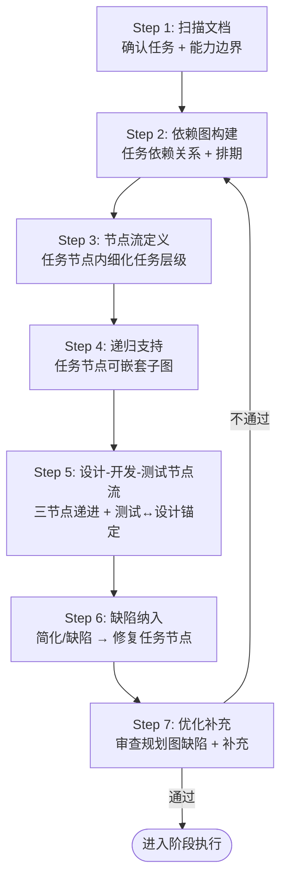

### 17.2 Step 1: 扫描文档 — 确认任务与能力边界

**执行者**：PM-A + ARCH-A

扫描以下文档，确认当前阶段的任务范围和编译器能力边界：

| 扫描目标 | 目的 | 输出 |
|---------|------|------|
| `docs/lang-design/` 对应阶段设计文档 | 确认设计意图 | 设计意图摘要 (3-5 句) |
| `docs/develop/v0/tech-debt-register.md` | 确认当前技术债状态 | 已解决项 + 剩余项清单 |
| `docs/develop/v0/calibration-data.md` | 确认历史校准基线（§6.6.1） | L2/L3 轮次区间 + 误分类率告警阈值 |
| `docs/develop/v0/v0.1-capability-boundaries.md` | 确认当前能力边界 | 已支持/限制/不支持列表 |
| `docs/develop/v0/v0.5-roadmap.md` (或当前路线图) | 确认长期路线图对齐 | 当前版本在路线图中的位置 |
| `docs/tests/matrix.md` | 确认当前测试覆盖 | 测试计数 + 覆盖率 |
| `docs/worklog.md` (尾部) | 确认上一阶段输出 | 上一阶段 Stage Summary |
| `docs/develop/v0/stage-N/` (最新 gate-review) | 确认审查结论 | GO / GO-WITH-CONDITIONS / NO-GO |

**强制规则**：
1. 不得跳过扫描直接规划——即使 Agent "知道"当前状态，也必须先查文档确认。
2. 扫描输出必须包含"能力边界确认"——明确当前编译器能做什么、不能做什么。
3. 如果文档与实际状态不一致，以代码为准但必须在本阶段修正文档（per §8.4.5）。

### 17.3 Step 2: 依赖图构建 — 任务依赖关系与排期

**执行者**：PM-A

基于 Step 1 的扫描结果，构建任务依赖图：

```mermaid
graph LR
    A["任务 A"] --> B["任务 B"]
    A --> C["任务 C"]
    B --> D["任务 D"]
    C --> D
    D --> E["任务 E"]
```

**依赖图规则**：

| 规则 | 说明 |
|------|------|
| 有向无环图 (DAG) | 任务依赖图必须是 DAG——不允许循环依赖 |
| 边 = 执行依赖 | A → B 表示 B 的前置条件是 A 完成 |
| 节点 = 任务节点 | 每个节点是一个"任务节点"（见 Step 3） |
| 并行执行 | 无依赖关系的节点可并行执行 |
| 排期 = 拓扑排序 | 按拓扑排序确定执行顺序 |

**输出**：任务依赖图（mermaid 格式）+ 拓扑排序后的执行计划。

### 17.4 Step 3: 节点流定义 — 任务节点内细化任务层级

**执行者**：PM-A + ARCH-A

每个任务节点内部细化任务层级流：

```mermaid
flowchart TD
    subgraph TaskNode["任务节点 N"]
        T1["子任务 1 (权重: 高)"] --> T2["子任务 2 (权重: 中)"]
        T2 --> T3["子任务 3 (权重: 低)"]
        T3 --> T4["子任务 4 (权重: 中)"]
    end
    TaskNode --> NextNode["下一任务节点"]
```

**节点内规则**：

| 规则 | 说明 |
|------|------|
| 任务权重 | 权重仅作用于节点内任务排序（高→低），不影响跨节点执行顺序。权重含义：**高**=阻塞型/核心路径任务；**中**=重要但可并行；**低**=辅助/文档类 |
| 节点完成条件 | 节点内所有任务 + 子任务全部完成，才能根据执行流边进入下一任务节点 |
| 任务层级 | 节点内任务可有父子关系（子任务是父任务的细化） |
| MUV 对齐 | 每个叶子任务对应一个 MUV（§4），有明确的输入条件、输出物、验收标准 |

### 17.5 Step 4: 递归支持 — 任务节点可嵌套子图

**执行者**：PM-A

任务节点本身也可以是一个任务依赖子图（递归）：

```mermaid
graph LR
    subgraph Outer["外层任务节点"]
        A["子节点 A"] --> B["子节点 B"]
        B --> C["子节点 C"]
    end
    subgraph Inner["子节点 B 展开为内层任务依赖子图"]
        B1["孙任务 B1"] --> B2["孙任务 B2"]
        B2 --> B3["孙任务 B3"]
    end
    C --> NextNode["下一外层任务节点"]
```

**递归规则**：
1. 任何任务节点可以展开为子依赖图。
2. 子图的完成条件 = 子图内所有叶子任务完成。
3. 递归深度无硬性限制，但建议 ≤3 层（避免过度规划）。
4. 子图的执行顺序遵循同一套拓扑排序规则。

### 17.6 Step 5: 设计-开发-测试节点流 — 三节点递进

**执行者**：ARCH-A (设计) + DEV-A (开发) + QA-A (测试)

每个任务节点的内部流应遵循"设计节点 → 开发节点 → 测试节点"递进模式：

```mermaid
flowchart TD
    subgraph TaskFlow["任务节点内流"]
        D["设计节点<br/>查阅 lang-design + 确认方案"] --> Dev["开发节点<br/>区分主次 + 遵循设计原则"]
        Dev --> T["测试节点<br/>从局部到全局 + 多分类 + 全覆盖"]
        T -.->|"测试↔设计相互印证<br/>并决定开发"| D
        T -->|"测试通过"| Done(["节点完成"])
        T -->|"测试不通过"| Dev
    end
```

**三节点规则**：

| 节点   | 职责                                 | 输出                 |
| ---- | ---------------------------------- | ------------------ |
| 设计节点 | 查阅 `docs/lang-design/`，确认方案，输出设计摘要 | 设计意图 + 数据结构 + 接口契约 |
| 开发节点 | 按设计实现代码，区分任务主次关系，遵循 §2.3 设计原则      | 代码 + Bytecode 验证   |
| 测试节点 | 按测试理论设计测试用例，从局部到全局，多分类，全覆盖         | 测试用例 + 覆盖矩阵        |

**测试节点递进图**：

```mermaid
flowchart TD
    T1["阶段 1: 局部单元测试<br/>单个函数/模块"] --> T2["阶段 2: 集成测试<br/>阶段间数据流"]
    T2 --> T3["阶段 3: 端到端测试<br/>全流水线"]
    T3 --> T4["阶段 4: 负向/破坏性测试<br/>错误路径 + 边界条件"]
    T4 --> T5["阶段 5: 健壮性测试<br/>fuzz + stress + 大规模"]
```

**测试↔设计锚定**（per §9.4）：
- 测试用例必须与设计文档相互印证——测试验证设计意图，设计驱动测试用例。
- 如果测试发现设计缺陷，必须回到设计节点修正设计（测试 → 设计反馈边）。
- 如果开发实现偏离设计，测试应捕获偏差（测试 → 开发反馈边）。

### 17.7 Step 6: 缺陷纳入 — 简化/缺陷 → 修复任务节点

**执行者**：PM-A + ARCH-A

如果当前开发过程存在缺陷或简化，必须将完整修复缺陷与简化纳入任务规划排版图：

```mermaid
flowchart LR
    subgraph NormalFlow["正常任务流"]
        D1["设计"] --> Dev1["开发"] --> T1["测试"]
    end
    subgraph DebtFlow["缺陷修复流 (并行)"]
        DebtIdentify["识别简化/缺陷"] --> DebtPlan["规划修复任务"]
        DebtPlan --> DebtDesign["修复设计"]
        DebtDesign --> DebtDev["修复开发"]
        DebtDev --> DebtTest["修复测试"]
    end
    T1 --> Merge["合并验证"]
    DebtTest --> Merge
    Merge --> NextNode["下一任务节点"]
```

**缺陷纳入规则**：

| 规则 | 说明 |
|------|------|
| 识别 | 在设计/开发/测试/审查/修复/重构/文档更新任何流程中发现简化或缺陷时，必须识别并记录 |
| 规划 | 将修复任务作为独立任务节点纳入依赖图（不遗漏） |
| 优先级 | 修复任务的优先级按 §6 缺陷分级确定（P0 阻塞、P1 重要、P2 可延后） |
| 文档化 | 简化/缺陷的原因及描述必须记录在开发/设计文档中（per §8） |
| 修复计划 | 每个简化/缺陷必须有明确的修复计划（目标版本 + 修复方案） |
| 整体性修复 | 同类型错误或存在依赖关系的情况应考虑整体性完整修复，避免存在缺漏和遗失 |
| 适用范围 | 此条例适用于：设计、开发、测试、审查、修复优化重构、复写更新等所有流程 |

### 17.8 Step 7: 优化补充 — 审查规划图缺陷 + 任务重排

**执行者**：REV-A

审查任务规划排版图的完整性：

| 检查项 | 要求 |
|--------|------|
| 任务遗漏 | 所有设计文档要求的功能是否都有对应任务节点？ |
| 依赖完整性 | 所有任务的前置依赖是否明确？是否有缺失的依赖边？ |
| 缺陷纳入 | 所有已知的简化/缺陷是否有修复任务节点？ |
| 测试覆盖 | 测试节点是否覆盖所有开发节点？是否有负向/破坏性测试？ |
| 能力边界 | 规划是否超出了当前编译器能力边界？超出的部分是否有前置任务？ |
| 递归合理性 | 子图递归深度是否合理（≤3 层）？是否有过度规划？ |
| **任务阻塞审查** | 如果任务依赖缺陷或环境阻塞，是否已做任务审查？ |
| **任务重排** | 如果当前能力不足以处理任务，是否已重排任务排版图（当前及以后节点阶段）？ |

**任务阻塞审查**：

当开始选择处理任务时遇到任务依赖缺陷及环境等任务阻塞问题时：
1. **先做任务审查**：当前项目的能力是否具备处理当前任务？是否为最佳处理时机？
2. **如果不能**：重构重排任务排版图（当前及以后节点阶段的图）
3. **记录原因**：将重排原因及描述记录到开发文档中，避免不合理的任务排期和构建

**不通过时**：回到 Step 2 重新构建依赖图。**最多重试 3 次**；3 次不通过则升级到 PM-A + ARCH-A 仲裁，由 PM-A 决定是否缩减范围或调整设计意图。

### 17.9 任务规划排版图输出格式

任务规划排版图必须输出到 `docs/develop/v0/stage-N/plan.md`，包含以下结构：

````markdown
# Stage N 任务规划排版图

## 1. 扫描结果 (Step 1)
- 设计意图摘要: ...
- 能力边界: ...
- 技术债状态: ...

## 2. 任务依赖图 (Step 2)
```mermaid
graph LR
    A[任务 A] --> B[任务 B]
    ...
```

## 3. 任务节点详情 (Step 3-4)
### 任务节点 A: ...
- 子任务 A1 (权重: 高): ...
- 子任务 A2 (权重: 中): ...
- 完成条件: ...

### 任务节点 B: ... (递归子图)
```mermaid
...
```

## 4. 设计-开发-测试节点流 (Step 5)
### 任务节点 A 内流:
- 设计节点: ...
- 开发节点: ... (主任务: ..., 次任务: ...)
- 测试节点: ... (阶段 1-5)

## 5. 缺陷修复任务 (Step 6)
### 缺陷 D1: ...
- 原因: ...
- 修复计划: ...
- 修复任务节点: ...

## 6. 审查结论 (Step 7)
- GO / NEEDS REVISION
````

### 17.10 与现有章节的关系

| 现有章节 | §17 关系 |
|---------|---------|
| §4 MUV 拆分 | §17 Step 3 的叶子任务 = MUV；§17 是 §4 的前置规划 |
| §13.1 设计对齐 | §17 Step 1 扫描包含 §13.1 的设计文档查询；§17 在 §13.1 之后执行 |
| §5 审查-修订内循环 | §17 Step 7 审查 = §5 内循环在规划层面的应用 |
| §9.4 设计-开发-测试锚定 | §17 Step 5 三节点流 = §9.4 在任务规划层面的实例化 |
| §6 缺陷分级 | §17 Step 6 缺陷纳入使用 §6 的分级标准 |
| §14 深度审查 | §17 在阶段开始时执行，§14 在阶段末尾执行——首尾呼应 |

---

## 18. 依赖与基础设施审查

> **目的**：当设计内容需要依赖底层实现和功能时，必须先做依赖与基础设施完整能力审查，确认前置项完整且具备完全设计实现当前任务的能力。
>
> **触发时机**：在设计和开发过程中，发现设计的内容需要依赖底层实现或功能时。
>
> **执行者**：ARCH-A 主导审查，DEV-A 验证实现，QA-A 验证测试。

### 18.1 审查内容

当发现设计依赖底层实现时，必须审查以下内容：

| # | 审查项 | 要求 |
|---|--------|------|
| 1 | **基础设施能力** | 当前项目的基础设施能力是否完整且具备完全设计实现当前任务的能力？ |
| 2 | **前置项完整性** | 当前任务的前置项（依赖）是否完整？前置项的设计、开发、测试是否完善（编码、文档）？ |
| 3 | **其他依赖性问题** | 是否存在其他依赖性问题？ |
| 4 | **全面审查** | 如果存在缺失或问题，对整个基础设施与前置项进行全面审查（当发现一个 bug 时往往隐藏着更多问题） |

### 18.2 审查流程

```mermaid
flowchart TD
    A["发现设计依赖底层实现"] --> B["1. 审查基础设施能力"]
    B --> C{"能力完整？"}
    C -->|是| D["继续当前任务"]
    C -->|否| E["2. 审查前置项完整性"]
    E --> F{"前置项完整？"}
    F -->|是| D
    F -->|否| G["3. 全面审查基础设施与前置项"]
    G --> H["4. 修复缺失项"]
    H --> I["5. 再次审查"]
    I --> C
```

### 18.3 核心原则

> **"直到审查不出问题为止"**：审查不是一次性活动，而是迭代过程。发现一个 bug 时往往隐藏着更多问题，必须持续审查直到确认无遗漏。

- **迭代审查**：每修复一个缺失项后，重新审查是否有新的依赖性问题
- **全面覆盖**：审查不仅看直接依赖，还要看间接依赖（当发现一个 bug 时往往隐藏着更多问题）
- **记录结果**：每次审查结果记录在开发文档中

### 18.4 外部依赖审查

| 依赖              | 引入阶段     | 必要性          | 替代方案                 |
| --------------- | -------- | ------------ | -------------------- |
| `rustc`/`cargo` | Stage 0  | **必须**（开发语言） | 无                    |
| LLVM            | Stage 3+ | **可选**（发布优化） | QBE, Cranelift, C 转译 |
| QBE             | Stage 2+ | **可选**（快速后端） | Cranelift, C 转译      |
| Cranelift       | Stage 2+ | **可选**（快速后端） | QBE, LLVM            |

### 18.5 内部依赖图

```mermaid
flowchart TD
    subgraph Crates["Cargo Workspace"]
        L0["kerf-span<br/>Span/位置"]
        L1["kerf-syntax<br/>SyntaxObject"]
        L2["kerf-reader<br/>词法+语法"]
        L3["kerf-expander<br/>宏展开"]
        L4["kerf-core<br/>CoreExpr 定义"]
        L5["kerf-compiler<br/>字节码生成"]
        L6["kerf-vm<br/>字节码 VM"]
        L7["kerf-runtime<br/>运行时/GC"]
        L8["kerf-driver<br/>编译器入口"]
    end
    
    L0 --> L1
    L1 --> L2
    L1 --> L3
    L4 --> L3
    L4 --> L5
    L5 --> L6
    L6 --> L7
    L2 --> L8
    L3 --> L8
    L5 --> L8
    L6 --> L8
```

### 18.6 依赖限制处理

- **发现依赖限制时**：停止推进，同步到 tech-debt，参考同类优秀实例修复
- **禁止阉割版推进**：正确 > 妥协（§2.3 原则 9）

---

## 19. 阶段打包规则

> **目的**：每个 stage 阶段完成后必须压缩打包并返回包，确保用户可以获取每个阶段的完整交付物。
>
> **触发时机**：每个 stage 阶段完成且验收通过后（§3.2 验收全绿）。
>
> **执行者**：主导 Agent（通常为 ARCH-A 或 DEV-A）。

### 19.1 打包规则

| 规则 | 说明 |
|------|------|
| **时机** | 每个 stage 阶段完成且 §3.2 验收全绿后立即打包 |
| **格式** | tar.gz 压缩包 |
| **命名** | `kerf-<stage0...>-v<big-version>.<min-version>.<fix-version>-<big-doc-stage-dev-plan-ver>.<small-doc-stage-dev-plan-ver>-<short-details>.tar.gz` |
| **内容** | 排除 `target/`、`.git/`、`download/` 目录 |
| **位置** | 保存到 `/home/z/my-project/download/` 目录 |
| **验证** | 打包后验证文件存在且大小合理（> 1MB） |

### 19.2 命名约定示例

```
kerf-stage0-v0.1.0-stage0.1-process-doc-v10.0-optimize-r1.tar.gz
```

- `kerf` — 项目名称
- `stage0` — 当前 stage 编号
- `v0.1.0` — 项目版本号
- `process-doc-v10.0-optimize` — 简短描述
- `r1` — 修订号（递增）

### 19.3 打包前检查

- [ ] §3.2 验收命令全绿
- [ ] Git Commit 已完成
- [ ] `RELEASE_NOTES.md` 已更新
- [ ] 版本号已 bump

### 19.4 打包命令

```bash
# 打包产物（v12.3 修正：tools/ + scripts/ + worklog.md + .gitignore 纳入——r34 包内自举实测教训：
# 缺 tools/qbe 二进制致 qbe_backend_tests 9 case 失败（QBE 查找链无「编译期仓库锚」兜底可达）；
# r25+ 实践惯例（r33 包含 tools/ 10 条目）与 §19.4 模板漂移——本轮以实践为准修正模板（R4 口径）
tar -czf /home/z/my-project/download/kerf-stage<N>-v<version>-<details>-r<N>.tar.gz \
    src/ \
    crates/ \
    tests/ \
    docs/ \
    examples/ \
    scripts/ \
    tools/ \
    Cargo.toml \
    Cargo.lock \
    README.md \
    RELEASE_NOTES.md \
    worklog.md \
    .gitignore
```

---

## 20. 迭代审计原则

> **目的**：将"直到审查不出问题为止"的迭代审计原则固化为流程规则。审查不是一次性活动，而是持续迭代直到确认无遗漏。
>
> **触发时机**：
> 1. 发现一个 bug 或 soundness hole 时（§17.7 缺陷纳入）
> 2. 修复一个 bug 后（审查是否有同类 bug）
> 3. 修复一个 soundness hole 后（审查是否有类似 hole）
> 4. 任何深度审查（§14.5 / §14.6）完成后
>
> **执行者**：ARCH-A 主导，QA-A 验证。

### 20.1 核心原则

> **"直到审查不出问题为止"**：当发现一个 bug 时往往隐藏着更多问题。修复后必须继续审查同类路径，直到不再发现新问题。

**Bug 概率分布推理**：
- 发现一个 bug 意味着**肯定存在大量类似 bug** — 因为 bug 的产生源于设计缺陷或实现模式错误，而设计/模式会在多处复用
- 遇到 bug 的阶段**肯定也大概率含有类似 bug** — 因为同一阶段的代码由同一模式生成，共享相同的缺陷模式
- Bug 的**显隐关系**：显性 bug（已触发）是冰山一角，隐性 bug（未触发但存在相同缺陷模式）往往更多
- 因此：**多方面全方位审查**是必要的 — 不仅仅是审查同类路径（§20.3），还要审查不同维度的同类模式（如所有传递 `None` 的位置、所有 `&cx` 签名的函数、所有 `loop {}` marker body）

### 20.2 迭代审计流程

```mermaid
flowchart TD
    A["发现 bug / soundness hole"] --> B["修复 bug"]
    B --> C["审查同类路径"]
    C --> D{"发现新问题？"}
    D -->|是| E["记录新问题"]
    E --> B
    D -->|否| F["审查其他相关路径"]
    F --> G{"发现新问题？"}
    G -->|是| E
    G -->|否| H["审计收敛 — 审查完成"]
```

### 20.3 同类路径审查

修复一个 bug 后，必须审查所有"同类路径"——即相同模式的其他代码路径：

| 发现的 bug 类型 | 需要审查的同类路径 |
|----------------|-------------------|
| 类型未传播 | 所有接收类型的代码路径（let binding, fn call arg, struct field, enum variant, fn return, if branch, match arm, array element, Box::new, struct literal field） |
| unify arg order 反转 | 所有 unify 调用点 |
| LOC 超阈值 | 所有源文件 LOC |
| 接口隔离违规 | 所有跨阶段调用 |
| 缺少某字段传播 | 所有表达式上下文 |

### 20.4 收敛条件

审计"收敛"（完成）的条件：
1. 连续 1 轮全面审计未发现新问题
2. 所有已发现问题均已修复
3. 所有修复均通过验收（§3.2）
4. 所有同类路径均已审查

### 20.5 与 §17.7 的关系

§17.7（缺陷纳入）定义了"发现 bug 时应纳入修复任务"的规则。§20（迭代审计）补充了"修复后继续审查同类路径直到不再发现新问题"的迭代原则。两者互补：

| 协议 | 关注点 | 时机 |
|------|--------|------|
| §17.7 缺陷纳入 | 发现 bug → 纳入修复任务 | 任何流程中发现 |
| §20 迭代审计 | 修复 bug → 审查同类路径 → 直到收敛 | 修复 bug 后 |

### 20.6 实验性探索方法论

> **目的**：将"注释 1 行 → 测试 → 恢复/移除"实验方法论固化为可复用流程规则。

**适用场景**：当架构重构涉及移除某个 phase/workaround/pass 时，必须先验证移除是否安全。

**方法论步骤**：

1. **注释目标代码**（1 行或 1 个函数调用）
2. **运行全测试套件**（`cargo test --release -- --test-threads=1`）
3. **判断结果**：
   - **0 失败** → 目标代码冗余 → 标记为 REMOVED → 更新文档
   - **N 失败** → 目标代码仍必需 → 深挖根因（必要时走 §1.6 升级路径仲裁）
4. **如果深挖根因后找到修复** → 修复根因 → 重新步骤 1-3
5. **如果连续 2 轮深挖后仍 NOT redundant** → §5.2 收敛 → 标记为 required → 记录根因 → 转向下一个 phase

**关键原则**：
- **深挖根因义务（§1.6 升级路径兜底）**：不接受"NOT redundant"的表面结论 — 必须深挖根因（v12.5 修正：原"§1.6 终极检验"为坏链——§1.6 为任务分派与升级路径）
- **§2.3 原则 9 (正确 > 妥协)**：不强行移除仍必需的代码
- **§2.3 原则 5 (去除兼容思维)**：如果 0 失败 → REMOVED（不是仅 disabled）
- **§5.2 (提前收敛)**：连续 2 轮 NOT redundant → 真正极限

**方法论启示**：当 §5.2 收敛到"NOT redundant"时，必须执行外科手术式实验（拆分 bundled concerns）区分 TRUE LIMIT vs WORKAROUND。本方法论需要扩展支持 surgical split（env var guards per pass）。

### 20.7 每阶段统计

| 指标 | 记录到 |
|------|--------|
| 预估等级 vs 实际轮次 | calibration-data.md |
| P0/P1/P2/P3 数量 | calibration-data.md |
| P3 误分类率 | calibration-data.md |
| 集成测试覆盖率 | calibration-data.md |
| 外循环否决票领域 | calibration-data.md |
| 紧急通道触发次数 | calibration-data.md |

### 20.8 校准数据池更新（闭环接线 v12.5）

每大阶段末尾必须更新 `docs/develop/v0/calibration-data.md`。**闭环义务**：更新时若发现校准阈值越界（P3 误分类率 ≥30% / 集成覆盖率 <50% / 实际轮次 > 预估 × 1.5 连续两阶段），必须开立 §3.3 演进提案（或 worklog 显式记录"裁定不修订"及理由）——审计发现必须导向 SOP 修订决定，禁止只记录不处理。

---

## 21. 阶段推进规划与后端策略

> **目的**：为项目的长期推进提供分阶段的后端策略、语言选择和演进路径指导。每个 Agent 在进入新阶段前**必须**首先阅读本节。

### 21.1 总体阶段规划

| Stage | 核心目标 | 实现语言 | 后端策略 | 关键产出 | 代码量估计 | 工程节奏 |
|-------|---------|---------|---------|---------|-----------|---------|
| **Stage 0** | 语义验证 | Rust（100%） | 自建字节码 VM | 12（10+2）能力模型：Reader + Expander + 9 原语 + VM + Runtime + GC + 四项接口预留 | ~7000 行 | 最小内核 2-4 周 / 完整矩阵 12-18 周（§21.8） |
| **Stage 1** | 自举验证 | Rust (~70%) + kerf (~30%) | Stage 0 VM | 目标语言子集重写核心 + 类型检查器 | ~8000 行 | 4-8 周 |
| **Stage 2** | 完整语言 | kerf (~80%) + Rust (~20%) | 可选 QBE/Cranelift/C 转译 | 完整 kerf 编译器 + 标准库 + FFI | ~20000-50000 行 | 8-16 周 |
| **Stage 3+** | 完全自举 | kerf (100%) | 可选 LLVM（发布后） | 完全自举的编译器 + 工具链 | 持续增长 | 持续演进 |

### 21.2 后端策略演进

```mermaid
flowchart TD
    subgraph S0["Stage 0: 自建 VM"]
        VM0["字节码 VM<br/>~1500 行 Rust/C<br/>性能: 1/10-1/30"]
    end
    
    subgraph S2["Stage 2: 可选后端"]
        QBE["QBE 后端<br/>10% 代码=70% 性能"]
        CRANE["Cranelift 后端<br/>编译快40%"]
        CTRANS["C 转译器<br/>最大可移植性"]
    end
    
    subgraph S3["Stage 3 及以上: LLVM"]
        LLVM["LLVM 后端<br/>仅发布构建<br/>极限优化"]
    end
    
    VM0 -->|语义稳定后| QBE
    VM0 -->|语义稳定后| CRANE
    VM0 -->|语义稳定后| CTRANS
    QBE -->|需要极限性能| LLVM
    CRANE -->|需要极限性能| LLVM
    CTRANS -->|需要极限性能| LLVM
```

**核心约束**：
1. **LLVM 永远不进入自举链**——编译器永远能不依赖 LLVM 构建
2. **后端永远可插拔**——通过统一的目标描述接口切换
3. **开发构建使用快速后端**——仅发布构建用 LLVM
4. **自建 VM 永远保留**——作为调试、交叉编译和嵌入的后备

**编译速度四档预期（v12.6/r57 接入——next5.md 第九轮 Round 1 吸收链）**：Stage 0 验证编译 ~10μs/行（~10 万行/秒）/ Stage 1 开发编译 ~20μs/行 / Stage 2 增量编译 ~ms 级（整应用——查询式增量架构）/ Stage 3+ 发布编译 ~200μs/行；双路径策略 = 开发快速路径（类 Zig 增量 10-50ms）+ 发布慢速路径（类 GCC -O2），用户按需选择。公开标杆：TCC ~1μs/行（单遍零优化）/ Jai ~10μs/行（声明值不可独立复验——原则 35）/ Zig 增量 10-50ms。**各档验收口径与后端载体对齐**（本节后端策略决定载体，四档预期决定验收）；权威落位 = lang-design/08-backend-evolution.md §4（速度标杆表 + 四档 + 双路径 + kerf QBE AOT 实况对照——可选不入自举链）。

**转换开销正贡献（v12.7/r58 接入——next6.md 第十轮 Round 2 吸收链）**：IR 层级正交精简（四层修正案——权威落位 08 §5.2 / 15 §5.2）对四档速度的量化贡献：IR 转换 5 次 → 3 次（40% 减少——AST→CoreExpr+元数据单遍 / CoreExpr→ANF-SSA 单遍 / ANF-SSA→LLVM 一次生成）；完整遍历 6 次 → 3 次（Stage 1 开发档与 Stage 2 增量档直接受益）；Layer 3 原地 pass 修改（内存分配显著减少）；转换减少 = 信息丢失减少。设计口径——修正案登记非推翻（开窗后实测对账，同 QBE AOT 实况对照纪律）。

### 21.3 各阶段验收标准

| Stage | 验收标准 | 阻塞项 |
|-------|---------|--------|
| **Stage 0** | (1) 9 原语语义正确 (2) 50+ 快照测试通过 (3) 自举测试通过（编译器编译自身，两次输出一致） (4) Span 全管线传播 (5) 性能基准基线建立 (6) 四项接口预留冻结（Effects / 多阶段 / 能力模型 / 编译缓存，§21.7） | 语义错误、Span 丢失、接口预留未冻结 |
| **Stage 1** | (1) 目标语言子集能表达编译器前端 (2) 在 Stage 0 VM 上正确运行 (3) 标准库最小集可用 (4) 增量编译基础设施可用 | 类型检查循环依赖 |
| **Stage 2** | (1) 完整 kerf 编译器用 kerf 编写 (2) 两次编译自身结果一致 (3) 至少一个非 VM 后端工作 (4) FFI 可用 | FFI 所有权模型未定义 |
| **Stage 3+** | (1) 完全自举（100% kerf） (2) 构建系统可用 kerf 重写 (3) 开发效率不低于 Rust 版本 | 无阻塞项 |

### 21.4 语言选择决策

| 阶段 | 开发语言 | 理由 |
|------|---------|------|
| Stage 0 | **Rust（100%）** | 内存安全 + 类型安全 + 现代工具链；借用检查器强制思考数据所有权 |
| Stage 1 | **Rust (~70%) + kerf (~30%)** | 核心前端用目标语言重写；VM/工具链保持 Rust |
| Stage 2 | **kerf (~80%) + Rust (~20%)** | 大部分迁移到 kerf；构建引导和后端 FFI 保持 Rust |
| Stage 3+ | **kerf (100%)** | 完全自举；Rust 仅作为历史遗迹 |

### 21.5 阶段切换信号

**从 Stage N 切换到 Stage N+1 的条件**（全部满足）：

```
□ 语义稳定：当前阶段所有核心原语/功能语义正确且通过测试
□ 自举验证：编译器编译自身，两次输出字节一致
□ 测试覆盖：测试矩阵覆盖率 ≥ 95%
□ 性能基线：当前阶段性能基准已建立
□ 文档同步：所有设计文档与代码一致
□ 能力处理程度：各能力模型处理程度与 §21.9 演进矩阵的本阶段要求一致，无倒挂
□ 技术债清零：所有 P0/P1 已修复
□ 外循环投票：≥ 95% 通过
□ 阶段间深度验证（§14.6）：4 项强制审查全部通过
```

### 21.6 风险与缓解

| 风险 | 影响 | 缓解策略 |
|------|------|---------|
| 过早自举 | 语言特性不稳定导致返工 | 严格遵循切换信号（§21.5） |
| 性能悬崖 | VM→本地码切换时性能骤降 | 渐进式后端策略（§21.2） |
| 类型检查循环依赖 | Stage 1 无法用目标语言编写类型检查器 | 外部 Rust 实现类型检查器，Stage 2+ 再迁移 |
| 生态锁定 | LLVM 依赖导致无法完全自举 | LLVM 永远不进入自举链（§21.2） |

### 21.7 能力成熟度分级与处理程度标度

> **目的**：回答“每个能力模型应该在哪个阶段引入、引入到什么程度”——这是阶段规划（§21.1）与 §17 任务规划（Step 1 扫描）的能力维度输入。**引入时机的第一判据是生态成熟度**：不是“技术是否存在”，而是“技术是否已在生产环境中被足够规模的实践验证”。

#### 21.7.1 三档成熟度分级

| 成熟度档次 | 判定标准 | 2026 年代表能力 | 处理程度上限 |
|-----------|---------|---------------|-------------|
| **生产就绪** | 10 年以上生产环境验证，失败模式已知 | Token 流 + 图 IR、结构化 CodeValue、Span 系统、诊断框架 | P0/P1 直接实现 |
| **早期实践** | 主流语言已发布稳定实现，大规模应用仍集中于工具链与基础设施 | Effect Handlers、编译缓存 | P2 接口预留（可加最小验证） |
| **研究前沿** | 理论成熟但实现依赖启发式方法，或语言级应用生态未建立 | 多阶段编程、能力模型 + 线性类型 | P3 仅类型定义 |
| **其余** | 不在 Stage 0 设计范围 | LSP、本地码生成、优化器、FFI、并发（**类型检查器**：原列本档，r7 经 §21.6 风险缓解「外部 Rust 实现 + Stage 2+ 再迁移」路径提前至 Stage 1 引入——保守静态 R1-R8 + 多错误 E0005；提前引入经阶段计划显式登记，不构成 §21.9 解读规则 1 的倒挂） | P4 完全推迟 |

**成熟度是时间函数而非静态标签**：早期实践层能力正沿“工具链 → 语言核心”路径扩散；研究前沿层能力可能在 Stage 2 执行期间跨入早期实践档。因此 §21.9 的演进矩阵把每个阶段的引入决策设计为“可依据当时成熟度重新评估”的结构，而非一次性锁死——每阶段规划时必须重新核对届时成熟度。

#### 21.7.2 处理程度五级标度（P0-P4）

“引入到什么程度”需要一个比“实现/推迟”二元划分更细的**可审计**标度——五级标度让处理程度成为明确的工程承诺：

| 级别 | 名称 | 处理深度 | 冻结内容 | Stage 0 例子 |
|------|------|---------|---------|-------------|
| **P0** | 完整实现 | 生产深度：全部行为 + 错误路径 + 测试 | 接口契约 + 语义 | Token Reader、图 IR、Span、诊断、GC、VM |
| **P1** | 基础实现 | 核心路径可用，边界特性显式推迟 | 接口契约 | 宏系统（卫生保证完整，展开调试工具推迟）、最小 I/O |
| **P2** | 接口预留 | 冻结类型签名与行为规格，无实现 | trait 签名 + 语义约定 | 编译缓存 |
| **P3** | 类型定义 | 仅类型声明，行为规格部分留白 | 类型形状 | Effect Handlers、多阶段编程、能力模型 I/O |
| **P4** | 完全推迟 | 不设计、不预留 | 无（重新评估时机已约定） | LSP、类型检查器、本地码生成、优化器、FFI、并发 |

**匹配规则**（§2.2 原则 26）：生产就绪 → P0/P1；早期实践 → P2；研究前沿 → P3；其余 → P4。P2 与 P3 的区别不是术语游戏——P2 的 trait 签名附带完整行为规格（下一阶段可直接按规格实现），P3 只承诺类型形状（行为语义留给引入时的实践数据来定）。

### 21.8 能力引入的 Phase 管线与双时间口径

Stage 0 完整能力矩阵（12（10+2）个能力模型 = 10 个语义与编译期能力 + 2 个运行时基座）的构建过程，按能力引入的依赖关系划分为四个 Phase：

| Phase | 主题 | 内容 | 依赖关系 |
|-------|------|------|---------|
| **Phase 1 语义验证** | 核心语义 | Token Reader → 图 IR → 元循环求值器 → 闭包 → 最小 I/O，加字节码 VM 与 GC 构成运行时基座；用 eval 与 VM 双执行路径互查验证 9 原语语义 | 起点 |
| **Phase 2 基础设施** | 质量基座 | Span 全管线传播、结构化诊断框架、相位分离系统 | **与 Phase 1 并行贯穿**——Span/诊断从第一天内置进数据结构（原则 6：横切关注点必须早期内置），而非事后补丁 |
| **Phase 3 可拓展性** | 宏引擎 | 结构化 CodeValue + 基础宏系统 | 硬依赖相位分离（无 Phase 0/1 隔离的宏展开无法保证正确性）；软依赖 Span |
| **Phase 4 接口预留** | 演进空间 | 冻结 Effects / 多阶段 / 能力模型 / 编译缓存四项类型签名 | 依赖类型系统定型（接口形状引用 Value、CodeValue、Span 等已定型类型） |

```mermaid
flowchart TD
    P1["Phase 1 语义验证<br/>Reader / IR / Eval / 闭包 / I/O<br/>+ VM + GC 运行时基座"]
    P2["Phase 2 基础设施<br/>Span / 诊断 / 相位分离<br/>（与 Phase 1 并行贯穿）"]
    P3["Phase 3 可拓展性<br/>CodeValue + 宏系统"]
    P4["Phase 4 接口预留<br/>冻结四项类型签名"]
    M["Stage 0 完成<br/>完整能力矩阵交付"]
    N["Stage 1 启动<br/>目标语言重写"]
    P1 --> P3
    P2 --> P3
    P3 --> P4
    P4 --> M
    M --> N
```

**双时间口径**（§21.1 工程节奏列的两个数字，必须显式区分）：

| 口径 | 时长 | 内容 | 价值 |
|------|------|------|------|
| **最小语义内核** | 2-4 周 | Phase 1 的加速交付（Reader / Expander / Compiler / VM / GC 及其测试） | 尽早验证核心语义；Stage 1 准备工作可提前启动 |
| **完整能力矩阵** | 12-18 周 | 在最小内核之上：基础设施做到全管线深度（Span 贯穿每处）、宏系统做到完整卫生保证、完成全部四项接口预留冻结 | 把后期重构成本从“架构级返工”降为“按冻结接口替换实现” |

**口径分工**：Phase 视角服务架构决策（能力依赖决定顺序），Week 视角服务工程执行（人力与节奏决定排期）。团队可先完成 Phase 1 最小版本（2-4 周口径）再回头补足基础设施深度——这个弹性正是 §21.11 前两类基础设施风险的缓冲空间。

### 21.9 Stage 0 → Stage 3+ 能力演进矩阵

每个能力模型在每个阶段的处理程度状态（状态用语与 §21.7.2 五级标度衔接；**实现中** = P0/P1、**重写升级** = P0 状态保持但实现语言替换、**预留定义** = P2/P3、**做实引入** = 从预留转为实现、**移除** = 退役）：

| 能力 | Stage 0<br>（完整 12-18 周） | Stage 1<br>（4-8 周） | Stage 2<br>（8-16 周） | Stage 3+<br>（持续） |
|------|--------------------------|---------------------|---------------------|---------------------|
| Token 流 + 图 IR | 实现中（P0） | 重写升级（目标语言） | 完全自举 | 优化（增量/并行） |
| 结构化 CodeValue | 实现中（P0） | 增强（宏集成） | 升级（多阶段支持） | 优化（JIT 预备） |
| 元循环求值器 | 实现中（P0） | 重写升级 | 被编译器替换 | 移除 |
| 基础闭包 | 实现中（P0） | 保持 | 升级（Effects 引入后语义协调） | Effects 生态 |
| Effect Handlers | 预留定义（P3） | 做实引入（编译器内部）**✅ r8 做实（一次性逃逸层 + InternalEffectSystem，语言面保持 P3）** | 做实引入（语言级） | 异步生态 |
| 多阶段编程 | 预留定义（P3） | 预留保持（类型扩展） | 做实引入（实验） | 编译期优化 |
| 能力模型 I/O | 预留定义（P3，lang-design 侧 v5.2 修订为 P2） | 做实引入（基础传递）**✅ r8 做实（require 声明 + R9/E0006 + IoGrant 令牌门控）** | 做实引入（完整模型） | 安全沙箱 |
| Span 系统 | 实现中（P0） | 保持 | 保持 | 保持（永续增强） |
| 诊断框架 | 实现中（P0） | 保持 | 保持 | IDE 集成 |
| 宏系统 | 实现中（P1） | 增强（调试工具） | 完整化 | DSL 生态 |
| 编译缓存 | 预留定义（P2） | 做实引入（查询式）**✅ r7 做实（内存内容寻址 + 三方法 + 管线复用）** | 深化（增量编译） | 并行查询 |
| 字节码 VM + GC | 实现中（P0） | 保持 | 升级（本地码后端并存） | 分代 GC / JIT |
| **（附加）类型检查器** | 完全推迟（P4） | **✅ r7 提前引入（保守静态 R1-R8 + 多错误 E0005——循环依赖风险缓解「外部 Rust 实现」路径落地，偏差已登记）** | 迁移评估（自举内迁） | 类型生态 |

> **实施状态对账注记（v11.1，2026-09-10）**：上表 ✅ 标记为实施进度回写——四项（编译缓存/类型检查器/Effect 编译器内部/能力 I/O 基础传递）均在 Stage 1 批次 C/D 交付，方向与矩阵规划一致（无倒挂）；类型检查器为提前引入（P4 → Stage 1 实现），系 §21.6 风险缓解路径的显式裁定（阶段计划登记），按解读规则 3 要求在此登记偏差依据；能力模型 I/O 的 Stage 1 单元格由「预留保持（基础传递）」更新为「做实引入（基础传递）」——r8 实施实际交付了基础传递（声明面 + 编译期验证 + 令牌授权），符合单调深化。语言级 Effect 与完整能力模型维持 Stage 2 计划不变。详细状态与 lang-design 侧同步对账见 [12-路线图 §2.5.1](lang-design/12-roadmap.md)。

**解读与执行规则**：
1. **处理程度单调深化**：沿时间轴应当“预留 → 做实 → 优化”单调深化。任何“先实现再降级回预留”的倒挂都意味着引入时机判断失误，必须触发 §21.11 风险评审并在 gate review 标记为 P1。
2. **“预留长期不做实”是允许的**：接口预留的成本只有类型维护，没有实现债务。
3. **阶段门审查应用**（§7.3）：gate review 必须核对当前各能力模型的实际处理程度与本矩阵一致——超出矩阵提前实现（如 Stage 0 做完 Effects 全语义）或落后于矩阵（如 Stage 1 仍未做实编译缓存）均按 §6 缺陷分级处理。
4. **两个特殊行**：元循环求值器是唯一规划了退役路径的能力（Stage 2 起被编译器替换，Stage 3+ 移除）；Span 与诊断是唯二“实现后永续增强”的能力（质量属性随阶段只增不减）。

### 21.10 能力模型选型决策点

三大能力维度的“传统方案 vs 前沿方案”选型均已裁定并冻结于设计蓝图：

| 维度 | 决策点 1：元循环求值器 vs 多阶段编程 | 决策点 2：传统闭包 vs Effect Handlers | 决策点 3：传统 I/O vs 能力模型 I/O |
|------|----------------------------------|--------------------------------------|-----------------------------------|
| 选传统方案 | 自举快 3-4 周；Stage 1 重写简单；无类型保证；风险低 | 自举快 1-2 周；异步/并发需额外机制；生态成熟 | 自举快 0.5-1 周；无权限控制；生态成熟 |
| 选前沿方案 | 自举慢 3-4 周；重写复杂（需实现多阶段原语）；有类型保证；实现依赖启发式（风险高） | 自举慢 1-2 周；原生支持异步/并发；生态新兴 | 自举慢 1-2 周（线性类型实现）；编译期权限验证；生态新兴 |
| **Stage 0 裁定** | 元循环求值器（多阶段 Stage 2+ 替换） | 传统闭包（Effects Stage 2 语言级引入） | 传统 I/O（能力模型 Stage 1 基础 / Stage 2 完整） |

**共同裁决逻辑**：先快速验证语义，再引入高级机制——语义正确性错误在传统方案中 2 周内即可暴露；若在引入前沿方案的复杂度之后才发现语义错误，修正成本会乘上效应系统/多阶段系统本身的实现规模。

**变更控制**：三个裁定已冻结，推翻任一裁定属于架构级变更——必须走 §13.2 切换期重构流程 + §6.3 委员会投票，并在 §14.8 阶段末尾设计回写中记录偏差依据。

### 21.11 能力引入进程风险

与 §21.6 的进程级风险互补，本表覆盖能力引入层面的六类风险——每项附**触发信号**：当信号出现时按既定缓解策略行动，而不是重新展开决策：

| 风险 | 概率 | 影响 | 触发信号 | 缓解策略 |
|------|------|------|---------|---------|
| 类型化 Token 流设计过度 | 中 | 延迟 2-3 周 | Token 结构字段超出接口契约仍在增加 | 回退最简 Token，增强项推迟 Stage 1 |
| 图 IR 实现过于复杂 | 中 | 延迟 2-3 周 | 共享查找/哈希逻辑侵入正常构造路径 | 先用树 AST 承载，图结构 Stage 2 迁移 |
| 宏系统开发延期 | 高 | 延迟 3-4 周 | 第 2 周结束时展开器骨架未通过核心形式测试（周表口径，§21.8） | 先落非卫生宏撑起管线，卫生保证下一阶段补齐 |
| 相位分离设计错误 | 中 | **不可逆**（核心重构） | 宏代码与运行时代码出现隐式值传递 | 严格执行相位边界；参考 Racket 相位语义 |
| 接口预留过多 | 低 | 维护负担 | 预留 trait 数量超出 14 项矩阵清单（lang-design/13 §3.4） | 裁剪回矩阵清单——矩阵外预留须走 §13.1 设计对齐重新裁决 |
| 接口预留不足 | 中 | Stage 2 破坏性重构 | 阶段期间出现绕过接口直改内部类型的冲动 | P0 三项（LSP 查询/调试信息/增量查询）与既有四项预留不动摇（§21.12）；新增内部类型时先查 §3.4 矩阵是否要求预留位置 |

其中“相位分离设计错误”是唯一标为不可逆的风险——这正是 Span / 诊断 / 相位分离必须从第一天内置（原则 6、§21.8 Phase 2 并行贯穿）的原因。

### 21.12 接口预留时机（v6.1 完整性审查接入）

**接口预留层完整清单（14 项）与优先级**的权威落位是 lang-design/13-capability-matrix.md §3.3-§3.5（next4.md 第八轮吸收：既有 4 项预留 + 10 项新识别接口；LSP/FFI 自完全推迟层重分类）。本节只登记**流程接入点**：

1. **与能力引入时机（§21.7-§21.11）的叠加规则**：能力引入时机（§21.9 演进矩阵）决定接口**何时被实现**；接口预留时机（lang-design/13 §3.5.1 P0-P3）决定数据结构位置**何时被冻结**。前者可以推迟，后者必须在 Stage 0（P0 项）或 Stage 1（P2 项）完成，否则破坏渐进替换原则（原则 28）。
2. **与 §13.1 设计对齐的接线**：任何涉及 AST/IR/编译器架构数据结构的新设计，进入内循环前必须先查 13 §3.4 矩阵——若该数据结构承载 P0 预留位置（AST 增量/绑定查询、IR 反向链接/稳定 ID、查询式 pass 建模），设计方案须显式声明预留挂点，否则设计对齐不通过。
3. **与 §6.2 技术债的接线**：P0 预留位置的缺失按 P1 技术债登记（「预留位置缺失」类——破坏性重构风险），不得因「功能未实现」降级为 P3（§6.2 分级审查 + 原则 32）。
4. **预留成本口径**：14 项全量预留 ~3 周（Stage 0 12-18 周内占比 17-25%）；裁剪只允许发生在 P2/P3 项（P0 三项不可妥协），且裁剪须登记技术债。
5. **接口预留 × 机制预留正交互补（v12.6/r57 接入——next5.md 第九轮「接口预测悖论」吸收）**：接口预留（13 §3.4 14 项矩阵）防**已知需求**的破坏性重构（冻结数据结构位置——原则 32）；机制预留（13 §3.6——原语图灵完备 + 自定义效应/宏展开/能力系统三种打洞能力）防**未知需求**的不表达（保证表达通道——原则 36）。两者不可互相替代：14 项清单只覆盖清单制定时的已知世界，任何新需求评估必须先过机制通道（Custom 效应/宏/能力可承载 → 不修改编译器）再考虑编译器变更（过 22 新原语两判据 + 23 §2.2 触发式纪律）。**判据强化（代价分级）**：接口预留义务的判别式 = 后期修改代价——**重构级**（数据结构/类型签名/契约——不预留不可后期补救）vs **增量级**（具体实现——可后期添加）——「数据结构不可变，实现可替换」（13 §3.5.4）。
6. **Stage 2 优化窗裁定材料登记（v12.7/r58 接入——next6.md 第十轮「优化桥接与 IR 正交精简」吸收）**：优化窗（T3+ 触发式）开窗时的首批裁定材料已登记——①**模式识别桥接**（13 §3.7：循环四特征/异常三特征判据 + 等价标记 → 复用 LICM/向量化/零成本异常 + 保留细粒度信息获得额外优化——性能天花板风险的正面解法）②**IR 四层修正案**（15 §5.2：结构/语义/形式/目标四维正交——AnnotatedANF 与 SSA 为维度重复层；与六层规划的差集论据[效应标注独立 + MLton 闭包显式化]开窗时按正交性验证表 + 性能实测裁定）。**判据与方案分层吸收纪律**：正交合并三原则（维度正交/Pass 而非 Layer/单遍合并）作为原则 39 **即刻生效为判据**（后续任何 IR 层级设计决策过三原则检查）；四层合并方案本身**触发式评估**（与 14 §4.7 选择 B 同为 T3+ 登记项——零信号不开窗，权威性维持至开窗）。
7. **三阶段性能预期登记与性能讨论判据纪律（v12.8/r59 接入——next7.md 第十一轮「双轨策略总结与偏见纠正」吸收）**：①**性能讨论判据纪律（即刻生效）**：性能潜力（理论上限）与开发成熟度（当前表现——研究投入侧：胖关键字 50 年 vs 极小原语 ~30 年）为两个正交概念——后续任何性能讨论（含优化窗裁定、实测对账、深审性能面、tech-deb 性能登记）**须先过此概念区分**（概念混淆即判据错误——原则 35 同族纪律）；「性能可能稍低」类表述按偏见处理（差距本质 = 研究投入差距非设计本质差距）。②**三阶段性能预期登记（设计口径非承诺）**：短期[模式识别复用后]≈胖关键字水平 ~1/1.2 C / 中期[原语独有优化后]特定场景 1/1.0 甚至超越 / 长期[全程序优化成熟后]> 任何胖关键字语言（理论上限：保留完整语义信息的编译器的极限）——与 §21.2 速度四档构成「运行性能 × 编译速度」双预期矩阵；开窗时作为验收锚候选（实测对账，零信号不开窗）。③**轨道 B 六项验证状态 = 原则 26 成熟度匹配的优化域投影**：生产就绪[MLton 全程序优化] / 早期实践[GHC 流融合、Koka 效应内联、Racket 生态] / 研究前沿[自动并行化、MetaOCaml 部分求值]——六项优化的引入时机与处理程度按此分级匹配（权威落位：lang-design/13-capability-matrix.md §3.7.5 + 08-backend-evolution.md §5.4 + 19-references.md §11）。
8. **根空间统一组织接入（v12.9/r62——next8.md 第十二轮「根空间架构与约束组合代数」吸收）**：①**三层预留体系全景（自 v12.9 起权威口径）**：接口预留（13 §3.4 14 项矩阵——原则 32，防已知需求的破坏性重构）+ 机制预留（13 §3.6 三种打洞能力——原则 36，防未知需求的不表达）+ 根空间统一组织（13 §3.8——原则 40，防预留碎片化与依赖具体化）——点 + 通道 + 骨架三层正交。②**预留接口依赖方向判据（即刻生效）**：任何预留接口（含 13 §3.4 全部 14 项）的签名设计**必须依赖抽象约束（根空间 marker/子空间约束）而非具体实现类型**（依赖倒置的预留层投影）——新预留接口评审过此判据；既有预留接口的依赖方向审计与矫正 = r62 代码面 MUV 的执行内容（用户显式指令开窗——合规信号源）。③**空间关系表述纪律**：预留/拓展空间关系以约束组合代数口径表述（约束特化/合取/格/属于——「继承」仅为概念便利语；用户裁定原文：「概念上方便理解可以说继承，但实质并不是，具备数学原理去解释」——设计文档与代码注释以约束组合为准）。④**组织层零载荷纪律**：根空间是概念骨架非新机制——不新增原语/关键字/语法（原则 1 极小化同族纪律）；代码面落位仅限预留接口依赖方向矫正（T3+ 治理[23 §2.2]与用户显式指令裁量）。
9. **脚手架哲学接入（v13.0/r63——next9.md 第十三轮「双向调试策略与脚手架哲学闭环」吸收）**：①**三种已登记脚手架全景**：语法脚手架（S 表达式 Reader——Stage 2 拆除换目标语法，验证锚 = 新 Reader 产生相同 CoreExpr）+ 信任脚手架（Rust 宿主——Stage 2 完全拆除[全自举] + Stage 3+ 仅保留构建种子）+ 优化脚手架（胖关键字优化——Stage 3 搭建接入、Stage 4+ 逐个拆除换原语优化）——三者遵循同一「借用→自建→拆除→超越」统一生命周期（权威落位：12-roadmap.md §2.11 三种脚手架生命周期；工程能力定位 13 §3.9）。②**新借用登记纪律（即刻生效为判据）**：任何新的外部依赖/临时借用引入，评审时须显式登记为脚手架（拆除判据 ≥98% 或额外能力 > 0 + 时间表 + 可回滚）或声明为长期依赖（有意识锁定）——二选一，禁止模糊状态（原则 41 的评审面投影；「临时方案后补判据」的推进时先登记后推进）。③**双向调试策略登记（设计登记态）**：模式识别器双重用途（for_optimization + for_debugging——同一模式数据库不复制）+ 五级调试视图 + 零额外基础设施四组件统一（模式识别器/等价替换/Span/IR）——Stage 2+ 实现窗口与优化桥接同窗（当前零实现零信号不开窗——红线 3；权威落位：11-testing.md §5 调试策略权威 + 13 §3.9 工程能力定位）。④**零载荷纪律**：脚手架哲学是治理判据与登记纪律——非新流程节点（判据接入评审面与演进规划，不新增审批环节）；优化脚手架拆除为 Stage 4+ 上游演进视角（项目侧治理依 T3+ 触发表裁量）。

10. **空间层级从属判据（v13.1/r65——用户审查指令「空间划分定性→从属→收敛→落位」驱动，24-space-decomposition.md 唯一权威）**：①**五级从属链即刻生效**：预留契约从属必须逐级声明——`trait 族契约: 所属域: ExtensibleSpace: ExtensibleRoot`（根 → 拓展空间 → 域 → 契约 → 实现体），**跨级直挂 = 违例**（反例：`CapabilityIO: ExtensibleRoot`——实例层跳过能力域与拓展空间两级直挂根；正确：`CapabilityIO: CapabilityDomain`）；新预留接口评审必须声明所属域。②**六域从属表**：能力域（许可——capability_model/capability_io）/效应域（副作用——effect_handlers）/语法域（元编程——multistage）/优化域（零成员空域——Stage 2+ 开窗落位）/工具链域（编译期服务——compilation_cache/toolchain 11 契约）/外域（跨边界——FfiBoundary；FFI 令牌归能力域，协作非从属）。③**三步从属审理程序**（每步否决权）：定性（语义载荷域判据）→ 能力与边界（域内成员职责互斥）→ 载定位置（载体 + supertrait 链落位）。④**全链显式纪律**：实现体显式 impl 全链（Probe 四层——每一级从属都是显式裁定痕迹；Rust 编译器强制 supertrait 逐层满足 = 层级由纪律升格为机制；blanket 自动传播否决——静默从属是扁平挂靠病灶同型）。

    **v13.2 增补（r66——双侧统一体系，24 v2.0 唯一权威）**：⑤**核心空间显式化**：`CoreSpace: RootSpace` 载体 + **七核心域**（语言/前端/编译/后端/执行/横切/组织——15 §5.3 五轴宏观归并；10 crate 主类型三层 impl[根+核心空间+域]——44 类型收编表 24 §7.2）——「闭集不设 marker」裁定废除（核心空间进入同一套公理与程序——用户「不独特，显式处理」指令）。⑥**统一编码分流治理**（A6）：开闭差异是治理面差异[核心 = 闭：成员变更 = 修改编译器仓库；拓展 = 开：任何处实现契约]非编码面差异——编码面双侧同套 marker 家族。⑦**改名三连**（24 §11 N1-N3）：`ExtensibleRoot`→`RootSpace`（名实修复）/`ExtensibleSpace`→`ExtensionSpace`（名词族）/`SyntaxDomain`→`MetaprogrammingDomain`（语义自明）。⑧**kerf-space 骨架 crate**（A5 物理极端形态）：marker 家族居依赖图最底层（零依赖被全 10 crate 依赖——q2 Rust core::marker 同型）。⑨**A7 单一事实源**：物理组织（crate/mod 树）不承载空间语义——从属唯一判据 = marker impl；**type alias 非从属载体**（E0117 机制边界——alias 身份由宿主结构承载）。⑩**J8 双侧对称判据**：双侧体系要素成对存在——唯一合法不对称 = A6 治理差异与深度差[核心四级/拓展五级 = 开闭性结构表达]；超出即特殊化违例。
11. **原语集真值对账纪律（v13.3/r67——用户指令「当前项目确定的原语是 fn, apply, var, if, literal, assign, let, perform, handle 那么其他的就应该修正或者注明为过去形式条例」驱动——01 §2 过去形态条例为权威载体）**：①**真值单一锚**：原语集现行态的唯一事实源 = `kerf-core/src/expr.rs`（R4 代码为准）——文档任何处的原语集断言（列举/计数/冻结契约措辞）必须与代码逐项互锚（现行九语义原语 = Fn/Apply/If/Var/Literal/Assign/Let/Perform/Handle + ModuleItem 声明层[Define/Require/Module] + do 表面糖→Let 脱糖）。②**两分法处置**：现役断言失真 → 修正（换现行集表述——r67 十件实例：01 §2 规范块/06 §1.1 语义域/21 L1 清单与 §5.2/09 冻结表述/22 N4 名面与 §13.3/20 关键字面时态/11 切分行/03 骨架与矩阵/04 编译臂注释）；历史记录 → 过去形态条例（时名/时点 gloss——「无需占据大量内容」：紧凑注记非大段正文，禁止历史形态占据正文语义位导致内容歧义或干扰）。③**缺位补齐义务**：原语集演进（新增/退役/层位迁移）后配套规范面（归约规则/四要素卡/关键字表）必须同轮补齐——r67 实例：R12 Let 归约规则补写（r45 原语落地后 06 §2 缺位跨 22 轮）+ 21 §5.2 Let 卡补列 + 22 §13.3 let 升原语级行；防同类：演进 commit 自检清单增「配套规范面三项对账」一问。④**计数漂移防护**：数量词仍真（「九原语」经 r25/r45/r49/r50-β 成员更替仍为 9）不改写——仅成员/词根/层位断言失真才触发修正；计数真漂移（22 Keyword 旧 22→25 / 00 正文 23→25 两处顺修）按 F7 类处理。

12. **错误机制设计登记纪律（v13.4/r81——next10.md 第十四轮「统一而分治」反哺，stage0.md v7.3 §9.15 唯一权威）**：①**禁止硬编码错误机制即刻生效为判据**：目标语言表面与标准库设计中 try/catch/throw 关键字化 = 特殊化违例（三违背：统一性/组合性/可扩展性）——错误处理走 Error 效应子空间（Perform/Handle + EffectRow + HandlerClause 统一五面 + 分治策略）；try/catch = 标准库宏（用户可定义自己的 try/catch 语义——官方 Error 空间可整体替换）。②**两通道分立终态声明（F13 清偿）**：运行时错误 = Error 效应（可拦截可恢复——分治策略[恢复/终止/传播]）；编译期诊断 = 编译器元信息系统（Span 定位/严重度分级/多错误收集——终止态 fail-closed R9）——二者正交，编译期检查 = 效应系统的静态投影（诊断呈现受原则 16 管辖非效应系统管辖）。③**one-shot continuation 纪律**：resume 至多一次 = 安全默认（多射空间爆炸 + 禁止标准优化——Affect 2025/Kobayashi 2025/Soundly Handling Linearity 文献锚 19 §15）；多射需线性/仿射类型保护（Stage 2+ 实现窗裁定）。④**目标语言设计登记态零载荷纪律**：六维身份定位/语法成员全糖化清单/生态扩展六维/渐进披露四层均为 Stage 2+ 表面语法切换窗（#15）设计登记态——零代码变更零流程节点（讨论先行已发生[第四次用户行权 r81]；切换窗仍按六步前置清单门控）。
13. **语法形式化登记纪律（v13.5/r83——第十五轮增量维度「语法定义形式与语法文件体系」反哺，stage0.md v7.4 §9.16 唯一权威）**：①**形式定义义务即刻生效为判据**：新语法成员的任何登记必须附 EBNF 产生式或等价体系（清单式登记不构成语法定义——「有什么」≠「如何定义」；G1/G2 类缺漏 = 违反原则 44）。②**登记记法裁定**：W3C EBNF 风格（`::=`/`|`/`(* *)`——XML 1.0 §6 先例 30 年工业实证；ISO 14977 记法弃用——Wheeler 2019 批评锚）；产生式后附语义/诊断锚注释（「well-formedness 约束」同构形态）。③**grammar 文档单源**：02-syntax-model.md §8.4 = L2 规范层（文档侧语法唯一权威呈现——Stage 0 事实文法 + Stage 2+ 骨架索引 + 优先级表[Stage 2+ 义务] + 诊断锚关联[Stage 2+ 义务]）；与代码侧 symbol.rs Keyword 枚举双面对照（冲突以代码为准 R4 + 当轮修正文档；漂移检测自动对账 = Stage 2+ 工具窗义务）。④**定义/实现分离纪律**：EBNF 登记 ≠ 生成器输入——语法生成器永不入自举链（LLVM 同构）；Stage 0 手写递归下降维持（Reader 正确性由九糖推导表 + 1005 测试锚守护）；PEG = Stage 2+ 实现参考锚（非规范记法——定义在 CFG 层面）。⑤**工具语法单向派生**：tree-sitter 等从规范层单向派生禁止反向（工具语法 ≠ 语言规范——容错文法与规范文法分离）。⑥**#15 切换窗形式载体就位**：Stage 2+ 目标语法 EBNF 骨架预登记（stage0 §9.16.4）= 六步前置清单第 1 步「完整语法规范」的预置载体——定稿义务仍在窗内（优先级/结合性/二义性审理）；try/catch 属库层文法分区非内核产生式（原则 42 违例检查点）；零代码变更零流程节点（登记态零载荷）。

14. **效应理论登记纪律（v13.6/r84——第十六轮「效应本体论与目标语言极简设计」反哺，stage0.md v7.5 §9.17 唯一权威）**：①**解释框架层登记**：目标语言效应理论演进链（标注式 `effects {}` → 容器式 `Return(T) | E` → 概率域式[四维结构] → 生命周期式[构造→投影→后续]）登记为理论档案——「同一系统两种描述」裁定：机制层（Perform/Handle/Resume + 效应帧栈 + one-shot resume）与 Koka/OCaml 5 100% 兼容，理论形态变更不构成任何 Stage 0/1 机制变更义务（零载荷纪律）。②**标注语法终态草案管理**：容器式 `Return(T) | E` 为登记终态草案（方案 A `+ {Error}` 被用户否决——二元分离残留教训：类型主体 + 效应附加的 try/catch 思维残留）；定稿义务在 #15 切换窗内（`|` 分隔符与行多态 `{..E}` 形态窗内统一裁定）。③**17 关键字正交分层**：目标语言 17 核心关键字（fn/struct/enum/module/let/if/else/match/type/impl/effect/perform/handle/capability/linear/use/pub）为设计登记态——与 Stage 0 实现语言 25 关键字（symbol.rs）正交分层（R4：Stage 0 是脚手架语法非目标语言形态）；十二项传统关键字经效应或宏替代（try/catch→handle+Error、async/await→Async 效应、while/for→宏或递归等）；宏层熟悉语法（try!/async!/while!/for! 标准库宏）= 渐进披露原则 43 的初学者面载体。④**Resume 完整语义**：one-shot（至多一次——原则 42）+ 可选性（可以零次——不 resume = 合法流终止）合围 `resume ∈ {0,1}`。⑤**渐进实现路径**：概率域四维结构不直接实现化（容器先行 → 概率域演化分阶段验证）；理论教学「机制先行理论后解释」。⑥**术语消歧义务**：概率域/投影/坍缩三术语入 22 §20 消歧登记（认知隐喻限定 + 文档语境限定 + 正式双锚「实例化/具体化」）。


15. **效应流形理论登记纪律（v13.8/r88——第十七轮「效应流形理论与形式化完备」反哺，stage0.md v7.6 §9.18 唯一权威）**：①**解释框架层第四环**：效应理论三部曲（容器→概率域→生命周期）经流形推广为四部曲（+流形）——三连接公理（串联/嵌套/循环）在 8 原语中可表达（串联 = Let(Handle)/嵌套 = Handler 内 Handle/循环 = 递归 + 双 handler），零新增原语零机制层变更义务（「同一系统两种描述」裁定沿袭——I-A）。②**隐喻性术语裁定**：「流形」的数学实质 = 带连接关系的效应范畴/图（EffectGraph），非拓扑流形——禁止作拓扑断言；升降维对偶式为语义层登记（project∘lift = id 限 lift 定义域内；lift∘project ⊇ id 为构造性表述）；消歧义务入 22 §21（I-B/I-B'）。③**EBNF v3 第二份骨架语料**：15 关键字演进（impl 并入 type + linear 降为类型标注——关键字减二表达能力不减）+ connect/lift/project/pass 流形语法——按原则 44 入 grammar L2；**三语法是否入目标语言首批形态属 #15 窗内就绪度裁定**（非吸收轮义务）；定稿义务（优先级/结合性/二义性审理）维持六步清单第 1 步。④**坐标系/地图裁定**：空间理论 = 组织工具（「不『做』任何事只『组织』一切事」——坐标系不是点）；模型 = 坐标系中的点（唯一坐标义务）；低熵控制 = A1-A7 公理的信息论再表述（零新公理）；七维度 = 描述轴与六域层级分类正交互补。⑤**语义面登记态**：14 推理规则 + 小步语义 + 效应行合一算法 = Stage 2+ 目标语言登记素材（06 §8 大步归约零变更）。⑥**设计宪法第一查询锚**：概念定义漂移以 stage0 §9.18.2 五定义（效应/效应容器/根空间/8 原语/返回区域）为集中权威源（宪法式集中权威化——多轮讨论一致性防护）。
16. **逆向效应与计算干涉登记纪律（v13.9/r89——第十八轮「逆向效应流与计算干涉」反哺，stage0.md v7.7 §9.19 唯一权威）**：①**解释框架层第五环**：效应理论四部曲（容器→概率域→生命周期→流形）经逆向对偶推广为五部曲（+逆向）——Consume = Perform(Receive) / Offer = Handle 服务提供模式 / Rewind = Resume 多播形态（三逆操作 = 正向三原语使用模式），**零新增原语零机制层变更义务**（8 原语闭合三轮验证：r84 载体映射 + r88 流形映射 + r89 逆向/干涉/坍缩映射——「同一系统两种描述」裁定沿袭 I-A/H-A → J-A）。②**「量子」术语族隐喻性裁定**：计算干涉 = 共享资源的经典非对易性结构（`[A,B]_R = A∘B(R) ⊖ B∘A(R)`），非物理量子——诚实差异三例（无复概率幅/无真随机/无 Bell 违反——语料自载）；层次 2「计算量子」= 预留方向非承诺（E.19-122 Selinger 锚）；「收拢」（逆向嵌套聚合）与「坍缩」（投影选择）同形异义消歧；消歧义务入 22 §22（与「流形」「概率域」隐喻族同门——J-B）。③**知识不对称判据**：逆向不可替代性 = 全局解不可分解为局部解组合（`f(x₁..xₙ) ≠ g₁(x₁)∘...∘gₙ(xₙ)`）——四领域（全局共识/迭代收敛/事务原子性/确定性资源回收）登记为效应适用域判据（与原则 14 联动——J-C）。④**EBNF v4 第三份骨架语料**：逆向（consume/offer/rewind/absorb/aggregate/pipeline `|>`）+ 干涉（interference_decl/constructive·destructive·entangled·auto）+ 概率（probabilistic handle/competitive offer/weight）三语法族——~10 新关键字候选与 15 关键字极简方向的张力窗内按「实现就绪度 + 极简义务」双判据裁定；**备选零关键字路径** = 宏层脱糖（consume 脱糖为 perform Receive_E——使用模式裁定的语法投影）；定稿义务维持六步清单第 1 步（J-D）。⑤**Randomness 效应面登记**：伪随机坍缩 = 语言级效应（非运行时内建全局函数——策略外置：测试确定性 vs 生产熵源由 handler 决定）+ PCG32 实现锚（E.19-121）+ Stage 2+ std 效应族候选（与 Stage 0 最小 I/O 实况分立——J-E）。⑥**统一五层框架**：0 原语/1 生命周期/2 流形（正+逆）/3 干涉坍缩/4 空间理论/5 应用 = 层次化总图登记（各层均已在 §9.17-§9.19 落档——J-F 非新理论增量）。零载荷纪律：全条为登记面条款——不构成任何 Stage 0/1 机制变更义务（#15 门控维持）。

17. **数学工具箱分级与隐喻登记纪律（v13.10/r91——第十九轮「数学工具箱与波粒二象性」反哺，stage0.md v7.8 §9.20 唯一权威）**：①**K-A 三级分级裁定**：数学工具箱复用主张（「真实数学同构/实例化数学」）降格为三级形态——组合拓扑工具（同调 H₀/H₁/H₂、上同调、基本群 π₁、欧拉示性数）在离散 EffectGraph 上**精确同构可用**（严格数学——E.20-124 Edelsbrunner & Zomorodian 持久同调锚；死锁检测/并行化/同伦等价登记 Pass C 素材）；微分几何工具（切空间/余切空间/微分形式/外微分/Stokes/联络/曲率/平行移动/纤维丛）= **离散化对应物登记**（离散外微积分 DEC——E.20-123 Hirani 锚；「曲率=非对易性」经 r89 交换子 `[A,B]_R` 代数定义已承载——非微分定义）；量子结构 = 隐喻维持（J-B 沿袭）——不宣称未证明的公理级同构（效应图无局部欧几里得性[离散非连续]/无微分结构）。②**贝尔不等式诊断性裁定（K-B）**：经典计算系统关联必然 ≤ 经典上限（局域性在计算图天然满足）——`QuantumAdvantage::Present` 不可达分支 = 守卫代码形态非能力宣称（语料自载「经典系统必须通过通信模拟」诚实锚）；效应纠缠 = 事务/共识的代数结构隐喻（AllOrNothing/Majority/Correlated——经典实现不可达原语级形态，与知识不对称四领域①④正交互补）。③**波粒二象性第六环（K-C）**：用户理论 v6——解释框架层第六环（容器→概率域→生命周期→流形→逆向对偶→波粒二象性）；Perform=波坍缩为粒子 / Handle=粒子弥散为波 = **描述转换非机制新增**（8 原语闭合第四轮验证：r84 载体 + r88 流形 + r89 逆向干涉坍缩 + r91 波粒量子拓扑）；EffectUncertainty 两形态登记（位置-动量版 + r89 顺序版）。④**EBNF v5 第四份骨架语料（K-D）**：分层 Level 0-4（Level 3 拓扑/Level 4 量子为非就绪语法——~9 新关键字候选[interfere/entangle/superpose/measure/integral/topology/homology/curvature/euler] 窗内双判据裁定）；**Level 3-4 脱糖备选优先级提高**（topology_query 等以编译器分析器配置/pragma 形态暴露零关键字占用——K-A 第一级的语法投影）；四份骨架语料（v1/v3/v4/v5）统一在 #15 切换窗六步清单内定稿审理。⑤**空间归属单源（K-E）**：QuantumEffectSpace 不平级新增拓展空间 Level 2——WaveParticleDuality/EntanglementSpace 增量归位 **EffectSpace Level 3 量子登记态子空间**（第四子空间，Stage 3+ 研究性标注；InterferenceSpace/CollapseSpace 与 r89 已登记子空间同构不重复登记）。⑥**理论-实现分层映射采纳（K-F）**：五层理论 vs 四阶段实现（理论层 0 基础语义→Stage 0 / 层 1 统一→Stage 0-1 / 层 2 流形→Stage 1-2 / 层 3 拓扑→Stage 2-3 / 层 4 量子→Stage 3+ 研究性）= 理论登记默认层级视图（「理论全覆盖，实现分阶段」）；五 Pass 分立全景首次成型（A 基础优化/B 流形/C 拓扑/D 量子 + r89 干涉坍缩）。⑦**推演方法论档案登记（K-G）**：九步推演链 + 方法论七种 = 构建叙事档案非验收判据——**构建叙事与验收判据分立**（验收口径 = 原则 35 判据先行 + 检索证口径 + R4 实况为准）；完整性自评 97%/99% = 讨论时点档案（K-H）。零载荷纪律：全条为登记面条款——不构成任何 Stage 0/1 机制变更义务（#15 门控维持；理论载体六环齐备不构成开窗信号）。

18. **能力-效应正交与内禀关系登记纪律（v13.11/r93——第二十轮「能力模型内禀几何」反哺，stage0.md v7.9 §9.21 唯一权威）**：①**八维度正交分解双模型（CAP-B）**：能力模型与效应模型各八维（定义/性质/能力/职责/控制/协同/变化/边界）精确数学定义——正交判据 = 职责集不相交（唯一邻接对 Effect.R2「HOW to handle」投影选择 vs Capability.R2「WHETHER allowed」门卫验证分立）；协同接口 = 唯一接触面 `Perform(e) requires Capability(e)`（kerf E0006 = 层次 1 既有生产形态——理论完备化实现/实现锚定理论双向确认）。②**三支柱统一体（CAP-A）**：线性类型（编译期安全）× OCap（运行时安全——与 r92 Wasm 组件模型 M1 实装对账）× 能力效应融合（Unison abilities）——kerf 定位 = 最小自举统一体；CapabilitySpace Level 2 平行提议 → 理论坐标系保留 + 实施面核心七域单源；七维度 = 九动词投影双视角（不替换双登记）。③**内禀关系解释框架层（CAP-C）**：效应 = 概率空间上的流/能力 = 度规（`dE² = C_μν dE^μ dE^ν` + 三层内禀方程 + 14 操作完备集——度规/联络/曲率依原则 48 K-A ②离散化对应物登记；理论载体第七环）。④**EBNF v6 第五份骨架（CAP-D）**：capability_decl 四成员 + 15+ 关键字张力（E0020 名空间经济判据 → 宏层糖脱糖备选——不入语言首批形态）+ 环境五元组 C 通道（运行期/编译期通道分立）。⑤**四层次协同谱系（CAP-E）**：门控[Stage 0 已交付 ✅] / 调制[<5% 三策略] / 演化[on-effect] / 耦合[Stage 3+ 前沿——LV 收敛三失败模式 + 三缓解，收敛性证明 = 数学难题登记]——层次 2-4 触发式远窗（判据 = 用户信号——同 TD-031 M2 模式）。8 原语不变性第五轮验证（零新原语）。零载荷纪律：全条为登记面条款——不构成任何 Stage 0/1 机制变更义务（#15 门控维持；理论载体七环齐备不构成开窗信号）。
19. **生命周期效应化登记纪律（v13.12/r94——第二十一轮「生命周期效应化与四模型协同」反哺，stage0.md v8.0 §9.22 唯一权威）**：①**生命周期 = 资源的时间效应（LC-A）**：ResourceLifecycle 四操作（acquire/use/release/transfer）全 Perform 使用模式——8 原语不变性第六轮验证零新原语（承 v7.3/v7.6/v7.7/v7.8/v7.9 五轮）；with_resource 作用域 = Handle 语义（Return/Error 双臂 RAII 释放——错误路径同样释放）；借用 = 效应组合（immutable 可复制非线性共享 / mutable 线性 use-once 独占——线性性差异承载语义分野）；冲突检测 = 效应干涉分析（Immutable ∩ Mutable ≠ ∅——三处置策略[拒绝/等待/排队] handler 外置）。②**生命周期非平级模型（LC-E 双口径注记）**：生命周期 = 效应的应用非独立系统——「四模型协同」（效应/能力/生命周期/类型）= 协作面视角描述；kerf 模型族单源口径维持（效应/能力/空间/类型）；ResourceLifecycleEffect/BorrowEffect 归位 EffectSpace Level 2 登记态子空间（K-E/§18 先例第六例——不平级新增平行空间）。③**编译期验证 = 效应消除优化（LC-B）**：Koka 效应消除迁移——三 Stage 管线 + LifecycleAnalysisPass 五 Phase 算法（规则三：Acquire 前置/悬垂引用/线性流）+ 消除三形（Full 简单作用域零开销/Partial 静态借用/Optimized 动态可约化）——Stage 2+ 优化窗 pass 候选（零信号不开窗）。④**EBNF v7 第六份骨架（LC-C）**：resource_decl/borrow_decl/with_resource_stmt/lifetime_annotation 七约束/lifetime_analysis 四查询——~7 新关键字候选依 E0020 经济判据宏层脱糖备选优先（with resource → with_resource 函数糖/@lifetime → LifecycleConstraint 效应糖/analyze → 工具链指令）；零环境通道增量（纯糖层）。⑤**接口契约五形最小正交（LC-E）**：EffectRow 注解/Perform requires Capability/LifecycleEffect 模式/ResourceCap 门控/linear 标注——每形三元组（数据流方向/传输内容/时机），唯一接触面纪律多模型推广（r93 双模型 → 四模型五接触面）。⑥**安全底线裁定（LC-F）**：效应分析管线单点性风险登记（五下游依赖）+ 缓解三策略（分层实现/多级缓存/保守-乐观双模式）——**保守-乐观双模式的乐观仅限性能优化域，安全域[能力门控/E0006]恒保守 fail-closed**。零载荷纪律：全条为登记面条款——不构成任何 Stage 0/1 机制变更义务（#15 门控维持；理论载体八环齐备不构成开窗信号）。
20. **流形统一分析登记纪律（v13.13/r95——第二十二轮「流形统一分析」反哺，stage0.md v8.1 §9.23 唯一权威）**：①**分析统一 = 架构级叙事登记（MU-A）**：所有分析 = 同一效应流形上的投影/切片——「分析的统一场论」为解释框架层第九环；十优势对账（六大显性 + 四隐藏——六项既有重述 + 四项须分级）；「架构革命」宣称 = 叙事层非实现宣称（统一流形分析中心 = Stage 3+ 愿景层档案——K-F 分层既有）。②**Pass 数据结构单源纪律（MU-B）**：任何分析 Pass 不得引入自有中间表示——三级单源体系（IR 单源 CoreExpr + 分析单源流形对象 + Pass 变换纪律）；Stage 2+ 优化窗设计约束即刻生效不提前实现化。③**数学工具映射必经 K-A 三级分级（MU-C）**：八项映射表（连通分量 Tier 1 / H₀·H₁·欧拉·联络 Tier 2 / 曲率·外微分·Stokes Tier 3）零越级升格；H₀/H₁ 同调语言 = 图算法数学上溯表述（工程实现维持图算法位）。④**统一性收益/风险对偶登记**：统一数据结构收益面 = 效应分析单点性风险面（同一架构属性两面）——缓解承袭 LC-F 三策略 + 近似/分级两新策略（性能域近似不违 fail-closed）。⑤**AI/ML 接口 = Level 5 远见登记**：MLGO 工业锚（ML 入管线可行）+ GNN-on-manifold 特有愿景（无先例——q1/q3 检索确认）——不入近期路线图。⑥**零丢失精确化 + 实况修正纪律**：表示层真（共享底层零转换）/ 分析层投影必有损（切片即丢弃维度）；流形→ANF-SSA 桥接归 kerf 自有管线 + 目标面可选件不入自举链。零载荷纪律：全条为登记面条款——**本轮零语法零原语零 EBNF（历次最轻量吸收轮）**不构成任何 Stage 0/1 机制变更义务（#15 门控维持；理论载体九环齐备不构成开窗信号）。

21. **类型观测化登记纪律（v13.14/r96——第二十三轮「效应容器类型系统」反哺，stage0.md v8.2 §9.24 唯一权威）**：①**类型 = 效应流的观测描述（TY-A/TY-B）**：静态类型 = 节点快照观测 / 动态类型 = 区域轨迹观测——静动统一 = 观测模式二分（「哥白尼革命」= 叙事层定位非实现宣称——K-H 沿袭）；观测理论可操作内核[推导链五步 + 观测维度代数 + TypeCoupling 三形]登记为 Stage 2+ 设计约束不提前实现化。②**横切静态验证层（验证者非执行者）**：类型系统 = 四大模型中唯一贯穿其他模型的静态验证层——「不做任何事，验证其他系统声明的事」；**零运行时原语**（8 原语不变性第八轮验证——类型检查器编译期消费流形对象）。③**类型推断 = 流形约束求解 = HM[X] 约束域扩展叙事**：argmin 形式 = 约束满足规约表述——生成/求解分离 + 迭代传播至不动点 = HM[X]（Sulzmann）成熟范式结构对应**非新数学结构**；流形求解器 = Stage 2+ pass 候选（MU-B Pass 数据结构单源纪律适用——操作流形对象不引入自有 IR）。④**InferenceStrategy 四形与安全域裁定**：Dynamic/Progressive/Hybrid 仅限性能优化域与表达力域——**安全域[能力/线性/悬垂检查]恒 Static fail-closed**（r94 LC-F 裁定的四策略推广形态）。⑤**EBNF v8 第七份骨架分层门控**：依赖/演化/叠加/渐进四形全族 = Stage 3+ 愿景不入 Stage 2+ 骨架定稿范围；~12+ 关键字候选历次最大张力——两域分层门控 + 宏层脱糖备选优先 + E0020 排他经济判据。⑥**模型间接口恰五（接口计数纪律）**：效应↔类型 EffectRow / 效应↔能力 Cap-gates / 效应↔生命周期 ResourceLifecycleEffect / 能力↔生命周期 ResourceCap / 类型↔能力 LinearType——**自反一致性[类型↔类型]为内部性质不占接口计数 + 类型↔生命周期经效应中介传递[6 边取 5 直连]**。零载荷纪律：全条为登记面条款——本轮纯文档轮零代码变更不构成任何 Stage 0/1 机制变更义务（#15 门控维持；**五线程族完备不构成开窗信号**——理论载体第十环）。

22. **混合自举与迁移验证登记纪律（v13.15/r98——第二十四轮「渐进式混合自举与语法迁移验证」反哺，stage0.md v8.3 §9.25 唯一权威）**：①**自举路径第三形态 = 最大化前端自举（BS-A）**：前端三段 + HM 判定面 + 构建编排五切口全自举（自举面 = 前端自举定义的超集——D1 完全自举清单中除 VM/Runtime/基础库外全部成员）+ VM 永久 Rust 基座（12 §2.5.1/INC7/r69 A 类裁定——「完全自举」的 VM/Runtime 重写 = 宪制排除项非计划项；自举面扩张循用户指令 + 判据双闸门行权形态——INC3 经 r80 推翻为合法路径先例）。②**本地码后端永不入自举链（BS-B）**：QBE/LLVM = Stage 2+ 可选后端性能通道——「Phase 2 为 Phase 3 铺路/VM 角色弱化」因果链在 kerf 截断（本地码导向 VM+native 并存非 VM 重写）。③**语法迁移 = 同结果测试硬纪律（BS-C）**：双 Reader 对同一逻辑产出 CoreExpr/字节码全等（原则 31 进程面硬断言）+ 错误消息/Span 逐字节 parity——「行为大致相同」为纪律弱化违例；语义安全网分层（字节级比较限同语法 fixpoint 链/跨语法以 CoreExpr 全等 + 运行结果等价为判据——不降级也不越级）。④**两路径合法声明义务**：一次性替换 vs 渐进演进两条合法路径（kerf 已选渐进——E5 先例：别名层→命名空间层→一次性移除）；路径形态变更须过治理登记（07 §3.2.1 对照注记 + 22 §12 重筛判据）。⑤**零信号不开窗**：目标语法轮 T3+ 触发式维持——讨论语料（设计文档/EBNF 骨架/next 系列）不构成 match 表面消费信号；切换窗循 r70 §5.2 六步前置清单（信号命中→证据回填→开窗评审→L3 升级→五步流程→B 类替换面识别）。⑥**三阶段 fixpoint 扩展为迁移完成判定**：A 编译 B、B 编译 C、B==C 字节级（门 B fixpoint 传递性扩展——开窗时与既有门合并为「fixpoint 门二/三阶段双口径」）。零载荷纪律：全条为登记面条款——本轮纯文档轮零代码变更（**工程进程线程开面——第一个工程面吸收轮**，理论载体十环维持；8 原语零触及）。
23. **EBNF 整合定稿登记纪律（v13.16/r104——第二十五轮「EBNF 整合定稿」反哺，stage0.md v8.4 §9.26 唯一权威）**：①**定稿子窗行权形态**：用户指令直接开窗履行原 #15 窗内定稿义务（M1 指令开窗第十二例——纯文档域；**定稿 ≠ 实施**：切换窗本体维持未开窗，六步前置清单第 1 步「完整语法规范」设计面达成——02 §8.13 grammar L2 权威定稿位就位）。②**单源收敛原则**：八份骨架（v1 极简/v2 容器/v3 流形/v4 正逆干涉/v5 分层/v6 能力/v7 生命周期/v8 类型）跨版本同名产消取最新演进形态；冲突按十二整合裁定 C1-C12 裁决；被替代形态入演进档案可追溯（EBNF 块双源零漂移——stage0 §9.26 与 02 §8.13 逐字节同源）。③**定稿域边界纪律**：Level 0 + 优先级十四级表 + 22 定稿词面（15 全域 + 4 语境修饰 + 3 handler 位形）= Stage 2 切换窗首批 Reader 解析规范基线；Level 1-4 候选恒登记态——脱糖优先不升格。④**优先级/结合律/二义性 = 定稿义务三件**：层级文法机器面与表格面单源一致；二义性 22 例完备登记（四策略：位置/字符形态/产消分立/词法裁定）零隐式歧义。⑤**关键字经济全域适用**：E0020 排他经济判据延伸目标域——净增 7 词全为位形限定词，全域排他面不扩大；张力族 ~47 候选全部脱糖路径在位。⑥**内核不变终验**：8 原语不变性第九轮验证（v9 全量产消经脱糖抵达核心形式——零新增原语零通道增量；⟨e,ρ,σ,κ,C⟩ 五元组维持）。⑦**Rust 最小集补全边界**：仅补结构性缺位（词法完备/路径 `::`/泛型实例化消歧/优先级结合律表/where 子句/语境修饰词）——不引入 unsafe{能力门控 E0006 承接}/trait 独占域{type+impl 简化 + 14 号件候选对照}/生命周期标注{生命周期效应化承接}三主线。零载荷纪律：全条为登记面条款——本轮纯文档轮零代码变更（语法线程收束条——八份骨架累积义务兑现；理论载体十环维持）。
24. **信息效应化登记纪律（v13.17/r111——第二十六轮「信息效应化」反哺，stage0.md v8.5 §9.27 唯一权威）**：①**信息 = 效应流的状态投影 = 解释框架层登记**：五类信息（Error 异常坍缩/Warning 风险/Hint 建议/Debug 轨迹/Performance 特征）全部为流形观测投影——非独立于计算流的外部标注；观测双子闭合（类型形状观测 + 信息状态观测互补非重叠——理论载体第十一环·六线程族{效应七环+能力+生命周期+分析+类型+信息}）；「计算宇宙学/最后一块拼图」= 叙事层收束非实现宣称（K-H 沿袭）。②**统一五机制/分治五策略 = 登记态推广**：产生 perform/处理 handle/传播 EffectRow/组合 handler/观测分析查询——全 8 原语既有使用模式（**零新增原语零通道增量——8 原语不变性第十轮验证**）；策略全部外置 handler——原则 42 的信息面推广且**推广零修订 42 原文**（冲突时以 42 原文为准）；渐进观测分级（errors→warnings→hints→debug→full 五级）= 原则 43 观测面投影——LSP DiagnosticSeverity 四级协议同构（E.27-150）。③**信息效应语法 = 第九源语料 Level 1-4 登记态**（INFO-C）：三分域归位（用户侧效应 Level 2/观测指令 Level 4 工具链面/管道库面）；~20 关键字候选全部脱糖路径在位；**Level 0 定稿域零扰动**（原则 54 定稿域边界纪律——22 定稿词面/优先级表/词法层不变）；二义性预防新增例 23-25（emit 位形/info 双位形/管道词法邻近）。④**空间双层口径**（INFO-D）：InfoEffectSpace = EffectSpace Level 2 登记态子空间第七例（空间单源纪律第九轮维持——不平级新增空间）；语言级信息效应归 EffectSpace/编译器内部诊断留 InfrastructureSpace（语料「仅保留 Span+Render」越界收缩不采纳——元级子系统不因目标语言理论演进改归属）。⑤**编译期诊断恒值通道不可漂移**（INFO-E）：F13 正交裁定维持——编译期诊断 = Result/Diagnostic 终止性控制流非 perform/handle 效应（元级/对象级分立[自举链纪律] + fail-closed[编译期错误必须终止——resume 不适用元级恢复] + 既有实况[Diagnostic 结构 + hm.rs 多错误收集 + check 三路管线全值通道]三理由）；信息流管线 = 架构叙事层登记（MU-E 信息面视图 + with_info_collector = diagnostics_stream 既有接口愿景完备化 Stage 2+）；ErrorPolicy 三策略（FailFast/Collect/BestEffort）= 既有配置面命名完备化零实现变更义务。⑥**接口计数维持**：信息系统不升格平级模型、零新模型间直连接口（信息经 EffectRow 既有接口承载——五接口计数不变[r96 接口计数纪律沿袭]）。零载荷纪律：全条为登记面条款——本轮纯文档轮零代码变更（错误处理线程 r81 开面→本轮信息面收束；观测双子闭合）。
25. **流特性理论登记纪律（v13.19/r113——第二十七轮「流特性理论」反哺，stage0.md v8.6 §9.28 唯一权威）**：①**流 = 理论本体对象·流本体论第十二环（FLW-A）**：五层特性（波动性宏观/粒子性微观/中间态弦视角/间隙性观测降维/时间性贯穿）= 同一效应流的五种观测模式 = 本体对象的完备观测谱；六线程族{效应七环+能力+生命周期+分析+类型+信息}维持不推翻——本体层为其共同基座叙事（非新线程非新支柱）；「九支柱」「五系统统一+流本体」= 语料叙事层口径——体系计数口径恒为模型族单源[效应/能力/空间/类型四模型] + 理论环数[12 环]；四视角全景登记态：本体[流]/机制[效应]/分析[投影]/观测[信息]——三口号终态维持不推翻。②**固定 vs 确定 = 观测维度阶区分（FLW-B-1）**：Fix(v,d) 单维度锁定（其余维度叠加开放）vs Det(v) 全维度坍缩（理论上限）；Handle = 固定操作非确定操作（与 resume∈{0,1} 合围兼容——正交效应行独立坍缩）；「固定而非确定」= 退相干式表述增益（E.28-155 Schlosshauer 2004 物理先例锚——退相干 = 叠加选择性削减非完全消灭）。③**随机种子 = 自由度·能力约束对偶第三形态（FLW-B-3）**：能力 = 约束减少自由度 ℝᴺ→ℝᴹ ↔ 随机种子 = 提供自由度 ∅→ℝᴺ（CAP-C 对偶面完备化）；「Freedom×Constraint≥Constant」= 隐喻性叙事层非严格数学（无 ℏ 类常数定义）——数学实质 = 自由度计数恒等式 TotalFreedom = Constrained + Removed（E.28-159 相空间约束计数先例 N−2M−S）；实施面承接 = Randomness 效应 + PCG32（r89 既有——种子演进 = VM 确定性状态演化）。④**弦理论对应 = 隐喻工具箱 Tier 3（FLW-D）**：八行对应逐行裁定——T 对偶**驳回**（尺度对偶非观测机制——正确物理先例 = 退相干/投影测量 E.28-155 锚）/ 全息原理 = Tier 2 信息论骨架共享（投影算子+熵不等式 E.28-158 Bousso 2002 锚）/ 其余 Tier 3 隐喻维持；弦理论不采纳为第八数学基础层（准入判据 = Tier 1/2 主线——三条均隐喻级）；「数学结构同构」主张仅限投影/降维/信息丢失骨架。⑤**时间性 = 操作语义物理层重述（FLW-E）**：小步语义每步 = 一次坍缩 + Const = 时刻快照 + eager 求值 = 持续观测 + 种子演进 = VM 确定性状态演化（「无观测即混沌」含时间未知澄清采纳）——K-F 理论-实现分层零机制变更。⑥**零载荷纪律（FLW-C）**：8 原语不变性第十一轮验证（零新原语零通道增量零 VM 变更零语法增量——历次最轻量轮族）；五层↔8 原语映射语义面采纳 + 原语列精确化（语义/观测层承载行显式标注）；理论结构体[FlowTheory/CollapseEvent/DimensionalSeed] = Stage 3+ 分析愿景登记态——未来入分析层须过 MU-B Pass 单源纪律。零载荷纪律：全条为登记面条款——本轮纯文档轮零代码变更零语法增量不构成任何 Stage 0/1 机制变更义务（#15 门控维持；理论载体十二环不构成开窗信号）。
26. **统一流分析与描述论登记纪律（v13.20/r115——第二十八轮「统一流分析与描述论」反哺，stage0.md v8.7 §9.29 唯一权威）**：①**统一流分析 = 分析线程工程统一面（UFA-A）**：借用检查 = 流干涉分析投影——Lifetime(T) = π_time(EffectFlow(T))（观测投影家族第三实例：类型 π_shape/信息 π_state/生命周期 π_time）；UnifiedFlowAnalysisPass 四相位（构建效应流图→时间段分析 NLL→干涉分析→诊断生成）= Stage 2+ 分析窗登记态（MU-B Pass 单源纪律适用——MU-E 愿景的借用检查投影面实例化）；三干涉型（Destructive[Imm×Mut]/Exclusive[Mut×Mut]/Dangling[Use 后于 Release]）；四超越优势分级登记（并发 = Stage 3+ 愿景/资源管理 = 采纳[LC-A RAII 同构]/部分借用 = 登记态[语料「Rust 不支持部分借用」修正——Rust 实支持字段级 disjoint borrow]/渐进式 = 原则 43 分析面实例）；Polonius = 工业同构先例 E.29-160 + Koka Perceus = 效应型内存管理最近工业先例 E.29-161。②**EBNF 第十源语料 Level 1-4 登记态（UFA-B）**：统一流分析语法族七件（lifetime_override/lifetime_phase/lifetime_constraint/lifetime_interference_rule/flow_analysis_directive/resource_lifetime_decl/借用糖四形）——~32 关键字候选全脱糖优先（Level 0 定稿域零扰动——原则 54 免疫沿袭）；`use` = resource_phase 位形限定词非全域关键字（语境消歧义务——分析窗开启时兑现）；记法修正五处（语料缺陷如实登记——R1 桩判断纪律）；操作语义六规则族登记（NLL 段结束推导 = E.29-160 先例）；重写面 vs 标注面分治（默认推导优先 + lifetime_annotation 显式标注逃生舱互补——渐进披露生命周期面实例）。③**描述论 = 解释框架层哲学基础声明（UFA-C）**：实体主义→观测主义/关系主义——五描述修正表采纳为表述纪律（效应=计算描述/能力=约束描述含自由度随机分量/类型=几何观测描述/生命周期=时间投射在当前观测的描述/信息=观测描述）；**机制层豁免**：8 原语操作语义为机制事实非描述（K-F 分层的哲学面延伸）；三理由采纳（消除虚假实体化/观测理论一致/固定非确定一致）；哲学同构 Tier 3 隐喻级（康德/哥本哈根/维特根斯坦）+ OSR 最近哲学锚 E.29-163；环数维持 12——立场层非线程非支柱；编译器 = 描述生成器 = MU-E 描述论重述登记态。④**哥德尔不完备同构 = 理论终极验证层（UFA-D）**：第一定理↔间隙性（∀D ∃T: T∉D——四具体体现为既有登记态理论重述[动态类型/Custom 效应/运行时权限检查/调试多次观测的存在理由]）；第二定理↔自举信任根（BS-E 三机制理论背书——可审计种子+parity oracle 链+fixpoint 确定性 = 缩短非消除信任链的数学根源）；不完备正面化三价值（开放性/自由度/描述多样性）叙事层；三重不完备统一（逻辑+计算+观测）叙事层；「超越不完备定理」降格表述增益（非新数学——哥德尔/图灵/Rice 的数学地位不变）；「理论被哥德尔终极验证」= 一致性确认叙事非理论证明数学。⑤**零载荷纪律（UFA-E）**：8 原语不变性第十二轮验证（零新原语零通道增量零 VM 变更——第十源语法登记态但 Level 0 定稿域零扰动）；原创贡献 #23/#24/#25 新登记（累计 25 项）；理论环数维持 12 环（本体层流本体论+立场层描述论双基座形态——r113 FLW-F 结构沿袭）。零载荷纪律：全条为登记面条款——本轮纯文档轮零代码变更（第十源语料 Level 1-4 登记态不构成 Level 0 定稿域触碰）不构成任何 Stage 0/1 机制变更义务（#15 门控维持 + 分析窗门控维持——统一流分析实施 = Stage 2+ 分析窗开启时按 MU-B 纪律行权）。
27. **同形树递归处理纪律（v13.21/r117——第二十九轮「递归处理与脚手架拆除对账」反哺，stage0.md v8.8 §9.30 唯一权威）**：①**四层实况谱系单源（REC-A）**：Reader 递归下降 + MAX_NESTING_DEPTH=256 深度帽（FS-1 实测锚：2MiB 测试线程栈 ~600 层溢出实测 → 256 取 >8× 裕量 + 结构化错误 fail-closed + **下游 expander/compile/eval 同形树递归同帽统一覆盖**——E.30-164 工业共识「递归 + 静态强制嵌套限制 = 完全正确的方案」）/ HM 推断迭代式零深递归 + 512 生成预算（A6 语义不变——超预算子树结构化诊断）/ VM 迭代主循环堆分配帧栈（TD-023——Rust 栈深恒定 + 帧数帽守卫失控递归 + 尾递归 O(1) 帧）/ eval 树走器互递归由 Reader 帽前置覆盖——四层谱系 = 架构分层单源对账。②**理论统一归位叙事层**：递归 = 效应流分支/嵌套 + 深度 = 流形嵌套层级 + 溢出 = 流分析边界条件 = 解释框架层叙事（K-F 零机制变更——统一流分析愿景的递归面重述）；「perform 不创建栈帧 / resume 恢复效应流非调用栈 / 效应流状态存储在堆上」三断言 = **效应处理器实现策略面非效应语义必然**（OCaml 5 堆分配动态调整栈 + 续延先例 E.30-165——kerf VM 帧栈策略与之为实现策略差异非语义差异）。③**备选谱系登记态**：方案 2 流式渐进解析（内存 O(深度)——matklad 事件流先例 E.30-166 + 无消费信号不开窗——r70 §5.2 六步前置清单沿袭）+ OverflowPolicy 四形 Error/Lazy/Compress/HeapEscape（实况恒 Error 形 fail-closed）。④**零语法面裁定**：递归处理 = 运行时/编译期防御机制非语法面——零关键字零产生式零记法（Level 0 定稿域零扰动——原则 54 免疫沿袭；语料 effect Traverse 声明形 = 伪代码示意非 kerf EBNF 候选——8 原语 Perform/Handle 语义不变）。⑤**脚手架拆除实况对账义务（REC-C）**：S-expr 语法脚手架拆除时点 = 切换窗步⑤ E5 收口清理批（原则 41 + 12 §2.4.1——.krf 四件原件保留为 parity oracle 至 fixpoint 收口）；拆除边界 = 生产链 + 语料面，种子链 S-expr Reader 保留 = 混合自举第三形态宪制裁定（BS-A——VM 永久 Rust 基座）；「IR 5→4 层」= 切换窗目标的结构化重述（Stx = 宏展开相位必需承载非「可消除冗余」）。零载荷纪律：全条为登记面条款——本轮纯文档轮零代码变更（递归处理 = 既有机制实况登记非本轮变更）不构成任何 Stage 0/1 机制变更义务。


---

*文档结束。此 v12.0 版本落地 Worklog 树机制（§8.6 三路径——flat 写路径不变 + rec 树压实/读路径：时间×精度双轴、l 稀疏路由、三原语检索、stale 对账、里程碑不可变；初始树 Stage 0/1 两里程碑 12 条目 bootstrap）；此 v11.4 版本落地设计原则 32「预留留白」（next4 第八轮接口预留完整性审查吸收）与 §21.12 接口预留时机流程接入（预留清单 4→14 项对账 + P0 三项硬约束 + 设计对齐/技术债双接线）；此 v11.3 版本落地设计原则 29-31（内部语法三原则——lang-design v6.0 同步）与蓝图存档登记（docs/stage0.md 自包含）；v11.2 版本落地测试入口架构意图（§8.4.6 Cargo.toml 精要原则——runner.rs 总入口）与 lang-design v5.5 同步；v11.1 版本完成 r7/r8 实施进度向 §21.9 演进矩阵的现状对账（编译缓存/类型检查器/Effect 编译器内部/能力 I/O 基础传递四项做实状态注记 + 类型检查器提前引入偏差登记，§8.4.5 规则 2 文档随代码）；v11.0 版本完成了设计蓝图（stage0.md v5.0）精华向 sop.md (v10.0) 的同步吸收：在保留原有全部流程协议的基础上，将核心设计原则扩至二十八条（§2.2）、新增核心架构原则（§2.4）与多 crate 项目结构规则（§8.4.6），并把能力引入时机与处理程度规划（§21.7-§21.11）接入阶段推进流程的对应节点。*
